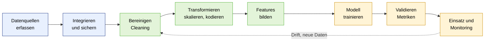
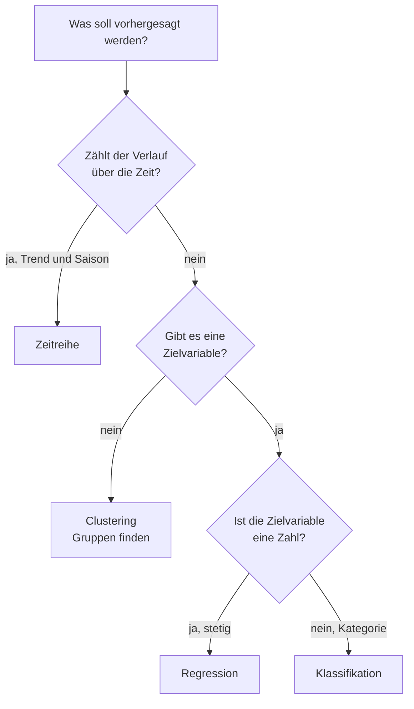
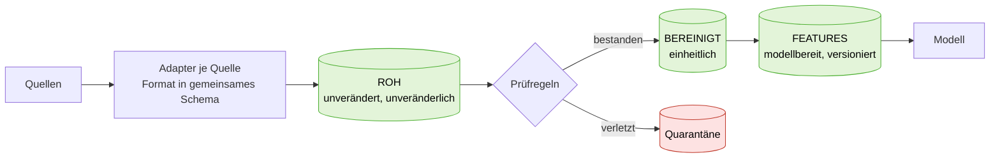

# Kompendium: Predictive Analytics und Data Science

*Allgemeines Nachschlagewerk zum Kurs „Predictive Analytics & Algorithmen". Konzepte, Formeln und Entscheidungsregeln, losgelöst von den einzelnen Aufgaben. Quellen: Folien UE 1 bis UE 8, unsere Arbeitsdateien (siehe Abschnitt 14) und die Gespräche dazu.*

**Legende:** ➕ = Ergänzung aus allgemeinem Fachwissen, nicht direkt aus den Folien · 🔎 = Hier steht ein typischer Denkfehler

---

## Inhalt

1. [Das Gesamtbild: vom Rohdatum zur Entscheidung](#1-das-gesamtbild-vom-rohdatum-zur-entscheidung)
2. [Datenmanagement: Grundbegriffe](#2-datenmanagement-grundbegriffe)
3. [Datenqualität und typische Datenprobleme](#3-datenqualität-und-typische-datenprobleme)
4. [Bereinigen (Cleaning)](#4-bereinigen-cleaning)
5. [Transformieren: Skalieren, Kodieren, Aggregieren](#5-transformieren-skalieren-kodieren-aggregieren)
6. [Feature Engineering](#6-feature-engineering)
7. [Modellwahl: Problemtypen und Algorithmen](#7-modellwahl-problemtypen-und-algorithmen)
8. [Metriken im Überblick](#8-metriken-im-überblick)
9. [Pipelines und Architektur](#9-pipelines-und-architektur)
10. [Governance, Risiko und Zielkonflikte](#10-governance-risiko-und-zielkonflikte)
11. [Wenn … dann …: Entscheidungs-Spickzettel](#11-wenn--dann-entscheidungs-spickzettel)
12. [Checklisten](#12-checklisten)
13. [Python-Snippets](#13-python-snippets)
14. [Dateiübersicht und Glossar](#14-dateiübersicht-und-glossar)

---

## 1. Das Gesamtbild: vom Rohdatum zur Entscheidung

### 1.1 Analytics-Spektrum

| Stufe | Leitfrage | Beispiel |
| --- | --- | --- |
| **Descriptive** | Was war? | Absatz- und Retourenquote der letzten 12 Monate |
| **Predictive** | Was wird sein? | Absatzprognose, Churn-Risiko, Retourenwahrscheinlichkeit |
| **Prescriptive** | Was tun? | Automatische Nachbestellung, gezielte Halte-Aktion |

### 1.2 Der Weg im Überblick



| Phase | Kernfrage | Abschnitt |
| --- | --- | --- |
| Erfassen, Integrieren, Sichern, Bereitstellen | Wo liegen die Daten, wem gehören sie, sind sie auffindbar? | 2, 10 |
| Cleaning | Sind Lücken, Ausreißer, Dubletten behandelt? | 4 |
| Transform | Haben alle Merkmale eine modellgeeignete Form? | 5 |
| Features | Übersetzen die Merkmale Rohdaten in Geschäftslogik? | 6 |
| Modell und Validierung | Passt der Modelltyp zur **Zielgröße**? Wie messe ich Güte? | 7, 8 |
| Einsatz | Läuft es reproduzierbar, überwacht, bezahlbar? | 9 |

**Leitsätze**
- Datenaufbereitung ist oft der **größte Hebel für die Modellqualität**. Gute Features steigern die Güte oft mehr als ein besseres Modell.
- **Garbage in, garbage out:** Qualität → Prognosegüte → Entscheidung → Geschäftserfolg. Qualität ist günstiger als Korrektur im Nachhinein.
- **Reihenfolge:** erst Datenbasis, dann Prognose.

---

## 2. Datenmanagement: Grundbegriffe

### 2.1 Datenarten

| Einteilung | Ausprägungen | Beispiele |
| --- | --- | --- |
| **Herkunft** | intern · extern | Kasse, ERP · Wetter, Verkehr, Marktdaten |
| **Struktur** | strukturiert · semi-strukturiert · unstrukturiert | Tabelle · JSON, Logfiles · Freitext, PDF, Bilder, E-Mails |
| **Rolle** | **Stammdaten** · **Bewegungsdaten** | siehe unten |

**Stamm- vs. Bewegungsdaten**

| | Stammdaten | Bewegungsdaten |
| --- | --- | --- |
| Beschreiben | Objekte (Wer/Was?): Kunde, Produkt, Maschine, Lieferant | Vorgänge (Was ist passiert?): Bestellung, Messung, Wartung, Buchung |
| Änderung | selten | laufend, hohes Volumen |
| Beispiele | Kundenname, **Maschinenstandort**, Produktgruppe | Bon, Sensorwert, Scan, Zahlung |

🔎 Der **Maschinenstandort** ist Stammdatum (beschreibt die Maschine), kein Bewegungsdatum.

### 2.2 Speicherarten: Data Warehouse und Data Lake

| | **Data Warehouse (DWH)** | **Data Lake** |
| --- | --- | --- |
| Daten | bereits **bereinigt**, strukturiert, einheitliches Schema | **Rohdaten** jeder Art (auch unstrukturiert), unverändert |
| Prinzip | erst modellieren, dann laden (Schema beim Schreiben) | erst ablegen, später interpretieren (Schema beim Lesen) |
| Stärke | verlässliche Berichte, einheitliche Kennzahlen | Flexibilität, Big Data, Data Science |
| Risiko | starr, Aufbau aufwändig | „Datensumpf" ohne Katalog und Governance |

🔎 Der Data Lake nimmt **Rohdaten** auf, nicht bereits bereinigte.

### 2.3 Zentrale Konzepte

| Begriff | Bedeutung | Merkpunkt |
| --- | --- | --- |
| **Single Source of Truth (SSOT)** | Für jedes Datenobjekt gibt es **eine führende Stelle** | Sichert **Konsistenz**, **nicht** Korrektheit oder Aktualität. Ein Fehler steht dann nur an einer Stelle falsch, aber überall |
| **Master Data Management (MDM)** | Stammdaten werden zentral gepflegt, **eine verbindliche Version** je Objekt | Löst Probleme wie „Kunde mal Karte, mal Konto", Maschinen-IDs je Abteilung anders |
| **Data Governance** | Regelwerk: **wer darf was, mit welchen Regeln und Standards** | Rollen, Definitionen, Zugriff, Qualität. Führungsaufgabe mit Budget |
| **Data Owner** | Fachlich verantwortlich: entscheidet über Definition, Qualität, Zugriff | je Datendomäne |
| **Data Steward** | Pflegt, prüft, ist Ansprechpartner | je Bereich/Standort |
| **Metadaten, Datenkatalog** | Beschreibung der Daten: Quelle, Bedeutung, Einheit, Owner | ohne Katalog weiß niemand, was es gibt |
| **Datensilo** | Daten isoliert in einer Abteilung/einem System | führt zu Doppelbeständen und Widersprüchen |
| **Schlüssel (ID)** | Eindeutiger Verknüpfungswert (Kunden-ID, Maschinen-ID) | ohne gemeinsamen Schlüssel keine Zusammenführung |
| **ETL** | Extract, Transform, Load: Quelle → Aufbereitung → Ziel | siehe 9.1 |

**Vorgehen:** Erfassen → Integrieren → Sichern → Bereitstellen. Wichtigster Hebel: SSOT und Data Ownership.

### 2.4 Datenschutz (DSGVO)

- **Datenminimierung** und **Zweckbindung:** nur sammeln und speichern, was gebraucht wird.
- Personenbezogene Daten **pseudonymisieren** oder **aggregieren**, bevor sie in Features gehen (z. B. Kopfzahl je Schicht statt Namen).
- Falsche personenbezogene Daten verstoßen gegen den Grundsatz der **Richtigkeit**.
- Bei Fahrer-GPS, Schichtplänen: Betriebsrat/Datenschutz früh einbeziehen. ➕

---

## 3. Datenqualität und typische Datenprobleme

### 3.1 Die vier Qualitätsdimensionen

| Dimension | Frage | Typischer Mangel | Kennzahl ➕ |
| --- | --- | --- | --- |
| **Vollständigkeit** | Ist alles da? | fehlende Werte, Lücken | Anteil fehlender Werte je Spalte |
| **Konsistenz** | Widerspricht sich nichts? | Datumsformate, uneinheitliche Definitionen, Dubletten | Dublettenquote, Formatvarianten |
| **Aktualität** | Ist es auf dem neuesten Stand? | veraltete Kundendaten, späte Erfassung | Alter des letzten Datensatzes |
| **Genauigkeit** | Stimmt es mit der Wirklichkeit überein? | Tippfehler, Messfehler, Sensor-Drift | Fehlerquote in Stichprobe |

**Datenqualität ist relativ:** immer im Verhältnis zum Verwendungszweck bewerten. Dieselbe Quelle kann für ein Ziel genügen und für ein anderes nicht.

### 3.2 Problemkategorien

| Kategorie | Inhalt | Beispiele |
| --- | --- | --- |
| **Qualität** | fehlende Werte, Ausreißer, Duplikate | Lücken, Spikes, doppelte Bons |
| **Struktur** | Formate, Datentypen, Dateistruktur | Datumsformate, Einheiten, Zeitzonen, fehlende Schlüssel |
| **Inhalt** | unklare Definitionen, Inkonsistenzen, fehlender Kontext | „Kunde" ist Karte oder Konto, Absatz ≠ Nachfrage |
| **Organisation** | Zuständigkeiten, Zugriff, Silos | keine Owner, Excel-Schattenlisten, Datenschutz |

Viele Probleme gehören zu mehreren Kategorien. Man nennt die **Hauptursache**. Meist mischen sich technische und organisatorische Ursachen: Zeitstempel-Chaos ist technisch, besteht aber nur, weil niemand einen Standard vorgegeben hat.

### 3.3 Katalog häufiger Probleme

| Problem | Woran erkennt man es? | Typische Behandlung |
| --- | --- | --- |
| **Fehlende Werte** | `isna().sum()`, leere Felder | löschen, imputieren, kennzeichnen (4.1) |
| **Dubletten** | `duplicated()`, gleiche ID mehrfach | exakte entfernen, mögliche prüfen (4.3) |
| **Gemischte Datumsformate** | mehrere Muster, `03/05` mehrdeutig | je Quelle Format festlegen, ISO `YYYY-MM-DD` speichern |
| **Uneinheitliche Einheiten** | Gewicht kg/t, °C/°F, EUR/CHF | Einheit je Quelle/Kunde hinterlegen, nie raten |
| **Ausreißer** | IQR, z-Score, Plausibilitätsgrenzen | prüfen, dann entscheiden (4.2) |
| **Negative Werte** | Menge/Umsatz < 0 | oft **Retoure/Storno**: kennzeichnen statt löschen |
| **Zeitzonen / Sommerzeit** | Lager lokal, Server UTC | alles in **UTC** speichern |
| **Kein gemeinsamer Schlüssel** | Maschine hat je System anderen Namen | Mapping-Tabelle, MDM |
| **Strukturbruch** | Systemwechsel, neue Produktgruppen | Mapping alt → neu, Bruch kennzeichnen |
| **Unterschiedliche Historien** | Kanal A seit 2019, Kanal B seit 2021 | Kanal als Merkmal, gemeinsam modellieren |
| **Absatz ≠ Nachfrage** | Ausverkauf, Aktionsverkäufe | Bestandsdaten ergänzen, Verzerrung benennen |
| **Excel-Artefakte** ➕ | ganze Zeile in Anführungszeichen, BOM, Zeile mit nur `;`, abgeschnittene Nullen (`199,0`) | `encoding="utf-8-sig"`, Zeile selbst parsen, Artefakte entfernen |
| **Sensor-Lücken** | Funkloch, Kabelbruch, Kalibrierdrift | Lücke kennzeichnen, nicht auffüllen (in Rohdaten) |

### 3.4 Probleme priorisieren

**Drei Leitfragen:**
1. Verzerrt das Problem die Prognose **direkt**?
2. Lässt es sich mit **vertretbarem Aufwand** beheben?
3. Welche Daten brauchen wir **zwingend**, welche sind „nice to have"?

**Skala:** 🔴 kritisch (vor dem Start klären) · 🟠 wichtig (zeitnah) · 🟢 unkritisch oder gut lösbar.

**Priorisierung von Maßnahmen:** Datenqualität (Wirkung) + Entscheidungsrelevanz + Aufwand (5 = gering), Summe 3 bis 15. Meist gewinnen **Definitionen und Verantwortliche** (billig, ohne Technik, Voraussetzung für alles andere).

**Datenquellen priorisieren:** Qualität × Nutzen × Verbesserungsaufwand. Hoher Nutzen mit überwiegend **organisatorischen** Mängeln zuerst, weil schnell und günstig. Technische Investitionen erst nach der **Ursachenanalyse**.

> **Leitgedanke:** Nicht jedes Problem muss vor dem Start gelöst sein, aber jedes muss **bekannt** sein.

---

## 4. Bereinigen (Cleaning)

**Ziel:** verlässliche, saubere Datenbasis. Cleaning kommt **vor** Transformation und Feature-Bau, sonst werden Fehler in Features „eingebacken".

### 4.1 Fehlende Werte

| Strategie | Vorteil | Nachteil | Wann |
| --- | --- | --- | --- |
| **Löschen** (Zeile oder Spalte) | einfach | Datenverlust | wenige Fälle, zufällig verteilt |
| **Mittelwert / Median** | bewahrt Datensätze | glättet die Verteilung, verringert Streuung | numerisch, wenige Lücken. **Median** bei Ausreißern |
| **Modellbasiert** | nutzt andere Merkmale | aufwändiger | viele Lücken, wichtiges Merkmal |
| **Kennzeichnen** ➕ | Fehlen bleibt als Information erhalten | zusätzliche Spalte | Fehlen ist selbst aussagekräftig (z. B. „Neukunde") |

- **Imputation:** fehlende Werte ersetzen (z. B. durch Mittelwert/Median), bewahrt Datensätze.
- Mit Bedacht: **nicht verfälschen.**
- 🔎 Lücken sind oft **nicht zufällig** (der Sensor fällt gerade vor dem Defekt aus). Dann verzerrt Auffüllen das Modell.
- Bei Zeitreihen zerstören Lücken den Verlauf. Kurze Lücken überbrücken, lange kennzeichnen.
- Prüfen: Lassen sich Lücken aus anderen Zeilen **rekonstruieren** (z. B. fehlender Name über dieselbe Kunden-ID)?

### 4.2 Ausreißer

**Erst prüfen, dann entscheiden. Nicht blind entfernen.**

| Frage | Antwort führt zu |
| --- | --- |
| **Tippfehler / Messfehler?** | korrigieren oder entfernen |
| **Echte Extreme** (Großbestellung, Corona-Boom)? | behalten, ggf. markieren, robuste Statistik (Median) |
| **Sondereffekt** (Aktion, Einmalereignis)? | als Merkmal kennzeichnen oder bewusst ausschließen |

**Erkennungsregeln**

| Regel | Formel | Hinweis |
| --- | --- | --- |
| **IQR-Regel** | Ausreißer, wenn $x < Q_1 - 1{,}5 \cdot IQR$ oder $x > Q_3 + 1{,}5 \cdot IQR$, mit $IQR = Q_3 - Q_1$ | robust, Standard im Boxplot |
| **z-Score-Regel** | $\lvert z \rvert > 3$ mit $z = \frac{x - \mu}{\sigma}$ | setzt grob normalverteilte Daten voraus. Ausreißer vergrößern $\sigma$ selbst |
| **Fachregel** | Gewicht je Palette 20 bis 1.200 kg, Temperatur −40 bis +30 °C | oft die beste Regel, weil sie Fachwissen nutzt |

Ausreißer verzerren **Mittelwerte** und Min-Max-Skalierung. Der **Median** ist robust.

### 4.3 Dubletten

| Typ | Beispiel | Behandlung |
| --- | --- | --- |
| **Exakte Dublette** | alle Spalten gleich | entfernen (Schlüssel eindeutig) |
| **Mögliche Dublette** | `Marie Müller` und `M. Müller`, gleiche E-Mail | zusammenführen nach Regel/Prüfung, nicht blind löschen |

Dubletten **verzerren Häufigkeiten** und Umsätze. Vor jeder Aggregation entfernen, sonst wird doppelt gezählt.

### 4.4 Cleaning-Reihenfolge (Abhängigkeiten)

1. Datei **korrekt einlesen** (Struktur, Encoding). Ohne das sind alle weiteren Schritte falsch.
2. **Typen und Formate** angleichen (Datum, Umsatz als Zahl).
3. **Dubletten** entfernen (vor jeder Aggregation).
4. **Negative Werte** klären (Retoure markieren).
5. **Fehlende Werte** zuletzt, wenn klar ist, was wirklich fehlt.
6. **Ausreißer** erst nach Formatierung und Dublettenentfernung beurteilen.

**Protokollieren:** jede Entfernung/Korrektur (Anzahl, Regel, Zeitpunkt). Original unverändert aufbewahren.

---

## 5. Transformieren: Skalieren, Kodieren, Aggregieren

**Ziel:** Daten in eine **modellgeeignete Form** bringen.

### 5.1 Skalierung

**Warum:** Merkmale haben sehr unterschiedliche Wertebereiche (Umsatz in Tausend, Alter in Jahren). Manche Modelle gewichten große Zahlen sonst über. Skalierung schafft Vergleichbarkeit.

| Methode | Formel | Ergebnis | Wann |
| --- | --- | --- | --- |
| **Min-Max-Normalisierung** | $x' = \frac{x - x_{min}}{x_{max} - x_{min}}$ | genau 0 bis 1 | fester Wertebereich nötig (z. B. neuronale Netze), keine starken Ausreißer |
| **Standardisierung (z-Score)** | $z = \frac{x - \mu}{\sigma}$ | Mittelwert 0, Streuung 1, nicht begrenzt | **Standardfall** für viele Modelle, weniger ausreißerempfindlich |
| **Robuste Skalierung** ➕ | $x' = \frac{x - \text{Median}}{IQR}$ | Median 0 | viele Ausreißer |
| **Log-Transformation** ➕ | $x' = \ln(1 + x)$ | staucht große Werte | stark **rechtsschiefe** Größen (Umsätze, Preise). Oft vorab, dann skalieren |

**Beispiel Min-Max** (10, 30, 50, 90): 0,00 · 0,25 · 0,50 · 1,00.
**Beispiel Standardisierung** (gleiche Werte, $\mu = 45$, $\sigma \approx 29{,}2$): −1,20 · −0,51 · +0,17 · +1,54. Das ist der **Abstand vom Mittelwert in Standardabweichungen**.

**Wann überhaupt nötig?**

| Modellfamilie | Skalierung nötig? |
| --- | --- |
| lineare/logistische Regression (mit Regularisierung), kNN, SVM, neuronale Netze, Clustering (k-Means) | **ja** (entfernungs- oder gradientenbasiert) |
| Entscheidungsbäume, Random Forest, Gradient Boosting | **nein** |

**Regeln**
1. 🔎 Skalieren **vor** dem Training, nicht danach. Skalierung gehört zur Aufbereitung.
2. **Parameter ($x_{min}, x_{max}, \mu, \sigma$) nur aus den Trainingsdaten** lernen (`fit`), dann auf Test und neue Daten **anwenden** (`transform`). Sonst Data Leakage. Testwerte dürfen dann außerhalb 0 bis 1 liegen.
3. Wird die **Zielgröße** skaliert, muss man Vorhersagen **zurückrechnen**: $x = x' \cdot (x_{max} - x_{min}) + x_{min}$ (bzw. $\sigma \cdot z + \mu$). Oft reicht es, nur Eingaben zu skalieren.
4. One-Hot-Spalten (0/1) brauchen keine Skalierung.
5. Parameter in der Pipeline speichern, damit der Betrieb dieselben Werte nutzt (Reproduzierbarkeit).

### 5.2 Kategoriale Daten kodieren

Modelle rechnen mit Zahlen, nicht mit Text. Kategorien müssen in Zahlen übersetzt werden.

| Methode | Wann | Wirkung |
| --- | --- | --- |
| **One-Hot-Encoding** | **ungeordnete** Kategorien, wenige Ausprägungen (bis ca. 10 bis 20) | je Kategorie eine 0/1-Spalte, keine künstliche Ordnung |
| **Ordinale Kodierung** | echte **Reihenfolge** (S < M < L, Note 1 bis 6) | Ganzzahlen, Reihenfolge bleibt erhalten |
| **Gruppieren, Target-/Frequency-Encoding** ➕ | **sehr viele** Ausprägungen (Artikelnummer, PLZ) | verhindert Hunderte fast leerer Spalten |
| **Zyklisch (sin/cos)** ➕ | Wochentag, Monat, Uhrzeit | 7 liegt neben 1, Abstand bleibt korrekt |

**Warum One-Hot statt durchnummerieren?**
- Durchnummerieren (1, 2, 3) erfindet eine **Reihenfolge und Abstände**: Kleidung (3) wäre „dreimal" Bücher (1), Elektronik „in der Mitte".
- Ein lineares Modell lernt bei Nummern **ein einziges Gewicht** über alle Kategorien. Mit One-Hot lernt es **ein eigenes Gewicht je Kategorie** ("Elektronik +40 €, Bücher −5 €").
- Baumbasierte Modelle kommen eher mit Nummern zurecht, lineare Modelle, kNN, SVM und neuronale Netze brauchen One-Hot.

**Praxisregeln:** Dummy-Trap beachten (bei linearen Modellen eine Spalte weglassen, `drop_first=True`), unbekannte neue Kategorien im Betrieb abfangen (`handle_unknown="ignore"`), Encoder nur auf **Trainingsdaten** anpassen.

### 5.3 Aggregation und Granularität

- **Aggregation:** feinere Daten verdichten (Tages- zu Monatswerten, Summe pro Monat). Passende **Granularität** wählen: Prognoseebene = Zielebene.
- **Früh verdichten spart Kosten:** Sekundenwerte für Features auf Minuten/Etappen reduzieren, Rohdaten bleiben im günstigen Speicher.
- Aggregation **nach** Dublettenentfernung.

### 5.4 Formate angleichen

Datum (ISO `YYYY-MM-DD`, Zeit in UTC), Einheiten (kg, EUR), Schreibweisen (Kategorien über Mapping-Tabelle), Dezimalzeichen, Spaltennamen. Ein Join über unterschiedlich geschriebene Schlüssel verfehlt Treffer. Daher **vor** dem Zusammenführen vereinheitlichen.

---

## 6. Feature Engineering

**Feature** = Eingabemerkmal des Modells, beschreibt einen Fall. **Feature Engineering** = Merkmale gezielt bauen, Fachwissen einbringen. Gute Features **übersetzen Rohdaten in Geschäftslogik** und verdichten viele Zeilen zu einem aussagekräftigen Wert (z. B. „Kaufhäufigkeit pro Monat" statt vieler Einzelkäufe).

### 6.1 Wie finde ich Features? Vier Fragen je Rohspalte

| Frage | `Kaufdatum` | `Kaufbetrag` | `Produktkategorie` |
| --- | --- | --- | --- |
| **Zerlegen** | Wochentag, Monat, Quartal, Feiertag | – | Ober-/Unterkategorie |
| **Aggregieren** | Käufe pro Monat | Summe/Mittel je Kunde | Anteil je Kategorie |
| **Vergleichen** | gleicher Tag Vorjahr | Betrag vs. eigener Durchschnitt | Kategorie vs. Sortiment |
| **Veränderung** | Abstand zwischen Käufen wächst | Steigung über die Zeit | Wechsel der Lieblingskategorie |

### 6.2 Bewährte Feature-Muster

| Muster | Beispiele | Ebene |
| --- | --- | --- |
| **Kundenverhalten (RFM)** ➕ | **R**ecency (Tage seit letztem Kauf), **F**requency (Kaufhäufigkeit je Zeitraum), **M**onetary (Ø oder Summe der Beträge) | Kunde |
| **Kalender** | Wochentag, Quartal, Feiertag, Ferien | Tag/Woche |
| **Lag** (Wert von früher) | Umsatz gestern, vor 7 Tagen, vor 364 Tagen (Vorjahr, gleicher Wochentag) | Zeitreihe |
| **Gleitender Durchschnitt** | Ø der letzten 7 oder 28 Tage | Zeitreihe |
| **Trend** | Verhältnis kurzes/langes Fenster (Ø7 ÷ Ø28, > 1 = steigend), Steigung einer Geraden, exponentiell gewichteter Schnitt | Zeitreihe |
| **Saison** | Monat, Quartal, Vorjahreswert | Zeitreihe |
| **Kontext** | Preis, Aktion aktiv, Bestand, Wetter, Kampagne | beliebig |

### 6.3 Data Leakage (größtes Risiko)

> Das Modell sieht beim Training etwas, was es im Einsatz **zum Vorhersagezeitpunkt nicht wissen kann**. Im Test sieht es großartig aus, im Betrieb enttäuscht es.

**Prüffrage je Feature:** *„Hätte ich diesen Wert zum Vorhersagezeitpunkt schon gekannt?"*

| Typischer Leakage-Fall | Richtig |
| --- | --- |
| Wochensumme (Mo bis So) als Feature für Dienstag | nur **Vorwoche** |
| Gleitender Durchschnitt, der den Zieltag enthält | erst `shift(1)`, **dann** das Fenster bilden |
| Mittelwert über alle Käufe inkl. des zu prognostizierenden | nur Käufe **vor** dem Stichtag |
| Scaler/Encoder auf allen Daten angepasst | nur auf Trainingsdaten |
| Folgetag-Scans, tatsächliche Ankunft, am Folgetag gemessenes Wetter | nur Stand **bis zum Stichtag** (z. B. 16:00 am Vortag), Wetter**vorhersage** statt Messung |
| Zufälliges Mischen bei Zeitreihen ➕ | zeitlich trennen: Training früher, Test später |

### 6.4 Bewertungskriterien für Features

| Kriterium | Frage |
| --- | --- |
| **Relevanz** | Hilft es der Prognose? |
| **Verfügbarkeit zum Vorhersagezeitpunkt** | Ist es dann bekannt (kein Leakage)? |
| **Stabilität über die Zeit** | Bleibt die Bedeutung bei Wachstum, Preisänderung, Aktionen gleich? |
| **Für alle berechenbar?** | Neukunden, neue Produkte haben keine Historie (Trend, Recency, Vorjahr leer) |
| **Redundanz** | Woche, Monat und Quartal tragen fast dieselbe Information |

**Weniger, aber bessere Features sind oft stärker.** Irrelevante Features erhöhen die Komplexität. Die Auswahl gehört zur Arbeit.

---

## 7. Modellwahl: Problemtypen und Algorithmen

### 7.1 Entscheidungslogik: die Zielgröße entscheidet

> **Die Zielgröße bestimmt den Modelltyp, nicht die verfügbaren Daten.**



| Problemtyp | Zielgröße | Frage | Beispiele | Beispiel-Verfahren | Metriken |
| --- | --- | --- | --- | --- | --- |
| **Regression** | stetige Zahl | Wie viel? | Absatz, Preis, benötigte Menge | lineare Regression | MAE, RMSE, R² |
| **Klassifikation** | Kategorie (binär oder mehrklassig) | Welche Klasse? | Churn ja/nein, Retoure, Betrug, Retourengrund | Entscheidungsbaum, logistische Regression | Precision, Recall, F1, ROC-AUC (mehrklassig: Accuracy, Macro-F1) |
| **Zeitreihe** | Wert über die Zeit | Wie entwickelt es sich? | Absatz je Monat, Auslastung | saisonale Fortschreibung ➕ | MAE, RMSE, MAPE |
| **Clustering** | keine | Welche Gruppen gibt es? | Kundensegmente | k-Means ➕ | Silhouette + fachliche Deutung |

**Regression und Zeitreihe verbinden:** Eine Zeitreihe kann zusätzlich Einflussgrößen (Preis, Aktion, Wetter) nutzen. Entscheidend ist, ob die **Zeit selbst** (Trend, Saison) oder **Einflussgrößen** im Vordergrund stehen.

**Klassifikation liefert eine Wahrscheinlichkeit**, eine **Schwelle** macht daraus die Entscheidung. Die Schwelle hängt vom Fehlerpreis ab (8.2).

### 7.2 Modell-Lifecycle

Daten → **Training** → **Validierung** → **Deployment & Monitoring**. Iterativ: mit einem einfachen Basismodell starten, validieren, einsetzen, verbessern.

| Begriff | Bedeutung |
| --- | --- |
| **Trainingsdaten / Testdaten** ➕ | Training zum Lernen, Test zum fairen Prüfen auf **ungesehenen** Daten |
| **Overfitting** | Modell glänzt im Training, versagt in der Praxis. Gefahr bei zu komplexem Modell und wenig/lückenhaften Daten |
| **Model Drift** | Die Wirklichkeit ändert sich, das Modell wird schlechter. Nur durch **Monitoring** bemerkbar |
| **Baseline** ➕ | Einfachste Vergleichsvorhersage (z. B. Wert der Vorwoche). Ein Modell muss sie schlagen |

### 7.3 Risiken bei falscher Modellwahl

| Falsche Wahl | Folge |
| --- | --- |
| Zahl statt Ja/Nein (Regression statt Klassifikation) | keine klare Entscheidung ableitbar (Wahrscheinlichkeit ohne Schwelle) |
| Kategorie statt Zahl | Informationsverlust (nur „viel/wenig"), Einkauf nicht planbar |
| Regression statt Zeitreihe | Trend und Saison übersehen, Frühjahrsspitzen unterschätzt |
| Zu komplexes Modell, wenig Daten | Overfitting |
| Ohne Validierung und Monitoring | Fehler erst im Betrieb sichtbar, Drift unbemerkt |

**Rahmenbedingungen und Konsequenz:** Unvollständige Daten → Lücken zuerst prüfen und behandeln, einfache robuste Modelle bevorzugen. Zeitdruck → einfaches Basismodell, iterativ verbessern, erklärbare Verfahren sind schneller vermittelbar.

---

## 8. Metriken im Überblick

### 8.1 Formeln

| Metrik | Gilt für | Formel | Frage, die sie beantwortet | Hinweis |
| --- | --- | --- | --- | --- |
| **Accuracy** | Klassifikation | $\frac{TP + TN}{TP + TN + FP + FN}$ | Wie viel Prozent aller Vorhersagen sind richtig? | Täuscht bei seltenen Klassen (2 % Betrug → 98 % „Accuracy" ohne Modell) |
| **Precision** | Klassifikation | $\frac{TP}{TP + FP}$ | Wie viele der als „positiv" markierten Fälle sind wirklich positiv? | Wichtig, wenn **Fehlalarme** teuer sind |
| **Recall** | Klassifikation | $\frac{TP}{TP + FN}$ | Wie viele der echten positiven Fälle finden wir? | Wichtig, wenn **Übersehen** teuer ist (Betrug, Churn, Ausfall) |
| **F1-Score** | Klassifikation | $2 \cdot \frac{\text{Precision} \cdot \text{Recall}}{\text{Precision} + \text{Recall}}$ | Ausgleich aus Precision und Recall | Ein Wert, wenn beides zählt |
| **ROC-AUC** | Klassifikation | Fläche unter ROC-Kurve, $\text{TPR} = \frac{TP}{TP+FN}$, $\text{FPR} = \frac{FP}{FP+TN}$ | Wie gut trennt das Modell die Klassen über alle Schwellen? | 0,5 = Zufall, 1 = perfekt. Bewertet Wahrscheinlichkeiten |
| **MAE** | Regression, Zeitreihe | $\frac{1}{n} \sum \lvert y_i - \hat{y}_i \rvert$ | Wie weit liegen wir im Schnitt daneben (in Einheiten)? | Leicht verständlich, robust gegen Ausreißer |
| **RMSE** | Regression, Zeitreihe | $\sqrt{\frac{1}{n} \sum (y_i - \hat{y}_i)^2}$ | Wie weit daneben, große Fehler stärker gewichtet? | Immer ≥ MAE, ausreißerempfindlich |
| **MAPE** | Regression, Zeitreihe | $\frac{100\,\%}{n} \sum \left\lvert \frac{y_i - \hat{y}_i}{y_i} \right\rvert$ | Wie viel Prozent liegen wir im Schnitt daneben? | Unbrauchbar bei Werten nahe 0 |
| **R²** | Regression | $1 - \frac{\sum (y_i - \hat{y}_i)^2}{\sum (y_i - \bar{y})^2}$ | Welcher Anteil der Schwankung wird erklärt? | Für Zeitreihen nur eingeschränkt |
| **Silhouette** | Clustering | $s = \frac{b - a}{\max(a, b)}$ | Wie klar sind Gruppen getrennt? | −1 bis 1. Ersetzt nicht die fachliche Deutung |

**Legende:** $TP$ richtig positiv · $TN$ richtig negativ · $FP$ falsch positiv (Fehlalarm) · $FN$ falsch negativ (übersehen) · $y_i$ tatsächlich · $\hat{y}_i$ vorhergesagt · $\bar{y}$ Mittelwert · $a$ mittlerer Abstand zur eigenen Gruppe · $b$ zur nächsten fremden Gruppe.

### 8.2 Welche Metrik wähle ich?

| Situation | Metrik | Begründung |
| --- | --- | --- |
| Klassen **ausgewogen**, alle Fehler gleich teuer | Accuracy | ausreichend |
| Klasse **selten** (Betrug, Ausfall) | Recall, Precision, F1 | Accuracy täuscht |
| **Übersehen** ist teuer (Kühlkette, Betrug, Ausfall) | **Recall** hoch | lieber ein Fehlalarm mehr |
| **Fehlalarm** ist teuer (Kunden blockieren, unnötige Wartung) | **Precision** hoch | |
| Beides zählt, ein Zahlenwert | F1 | |
| Modellqualität **unabhängig von der Schwelle** | ROC-AUC | |
| Fehler in **Einheiten** verständlich | MAE | |
| **Große Fehler** besonders schlimm | RMSE | |
| Fehler in **Prozent** (Werte nicht nahe 0) | MAPE | |

**Konfusionsmatrix** ➕ (Klassifikation):

| | Vorhergesagt positiv | Vorhergesagt negativ |
| --- | --- | --- |
| **Tatsächlich positiv** | TP | **FN** (übersehen) |
| **Tatsächlich negativ** | **FP** (Fehlalarm) | TN |

---

## 9. Pipelines und Architektur

### 9.1 ETL und Pipelines

| Schritt | Aufgabe |
| --- | --- |
| **Extract** | Daten aus Quellen holen |
| **Transform** | bereinigen, umformen, Features bauen |
| **Load** | in Zieldatenspeicher laden |
| **Wiederholen** | automatisiert, regelmäßig |

**Datenpipeline:** wiederholbare, automatisierte Datenprozesse **von der Quelle bis zum modellbereiten Datensatz**. Reproduzierbarkeit statt manueller Einzelschritte, skalierbar für große Mengen.

**Reproduzierbarkeit:** gleicher Input → gleicher Output, nachvollziehbar und prüfbar, Basis für Vertrauen.

**Manuelle Excel-Aufbereitung** ist inkonsistent, fehleranfällig, nicht reproduzierbar und skaliert nicht mit dem Wachstum.

### 9.2 Die Drei-Schichten-Architektur



| Grundsatz | Begründung |
| --- | --- |
| **Rohdaten nie verändern** | Jede Bereinigung ist neu berechenbar, Fehler lassen sich beheben |
| **Je Quelle ein Adapter** | Formatvielfalt wird am Rand aufgefangen |
| **Quarantäne** statt stilles Löschen oder Raten | Regelverletzungen landen mit Grund zur Klärung |
| **Features versioniert** mit Stichtag und Regelversion | Nachvollziehbarkeit, Audit, Neuberechnung |
| **Qualitätsmonitor** an jeder Stufe | Fehler erscheinen als Alarm, nicht als stille Verzerrung |

### 9.3 Automatisieren oder kontrollieren?

**Faustregel:** Automatisieren, was **regelbasiert, eindeutig und umkehrbar** ist. Der Mensch entscheidet, was **mehrdeutig, haftungsrelevant oder nicht umkehrbar** ist.

| Frage | Ja → | Nein → |
| --- | --- | --- |
| Haftungsrelevant (Ware, Vertrag, Recht)? | Kontrolle | Automatisierung |
| Umkehrbar (Rohdaten bleiben)? | Automatisierung | Kontrolle |
| Regel eindeutig? | Automatisierung | Kontrolle |
| Menge für Menschen zu groß? | Automatisierung + Stichproben | – |

> **Automatisiere das Prüfen, nicht das Entscheiden.** Die Maschine prüft alle Datensätze, der Mensch bekommt die wenigen relevanten Fälle.

| Typisch automatisch | Typisch mit Mensch |
| --- | --- |
| Formate übersetzen, UTC, bekannte Einheiten | Quarantäne-Fälle |
| exakte Dubletten, Plausibilitätsprüfung | neues Quellformat (Schema-Änderung) |
| Kennzahlen, Zeitplan, Alarmierung | Änderung von Transformationsregeln (4 Augen) |
| kurze Lücken **in Features**, gekennzeichnet | Grenzwertverletzung mit Haftung (z. B. Kühlkette) |

### 9.4 Was tun bei Regelverletzung?

1. **Automatisch korrigieren und markieren:** nur bei **eindeutigen** Fehlern (Dublette, bekanntes Format).
2. **Markieren und mitführen:** Information statt Fehler (Funkloch, Routenabweichung).
3. **Quarantäne:** mehrdeutig (Einheit unklar). Zuständiger Steward entscheidet in einer Frist.
4. **Alarm:** kritisch (Grenzwert, Quellenausfall).
**Nie:** still löschen oder still raten. Jede Entscheidung protokollieren.

### 9.5 Bezahlbar bei wachsendem Volumen

| Hebel | Wirkung |
| --- | --- |
| Früh verdichten (Feature-Schicht klein halten) | Wachstum fast nur in der Rohschicht |
| Speicher-Stufen heiß, warm, kalt | Großteil im günstigsten Tarif |
| Spaltenformat (Parquet) + Kompression ➕ | oft Faktor 5 bis 10 weniger Platz |
| Inkrementell verarbeiten (nur Neues) | Rechenzeit proportional zum Neuen |
| Kostenpflichtige APIs bündeln (je Korridor/Gitter, mit Zwischenspeicher) | Kosten wachsen mit Fläche, nicht mit Fahrzeugen |
| Aufbewahrungsfristen | begrenzt Wachstum |
| Mikro-Batch statt Echtzeit, wo möglich | weniger Komplexität. Echtzeit nur, wo Menschen sofort handeln müssen |

### 9.6 Gute Praxis

Jeden Schritt **dokumentieren und versionieren** (Code, Mapping-Tabellen in Git) · Datenqualität **automatisiert** prüfen · Pipelines **modular und testbar** · **Fachexperten** in Feature-Entscheidungen einbinden.

---

## 10. Governance, Risiko und Zielkonflikte

### 10.1 Typische Rollen und Abläufe

| Rolle | Aufgabe |
| --- | --- |
| **Data Owner** (fachlich) | entscheidet über Definition, Qualität, Zugriff |
| **Data Steward** | pflegt Regeln und Mapping, klärt Quarantäne |
| **Data Engineering** | baut und betreibt Pipelines |
| **Data Council / Gremium** | schlichtet Definitionsfragen, priorisiert |
| **Datenschutz** | prüft personenbezogene Daten |

**Änderung von Transformationsregeln:** Vorschlag (Engineering) → fachliche Bestätigung (Steward) → Freigabe (Architekt, 4-Augen) → Versionierung mit *Was, Warum, Wer, Wann* → Neuberechnung aus den Rohdaten.

**Formatänderung einer Quelle:** Schema-Prüfung schlägt an → Quelle in Quarantäne + Ticket an Steward → Adapter anpassen und testen → Freigabe → ausrollen → Quarantäne-Daten neu verarbeiten → dokumentieren.

### 10.2 Zielkonflikte (bewusst abwägen)

| Zielkonflikt | Kern | Typischer Ausgleich |
| --- | --- | --- |
| **Genauigkeit vs. Geschwindigkeit** | gründliche Aufbereitung kostet Zeit, schnelle Pipelines lassen manches weg | je Anwendungsfall: Echtzeit braucht andere Kompromisse als Monatsreport |
| **Komplexität vs. Wartbarkeit** | mächtige Pipelines mit vielen Regeln sind schwerer zu durchschauen | einfach und modular halten, dokumentieren |
| **Kosten vs. Nutzen** | Datenpflege kostet, Nutzen kommt später | Business Case, Baseline erheben |
| **Zentral vs. flexibel** | Einheitlichkeit gegen Freiheit der Standorte | zentrale Definitionen, dezentrale Stewards |
| **Automatisierung vs. Kontrolle** | Skalierung gegen Nachvollziehbarkeit | Prüfen automatisieren, Entscheiden beim Menschen (9.3) |
| **Schnelle Teilergebnisse vs. gründliche Bereinigung** | Zeitdruck gegen Qualität | Quick Win + Pilot, dann ausbauen |

### 10.3 Typische Risiken bei schlechter Datenqualität

- **Fehlentscheidungen** auf Basis falscher Prognosen (Garbage in, garbage out).
- **Vertrauensverlust** in Daten und Datenprojekte.
- **Verlorene Zeit und Kosten** durch Nacharbeit und Doppelarbeit.
- **Scheinsicherheit:** gute Modellkennzahl auf schlechten Daten wirkt belastbar, ist es aber nicht. Konsistente, aber falsche Daten bleiben auch in der SSOT falsch.
- **Compliance-Risiko** (DSGVO).
- **Systematische Einheitenfehler** (kg statt t, Faktor 1000): formal gültig, fallen nicht über „Wert > 0" auf. Schutz durch Einheit je Kunde im Stammdatensatz, Plausibilitätsgrenzen je Palette, Statistik je Kunde, Tagesabgleich vor dem Prognose-Stichtag.

---

## 11. Wenn … dann …: Entscheidungs-Spickzettel

| Situation | Entscheidung |
| --- | --- |
| Zielgröße ist eine Zahl | Regression |
| Zielgröße ist eine Kategorie | Klassifikation |
| Verlauf über die Zeit zählt (Trend, Saison) | Zeitreihe |
| Keine Zielgröße, Gruppen gesucht | Clustering |
| Seltene Klasse (Betrug, Ausfall) | nicht Accuracy, sondern Recall/Precision/F1 |
| Übersehen teurer als Fehlalarm | Recall hoch gewichten, Schwelle senken |
| Wenige fehlende Werte, zufällig | löschen |
| Fehlende Werte, bewahren der Datensätze nötig | Median (bei Ausreißern) oder Mittelwert |
| Fehlen ist selbst Information | Kennzeichen-Spalte statt blind füllen |
| Ausreißer gefunden | erst prüfen: Fehler oder echt? Dann entscheiden |
| Negative Menge/Betrag | Retoure kennzeichnen, nicht löschen |
| Datum `03/05/2024` | mehrdeutig: Format je Quelle festlegen und dokumentieren |
| Merkmale mit sehr unterschiedlichen Wertebereichen | skalieren (Standardisierung als Standard) |
| Starke Ausreißer | Standardisierung oder robuste Skalierung, nicht Min-Max |
| Stark rechtsschiefe Beträge | Log-Transformation, dann skalieren |
| Baumbasiertes Modell | Skalierung unnötig |
| Ungeordnete Kategorie, wenige Werte | One-Hot |
| Kategorie mit echter Reihenfolge | ordinal kodieren |
| Sehr viele Kategorien (Artikelnummer) | gruppieren, Frequency/Target-Encoding |
| Wochentag/Monat als Merkmal | One-Hot oder sin/cos, nicht 1 bis 7 als Zahl |
| Trend aus Tageswerten | Ø7 ÷ Ø28 oder Steigung, immer mit `shift(1)` |
| Saison abbilden | Vorjahreswert (364 Tage), Monat/Quartal |
| Feature enthält Info „von morgen" | Data Leakage: Fenster vor den Stichtag |
| Neukunden haben keine Historie | Fehlwert-Kennzeichen, `ist_neukunde` |
| Zwei Quellen, gleicher Begriff, andere Definition | Definition vereinheitlichen (Governance), Data Council |
| Gleiche Entität, andere ID je System | Mapping-Tabelle / MDM |
| Fehler macht Ware/Haftung betroffen | Mensch entscheidet, Rohdaten unverändert, Alarm |
| Fehler eindeutig und umkehrbar | automatisch, protokolliert |
| Volumen wächst | früh verdichten, Speicher-Stufen, inkrementell |
| Quellformat ändert sich | Schema-Prüfung → Quarantäne → Steward → Adapter-Update |
| Modell glänzt im Training, schlecht im Test | Overfitting: einfacheres Modell, mehr Daten |
| Modell wird im Betrieb schlechter | Drift: Monitoring, neu trainieren |
| Zeitdruck und lückenhafte Daten | einfaches robustes Basismodell, iterativ verbessern |

---

## 12. Checklisten

### Datenaufbereitung (UE 1)
- [ ] Sind Lücken, Ausreißer, Dubletten behandelt?
- [ ] Sind Merkmale skaliert und kodiert?
- [ ] Ist Data Leakage ausgeschlossen?
- [ ] Ist die Pipeline reproduzierbar?

### Neue Datei analysieren (erste Schritte) ➕
- [ ] Encoding, Trennzeichen, Dezimalzeichen, BOM, Kopfzeile geprüft?
- [ ] Zeilen- und Spaltenzahl plausibel? Leere oder „nur-Trennzeichen"-Zeilen?
- [ ] Datentypen korrekt (Datum, Zahl, Text)?
- [ ] Fehlende Werte je Spalte, Dubletten, Wertebereiche, Ausreißer?
- [ ] Welche Formate kommen vor (Datum, Einheiten, Währung)?
- [ ] Schlüssel eindeutig? Verknüpfbar mit anderen Quellen?

### Feature-Prüfung
- [ ] Hätte ich den Wert zum Vorhersagezeitpunkt gekannt (kein Leakage)?
- [ ] Für alle Fälle berechenbar (Neukunden, neue Produkte)?
- [ ] Stabil über die Zeit? Nicht redundant?
- [ ] Skaliert/kodiert passend zum Modell?

### Pipeline und Betrieb
- [ ] Rohdaten unverändert abgelegt, Schichten getrennt?
- [ ] Prüfregeln je Quelle, Quarantäne, Alarm?
- [ ] Owner und Steward je Quelle benannt?
- [ ] Code und Regeln versioniert, Läufe protokolliert?
- [ ] Kosten bei 3-fachem Volumen tragbar?

### Modellbewertung ➕
- [ ] Modelltyp passt zur Zielgröße?
- [ ] Metrik passt zum Fehlerpreis (Recall vs. Precision)?
- [ ] Vergleich mit einfacher Baseline?
- [ ] Zeitliche Trennung Training/Test bei Zeitreihen?
- [ ] Monitoring und Neutraining geplant?

---

## 13. Python-Snippets

### 13.1 Einlesen und erste Diagnose

```python
import pandas as pd

df = pd.read_csv("datei.csv", sep=";", encoding="utf-8-sig", decimal=",")   # BOM, Dezimalkomma
df.info()                              # Typen, Nicht-Null-Zähler
df.describe()                          # Wertebereiche
df.isna().sum()                        # fehlende Werte je Spalte
df.duplicated().sum()                  # exakte Dubletten
df.duplicated(subset=["BestellID"]).sum()   # Dubletten nach Schlüssel
```

### 13.2 Cleaning

```python
df = df.drop_duplicates()                                       # exakte Dubletten
df["Datum"] = pd.to_datetime(df["Datum"], format="%d.%m.%Y")    # EIN Format je Quelle festlegen
df["Umsatz"] = df["Umsatz"].fillna(df["Umsatz"].median())       # Imputation mit Median

# Ausreißer mit IQR-Regel
q1, q3 = df["Umsatz"].quantile([0.25, 0.75])
iqr = q3 - q1
ausreisser = df[(df["Umsatz"] < q1 - 1.5 * iqr) | (df["Umsatz"] > q3 + 1.5 * iqr)]
```

### 13.3 Skalieren und Kodieren (ohne Leakage)

```python
from sklearn.model_selection import train_test_split
from sklearn.preprocessing import MinMaxScaler, StandardScaler, OneHotEncoder

X_train, X_test = train_test_split(X, test_size=0.2, random_state=42)

scaler = StandardScaler()                      # oder MinMaxScaler() für 0 bis 1
X_train_s = scaler.fit_transform(X_train)      # Parameter NUR aus Training lernen
X_test_s = scaler.transform(X_test)            # gleiche Parameter anwenden

enc = OneHotEncoder(handle_unknown="ignore")
kat_train = enc.fit_transform(X_train[["produktkategorie"]])
kat_test = enc.transform(X_test[["produktkategorie"]])

# schnell zum Ausprobieren
df = pd.get_dummies(df, columns=["produktkategorie"], dtype=int)

# Zielgröße zurückrechnen
y_orig = scaler.inverse_transform(y_pred_skaliert)
```

### 13.4 Zeitliche Features (nur Vergangenheit)

```python
# tag: eine Zeile je Tag, Index = Datum (sortiert), Spalte "umsatz"
tag["wochentag"] = tag.index.dayofweek
tag["quartal"] = tag.index.quarter

vergangen = tag["umsatz"].shift(1)                 # ZUERST verschieben, DANN Fenster bilden
tag["mittel_7"] = vergangen.rolling(7).mean()
tag["mittel_28"] = vergangen.rolling(28).mean()
tag["trend_7_28"] = tag["mittel_7"] / tag["mittel_28"]     # > 1 = steigt

tag["lag_7"] = tag["umsatz"].shift(7)              # gleicher Wochentag letzte Woche
tag["lag_364"] = tag["umsatz"].shift(364)          # gleicher Wochentag Vorjahr
```

### 13.5 Kundenmerkmale (RFM) mit Stichtag

```python
stichtag = pd.Timestamp("2024-04-01")
vorher = df[df["Datum"] < stichtag]                # nur Daten VOR dem Stichtag

kunden = vorher.groupby("KundenID").agg(
    letzter_kauf=("Datum", "max"),
    haeufigkeit=("BestellID", "nunique"),
    mittel_betrag=("Umsatz", "median"),
)
kunden["tage_seit_letztem_kauf"] = (stichtag - kunden["letzter_kauf"]).dt.days
```

### 13.6 Metriken

```python
from sklearn.metrics import (accuracy_score, precision_score, recall_score, f1_score,
                             roc_auc_score, confusion_matrix,
                             mean_absolute_error, mean_squared_error, r2_score)
import numpy as np

# Klassifikation
precision_score(y_true, y_pred); recall_score(y_true, y_pred); f1_score(y_true, y_pred)
roc_auc_score(y_true, y_wahrscheinlichkeit)
confusion_matrix(y_true, y_pred)

# Regression / Zeitreihe
mae = mean_absolute_error(y_true, y_pred)
rmse = np.sqrt(mean_squared_error(y_true, y_pred))
mape = np.mean(np.abs((y_true - y_pred) / y_true)) * 100
```

---

## 14. Dateiübersicht und Glossar

### 14.1 Wo steht was?

| Datei | Inhalt | Thema |
| --- | --- | --- |
| `01_Predictive-Analytics/01_UE2_Arbeitsauftrag1.md` | Prognose-Anwendungsfelder, Modelltyp, Metriken-Tabelle | Use Cases, Modellwahl, Metriken |
| `02_Daten-und-Modelle/02_UE2_Arbeitsauftrag1_Bearbeitung.md` | Datenprobleme Gartenwelt, Kritikalität, Szenario → Modelltyp, Risiken | Problemkatalog, Bewertung |
| `03_Datenmanagement/03_Loesung_Arbeitsauftrag1_und_2.md` | Predictive Maintenance: Datenquellen, Probleme, Qualität bewerten, Priorisierung | Datenmanagement |
| `03_Datenmanagement/03_Fallstudie_AutoParts_Arbeitsdatei.md` | Datenlandschaft, Maßnahmen M1 bis M10, Governance, Roadmap, Budget | Governance, Priorisierung |
| `04_Datenaufbereitung/04_Bestelldaten_Probleme.py` und `_Bericht.md` | Diagnose-Skript und Bericht zur Bestelldaten-CSV | Cleaning praktisch |
| `04_Datenaufbereitung/04_Loesung_Arbeitsauftrag2_Features.md` | Feature Engineering, One-Hot, Leakage | Features |
| `04_Datenaufbereitung/04_Fallstudie_ECommerce_Pipeline.md` | ETL-Pipeline mit Mermaid-Diagrammen | Pipelines |
| `04_Datenaufbereitung/04_Transferprojekt_TransAlpin_Logistik.md` | Architektur, Qualitätsregeln, Governance, Risiko, Automatisierungsgrenze | Architektur, Kernentscheidung |
| `03_Datenmanagement/03_MLPenguins.py` | Übung: EDA und Ausreißer an Pinguin-Daten | Praxis EDA |
| `05_Modellauswahl/05_Loesung_Arbeitsauftrag1_und_2.md` | Problemtyp zuordnen (Notaufnahme), Modellwahl abwägen (Nachfrage, Notebook-Preise), Risiken | Modellwahl |
| `05_Modellauswahl/05_Notebookpreise_Modell.ipynb` und `.py` | Regression auf 500 Notebooks: Plots, Kreuzvalidierung, Modellvergleich | Modellvergleich praktisch |

### 14.2 Glossar

| Begriff | Kurz erklärt |
| --- | --- |
| **Aggregation** | Daten verdichten (z. B. Summe pro Monat) |
| **Baseline** | einfache Vergleichsvorhersage, die das Modell schlagen muss |
| **Bewegungsdaten** | Vorgänge mit hohem Volumen (Bestellung, Messwert) |
| **Cleaning** | Fehler und Lücken beheben (fehlende Werte, Ausreißer, Dubletten) |
| **Clustering** | Gruppen finden ohne Zielvariable |
| **Data Governance** | Regelwerk: wer darf was, welche Standards |
| **Data Lake** | Speicher für Rohdaten aller Art |
| **Data Leakage** | Modell nutzt Information, die es zum Vorhersagezeitpunkt nicht hätte |
| **Data Owner / Steward** | fachlich Verantwortliche / pflegende Person |
| **Data Warehouse** | zentrale, bereinigte, strukturierte Datenbasis |
| **Datenkatalog** | Beschreibung aller Daten (Bedeutung, Owner) |
| **Drift** | Modell wird schlechter, weil sich die Wirklichkeit ändert |
| **ETL** | Extract, Transform, Load |
| **Feature** | Eingabemerkmal des Modells |
| **Feature Engineering** | Merkmale gezielt aus Rohdaten bauen |
| **Granularität** | Detailgrad der Daten (Sekunde, Tag, Monat) |
| **Imputation** | fehlende Werte ersetzen |
| **IQR** | Interquartilsabstand $Q_3 - Q_1$ |
| **Lag** | Wert aus der Vergangenheit als Feature |
| **MDM** | Master Data Management: eine verbindliche Version der Stammdaten |
| **Normalisierung** | Skalierung auf 0 bis 1 (Min-Max) |
| **One-Hot-Encoding** | Kategorien in 0/1-Spalten |
| **Overfitting** | Modell merkt sich Trainingsdaten statt allgemeine Muster |
| **Quarantäne** | Ablage für Datensätze, die eine Regel verletzt haben |
| **Reproduzierbarkeit** | gleicher Input, gleicher Output |
| **SSOT** | Single Source of Truth: führende Stelle je Datenobjekt (sichert Konsistenz, nicht Korrektheit) |
| **Stammdaten** | beschreiben Objekte, ändern sich selten |
| **Standardisierung** | Skalierung auf Mittelwert 0, Streuung 1 (z-Score) |
| **UTC** | einheitliche Weltzeit für Zeitstempel |

---

*Wird laufend ergänzt. Neue Konzepte aus weiteren Einheiten bitte in den passenden Abschnitt einsortieren und in Abschnitt 11 (Spickzettel) als Regel eintragen.*
