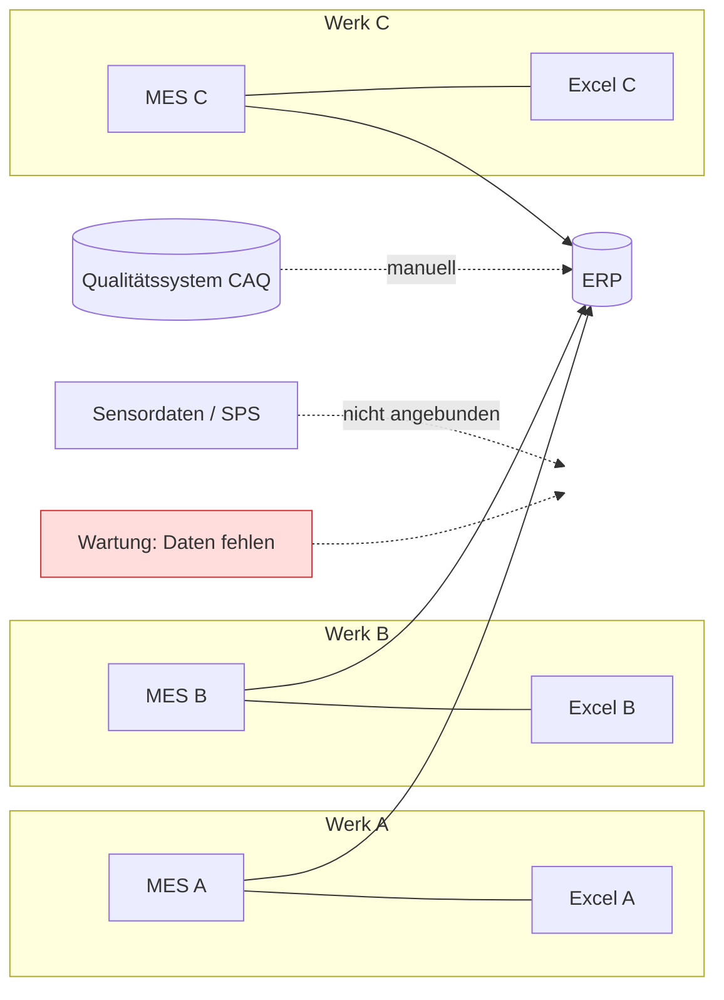
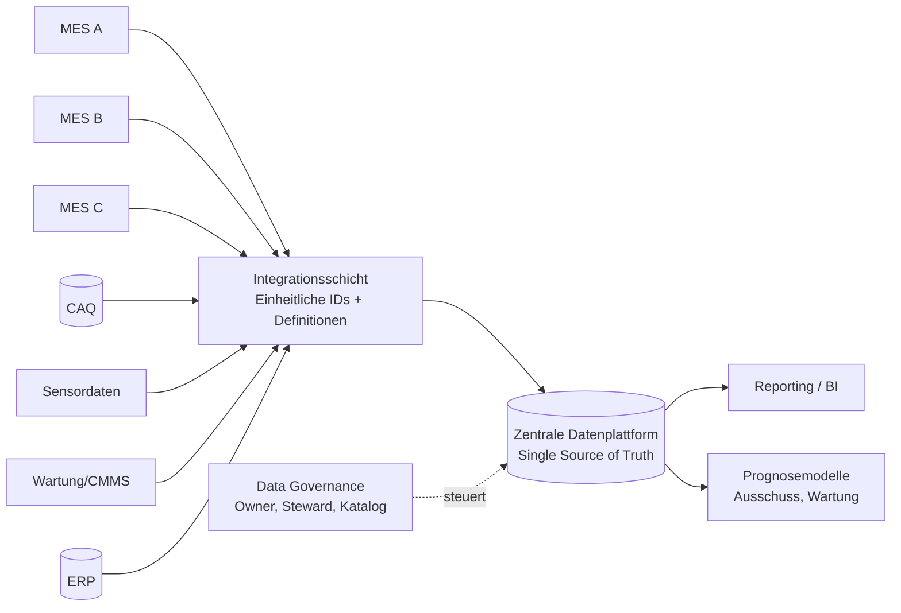

# Fallstudie AutoParts GmbH – Arbeitsdatei (UE 5–6)

Status: **Entwurf zum gemeinsamen Weiterarbeiten.** Alles mit 🟡 ist eine Annahme oder offen und muss von uns entschieden werden. Die Folien nennen nur wenige Fakten, daher sind viele Details bewusst als Annahme markiert.

---

## 0. Ausgangslage (laut Folien)

| Punkt | Angabe |
|---|---|
| Unternehmen | AutoParts GmbH, Zulieferer in der Automobilindustrie |
| Budget / Zeit | **400.000 €, 12 Monate** |
| Datenlage | Produktionsdaten über mehrere Systeme verteilt (Silos) |
| Definitionen | Unterschiedlich je Werk. Beispiel: „Ausschuss" ist je Werk anders definiert |
| Lücken | Fehlende Daten zur Maschinenwartung |
| Schmerz | Hohe Qualitätskosten durch Ausschuss |
| Kernproblem | Ohne saubere Datenbasis keine Prognose. **Wo zuerst ansetzen?** |

**Ziel der Fallstudie:** Datenlandschaft verstehen → größte Datenqualitätsprobleme finden → Maßnahmen ableiten und priorisieren → Governance für die Datenbasis schaffen.

**Erwartetes Ergebnis (Folie 7):** (1) Skizze der Datenlandschaft, (2) priorisierte Maßnahmen zur Datenqualität, (3) erster Governance-Ansatz. Bearbeitung in Kleingruppen, Vorstellung im Plenum.

---

## 1. Datenlandschaft analysieren

### 1.1 Welche Systeme enthalten relevante Daten? 🟡

Die Folien nennen keine Systemnamen. Für ein Zulieferer-Werk sind folgende Systeme typisch, wir treffen sie als **Arbeitsannahme**:

| System | Inhalt | Art (UE 1) | Relevanz für Ausschuss-Prognose | Zustand (Annahme) |
|---|---|---|---|---|
| **ERP** | Aufträge, Stücklisten, Artikel, Kosten | intern, Stamm- und Bewegungsdaten | mittel (Kosten, Auftragsbezug) | zentral oder je Werk, uneinheitlich |
| **MES / BDE** (Fertigungssteuerung/Manufacturing Execution System, Betriebsdatenerfassung) | Stückzahlen, Laufzeiten, Stillstände, Ausschussmeldungen | intern, Bewegungsdaten | **hoch** | je Werk anders, Definition von „Ausschuss" abweichend |
| **Qualitätssystem / CAQ** (computer-aided quality assurance) | Prüfergebnisse, Reklamationen, Nacharbeit | intern, Bewegungsdaten | **hoch** (das Ziel: Ausschuss) | teils Excel |
| **Maschinen-/Sensordaten** (PLC prgrammable logic controller, IoT) | Temperatur, Druck, Drehzahl, Taktzeit | intern, Bewegungsdaten, hochfrequent | hoch | verfügbar, aber nicht angebunden 🟡 |
| **Wartung / Instandhaltung** | Wartungsaufträge, Störungen, Ersatzteile | intern, Bewegungsdaten | **hoch**, aber **fehlt** | laut Folie: fehlende Daten |
| **Maschinenstammdaten** | Maschinentyp, Baujahr, Werkzeug | intern, Stammdaten | mittel | uneinheitlich je Werk |
| **Excel-Listen der Werke** | Schattenlisten, Auswertungen | halbstrukturiert | mittel | Silos, ohne Verantwortliche |
| **Extern** (Kunden-Reklamationen, Lieferantenchargen) | Qualität zugelieferter Teile | extern | mittel | 🟡 offen |

### 1.2 Wo gibt es widersprüchliche Definitionen?

| Begriff | Mögliche Abweichung je Werk | Auswirkung |
|---|---|---|
| **Ausschuss** | Werk A: nur endgültig verschrottete Teile. Werk B: inkl. Nacharbeit. Werk C: inkl. Anlaufteile und Einrichtung | Ausschussquoten nicht vergleichbar, Prognosemodell lernt Definitionsunterschiede statt Ursachen |
| **Stillstand / Ausfall** | geplant vs. ungeplant, Mindestdauer | Wartungsprognose unbrauchbar |
| **Produktionszeit / Schicht** | Netto-/Brutto-Zeit, Rüstzeiten | Kennzahlen verzerrt, z. B. die **OEE** (Overall Equipment Effectiveness, deutsch Gesamtanlageneffektivität): Sie misst, wie produktiv eine Anlage tatsächlich ist, und ergibt sich aus Verfügbarkeit × Leistung × Qualität (jeweils als Anteil, z. B. 90 % × 95 % × 98 % ≈ 84 %). Die Verfügbarkeit hängt von der Definition von Stillstand und Produktionszeit ab, die Qualität vom Ausschuss. Abweichende Definitionen je Werk machen die OEE daher nicht vergleichbar |
| **Maschinenbezeichnung** | unterschiedliche IDs je Werk und System | keine Verknüpfung möglich |
| **Charge / Los** | unterschiedliche Granularität | Rückverfolgbarkeit lückenhaft |

### 1.3 Wie hängen die Systeme zusammen?

Skizze der Datenlandschaft (**Ist-Zustand**, Annahme):

Sinn der Skizze: Schnittstellen sind teils manuell (gestrichelt), Sensor- und Wartungsdaten hängen an **keinem** gemeinsamen System, und jedes Werk ist ein eigenes Silo.

**Soll-Zustand (Zielbild, Vorschlag):**

---

## 2. Größte Datenqualitätsprobleme identifizieren

Zuordnung nach den Kategorien aus Arbeitsauftrag 1 (Qualität / Struktur / Organisation) und den Dimensionen aus UE 1.

| # | Problem | Dimension | Kategorie | Schwere für das Ziel (1–5) | Begründung |
|---|---|---|---|---|---|
| P1 | **„Ausschuss" je Werk anders definiert** | Konsistenz | Organisation | **5** | Zielgröße des Modells ist nicht vergleichbar. Ohne einheitliche Definition ist jede Prognose wertlos |
| P2 | **Fehlende Wartungsdaten** | Vollständigkeit | Qualität | **5** | Wichtigste vermutete Ursache für Ausschuss (Maschinenzustand) fehlt komplett |
| P3 | **Datensilos je Werk/System** | Konsistenz | Organisation | 4 | Keine Gesamtsicht, doppelte und widersprüchliche Bestände |
| P4 | **Kein gemeinsamer Schlüssel (Maschine, Charge, Auftrag)** | Konsistenz | Struktur | 4 | Systeme lassen sich nicht verknüpfen, Ursache-Wirkung nicht rückführbar |
| P5 | **Keine Data Owner / Verantwortlichkeiten** | alle | Organisation | 4 | Qualität verfällt, niemand fühlt sich zuständig |
| P6 | **Uneinheitliche Zeitstempel, Einheiten, Formate** | Konsistenz | Struktur | 3 | Daten sind technisch nur mit Aufwand zusammenführbar |
| P7 | **Manuelle Erfassung / Excel-Schattenlisten** | Genauigkeit, Aktualität | Qualität | 3 | Tippfehler, Verzögerung, Versionschaos |
| P8 | **Fehlende Metadaten / Datenkatalog** | – | Organisation | 2 | Niemand weiß, welche Daten es gibt und was sie bedeuten |
| P9 | **Sensordaten: Lücken, Ausreißer, Rauschen** 🟡 | Vollständigkeit, Genauigkeit | Qualität | 2–3 | Erst relevant, wenn sie angebunden werden |

**Beobachtung:** Die beiden schwersten Probleme (P1 und P2) sind nicht „Technik", sondern **Definition und Erfassung**, also organisatorisch. Das deckt sich mit der Erkenntnis aus Arbeitsauftrag 1: Datenprobleme sind eine Mischung aus technischen und organisatorischen Ursachen.

---

## 3. Maßnahmen definieren und priorisieren

### 3.1 Maßnahmenkatalog

| ID | Maßnahme | Löst | Beschreibung |
|---|---|---|---|
| **M1** | **Einheitliche Ausschuss-Definition** und Kennzahlenkatalog | P1 | Gemeinsamer Workshop der Werke, verbindliche Definition (Ausschuss, Nacharbeit, Stillstand), Freigabe durch Werksleitungen |
| **M2** | **Data Owner und Data Steward benennen**, Governance-Gremium aufsetzen | P5, P3 | Rollen, Entscheidungswege, Regeltermin (siehe Abschnitt 4) |
| **M3** | **Wartungsdatenerfassung aufbauen** | P2 | Digitales Wartungsprotokoll mit Pflichtfeldern (Maschine, Zeitpunkt, Art, Dauer), Anbindung an Maschinenstamm |
| **M4** | **Gemeinsame Maschinen-/Chargen-ID** (Master Data Management) | P4 | Eindeutiger Schlüssel über alle Werke, Mapping-Tabelle der Altbezeichnungen |
| **M5** | **Zentrale Datenplattform / Integration** (Data Warehouse, später Lake) | P3, P6 | Einheitliche Sicht, standardisierte Zeitstempel (UTC, ISO 8601) und Einheiten |
| **M6** | **Automatisierte Qualitätschecks und Kennzahlen** | P7, P9 | Anteil fehlender Werte, Dublettenquote, Aktualität, regelmäßiges Reporting |
| **M7** | **Excel-Schattenlisten ablösen** | P7 | Erfassung direkt im System, Excel nur noch als Auswertung |
| **M8** | **Datenkatalog / Metadaten** | P8 | Quelle, Format, Bedeutung, Owner je Datensatz |
| **M9** | **Sensordaten anbinden** 🟡 | P9 | Nur für Top-Maschinen als Pilot, erst nach M3/M4 |
| **M10** | **Schulung / Change Management** | alle | Akzeptanz in den Werken, Datenkultur |

### 3.2 Priorisierung nach den Kriterien der Folie

Kriterien: **Datenqualität** (wie stark verbessert?), **Entscheidungsrelevanz** (wie wichtig?), **Aufwand** (wie realistisch? **5 = gering**, 1 = hoch). Skala 1–5, Summe 3–15. 🟡 Punktwerte sind begründete Schätzungen und sollten in der Gruppe diskutiert werden.

| ID | Datenqualität | Entscheidungsrelevanz | Aufwand (5 = gering) | **Summe** | Rang |
|---|---|---|---|---|---|
| M1 Ausschuss-Definition | 5 | 5 | 5 | **15** | 1 |
| M2 Owner & Governance | 4 | 4 | 5 | **13** | 2 |
| M3 Wartungsdaten erfassen | 5 | 5 | 3 | **13** | 2 |
| M4 Gemeinsame IDs | 4 | 4 | 3 | **11** | 4 |
| M6 Qualitätschecks | 3 | 3 | 4 | **10** | 5 |
| M5 Datenplattform | 4 | 4 | 2 | **10** | 5 |
| M7 Excel ablösen | 3 | 2 | 3 | **8** | 7 |
| M8 Datenkatalog | 2 | 3 | 3 | **8** | 7 |
| M9 Sensoranbindung | 3 | 3 | 2 | **8** | 7 |
| M10 Schulung | 2 | 3 | 3 | **8** | 7 (begleitend) |

**Antwort auf „Wo zuerst ansetzen?":** Bei **M1 und M2** (Definitionen und Verantwortliche). Sie kosten wenig, brauchen keine Technik und sind Voraussetzung für alles andere. Parallel startet **M3**, weil die Wartungsdaten die größte inhaltliche Lücke sind und die Datenerhebung Vorlauf braucht (ohne Historie keine Prognose).

### 3.3 Roadmap (12 Monate) 🟡

| Phase | Monate | Inhalt | Ergebnis |
|---|---|---|---|
| **1 Fundament** | 1–3 | M1, M2, Start M3, Dateninventur, Datenkatalog-Gerüst (M8) | verbindliche Definitionen, Rollen, erste Qualitätskennzahlen |
| **2 Integration** | 4–8 | M4, M5 (Plattform), M6, M3 im Regelbetrieb, M7 | gemeinsame Datenbasis (SSOT) für ein Pilotwerk |
| **3 Nutzung** | 9–12 | Pilot Prognosemodell (Ausschuss), M9 für Top-Maschinen, Rollout auf weitere Werke, M10 | erstes Modell auf sauberer Basis, Business Case |

### 3.4 Budgetvorschlag (400.000 €) 🟡

| Posten | Betrag | Anteil |
|---|---|---|
| Governance, Definitionen, Workshops (M1, M2, M8) | 40.000 € | 10 % |
| Wartungsdatenerfassung (M3, Software/Tablets/Integration) | 90.000 € | 22,5 % |
| Master Data / IDs (M4) | 50.000 € | 12,5 % |
| Datenplattform und Integration (M5) | 120.000 € | 30 % |
| Qualitätschecks, Monitoring (M6) | 30.000 € | 7,5 % |
| Sensor-Pilot (M9) | 25.000 € | 6,25 % |
| Schulung / Change (M10) | 15.000 € | 3,75 % |
| Reserve | 30.000 € | 7,5 % |
| **Summe** | **400.000 €** | **100 %** |

(Beträge sind Platzhalter zur Orientierung, keine Kalkulation.)

---

## 4. Erster Governance-Ansatz

### 4.1 Rollen

| Rolle | Aufgabe | Besetzung (Vorschlag) |
|---|---|---|
| **Chief Data Officer / Data-Governance-Lead** | verantwortet Strategie und Standards | 🟡 Leitung IT oder neu geschaffene Rolle |
| **Data Owner** (je Datendomäne) | fachlich verantwortlich, entscheidet über Definition, Qualität und Zugriff | Produktion/MES: Produktionsleiter. Qualität/CAQ: Qualitätsleiter. Wartung: Instandhaltungsleiter. Stammdaten: Logistik/IT |
| **Data Steward** (je Werk) | pflegt Daten, prüft Qualität, Ansprechpartner im Werk | benannte Fachkraft je Werk |
| **Data Council** (Gremium) | schlichtet Definitionsfragen zwischen Werken, priorisiert | Owner + Werksleitungen + IT, monatlich |

### 4.2 Regeln und Standards

- **Single Source of Truth** je Datenobjekt (Maschine, Charge, Auftrag, Ausschuss): ein führendes System, alle anderen beziehen von dort.
- **Glossar / Kennzahlenkatalog:** jede Kennzahl hat Definition, Formel, Owner.
- **Qualitätsstandard:** Mindestqualität vor Modellnutzung (z. B. Vollständigkeit der Pflichtfelder ≥ 95 %, Zeitstempel in einheitlichem Format). 🟡 Schwellen im Plenum festlegen.
- **Pflichtfelder** bei Wartungs- und Ausschussmeldung.
- **Zugriffsregeln:** rollenbasiert, nach Datenminimierung. Personenbezogene Daten (z. B. Mitarbeiter-ID in Schichtdaten) nur anonymisiert oder pseudonymisiert (DSGVO).
- **Änderungsprozess:** Definitionsänderungen nur über den Data Council, mit Versionierung.

### 4.3 Wichtiger Hinweis aus UE 1

Eine Single Source of Truth stellt **Konsistenz** sicher, aber nicht **Korrektheit** oder **Aktualität**. Deshalb gehören **Qualitätschecks (M6)** und **Data Owner (M2)** zwingend dazu. Ohne sie steht ein Fehler dann nur an einer Stelle falsch, aber überall.

---

## 5. Risiken und Zielkonflikte

| Risiko / Konflikt | Beschreibung | Gegenmaßnahme |
|---|---|---|
| **Geschwindigkeit vs. Qualität** | Management will schnelle Prognosen, aber ohne Basis sind sie wertlos | frühes Quick Win (M1), Pilot in einem Werk, klare Erwartungssteuerung |
| **Zentral vs. flexibel** | Werke wollen ihre Freiheit, Zentrale will Einheitlichkeit | Zentrale Definitionen, dezentrale Stewards, Balance im Data Council |
| **Kosten vs. Nutzen** | Datenpflege kostet, Nutzen kommt später | Business Case über Ausschusskosten (Baseline erheben!) |
| **Akzeptanz in den Werken** | Zusatzaufwand durch Pflichtfelder | Nutzen zeigen, Erfassung vereinfachen, Schulung |
| **Fehlende Historie** | Wartungsdaten gibt es erst ab Start von M3, Prognosemodell braucht Vorlauf | Frühstart M3, bis dahin Modell mit vorhandenen Qualitäts- und Prozessdaten |
| **Budget reicht nicht** | 400.000 € für alle Werke und Plattform ist knapp | Pilotwerk zuerst, Cloud/Standardlösungen statt Eigenbau |

---

## 6. Offene Punkte für unsere gemeinsame Arbeit

- [ ] 🟡 Wie viele Werke, welche Systeme genau? (Annahme: 3 Werke, MES je Werk)
- [ ] 🟡 Welches Pilotwerk? Kriterien: höchste Ausschusskosten, beste Datenlage, motiviertes Team
- [ ] 🟡 Punktwerte der Priorisierung in 3.2 diskutieren und anpassen
- [ ] 🟡 Budgetaufteilung in 3.4 plausibilisieren
- [ ] 🟡 Datenlandschaft: Skizze an die Annahmen der Gruppe anpassen
- [ ] 🟡 Mindestqualitäts-Schwellen festlegen
- [ ] Präsentation für das Plenum: 3 Folien (Datenlandschaft, Top-Maßnahmen mit Priorisierung, Governance)?

## 7. Kurzfassung für das Plenum (Entwurf)

1. **Befund:** Die größten Probleme sind nicht technisch, sondern organisatorisch: uneinheitliche Definition von „Ausschuss" und fehlende Wartungsdaten.
2. **Zuerst:** Definitionen vereinheitlichen (M1), Verantwortliche benennen (M2) und Wartungsdatenerfassung starten (M3). Wenig Budget, hohe Hebelwirkung.
3. **Danach:** gemeinsame IDs und Datenplattform, automatisierte Qualitätschecks, dann erst Prognosemodell im Pilotwerk.
4. **Governance:** Data Council, Data Owner je Domäne, Data Steward je Werk, Kennzahlenkatalog.
5. **Kernbotschaft:** Qualität ist günstiger als Korrektur. Erst die Datenbasis, dann die Prognose.
