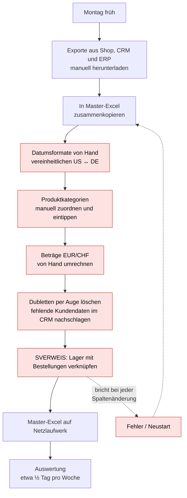
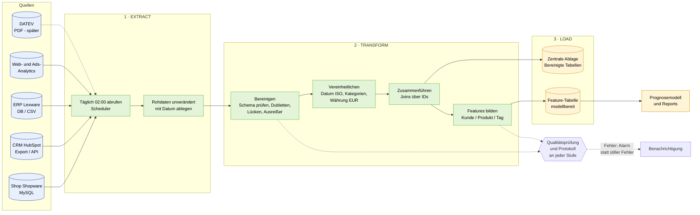
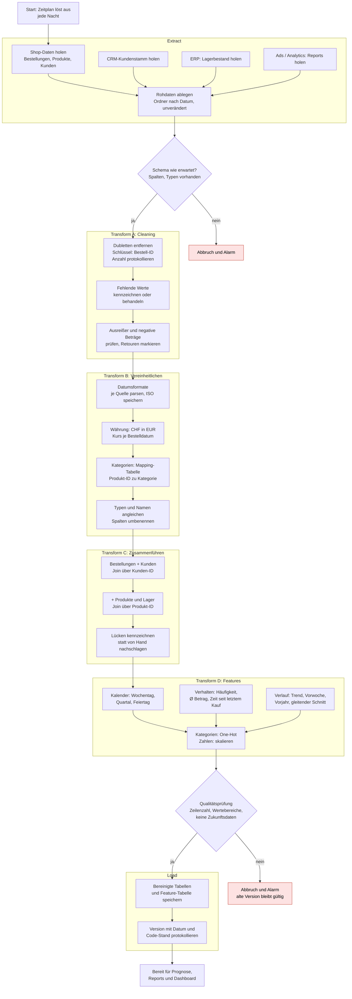
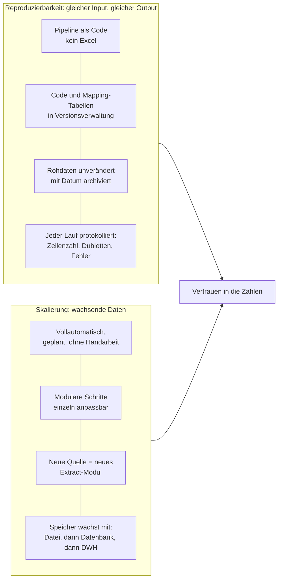
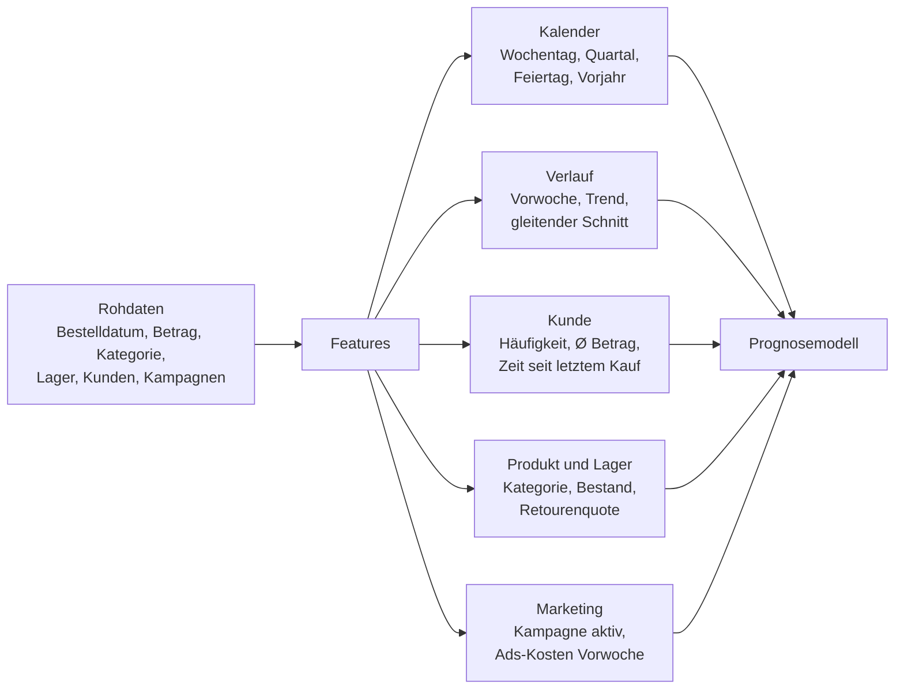
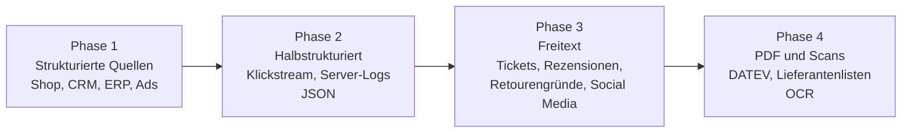
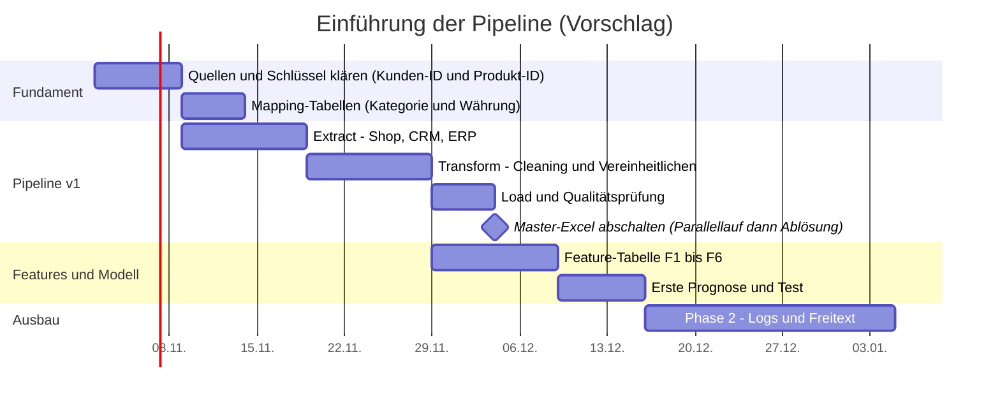

# UE 5–6 · Fallstudie E-Commerce: ETL-Pipeline und Features

*Arbeitsdatei, Basis: `04_05a_UE5_6_Fallstudie_Aufgabenstellung.pdf`. Verknüpfte Konzepte aus `04_01_UE1_Datenaufbereitung.pdf` (ETL, Workflow, Reproduzierbarkeit) und `04_03_UE3_Arbeitsauftrag2.pdf` (Features, Data Leakage).*

> Mermaid-Diagramme werden in der Markdown-Vorschau von VS Code (mit Erweiterung *Markdown Preview Mermaid Support*), GitHub, Obsidian und vielen weiteren Viewern gerendert.

---

## 1. Ausgangslage in Kürze

Online-Händler, ca. 25 Mitarbeitende, ca. 5.000 Bestellungen pro Monat, stark wachsend, **noch kein Data Warehouse**. Jeden Montag wird rund ein halber Tag in Excel für die Datenaufbereitung verbraucht.

**Aufgabe (Folie 7):** (1) Datenprobleme analysieren, (2) eine einfache ETL-Pipeline entwickeln, (3) relevante Features definieren.
**Erwartetes Ergebnis (Folie 9):** skizzierte ETL-Pipeline, Auswahl relevanter Features, Konzept für Reproduzierbarkeit und Skalierung. Bearbeitung in Kleingruppen, Vorstellung im Plenum.

### 1.1 Datenquellen

| # | System | Inhalt | Heute | Struktur |
| --- | --- | --- | --- | --- |
| Q1 | Shop (Shopware) | Bestellungen, Produkte, Kunden | MySQL-DB → CSV-Export | strukturiert |
| Q2 | CRM (HubSpot) | Kundenstamm, Kontakthistorie | Cloud → Excel-Export | strukturiert |
| Q3 | ERP (Lexware) | Lagerbestand, Lieferanten | DB → CSV / PDF | strukturiert (teils PDF) |
| Q4 | Buchhaltung (DATEV) | Rechnungen, Zahlungen | PDF | halb-/unstrukturiert |
| Q5 | Web-/Ads-Analytics (GA, Ads) | Klicks, Kampagnen, Kosten | Reports (Download) | strukturiert |
| Q6 | „Master-Excel" | manuell vereinte Auswertung | Datei auf Netzlaufwerk | **soll abgelöst werden** |
| U1 | Shop | Produktbeschreibungen, Rezensionen | Freitext | unstrukturiert |
| U2 | Zendesk + Outlook | Support-Tickets, Kunden-E-Mails | Freitext / .eml | unstrukturiert |
| U3 | freie Notizen | Retouren-/Reklamationsgründe | Freitext | unstrukturiert |
| U4 | Webshop | Klickstream, Server-Logs | JSON / Logfiles | semi-strukturiert |
| U5 | Instagram / Facebook | Social-Media-Kommentare | Textexport | unstrukturiert |

---

## 2. Aufgabe 1: Datenprobleme analysieren

### 2.1 Der heutige Prozess (Ist-Zustand)

*Rot markiert = fehleranfällige Handarbeit.*

### 2.2 Probleme, Auswirkung und Gegenmaßnahme

| # | Problem (aus Folie 4) | Datenqualitäts-Dimension | Auswirkung auf Prognosemodelle | Maßnahme in der Pipeline |
| --- | --- | --- | --- | --- |
| P1 | Manuelle Exporte, Zusammenkopieren | Aktualität, Konsistenz | Stand je nach Wochentag und Person unterschiedlich | **Extract** automatisiert (Shopware/CRM/ERP direkt per DB oder API, geplant) |
| P2 | Datumsformate gemischt (US ↔ DE) | Konsistenz | `03/05` = 5. März oder 3. Mai? Falsche Zeitabstände, falsche Saisonmuster | Beim Einlesen **pro Quelle** festes Format parsen und als ISO `YYYY-MM-DD` speichern |
| P3 | Kategorien manuell eingetippt | Konsistenz, Genauigkeit | Tippfehler, Varianten („Handy" / „Smartphone") zersplittern die Kategorie | **Mapping-Tabelle** (Produkt-ID → Kategorie), einmal gepflegt, versioniert |
| P4 | EUR/CHF per Hand umgerechnet | Konsistenz, Genauigkeit | Falsche Umsätze, uneinheitlicher Kurs | Währungsspalte behalten, **Kurstabelle je Datum**, Umrechnung in der Transformation |
| P5 | Dubletten „per Auge" | Konsistenz | Verzerrte Häufigkeiten und Umsätze | Regelbasierte Entfernung über Schlüssel (Bestell-ID), jede Entfernung protokolliert |
| P6 | Fehlende Kundendaten, im CRM nachgeschlagen | Vollständigkeit | Lücken in Features, nicht reproduzierbar | **Join über Kunden-ID** mit CRM-Daten, Lücken gekennzeichnet statt von Hand gefüllt |
| P7 | SVERWEIS bricht bei Spaltenänderung | Konsistenz, Wartbarkeit | Stille Fehler, falsche Verknüpfung | Verknüpfung über **Spaltennamen und stabile IDs** im Code, Schema-Prüfung |
| P8 | Prozess nur im Kopf der Beteiligten | Reproduzierbarkeit | Gleicher Input ergibt nicht gleichen Output | Pipeline als Code, versioniert, Tests, Protokoll |
| P9 | Unstrukturierte Quellen (Freitext, PDF, Logs) ungenutzt | Vollständigkeit | Wertvolle Signale (Retourengründe, Support) fehlen im Modell | **Phase 2:** Textfeatures (Stichworte, Stimmung, Anzahl Tickets) |

**Welches Problem verzerrt am stärksten?** Datumsformate (P2) und Dubletten (P5): Beide gehen in fast jedes Feature ein (Zeitabstände, Häufigkeiten) und lassen sich im Nachhinein nicht mehr erkennen. Deshalb stehen sie früh in der Transformation. Reihenfolge-Logik: erst Format, dann Dubletten, dann Aggregation.

---

## 3. Aufgabe 2: Die Ziel-Pipeline (ETL)

Leitfragen (Folie 8): *Welche Quellen müssen angebunden werden? Welche Schritte braucht die Aufbereitung? Wie wird der Prozess reproduzierbar?*

### 3.1 Gesamtbild (Soll-Zustand)

### 3.2 Die Schritte im Detail

**Warum diese Reihenfolge?** (Abhängigkeiten, wie in Arbeitsauftrag 1)

1. **Schema-Prüfung zuerst:** Ohne passende Spalten ist alles Weitere falsch.
2. **Cleaning vor Vereinheitlichung:** Dubletten und Fehlwerte erkennt man am besten am Original, bevor Formate verändert werden.
3. **Format, Währung, Kategorie vor dem Join:** Ein Join über unterschiedlich geschriebene Schlüssel verfehlt Treffer.
4. **Features zuletzt:** Features erben jeden Fehler aus den Schritten davor.
5. **Qualitätsprüfung vor dem Laden:** Fehlerhafte Daten sollen nicht in die „gute" Ablage gelangen.

### 3.3 Reproduzierbarkeit und Skalierung (Konzept)

| Baustein | Einfache Umsetzung (angemessen für 25 Mitarbeitende) | Begründung / Zielkonflikt |
| --- | --- | --- |
| Sprache | Python (pandas) in einzelnen, kleinen Modulen | Bekannt, kostenlos, leicht wartbar |
| Zeitplan | Geplanter Job (cron oder einfacher Scheduler) | Genug für tägliche Läufe. Ein großer Orchestrator wäre überdimensioniert |
| Rohdaten | Ordner mit Datum je Lauf (`raw/2026-10-21/…`) | Ermöglicht Nachvollziehbarkeit und Neuberechnung |
| Zentrale Ablage | zunächst Parquet-Dateien oder eine Datenbank (z. B. PostgreSQL) | **Kein** großes Data Warehouse am Anfang. Wächst später mit |
| Qualitätschecks | einfache Prüfungen im Code (Spalten vorhanden, Zeilenzahl im Rahmen, keine negativen Mengen ohne Retoure) | Fehler früh sehen (Folie „Gute Praxis") |
| Versionierung | Code und Mapping-Tabellen in Git | Welche Version hat welches Modell erzeugt? (Governance, UE 1 Folie 28) |
| Alarmierung | E-Mail oder Chat-Nachricht bei Abbruch | Statt stiller Fehler |

**Zielkonflikte bewusst abwägen (UE 1 Folie 18–19):** Eine „einfache" Pipeline lässt manche Randfälle weg (Genauigkeit gegen Geschwindigkeit), und viele Regeln machen sie schwer wartbar (Komplexität gegen Wartbarkeit). Empfehlung: klein starten, modular halten, dokumentieren.

---

## 4. Aufgabe 3: Relevante Features definieren

**Annahme (zu bestätigen im Plenum):** Die Fallstudie nennt „Prognose" ohne exaktes Ziel. Sinnvoll für einen wachsenden Online-Händler: **Absatzprognose je Produkt und Woche** (Lagerplanung, Einkauf) und optional **Kundenverhalten** (Wiederkauf, Retoure). Die Features unten sind für beides nutzbar.

**Bewertungskriterien (Folie 8):** *Relevanz für die Prognose · Verfügbarkeit zum Vorhersagezeitpunkt · Stabilität über die Zeit.*

### 4.1 Feature-Auswahl mit Bewertung

| # | Feature | Berechnung | Quelle | Relevanz | Verfügbar zum Vorhersagezeitpunkt | Stabilität | Risiko / Hinweis |
| --- | --- | --- | --- | --- | --- | --- | --- |
| F1 | Wochentag, Quartal, Feiertag | aus Bestelldatum | Shop | hoch (Wochenmuster, Saison) | ja, bekannt im Voraus | hoch | Wochentag One-Hot, nicht 1–7 als Zahl |
| F2 | Umsatz/Absatz Vorwoche und gleicher Tag Vorjahr (364 Tage) | Lag der Zielgröße | Shop | hoch | ja, nur Vergangenheit | mittel (Wachstum verschiebt das Niveau) | Vorjahr braucht ≥ 1 Jahr Historie. **Nie** aktuelle Woche verwenden (Leakage) |
| F3 | Trend: Ø 7 Tage ÷ Ø 28 Tage | gleitende Durchschnitte, mit `shift(1)` | Shop | hoch (Wachstumsphase!) | ja | mittel | In wachsendem Geschäft wichtig, sonst unterschätzt das Modell |
| F4 | Kaufhäufigkeit und Ø Kaufbetrag je Kunde | Aggregation über Fenster vor Stichtag | Shop + CRM | mittel bis hoch | ja | mittel | Neukunden: wenige Werte. Dubletten vorher entfernen |
| F5 | Produktkategorie (One-Hot) und Retourenquote je Kategorie | Mapping-Tabelle, Anteil Retouren | Shop + Mapping | mittel | ja | hoch (Mapping) / mittel (Quote) | Wenige, ungeordnete Kategorien: One-Hot passt. Retoure nur aus **abgeschlossenen** Zeiträumen |
| F6 | Lagerbestand (Verfügbarkeit) | Bestand zum Stichtag | ERP | hoch (ohne Bestand kein Absatz) | ja, **Stand zum Vorhersagezeitpunkt** | mittel | Nur der Bestand *vor* dem Zeitraum, sonst Leakage |
| F7 | Kampagne aktiv / Ads-Kosten Vorwoche | aus Kampagnenplan | Ads | mittel bis hoch | ja, wenn Plan im Voraus bekannt | niedrig bis mittel | Geplante Kampagne ja, tatsächliche Klicks der Zielwoche nein |
| F8 | Währung / Land (EUR/CHF) | Kennzeichen | Shop | gering bis mittel | ja | hoch | Nur sinnvoll, wenn Verhalten sich unterscheidet |
| F9 | Anzahl Support-Tickets / Stichworte (Phase 2) | Textauswertung | Zendesk | mittel | ja, wenn Tickets vor Stichtag | niedrig | Aufwändig, erst nach stabiler Basis-Pipeline |

**Empfehlung für die Abgabe:** F1 bis F6 als Kern (alle aus strukturierten Quellen, sofort umsetzbar), F7 optional, F8/F9 als Ausblick.

### 4.2 Kritische Prüfung

| Prüffrage | Betroffene Features | Maßnahme |
| --- | --- | --- |
| Steckt Zukunft drin (Data Leakage)? | F2, F3, F6, F7 | Zeitfenster enden **vor** dem Vorhersagezeitpunkt (`shift(1)`), Retourenquote nur aus abgeschlossenen Zeiträumen |
| Für alle Kunden/Produkte berechenbar? | F2 (Vorjahr), F3, F4 | Neue Kunden/Produkte haben keine Historie: Fehlwert-Kennzeichen, bewusst behandeln |
| Stabil über die Zeit? | F2, F3, F7 | Wachstum, Preisänderungen und Aktionen verändern die Verteilung. Regelmäßig prüfen |
| Redundant? | Woche / Monat / Quartal | Eine Gruppe wählen (Folie 13 UE 1: weniger, aber bessere Features) |
| Unterschiedliche Wertebereiche? | Betrag, Häufigkeit, Bestand | Skalieren (Normalisierung 0–1 oder Standardisierung) |

---

## 5. Unstrukturierte Quellen: Phase 2

Die Fallstudie nennt sechs unstrukturierte Quellen (Folie 3). Sie sollten **nicht** im ersten Schritt angebunden werden, sondern erst, wenn die Basis-Pipeline stabil läuft.

| Quelle | Mögliches Feature | Aufwand | Nutzen |
| --- | --- | --- | --- |
| Klickstream, Server-Logs (JSON) | Besuche, Warenkorbabbrüche pro Produkt | mittel | hoch für Nachfrage |
| Retourengründe (Freitext) | Gründe in Gruppen einteilen (Größe, Defekt, …) | mittel | hoch für Retourenprognose |
| Support-Tickets, E-Mails | Anzahl Tickets, Themen | mittel bis hoch | mittel |
| Rezensionen | Durchschnittsbewertung, Stimmung | mittel | mittel |
| Social-Media-Kommentare | Stimmung zur Marke | hoch | gering bis mittel |
| PDF/Scans (DATEV, Lieferanten) | Zahlungsverzug, Lieferzeiten | hoch (OCR) | gering, besser strukturierten Export anfordern |

---

## 6. Roadmap

*Die Zeiträume sind eine Annahme zur Veranschaulichung, keine Vorgabe aus der Fallstudie.*

---

## 7. Checkliste (UE 1, Folie 29)

- [ ] Sind Lücken, Ausreißer, Dubletten behandelt (Abschnitt 3.2, Transform A)?
- [ ] Sind Merkmale skaliert und kodiert (Transform D)?
- [ ] Ist Data Leakage ausgeschlossen (Abschnitt 4.2)?
- [ ] Ist die Pipeline reproduzierbar (Abschnitt 3.3)?

## 8. Kurzfassung für das Plenum

1. **Problem:** Verstreute Quellen, manuelle Excel-Schritte, inkonsistent, nicht reproduzierbar, skaliert nicht.
2. **Lösung:** Nächtliche, automatisierte ETL-Pipeline: Extract (Shop, CRM, ERP, Ads) → Transform (Cleaning, Vereinheitlichen, Zusammenführen, Features) → Load (bereinigte Ablage + Feature-Tabelle) mit Qualitätsprüfung und Alarm.
3. **Features:** Kalender, Verlauf/Trend, Kundenverhalten, Produkt/Lager, Kampagnen, bewertet nach Relevanz, Verfügbarkeit zum Vorhersagezeitpunkt und Stabilität.
4. **Reproduzierbar und skalierbar:** Pipeline als Code, Git, archivierte Rohdaten, Protokoll je Lauf, modulare Quellen, Speicher wächst mit.
5. **Unstrukturiertes** erst in späteren Phasen.
