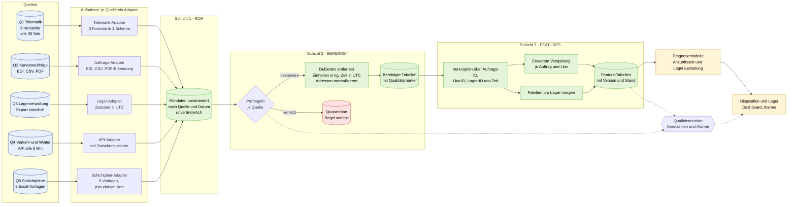
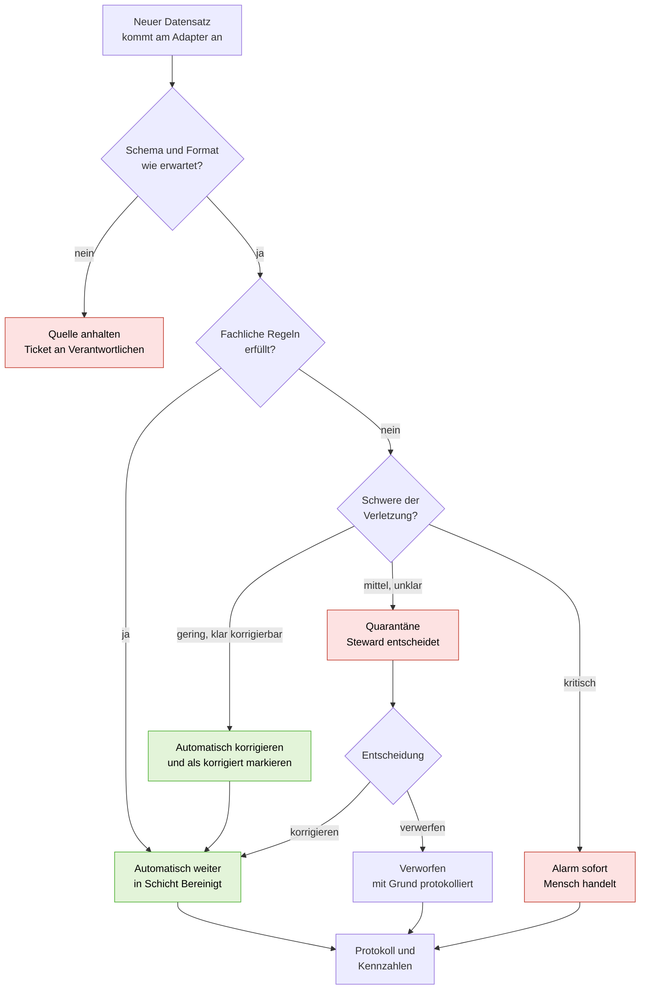
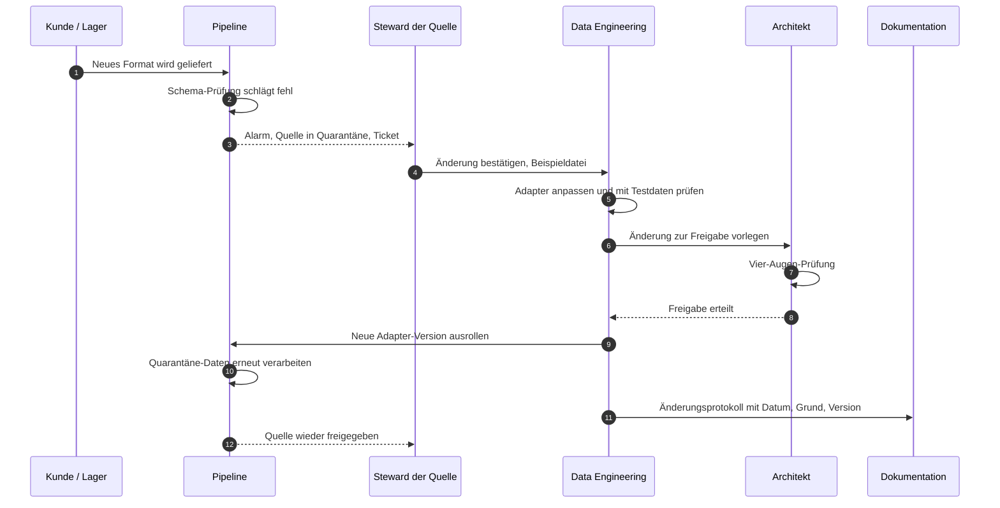

# UE 8 · Transferprojekt: TransAlpin Logistik

*Arbeitsdatei, Basis: `04_07_UE8_Transferprojekt.pdf`. Rolle: Chief Data Architect. Verknüpfte Konzepte: ETL und Reproduzierbarkeit (`04_01_UE1_Datenaufbereitung.pdf`), Features und Data Leakage (`04_03_UE3_Arbeitsauftrag2.pdf`), Pipeline-Skizze (`04_Fallstudie_ECommerce_Pipeline.md`).*

> Mermaid-Diagramme werden in der Markdown-Vorschau von VS Code (mit Erweiterung *Markdown Preview Mermaid Support*), GitHub und Obsidian gerendert. Zahlen, die nicht aus den Folien stammen, sind als **Annahme** markiert.

---

## 0. Aufgabe auf einen Blick

**Auftrag (Folie 4):** Eine **skalierbare Datenpipeline-Architektur** entwerfen, **End-to-End** von der Quelle bis zum nutzbaren Feature. Einzeln oder im Tandem, mit Kurzvortrag.

**Ziel des Unternehmens (Folie 2):** Ankunftszeiten der Lkw und Lagerauslastung für den **Folgetag** vorhersagen.

| # | Geforderte Ergebnisse (Folie 5 und 6) | Abschnitt |
| --- | --- | --- |
| 1 | Pipeline-Architektur: Weg von 5 Quellen zu den Features „erwartete Verspätung" und „Paletten pro Lager morgen"; wo liegen Rohdaten, bereinigte Daten, Features? | 3 |
| 2 | Automatisierung: was vollautomatisch, was mit Freigabe, wie bleibt es bei Wachstum bezahlbar? | 4 |
| 3 | Datenqualitätsstandards: Prüfregeln je Quelle, Umgang mit verletzenden Datensätzen | 5 |
| 4 | Governance: Zuständigkeiten bei Formatänderungen, Änderungsrechte, Dokumentation | 6 |
| 5 | Risikoanalyse: z. B. kg statt t bleibt unbemerkt | 7 |
| 6 | Kernentscheidung: Automatisierung gegen Kontrolle, begründet am Beispiel Kühltemperatur | 8 |

**Bewertungskriterien (Folie 8):** klare Struktur Quelle → Feature · trägt bei weiterem Wachstum · Qualitätsregeln und Verantwortliche je Quelle · begründete Grenze Automatisierung/Kontrolle.

---

## 1. Ausgangslage

| Merkmal | Angabe |
| --- | --- |
| Branche, Größe | Spedition für Stückgut und Kühltransporte, 1.150 Mitarbeitende, 480 Lkw, 9 Umschlaglager |
| Kunden, Umsatz | 2.300 Verlader, davon 40 Großkunden mit 60 % des Umsatzes, 310 Mio. € |
| Problem | 3 Mitarbeitende führen die Daten täglich per Excel zusammen, jeder 12. Datensatz (ca. 8 %) ist fehlerhaft |
| Wachstum | Datenvolumen in 2 Jahren verdreifacht, allein Telematik liefert 2 Mio. Ereignisse pro Tag |

**Größenordnung (Plausibilitätsrechnung):** 480 Lkw × 2 Messungen pro Minute × 24 h ≈ 1,4 Mio. Positionsmeldungen pro Tag. Mit Kühltemperatur als eigenem Ereignis und doppelten Meldungen kommt man auf die genannten ca. 2 Mio. Bei weiterem Wachstum (Annahme: noch einmal Faktor 3) wären das **ca. 6 Mio. Ereignisse pro Tag**. Excel ist dafür keine Option, und selbst „Datei pro Tag mit Skript" muss effizient gebaut sein.

### 1.1 Die fünf Quellen und ihre Probleme (Folie 3)

| # | Quelle | Format, Takt | Typische Probleme | Typ |
| --- | --- | --- | --- | --- |
| Q1 | **Telematik der Lkw** | GPS und Kühltemperatur alle 30 Sek. | Funklöcher, doppelte Ereignisse, 3 Hersteller mit eigenem Format | Datenstrom, groß |
| Q2 | **Aufträge der Kunden** | EDI, CSV, teils PDF per E-Mail | Adressen uneinheitlich, Gewichte mal kg, mal t | Bewegungsdaten, mehrere Formate |
| Q3 | **Lagerverwaltung** | Datenbank, stündlicher Export | fehlende Scans bei Störungen, Zeitzonen uneinheitlich | Bewegungsdaten |
| Q4 | **Verkehr und Wetter** | Schnittstelle alle 5 Min. | kostenpflichtig je Abruf, Ausfälle beim Anbieter | extern, Kosten |
| Q5 | **Schichtpläne** | Excel je Lager | 9 verschiedene Vorlagen, personenbezogene Daten | manuell, DSGVO |

---

## 2. Leitidee der Architektur

Fünf Grundsätze, aus denen sich alles Weitere ableitet:

1. **Rohdaten niemals verändern.** Alles wird zuerst unverändert abgelegt, später kann man jede Bereinigung neu berechnen (Reproduzierbarkeit).
2. **Drei Schichten:** Roh → bereinigt → Features. Jede Schicht hat eine klare Aufgabe und einen Verantwortlichen.
3. **Je Quelle ein Adapter.** Formatvielfalt wird am Rand aufgefangen und in ein gemeinsames Schema übersetzt, danach sehen alle Quellen gleich aus.
4. **Regeln statt Handarbeit, Mensch bei Ausnahmen.** Prüfregeln laufen automatisch, strittige Fälle landen in einer Quarantäne zur Freigabe.
5. **Früh verdichten, was nur gebraucht wird, um das Volumen zu bezahlen.** Der Rohdatenstrom wird nicht dauerhaft in teurem Speicher gehalten.

---

## 3. Ergebnis 1: Pipeline-Architektur

### 3.1 Gesamtbild

### 3.2 Wo liegen welche Daten? (Frage der Folie 5)

| Schicht | Inhalt | Ablage (Vorschlag) | Aufbewahrung (Annahme) | Wer greift zu? |
| --- | --- | --- | --- | --- |
| **Roh** | Originaldaten, Byte für Byte, plus Eingangszeit und Quelle | Objektspeicher im spaltenorientierten, komprimierten Format, je Quelle und Tag | Telematik lang (Nachweispflicht, siehe 8.3), Rest nach Bedarf | nur die Pipeline, Ausnahmefälle: Daten-Team |
| **Bereinigt** | Einheitliches Schema, Dubletten entfernt, UTC, kg, normalisierte Adressen, Qualitätsmarker pro Zeile | gleicher Speicher, eigene Zone oder Datenbank | mittelfristig (z. B. 2 Jahre) | Analyse, Daten-Team |
| **Quarantäne** | Datensätze, die eine Regel verletzt haben, mit Grund | eigene Tabelle | bis zur Klärung | Data Steward der Quelle |
| **Features** | Modellbereite Tabellen, versioniert mit Stichtag | Feature-Tabellen in Datenbank oder Dateien | je Version, nachvollziehbar | Modelle, Data Science |

**Mehr Sinn als bloß „Excel ersetzen":** Weil Roh-, bereinigte und Feature-Daten getrennt liegen, kann man bei einem erkannten Fehler (siehe Risiko kg/t) die Bereinigung **neu laufen lassen**, ohne Daten neu anzufordern.

### 3.3 Der Weg zu den beiden Ziel-Features

**Feature A: „erwartete Verspätung"** (je Lkw/Auftrag, zum Vorhersagezeitpunkt)

| Eingang | Quelle | Beispielmerkmal |
| --- | --- | --- |
| Position, Geschwindigkeit, Standzeit | Q1 Telematik | Rest-km bis Ziel, Ø Geschwindigkeit letzte Stunde, aktuelle Standzeit |
| Auftrag (Ziel, Zeitfenster) | Q2 Aufträge | geplante Ankunft, Zeitfenster-Länge, Gewicht (kg) |
| Verkehr, Wetter | Q4 Verkehr/Wetter | Staustufe auf Restroute, Niederschlag, Glätte |
| Wartezeit am Lager | Q3 Lager | Ø Wartezeit am Zielort um diese Uhrzeit |
| Kalender | abgeleitet | Wochentag, Feiertag, Ferien |

→ **Erwartete Verspätung = voraussichtliche Ankunft minus geplante Ankunft** (Zielgröße beim Training: tatsächliche minus geplante Ankunft).

**Feature B: „Paletten pro Lager morgen"** (je Lager und Tag)

| Eingang | Quelle | Beispielmerkmal |
| --- | --- | --- |
| Erwartete Ankünfte | Q2 Aufträge + Feature A | Anzahl Sendungen und **Paletten (aus Gewicht/Auftrag)** je Zielhorizont, verschoben um erwartete Verspätung |
| Lagerzustand | Q3 Lager | aktueller Bestand, Durchsatz je Stunde in der Vergangenheit |
| Personal | Q5 Schichtpläne | **Anzahl** Mitarbeitende je Schicht (aggregiert, nicht personenbezogen) |
| Kalender | abgeleitet | Wochentag, Feiertag, Monatsende |
| Verlauf | Q3 Lager | Vorwoche, gleicher Wochentag Vorjahr, Trend |

**Data-Leakage-Regel (wichtig für „Folgetag"):** Es gilt ein fester **Stichtag-Uhrzeit** (Annahme: 16:00 am Vortag). Jedes Feature darf nur Daten verwenden, die **vor** diesem Zeitpunkt vorlagen. Beispiel: Scans des Folgetags, tatsächliche Ankunftszeiten des Zieltags oder das Wetter, das erst am Folgetag gemessen wird, sind verboten. Zulässig sind **Wettervorhersagen** vom Vortag. Daher muss die Pipeline auch den **Stand zum Zeitpunkt** speichern (Versionierung der Quelle mit Eingangszeit).

---

## 4. Ergebnis 2: Automatisierung und Kosten

### 4.1 Was läuft automatisch, was braucht Freigabe?

**Faustregel:** Automatisieren, was **regelbasiert, eindeutig und umkehrbar** ist. Menschen entscheiden, was **mehrdeutig, haftungsrelevant oder nicht umkehrbar** ist.

| Schritt | Beispiel | Modus | Begründung |
| --- | --- | --- | --- |
| Einlesen, Format übersetzen | 3 Telematik-Formate in 1 Schema | **voll automatisch** | rein technisch, eindeutig |
| Zeitzone in UTC, Einheiten umrechnen | Lager lokal → UTC, t → kg | **voll automatisch**, wenn Regel je Kunde/Quelle bekannt | Regel eindeutig, **aber** mit Plausibilitätsprüfung (siehe 7) |
| Exakte Dubletten entfernen | doppelte Telematik-Ereignisse | **voll automatisch**, protokolliert | eindeutig (gleiche Gerät-ID und Zeit), Zählung wird überwacht |
| Kurze Funklöcher überbrücken | Lücke bis ca. 2 Min. | **automatisch**, aber **nur in Features**, markiert | bewusst nicht in den Rohdaten |
| Adressen normalisieren | „Hauptstr. 5" / „Hauptstraße 5" | **automatisch** bei sicherem Treffer, sonst **Freigabe** | Mehrdeutigkeit möglich |
| Regelverletzung (siehe 5) | Gewicht ≤ 0, Position außerhalb Route | **Quarantäne**, danach Mensch | Ursache unklar |
| Neues Quellformat (siehe 6) | Kunde ändert EDI | **Stopp und Freigabe** | sonst stille Fehler |
| Änderung einer Transformationsregel | neue Umrechnung, neue Grenze | **Freigabe (4-Augen)** | wirkt auf alle Folgedaten |
| Grenzwert Kühltemperatur überschritten | siehe 8 | **sofortiger Alarm an Mensch** | Haftung, Ware |
| Modell neu trainieren, Feature freigeben | neue Feature-Version | **Freigabe nach automatischen Tests** | Qualitätssicherung |

### 4.2 Entscheidung je Datensatz

### 4.3 Wie bleibt die Pipeline bei weiter steigendem Volumen bezahlbar?

Das Volumen soll sich erneut verdreifachen. Die Kosten dürfen nicht im gleichen Maß steigen. Hebel:

| Hebel | Idee | Wirkung |
| --- | --- | --- |
| **Früh verdichten** | Rohe 30-Sekunden-Punkte bleiben im günstigen Speicher, für Features werden sie je Lkw auf 1–5 Min. oder je Etappe verdichtet | Feature-Schicht wächst viel langsamer als die Rohschicht |
| **Speicher-Stufen** | Heiß (Tage, schnell, teuer) → warm (Monate) → kalt (Jahre, billig, komprimiert) | Der meiste Speicher liegt im günstigsten Tarif |
| **Spaltenformat, Kompression** | Parquet statt CSV | typischerweise Faktor 5 bis 10 weniger Platz, schnellere Abfragen |
| **Inkrementell statt komplett** | Nur neue Daten verarbeiten (Wasserzeichen), keine Vollläufe | Rechenzeit proportional zum Neuen, nicht zum Gesamtbestand |
| **Abrufe der Verkehrs-/Wetter-API bündeln** | je **Korridor oder Gitterfeld** abrufen und zwischenspeichern, nicht je Lkw; bei Ausfall letzten gültigen Wert mit Alter nutzen | Kosten steigen mit Fläche, nicht mit Lkw-Zahl. Ausfälle beim Anbieter werden abgefangen |
| **Bedarfsgerechte Rechenleistung** | Rechenressourcen nur für die Laufzeit hochfahren (Pay-per-Use) | keine Dauerlast für Spitzen |
| **Aufbewahrungsregeln** | Fristen je Datenart, Löschung automatisch | begrenzt Wachstum |
| **Nicht mehr Echtzeit als nötig** | Für „Folgetag" reicht **Mikro-Batch alle 5–15 Min.** statt echtem Streaming. Echtzeit nur für Kühlalarm | spart Komplexität und Kosten |

**Zielkonflikt (UE 1, Folie 18/19):** Mehr Echtzeit und mehr Detail erhöhen Genauigkeit, aber auch Kosten und Wartungsaufwand. Empfehlung: Echtzeit nur dort, wo ein Mensch **sofort** handeln muss (Kühlkette), sonst Takt nach Bedarf der Prognose.

---

## 5. Ergebnis 3: Datenqualitätsstandards

### 5.1 Prüfregeln je Quelle

| Quelle | Regel | Beispiel / Schwelle (Annahme) | Bei Verletzung |
| --- | --- | --- | --- |
| **Q1 Telematik** | Pflichtfelder vorhanden (Lkw-ID, Zeit, Lat, Lon) | nie leer | Quarantäne |
| | Zeitstempel plausibel, nicht in der Zukunft | max. wenige Minuten Abweichung zur Eingangszeit | auf Eingangszeit prüfen, sonst Quarantäne |
| | **GPS-Punkt auf der geplanten Route** | Abstand zur Route ≤ z. B. 2 km, sonst „Abweichung" | Flag „Routenabweichung" (kein Fehler, sondern Information), bei Sprung > Physik Quarantäne |
| | Geschwindigkeit physikalisch möglich | Position-Sprünge nicht > ca. 130 km/h | Punkt verwerfen (Ausreißer), Protokoll |
| | **Dubletten** | gleiche Lkw-ID + Zeit + Position | automatisch entfernen, Zähler überwachen |
| | **Lücke** (Funkloch) | Pause > 2 Min. | Lücke kennzeichnen, nicht erfinden |
| | **Kühltemperatur** im Bereich des Sensors | z. B. −40 bis +30 °C, keine Dauerwerte wie −99 oder 0 | Sensorfehler markieren, Alarm bei Verdacht |
| **Q2 Aufträge** | **Gewicht > 0** und je Palette plausibel | z. B. 20–1.200 kg je Palette, Sendung ≤ Nutzlast | Quarantäne. Einheit nie raten (siehe 7) |
| | Einheit angegeben oder durch Kundenprofil bekannt | je Kunde kg oder t hinterlegt | fehlt: Quarantäne |
| | Adresse vollständig, geocodierbar | Straße, PLZ, Ort, Land | Normalisierung, sonst Freigabe |
| | Auftrags-ID eindeutig | keine Doppelten | Dublette: zusammenführen oder verwerfen |
| | Lieferzeitfenster logisch | Ende nach Anfang | Quarantäne |
| | PDF-Aufträge | Extraktion mit Vertrauenswert | niedriger Vertrauenswert: manuelle Prüfung |
| **Q3 Lager** | Zeitzone angegeben oder aus Lagerstandort bekannt | immer in UTC speichern | sonst Quarantäne |
| | Scan-Reihenfolge logisch | Eingang vor Ausgang | **fehlende Scans** als Lücke markieren, nicht auffüllen |
| | Bestand ≥ 0 | nie negativ | Quarantäne |
| | Export vollständig und rechtzeitig | stündlich, Zeilenzahl im Rahmen | Alarm bei Fehlen oder Einbruch |
| **Q4 Verkehr/Wetter** | Antwort gültig, Werte im Bereich | z. B. Temperatur −40 bis +50 °C | letzter gültiger Wert mit Alter, dann Kennzeichen |
| | Aktualität | max. Alter z. B. 15 Min. | Alarm, Feature „unsicher" |
| | Kosten-Budget | max. Abrufe pro Tag | Stopp neuer Abrufe, Alarm |
| **Q5 Schichtpläne** | Vorlage erkannt (1 von 9) | bekannte Spaltenstruktur | sonst Quarantäne, Ticket |
| | Datum und Schicht gültig | keine Doppelbelegung | Freigabe |
| | **Datenschutz:** nur Kopfzahl je Schicht ins Feature | Namen nie in Features | Pseudonymisierung beim Einlesen |

### 5.2 Was passiert mit einem Datensatz, der eine Regel verletzt?

Vier Wege, abhängig von Schwere und Eindeutigkeit (siehe Diagramm in 4.2):

1. **Automatisch korrigieren und markieren:** nur bei **eindeutigen** Fehlern (z. B. Dublette, bekanntes Datumsformat). Das Original bleibt in der Rohschicht.
2. **Markieren und mitführen:** Information statt Fehler (z. B. Routenabweichung, Funkloch). Das Modell erhält ein Kennzeichen als Feature.
3. **Quarantäne:** Mehrdeutig (Einheit unklar, Gewicht 0). Steward der Quelle entscheidet, Frist (Annahme: gleicher Arbeitstag). Bis dahin fließt der Datensatz **nicht** in Features, die Lücke wird sichtbar gemacht.
4. **Alarm:** Kritisch (Temperaturverletzung, ganze Quelle fällt aus). Sofortige Benachrichtigung.

**Nie:** stilles Löschen oder stilles Raten. Jede Entscheidung wird protokolliert (Regel, Zeitpunkt, Aktion).

### 5.3 Messbarkeit: Qualitätskennzahlen je Quelle

| Kennzahl | Zielwert (Annahme) | Zweck |
| --- | --- | --- |
| Anteil Datensätze in Quarantäne | < 2 % pro Quelle und Tag | Früher Hinweis auf Formatänderung oder Fehler |
| Vollständigkeit (z. B. Telematik: Meldungen pro Lkw und Tag gegenüber Soll) | ≥ 95 % | Funkloch gegenüber Ausfall unterscheiden |
| Aktualität (Alter der letzten Lieferung je Quelle) | innerhalb Takt + Toleranz | Ausfälle früh erkennen |
| Fehlerquote vor/nach Einführung | von ca. 8 % (jeder 12.) auf < 1 % | Erfolgsnachweis für den Auftrag |

---

## 6. Ergebnis 4: Governance

**Prinzip:** Jede Quelle hat eine **fachlich Verantwortliche Person (Data Owner)** und eine **technisch Betreuende (Data Steward)**. Formatänderungen werden **erkannt, nicht erraten**.

### 6.1 Rollen

| Rolle | Aufgabe | Beispiel |
| --- | --- | --- |
| **Data Owner** (fachlich) | Verantwortet Inhalt und Bedeutung der Quelle, entscheidet über Regeln | Leitung Disposition (Q1, Q2), Lagerleitung (Q3), Personalleitung (Q5), Einkauf (Q4) |
| **Data Steward** | Pflegt Regeln und Mapping, klärt Quarantäne-Fälle | je Quelle benannt |
| **Data Engineering** | Baut und betreibt Adapter und Pipeline | Team Data Architect |
| **Data Architect** (Sie) | Gesamtarchitektur, Freigabe von Regeländerungen mit Wirkung auf mehrere Quellen | – |
| **Datenschutz** | Prüft personenbezogene Daten (Schichtpläne, Fahrer-GPS), Betriebsrat einbeziehen | – |

### 6.2 Zuständigkeit je Quelle (Folie 8: „Verantwortliche je Quelle")

| Quelle | Owner (fachlich, Annahme) | Steward | Typisches Ereignis |
| --- | --- | --- | --- |
| Q1 Telematik | Disposition / Fuhrpark | Data Engineering | Hersteller ändert Format oder Firmware |
| Q2 Aufträge | Kundenmanagement | Steward Aufträge | **Kunde ändert EDI-Format** |
| Q3 Lager | Lagerleitung je Standort | Steward Lager | Neue Scanner, Zeitzonenwechsel |
| Q4 Verkehr/Wetter | Einkauf / IT | Data Engineering | Anbieter ändert API oder Preis |
| Q5 Schichtpläne | Personalleitung je Lager | Steward Personal | **Lager nutzt neue Excel-Vorlage** |

### 6.3 Ablauf bei Formatänderung

### 6.4 Wer darf Transformationsregeln ändern, wie wird das dokumentiert?

| Frage | Antwort |
| --- | --- |
| Wer darf ändern? | Data Engineering schlägt vor, **Steward** bestätigt fachlich, **Architekt** gibt frei (4-Augen). Niemand ändert direkt in der laufenden Pipeline |
| Wo liegen Regeln? | Als **Code und Konfiguration in Versionsverwaltung (Git)**. Regeln sind Daten, keine Einzelskripte |
| Wie dokumentiert? | Jede Änderung: *Was, Warum, Wer, Wann, Freigabe von*. Pull-Request mit Pflichtfeldern, automatische Tests |
| Wie nachvollziehbar? | Jeder Datensatz in Features trägt die **Regelversion** und den Pipeline-Lauf. Bei Fehlern: neu berechnen aus Rohdaten |
| Datenkatalog | Beschreibung je Tabelle und Spalte: Bedeutung, Einheit, Owner, Aktualität |

---

## 7. Ergebnis 5: Risikoanalyse am Beispiel „kg statt t"

**Szenario:** Ein Kundenauftrag meldet das Gewicht in Tonnen (z. B. `18` = 18 t), die Pipeline interpretiert `18` als Kilogramm. Oder umgekehrt: 18.000 kg werden als 18.000 t gelesen. Fehlerfaktor **1000**.

### 7.1 Was richtet der Fehler an?

| Wirkung | Folge | Betroffene Stelle |
| --- | --- | --- |
| Gewicht zu **klein** (t als kg) | Paletten- und Ladungsmenge stark **unterschätzt**; Lagerauslastung „morgen" scheint niedrig; zu wenig Personal und Rampen geplant | Feature B, Lagerplanung |
| Gewicht zu **groß** (kg als t) | Lkw erscheint überladen oder Aufträge nicht beladbar; falsche Tourenplanung; Aufträge werden abgelehnt oder gesplittet | Disposition |
| **Verteilungsfehler** im Modell | Aufträge werden Ausreißer mit riesigen Werten und verzerren Mittelwerte und Trainingsdaten | Prognosemodell |
| Abrechnung / Haftung | Fracht nach Gewicht berechnet: falsche Rechnung, Vertragsstrafe bei Überladung | Finanzen, Recht |
| Vertrauen | Fehlprognosen untergraben die Akzeptanz bei Disposition und Lager | gesamt |

**Warum gefährlich?** Das Ergebnis sieht formal richtig aus (Zahl vorhanden, Typ passt). Die Prüfung „Gewicht > 0" schlägt nicht an. Ein einzelner Fall fällt kaum auf, **systematische** Fehler (ein Kunde, alle Aufträge) wirken jedoch wie eine reale Änderung der Nachfrage. Gerade Großkunden (40 Kunden mit 60 % des Umsatzes) wären betroffen.

### 7.2 Wie schnell muss es auffallen? Schutzschichten

| Schicht | Prüfung | Entdeckungszeit |
| --- | --- | --- |
| 1. **Eingang** | Einheit je Kunde im Stammdatensatz hinterlegt, **nie raten**. Fehlt sie: Quarantäne | Sekunden bis Minuten |
| 2. **Plausibilität je Datensatz** | Gewicht je Palette zwischen z. B. 20 und 1.200 kg; Sendung nicht über Nutzlast des Lkw (z. B. 25 t) | Minuten |
| 3. **Statistisch je Kunde** | Gewichte eines Kunden weichen plötzlich um Faktor ~1000 vom Median der letzten Wochen ab | wenige Stunden |
| 4. **Tagesabgleich** | Summe Gewicht und Paletten je Lager gegenüber Vorwoche und Lagerscans | **bis zum Folgetag**, vor der Prognose |
| 5. **Modellüberwachung** | Prognose weicht stark von Ist ab (Drift) | Tage, nur noch als Notbremse |

**Zielwert:** Fehler dieser Größenordnung (Faktor 1000) müssen **innerhalb von Minuten** durch Schicht 1/2 auffallen. Schicht 4 ist das Sicherheitsnetz **vor** dem Stichtag der Prognose (siehe 3.3), damit ein unbemerkter Fehler nie in die Planung des Folgetags gelangt.

### 7.3 Risikomatrix

| # | Risiko | Wahrscheinlichkeit | Schaden | Gegenmaßnahme |
| --- | --- | --- | --- | --- |
| R1 | Einheit kg/t falsch | hoch (bekannt aus Q2) | hoch | Kundenprofil, Plausibilitätsregeln, Tagesabgleich |
| R2 | Format einer Quelle ändert sich unbemerkt (EDI, Excel) | hoch | mittel bis hoch | Schema-Prüfung, Stopp und Quarantäne, Owner-Ticket |
| R3 | Zeitzonenfehler im Lager | mittel | mittel | Alles in UTC, Zeitzone je Lager im Stammdatensatz |
| R4 | Telematik-Ausfall oder Funkloch wird als „Stillstand" gelesen | mittel | mittel | Lücke kennzeichnen, nicht auffüllen. Modell kennt „unsicher" |
| R5 | Verkehr-/Wetter-API fällt aus oder wird zu teuer | mittel | gering bis mittel | Zwischenspeicher, Fallback, Budgetgrenze |
| R6 | Datenschutz (Schichtpläne, Fahrer-GPS) | mittel | hoch | Pseudonymisierung, nur aggregierte Kopfzahl, Zweckbindung, Betriebsrat |
| R7 | Kostenexplosion bei Wachstum | mittel | mittel | Stufenspeicher, Verdichtung, Aufbewahrungsfristen |
| R8 | Schlüsselperson-Abhängigkeit (3 Excel-Mitarbeitende fallen weg) | gering nach Einführung | mittel | Pipeline als dokumentierter Code, Wissen im Team |
| R9 | **Data Leakage** in Features (Zukunftsdaten) | mittel | hoch (Modell wirkt im Test besser als im Betrieb) | feste Stichtag-Uhrzeit, Stand-zum-Zeitpunkt speichern |
| R10 | Kühltemperatur-Fehler (siehe 8) | gering | **sehr hoch** | Rohdaten unveränderlich, Alarm, menschliche Entscheidung |

---

## 8. Ergebnis 6: Die Kernentscheidung

### 8.1 Die Alternative (Folie 7)

| | **Maximale Automatisierung** | **Maximale Kontrolle** |
| --- | --- | --- |
| Pro | Die 3 Excel-Stellen werden frei · skaliert mit dem Volumen | Jede Änderung geprüft und nachvollziehbar |
| Contra | Fehler können unbemerkt in die Prognosen laufen | Bei 2 Mio. Ereignissen pro Tag kaum leistbar · Prognosen kommen verzögert an |

Beide Extreme scheitern. Die Entscheidung lautet daher: **Wo** ist ein Fehler teuer und nicht rückholbar (Kontrolle), **wo** billig und leicht korrigierbar (Automatisierung)?

### 8.2 Meine Grenze

```mermaid
flowchart LR
    subgraph AUTO["Automatisch, ohne Menschen"]
        direction TB
        A1["Format übersetzen,<br/>UTC, Einheiten mit bekannter Regel"]
        A2["Exakte Dubletten entfernen"]
        A3["Plausibilitätsprüfung<br/>und Kennzahlen"]
        A4["Kurze Lücken in Features<br/>markiert überbrücken"]
    end

    subgraph HALB["Automatisch erkannt, Mensch entscheidet"]
        direction TB
        H1["Regel verletzt, Ursache unklar<br/>Quarantäne"]
        H2["Neues Format<br/>Schema-Änderung"]
        H3["Änderung an<br/>Transformationsregeln"]
        H4["Feature-Version freigeben"]
    end

    subgraph MENSCH["Mensch handelt sofort"]
        direction TB
        M1["Kühlkette verletzt<br/>Temperatur über Grenzwert"]
        M2["Ganze Quelle fällt aus"]
        M3["Verdacht auf Sensorfehler<br/>bei Kühldaten"]
    end

    AUTO --> HALB --> MENSCH

    classDef g fill:#e3f4d9,stroke:#4caf30,color:#000
    classDef o fill:#fff4d6,stroke:#c98a00,color:#000
    classDef r fill:#fde2e2,stroke:#c0392b,color:#000
    class A1,A2,A3,A4 g
    class H1,H2,H3,H4 o
    class M1,M2,M3 r
```

**Grenzkriterien (vier Fragen je Prozessschritt):**

| Frage | Ja → Richtung Kontrolle | Nein → Richtung Automatisierung |
| --- | --- | --- |
| Ist der Fehler **haftungsrelevant** (Ware, Vertrag, Recht)? | Kontrolle | Automatisierung |
| Ist die Korrektur **umkehrbar** (Rohdaten bleiben, Neuberechnung möglich)? | Automatisierung | Kontrolle |
| Ist die Regel **eindeutig** (immer gleiche Antwort)? | Automatisierung | Kontrolle |
| Ist die **Menge** so groß, dass Menschen sie nicht prüfen können? | Automatisierung + Stichproben | – |

### 8.3 Begründung am Beispiel Temperaturdaten der Kühltransporte

Kühlketten sind der Fall, in dem beide Seiten besonders deutlich werden:

**Menge spricht für Automatisierung:** Temperatur kommt alle 30 Sekunden von 480 Lkw. Kein Mensch kann das lesen. Daher läuft **automatisch**: Einlesen, Dubletten, Einheit (°C), Zeitstempel in UTC, Plausibilität (Sensorbereich), Erkennen von Lücken, Berechnung von Features (z. B. Ø Temperatur, Anteil Zeit über Grenzwert).

**Haftung spricht für Kontrolle:** Die Temperaturaufzeichnung ist der **Nachweis**, dass die Kühlkette eingehalten wurde (Verlader, Lebensmittel, Pharma; Annahme: Aufbewahrungs- und Nachweispflichten sind rechtlich zu prüfen). Daraus folgt:

| Regel | Begründung |
| --- | --- |
| **Rohwerte nie überschreiben, nie „glätten"** | Der Nachweis darf nicht durch Korrektur verfälscht sein. Eine automatische Korrektur eines echten Ausreißers würde eine Temperaturverletzung **verschleiern** |
| **Keine automatische Auffüllung von Lücken in den Nachweisdaten** | Funkloch bedeutet „unbekannt", nicht „war in Ordnung". Nur das **Feature** darf überbrücken, und nur gekennzeichnet |
| **Grenzwertverletzung löst sofort Alarm aus, die Entscheidung trifft ein Mensch** | Ob Ware verworfen, nachgekühlt oder freigegeben wird, ist eine Haftungsentscheidung mit Kenntnis der Ware, kein Datenproblem |
| **Verdacht auf Sensorfehler** (Dauerwert, Sprung) | Wird automatisch **markiert**, aber ob Sensor defekt oder Ware warm ist, klärt ein Mensch (Fahrer, Disposition, Werkstatt) |
| **Änderung der Grenzwerte oder Regeln** | Freigabe (4-Augen), dokumentiert. Fehlerhafte Regel würde alle Transporte betreffen |
| **Aufbewahrung der Rohdaten** | Länger als bei anderen Quellen, mit Zugriffsschutz |

**Warum nicht überall maximale Kontrolle?** Weil sie bei diesem Volumen nicht möglich ist und weil Menschen Fehler bei Routinearbeit leicht übersehen (siehe: jeder 12. Datensatz war in Excel fehlerhaft). Kontrolle wird daher **auf Ausnahmen konzentriert**: Die Maschine prüft alle Datensätze, der Mensch bekommt die **wenigen** relevanten Fälle.

**Warum nicht überall maximale Automatisierung?** Weil ein unbemerkter Fehler bei Temperaturdaten einen Schaden bei Kunde und Ware verursacht, der sich nicht rückgängig machen lässt (verdorbene Ware, Vertragsstrafe, Ruf).

**Kurzformel für den Vortrag:**
> *Wir automatisieren das Prüfen, nicht das Entscheiden. Die Pipeline prüft jeden der Millionen Datensätze, und Menschen entscheiden bei den wenigen, die haftungsrelevant, mehrdeutig oder nicht umkehrbar sind.*

---

## 9. Gesamtübersicht der Entscheidungen

| Frage der Folien | Kurzantwort |
| --- | --- |
| Struktur Quelle → Feature | 5 Adapter → Roh → Prüfung → Bereinigt (+ Quarantäne) → Features → Modell, mit Qualitätsmonitor |
| Wo liegen Daten? | Roh unverändert (Objektspeicher, nach Quelle und Tag), bereinigt (einheitliches Schema), Features (versioniert mit Stichtag) |
| Vollautomatisch | Einlesen, Format, UTC, bekannte Einheiten, exakte Dubletten, Plausibilität, Kennzahlen |
| Freigabe | Quarantäne-Fälle, neue Formate, Regeländerungen, Feature-Versionen |
| Bezahlbar bei Wachstum | früh verdichten, Speicher-Stufen, Spaltenformat, inkrementell, API-Abrufe bündeln, Aufbewahrungsfristen, Mikro-Batch statt Echtzeit |
| Prüfregeln | siehe 5.1 je Quelle, Umgang: korrigieren, markieren, Quarantäne oder Alarm |
| Governance | Owner und Steward je Quelle, Regeln in Git, 4-Augen-Freigabe, Änderungsprotokoll |
| Risiko kg/t | Einheit je Kunde, Plausibilität je Palette, Kundenstatistik, Tagesabgleich vor dem Stichtag |
| Kernentscheidung | Prüfen automatisieren, Entscheiden bei Haftung und Mehrdeutigkeit dem Menschen überlassen. Kühldaten: Rohwerte unantastbar, Alarm sofort, Entscheidung beim Menschen |

---

## 10. Bewertungs-Checkliste (Folie 8)

- [ ] **Architektur** zeigt klare Struktur von der Quelle bis zum Feature (Abschnitt 3)
- [ ] **Automatisierung** trägt bei weiter wachsendem Volumen (Abschnitt 4.3)
- [ ] **Qualitätsregeln und Verantwortliche** je Quelle festgelegt (Abschnitte 5.1 und 6.2)
- [ ] **Grenze Automatisierung/Kontrolle** begründet (Abschnitt 8)

## 11. Gliederung für den Kurzvortrag (Vorschlag, ca. 5–7 Minuten)

1. **Problem:** 3 Mitarbeitende, Excel, jeder 12. Datensatz fehlerhaft, Volumen × 3 (30 Sek.)
2. **Architektur:** das Gesamtbild aus 3.1, drei Schichten, ein Adapter je Quelle (90 Sek.)
3. **Zwei Ziel-Features** und der Stichtag gegen Data Leakage (60 Sek.)
4. **Qualität und Quarantäne:** Regeln, „nie still löschen, nie still raten" (60 Sek.)
5. **Governance:** Owner, Steward, 4-Augen, Git (45 Sek.)
6. **Risiko kg/t:** vier Schutzschichten (45 Sek.)
7. **Kernentscheidung:** „Prüfen automatisieren, Entscheiden dem Menschen überlassen", Beispiel Kühlkette (90 Sek.)

---

## 12. Offene Annahmen zum Klären im Plenum

- Stichtag-Uhrzeit der Prognose (hier 16:00 am Vortag).
- Aufbewahrungsfristen für Kühl- und Telematikdaten (rechtliche Prüfung).
- Ob die Einheit je Kunde im Stammdatensatz sicher gepflegt werden kann.
- Ob die Telematik-Hersteller eine direkte Schnittstelle bieten (statt Dateiexport).
- Konkrete Grenzwerte (Routenabstand, Sensorbereich, Gewicht je Palette) kommen aus dem Fachbereich, die hier genannten sind Beispiele.
