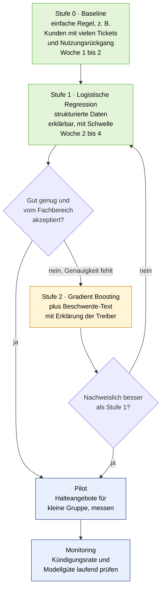
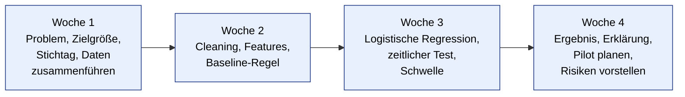

# UE 5–6 · Fallstudie TeleCom GmbH: Churn-Vorhersage

*Lösungsentwurf zur Fallstudie von Tag 5. Aufgaben laut Folie 6: (1) Problem klar definieren (Zielgröße), (2) passenden Modelltyp wählen, (3) Wahl begründen und Risiken benennen. Erwartet werden eine klare Problem- und Zieldefinition, ein begründeter Modelltyp und eine kurze Risikobetrachtung. Allgemeine Begriffe stehen im [`Kompendium`](../00_Kompendium/00_Kompendium_Predictive_Analytics.md).*

> **Annahmen** (nicht in der Aufgabe genannt, deshalb als **Annahme** markiert): Vorhersagehorizont 90 Tage, Kampagnenkosten 30 €, Erfolgsquote 25 %, Zeitplan der vier Wochen. Sie sind begründete Einschätzungen und sollten in der Gruppe angepasst werden. Der Code wurde nur mit **synthetischen Daten** getestet, die echten TeleCom-Daten liegen nicht vor.

---

## Ergebnis in fünf Sätzen

1. **Problem:** Gefährdete Kunden früh erkennen, damit sie gezielt gehalten werden können (nicht: „Churn verstehen" um seiner selbst willen).
2. **Zielgröße:** Kündigt der Kunde **innerhalb der nächsten 90 Tage** (ja/nein)? Das ist eine **Kategorie**, also **binäre Klassifikation**.
3. **Modell:** Mit **logistischer Regression** starten (erklärbar, schnell, robust bei mäßiger Datenqualität), **Gradient Boosting** als Herausforderer, nur wenn es nachweislich besser ist.
4. **Entscheidend:** Die Wahrscheinlichkeit plus **wirtschaftlich begründete Schwelle** (hier etwa 22 %), nicht die Accuracy. Kontaktiert wird, wer sich rechnet.
5. **Größte Risiken:** Data Leakage (Beschwerde-Freitext, Kündigungsgründe), unausgewogene Klassen (82 % bleiben), Erklärbarkeit gegenüber dem Fachbereich, Datenschutz (Profiling), Erwartung an 4 Wochen.

---

## 1. Ausgangslage und Zahlen

| Kennzahl | Wert | Bedeutung |
| --- | --- | --- |
| Kunden gesamt | 250.000 | Grundgesamtheit |
| Churn-Rate | 18 % pro Jahr | **ca. 45.000 Kündiger pro Jahr** (250.000 × 0,18) |
| Ø Kundenwert | 540 € / Jahr | jährlich entgehen ca. **24,3 Mio. €** (45.000 × 540 €) |
| Beschwerden | ca. 3.000 / Monat (Freitext) | wertvolle, aber schwierige Datenquelle |
| Fehlende Werte | ca. 12 % | Datenqualität begrenzt |
| Erwartung | erste Ergebnisse in 4 Wochen | Zeitdruck, schnell lieferbar |

**Verfügbare Daten:** Vertragsdaten · Nutzung (Minuten, GB) · Rechnungs- und Zahlhistorie · Beschwerde-Tickets (Freitext) · **Kündigungs-Label** (vorhanden, also historische Fälle mit bekanntem Ausgang).

**Rahmenbedingungen:** begrenzte Datenqualität · **Erklärbarkeit gegenüber dem Fachbereich gefordert** · schnelle erste Ergebnisse.

> **Größenordnung:** Selbst wenn nur jeder zehnte Kündiger gehalten würde, wären das rund 4.500 Kunden und etwa **2,4 Mio. € pro Jahr** (4.500 × 540 €). Das rechtfertigt ein Projekt, sagt aber noch nichts über die Kosten der Maßnahmen.

---

## 2. Aufgabe 1: Das Problem klar definieren

### 2.1 Vom Wunsch zur Zielgröße


| Leitfrage (Folie 7) | Antwort |
| --- | --- |
| **Was ist die Zielvariable?** | `kuendigt_90d`: 1, wenn der Kunde innerhalb von 90 Tagen nach dem Stichtag kündigt, sonst 0 |
| **Ist sie Zahl oder Kategorie?** | **Kategorie** mit zwei Ausprägungen (bleibt / geht) |
| **Welche Entscheidung folgt daraus?** | Kunden mit hoher Kündigungswahrscheinlichkeit erhalten ein **Halteangebot** (Anruf, Rabatt, Tarifberatung). Alle anderen werden nicht kontaktiert. |
| **Vorhergesagt oder erklärt?** | **Beides, mit Schwerpunkt Vorhersage**: Der Fachbereich will wissen *wer*, aber auch *warum*, um passende Maßnahmen zu wählen. |

### 2.2 Wichtige Festlegungen

| Festlegung | Vorschlag | Begründung |
| --- | --- | --- |
| **Was zählt als Churn?** | Aktive Kündigung des Vertrags (nicht: Nichtverlängerung, nicht Tarifwechsel) | klare Definition, sonst ist das Label unscharf |
| **Vorhersagehorizont** | **90 Tage** (**Annahme**) | lang genug zum Handeln, kurz genug für einen belastbaren Zusammenhang. Muss zur Kündigungsfrist passen. |
| **Stichtag** | monatlich je Kunde: Features aus der Vergangenheit bis zum Stichtag, Label aus den 90 Tagen danach | verhindert Data Leakage, bildet den echten Einsatz nach |
| **Betrachtete Kunden** | nur aktive Vertragskunden, die im Horizont kündbar wären | Kunden in Mindestlaufzeit ohne Kündigungsrecht verzerren die Rate |
| **Erfolgsmaß** | nicht Genauigkeit, sondern **gehaltener Kundenwert abzüglich Maßnahmenkosten** | Business-Sicht schlägt Modell-Sicht |

> **Warum nicht „Wann kündigt der Kunde?"** Das wäre eine Zeitdauer (Überlebensanalyse). Die Entscheidung ist aber ein Ja/Nein („jetzt anrufen oder nicht"), daher reicht die Klassifikation. Die Überlebensanalyse bleibt als spätere Erweiterung.

---

## 3. Aufgabe 2: Modelltyp wählen

### 3.1 Zuordnung nach dem Orientierungsraster

| Frage | Antwort | Folge |
| --- | --- | --- |
| Zahl, Kategorie oder Entwicklung über die Zeit? | **Kategorie** (bleibt/geht) | Klassifikation |
| Gibt es eine vorgegebene Zielvariable? | **Ja**, das Kündigungs-Label | überwachtes Lernen (nicht Clustering) |
| Welche historischen Daten werden benötigt? | Kunden mit Merkmalen **zum Stichtag** und bekanntem Ausgang danach | siehe Datenabschnitt |

**Problemtyp: binäre Klassifikation.** Das Modell liefert eine **Wahrscheinlichkeit** (z. B. 0,34), die **Schwelle** macht daraus die Handlung.

### 3.2 Welche Verfahren kommen infrage?

| Verfahren | Genauigkeit | Erklärbarkeit | Aufwand | Einschätzung |
| --- | :---: | :---: | :---: | --- |
| **Logistische Regression** | mittel | **hoch** (jedes Merkmal mit Vorzeichen und Gewicht) | gering | **Start**: schnell, robust, erklärbar |
| **Entscheidungsbaum** (flach) | mittel | **hoch** (Regeln wie „Tickets ≥ 3 und Restlaufzeit < 2 Monate") | gering | gut für den Fachbereich, auch als Ergänzung |
| **Random Forest** | hoch | niedrig bis mittel | mittel | möglich, wenig Mehrwert gegenüber Boosting |
| **Gradient Boosting** | **hoch** | niedrig bis mittel (mit Merkmalswichtigkeit teilweise erklärbar) | mittel bis hoch | **Herausforderer**, wenn der Gewinn nachweisbar ist |
| Neuronales Netz | hoch | niedrig | hoch | **nicht** geeignet: Zeitdruck, Erklärbarkeit, mäßige Daten |

### 3.3 Bewertung nach den Rahmenbedingungen

Skala 1 (ungünstig) bis 5 (günstig). Gewichte und Punkte sind eine **begründete Schätzung** (**Annahme**).

| Kriterium | Gewicht | Logistische Regression | Entscheidungsbaum | Gradient Boosting |
| --- | :---: | :---: | :---: | :---: |
| **Erklärbarkeit** (explizit gefordert) | 30 % | **5** | 4 | 2 |
| **Genauigkeit** | 25 % | 3 | 2 | **5** |
| **Robustheit bei begrenzter Datenqualität / fehlenden Werten** | 15 % | 4 | 4 | 3 |
| **Schnelle erste Ergebnisse (4 Wochen)** | 20 % | **5** | 4 | 3 |
| **Wartung und Übergabe** | 10 % | 5 | 4 | 2 |
| **Gewichtete Summe (max. 5,0)** | 100 % | **4,35** | **3,50** | **3,10** |

*Rechenweg:*
- Logistische Regression: 0,30·5 + 0,25·3 + 0,15·4 + 0,20·5 + 0,10·5 = 1,5 + 0,75 + 0,6 + 1,0 + 0,5 = **4,35**
- Entscheidungsbaum: 0,30·4 + 0,25·2 + 0,15·4 + 0,20·4 + 0,10·4 = 1,2 + 0,5 + 0,6 + 0,8 + 0,4 = **3,50**
- Gradient Boosting: 0,30·2 + 0,25·5 + 0,15·3 + 0,20·3 + 0,10·2 = 0,6 + 1,25 + 0,45 + 0,6 + 0,2 = **3,10**

> Die Rangfolge hängt nicht an den genauen Gewichten: Gradient Boosting läge nur vorn, wenn man die Genauigkeit sehr hoch gewichtet und die Erklärbarkeit fast ignoriert. Das widerspricht der Aufgabenstellung, die Erklärbarkeit ausdrücklich fordert.

### 3.4 Empfehlung: Stufenmodell



**Begründung**
1. **Zielvariable entscheidet:** Das Label ist eine Kategorie, es gibt historische Fälle: überwachte Klassifikation, kein Clustering, keine Zeitreihe.
2. **Erklärbarkeit ist explizit gefordert:** Der Fachbereich muss den Gründen glauben und Maßnahmen ableiten können („Kunden mit steigender Ticketzahl und fallender Nutzung").
3. **Begrenzte Datenqualität (12 % fehlende Werte):** Einfache Modelle sind robuster, Fehlen lässt sich explizit abbilden (siehe Daten).
4. **4 Wochen:** Eine Baseline und ein lineares Modell sind schnell, tragfähig und liefern früh Nutzen. Komplexere Modelle kommen **nach** dem ersten Ergebnis.
5. **Overengineering vermeiden (UE 1, Folie 24):** Erst nachweisen, dass Boosting die einfache Lösung **deutlich** schlägt, dann einsetzen.
6. **Kontext schlägt Ideologie:** Es gibt kein bestes Modell, nur das beste im Kontext aus Daten, Ziel und Anforderungen.

---

## 4. Daten: was nötig ist und worauf zu achten ist

| Quelle | Beispiel-Merkmale (zum Stichtag) | Hinweis |
| --- | --- | --- |
| **Vertragsdaten** | Vertragsdauer, Tarif, Restlaufzeit bis Kündigungsmöglichkeit, Preis, Mindestlaufzeit, Zahl der Verträge | Restlaufzeit ist oft ein starker Treiber |
| **Nutzung (Min./GB)** | Ø der letzten 3 Monate, **Trend** (Veränderung gegenüber den 3 Monaten davor), Anteil am Tarifvolumen | Nutzungsrückgang ist ein klassisches Warnsignal |
| **Rechnung/Zahlung** | Zahlungsverzug, Mahnungen, Rechnungshöhe und deren Änderung, Zahlart | Preiserhöhungen beachten |
| **Beschwerde-Tickets** | Anzahl in den letzten 90 Tagen, Zeit seit der letzten Beschwerde, Themenkategorie | Freitext zunächst nur **zählen und klassifizieren**, später Text auswerten |
| **Kündigungs-Label** | `kuendigt_90d` je Kunde und Stichtag | **nur** Ergebnis, nie als Merkmal |

### 4.1 Umgang mit der begrenzten Datenqualität (ca. 12 % fehlende Werte)

| Problem | Maßnahme |
| --- | --- |
| Fehlende Werte | **nicht löschen** (sonst gehen 12 % der Zeilen verloren, und es sind vermutlich nicht zufällig die „normalen"). Mit Median/Mehrheit auffüllen **und** eine Kennzeichnung „war fehlend" als zusätzliches Merkmal, denn Fehlen kann selbst ein Signal sein. |
| Ausreißer | prüfen (IQR/z-Score), fachlich sinnvolle Obergrenzen, extreme Nutzung nicht blind entfernen |
| Duplikate, inkonsistente Kundennummern | vor dem Zusammenführen der Quellen klären |
| Freitext (3.000 Beschwerden pro Monat) | **Stufe 1:** nur Anzahl, Zeitabstand und grobe Kategorie (Netz, Rechnung, Kundendienst). **Stufe 2:** Schlüsselwörter oder Textvektoren. Nicht am Anfang, sonst sprengt es die 4 Wochen. |

### 4.2 Ausgangs-Features (siehe Feature Engineering Tag 4)

- **Trend-Features** (Veränderung statt Absolutwert): Nutzung der letzten 30 Tage gegen Ø der 3 Monate davor, Anzahl Tickets der letzten 30 gegen 90 Tage.
- **Abstandsfeatures:** Tage seit der letzten Beschwerde, Tage bis zum Ende der Mindestlaufzeit.
- **Kategorien:** Tarif und Zahlart per One-Hot kodieren.
- **Skalieren:** bei logistischer Regression sinnvoll (Standardisierung), bei Bäumen nicht nötig.

---

## 5. Bewertung: woran wir Erfolg messen

**Fallstrick Accuracy:** 82 % der Kunden bleiben. Ein „Modell", das **immer** „bleibt" sagt, hat 82 % Accuracy und findet **keinen** einzigen Kündiger. Accuracy ist hier wertlos.

| Metrik | Frage | Einsatz |
| --- | --- | --- |
| **Recall** | Wie viele echte Kündiger finden wir? | Wenn Übersehen teuer ist |
| **Precision** | Wie viele der Kontaktierten kündigen wirklich? | Wenn Kontakte Geld kosten |
| **PR-AUC** (Precision-Recall-Fläche) | Wie gut ist die Rangfolge bei seltener Klasse? | Hauptmaß bei unausgewogenen Klassen |
| **ROC-AUC** | Wie gut trennt das Modell Kündiger von Bleibern? | Übersicht, aber bei seltener Klasse leicht zu optimistisch |
| **Lift / Treffer in den Top 10 %** | Wie viel besser als Zufall sind die obersten 10 % der Kunden? | sehr gut kommunizierbar |
| **Gewinn nach Maßnahmenkosten** | Was bleibt unterm Strich? | **das eigentliche Ziel** |

### 5.1 Schwelle wirtschaftlich festlegen

Ein Kunde mit Kündigungswahrscheinlichkeit *p* lohnt sich zu kontaktieren, wenn der erwartete Nutzen die Kosten übersteigt:

$$ p \cdot q \cdot W \;>\; K \quad\Longleftrightarrow\quad p \;>\; \frac{K}{q\cdot W} $$

*K* = Kosten je Kontakt, *q* = Erfolgsquote der Maßnahme (Anteil der Kündiger, der gehalten wird), *W* = Kundenwert.

**Beispiel** (Annahmen **K = 30 €, q = 25 %**, W = 540 €): Schwelle = 30 / (0,25 · 540) = **0,222**, also etwa **22 %**. Wer eine Wahrscheinlichkeit über 22 % hat, wird kontaktiert. Das ist **keine** 50-%-Schwelle, weil Halten viel mehr bringt als Kontaktieren kostet.

> **Wichtige Falle (am synthetischen Test beobachtet):** Diese Rechnung stimmt nur, wenn die Wahrscheinlichkeiten **kalibriert** sind, also „30 %" auch wirklich in etwa 30 % der Fälle Kündigung bedeutet. Mit `class_weight="balanced"` werden Wahrscheinlichkeiten künstlich hochgezogen: Im Test wären mit der 22-%-Schwelle rund 89 % aller Kunden kontaktiert worden (Precision 12 %, Recall 98 %). Ohne Gewichtung wurden rund 10 % der Kunden gewählt (Precision 30 %, also über der Schwelle von 22 %). Für eine Entscheidung nach Wirtschaftlichkeit daher **ohne** Gewichtung trainieren und die Kalibrierung prüfen.

### 5.2 Prüfmethode

- **Zeitliche Trennung:** früher Stichtage zum Lernen, spätere zum Testen, **nicht zufällig mischen** (sonst Data Leakage durch Zukunftsinformation).
- **Baseline-Vergleich:** Jedes Modell muss eine einfache Regel (z. B. nur Anzahl Tickets) schlagen.
- **Kreuzvalidierung** zeitlich gestaffelt (jeweils früher trainieren, später prüfen), nicht zufällig geteilt.
- **Pilot mit Kontrollgruppe:** Ein Teil der gefährdeten Kunden erhält **kein** Angebot. Nur so sieht man, ob die Maßnahme wirklich wirkt.

---

## 6. Umsetzung in Python (Vorlage)

Das Gerüst für die logistische Regression mit Zeit-Split, Imputation mit Kennzeichnung, Skalierung, One-Hot und Schwelle. Es lief mit **synthetischen** Daten durch, die Spaltennamen sind Platzhalter.

```python
import pandas as pd
from sklearn.compose import ColumnTransformer
from sklearn.impute import SimpleImputer
from sklearn.linear_model import LogisticRegression
from sklearn.metrics import average_precision_score, precision_score, recall_score, roc_auc_score
from sklearn.pipeline import make_pipeline
from sklearn.preprocessing import OneHotEncoder, StandardScaler

# df: eine Zeile je Kunde und Stichtag, Features aus der Vergangenheit, Label aus den 90 Tagen danach
zahlen = ["vertragslaufzeit_monate", "nutzung_gb_trend_3m", "anzahl_tickets_90d"]
kategorien = ["tarif"]
ziel = "kuendigt_90d"

# Zeitlicher Split: die letzten 20 % der Stichtage sind der Test
grenze = df["stichtag"].quantile(0.8)
train, test = df[df["stichtag"] <= grenze], df[df["stichtag"] > grenze]

vorverarbeitung = ColumnTransformer([
    # Fehlende Werte mit Median füllen UND als eigene Spalte kennzeichnen, dann skalieren
    ("zahlen", make_pipeline(SimpleImputer(strategy="median", add_indicator=True), StandardScaler()), zahlen),
    ("kategorien", OneHotEncoder(handle_unknown="ignore"), kategorien),
])
# Bewusst OHNE class_weight, damit die Wahrscheinlichkeiten für die Schwelle brauchbar bleiben
modell = make_pipeline(vorverarbeitung, LogisticRegression(max_iter=1000))
modell.fit(train[zahlen + kategorien], train[ziel])

p = modell.predict_proba(test[zahlen + kategorien])[:, 1]
y = test[ziel]

# Wirtschaftliche Schwelle: p > Kosten / (Erfolgsquote * Kundenwert)
kosten, erfolgsquote, kundenwert = 30, 0.25, 540        # Annahmen
schwelle = kosten / (erfolgsquote * kundenwert)          # ca. 0,22
kontaktieren = p >= schwelle

print("PR-AUC:", round(average_precision_score(y, p), 3), "| ROC-AUC:", round(roc_auc_score(y, p), 3))
print("Kontaktiert:", int(kontaktieren.sum()),
      "| Precision:", round(precision_score(y, kontaktieren), 3),
      "| Recall:", round(recall_score(y, kontaktieren), 3))

# Erklärung für den Fachbereich: Koeffizienten (positiv = erhöht das Kündigungsrisiko)
koeffizienten = pd.Series(modell[-1].coef_[0], index=modell[0].get_feature_names_out()).sort_values()
print(koeffizienten.round(2).to_string())
```

---

## 7. Aufgabe 3: Risiken

### 7.1 Risiko durch falsche Modellwahl

| Wenn wir wählen … | … und es war falsch, weil … | Konsequenz |
| --- | --- | --- |
| **Komplexes Modell (Boosting, neuronales Netz)** | Erklärbarkeit gefordert, Daten mäßig, nur 4 Wochen | Fachbereich vertraut der Black Box nicht und nutzt sie nicht, Overfitting auf verrauschten Daten, Zeitplan gerissen |
| **Zu einfaches Modell** | Nichtlineare Zusammenhänge oder Wechselwirkungen fehlen | **Underfitting**: Zu viele Kündiger bleiben unerkannt, geringerer Mehrwert |
| **Falscher Modelltyp (Regression, Clustering)** | Zielgröße ist eine Kategorie mit Label | Passt nicht zur Entscheidung („anrufen oder nicht"), Ergebnisse nicht nutzbar |
| **Falsche Zielgröße** (z. B. „Kündigt irgendwann") | kein Zeithorizont, nicht handlungsrelevant | Alle Kunden irgendwann „gefährdet", keine Priorisierung |

### 7.2 Typische Fehler (UE 1, Folie 24) im Fallstudien-Kontext

| Fehler | Beispiel hier |
| --- | --- |
| **Falsche Problemdefinition** | „Churn vorhersagen" ohne Horizont und Entscheidung. Besser: „Wer kündigt in 90 Tagen, und lohnt sich ein Angebot?" |
| **Overengineering** | Deep Learning auf Beschwerde-Text in Woche 1, obwohl Basisdaten noch nicht sauber sind |
| **Business ignoriert** | Hohe Genauigkeit, aber Marketing kann keine Maßnahme daraus ableiten |
| **Mit dem Modell statt dem Problem starten** | „Wir brauchen ein neuronales Netz" statt „Wir wollen 10 % der Kündiger halten" |

### 7.3 Weitere Risiken

| Risiko | Auswirkung | Gegenmaßnahme |
| --- | --- | --- |
| **Data Leakage** | Merkmale, die erst **nach** der Kündigung entstehen (Beschwerde „Ich kündige", Rückruf-Tickets, Rechnung nach Vertragsende, Kündigungsgrund). Das Modell sieht dann „die Zukunft", im Test glänzend, im Betrieb wertlos. | strenger Stichtag: nur Daten **vor** dem Stichtag, Label nur **danach** |
| **Unausgewogene Klassen** (18 % Churn) | Accuracy täuscht, Modell sagt immer „bleibt" | Recall, Precision, PR-AUC, Lift, Gewinnrechnung |
| **Schlechte Kalibrierung** | Schwelle trifft nicht, falsche Kontaktzahl | Kalibrierung prüfen, nicht mit künstlicher Gewichtung trainieren |
| **Ungleiche Qualität der Daten** (12 % fehlend) | Verzerrte Ergebnisse für bestimmte Kundengruppen | Fehlend als Merkmal, Gruppen getrennt auswerten |
| **Konzeptdrift** | Preisaktionen, neue Tarife, Wettbewerb verändern das Verhalten, Modell veraltet | Monitoring, regelmäßiges Neutraining, Vergleich mit Ist-Kündigungen |
| **Vorhersage ≠ Wirkung** | Das Modell sagt, **wer** geht, nicht, **bei wem ein Angebot wirkt**. Manche „Gefährdeten" kündigen trotzdem, manche würden auch ohne Rabatt bleiben, und Rabatte erzeugen Mitnahmeeffekte. | Pilot mit **Kontrollgruppe**, später **Uplift-Modelle** (Wirkung der Maßnahme statt Kündigungsrisiko) |
| **Rückkopplung** | Nach Halteangeboten ändert sich das Verhalten, das Label „kündigt" wird durch die Maßnahme verändert | Kontrollgruppe ohne Maßnahme behalten, bei Neutraining berücksichtigen |
| **Datenschutz (DSGVO)** | Kundenprofile und Beschwerde-Freitexte sind personenbezogen, automatisierte Bewertung ist **Profiling**. Freitexte können sensible Angaben enthalten. | Zweckbindung, Rechtsgrundlage und Widerspruchsrecht klären, Pseudonymisierung, Freitext vorsichtig behandeln, Datenschutzbeauftragte einbinden |
| **Faire Behandlung** | Gruppen werden systematisch schlechter oder besser bedient (z. B. Rabatte nur für „laute" Kunden) | Auswertung nach Gruppen, Maßnahmen nicht nur nach Modellwert |
| **Kontaktmüdigkeit** | Zu viele Angebote verärgern Kunden | Kontaktbudget und Obergrenze je Kunde |
| **Erwartungsmanagement** | „Wir sagen 100 % der Kündiger voraus" ist unrealistisch, die 4 Wochen liefern ein Pilotmodell, kein fertiges System | Schätzbare Ziele nennen (z. B. Lift in den Top 10 %), in Stufen liefern |
| **Fehlendes Monitoring/Verantwortung** | Modell läuft, niemand prüft | Verantwortliche benennen, Berichte, Neutraining |

**Kernaussage:** Eine falsche Modellwahl in diesem Fall kostet **Vertrauen des Fachbereichs, Zeit und Geld**. Das Risiko sinkt, wenn man **mit dem Problem startet**, **einfach beginnt**, **gegen eine Baseline testet**, **wirtschaftlich entscheidet** und **per Pilot mit Kontrollgruppe** beweist, dass es wirkt.

---

## 8. Vorschlag für die 4 Wochen (Annahme)



| Woche | Ergebnis | Entscheidung |
| --- | --- | --- |
| 1 | Präzise Zielgröße, Stichtagsdesign, Datenübersicht | Was zählt als Churn, welcher Horizont? |
| 2 | Bereinigte Daten, erste Features, einfache Regelbaseline | Welche Features sind belastbar? |
| 3 | Modell, Prüfung auf späteren Stichtagen, Schwelle | Besser als Baseline? Erklärbar? |
| 4 | Ergebnis mit Lift und wirtschaftlicher Einordnung, Pilotplan mit Kontrollgruppe | Pilot starten oder nachbessern? |

---

## 9. Kernaussagen für die Präsentation im Plenum

| # | Aussage |
| --- | --- |
| 1 | **Problem:** Gefährdete Kunden früh erkennen, damit gezielt gehandelt werden kann. Zielgröße: Kündigung in 90 Tagen (ja/nein). |
| 2 | **Modelltyp:** Binäre **Klassifikation**, überwachtes Lernen, weil Label und Historie vorhanden sind. |
| 3 | **Modell:** Mit **logistischer Regression** starten (Erklärbarkeit, Datenqualität, 4 Wochen), **Boosting** nur bei nachgewiesenem Mehrwert. |
| 4 | **Bewertung:** Nicht Accuracy (82 % bleiben), sondern Recall, Precision, PR-AUC und **Gewinn nach Maßnahmenkosten** mit wirtschaftlicher Schwelle. |
| 5 | **Risiken:** Data Leakage, Klassenungleichgewicht, Erklärbarkeit, Datenschutz, Wirkung der Maßnahmen unbewiesen, Drift. |
| 6 | **Vorgehen:** Stufenmodell mit Pilot und Kontrollgruppe. |

## 10. Wo könnten Antworten abweichen?

- **Horizont:** 30, 60 oder 90 Tage sind vertretbar, wichtig ist die Begründung durch Kündigungsfrist und Reaktionszeit.
- **Modellwahl:** Eine Gruppe könnte direkt Gradient Boosting mit Erklärung der Merkmalswichtigkeit empfehlen. Das ist vertretbar, wenn Erklärbarkeit durch Zusatzwerkzeuge (z. B. SHAP) gesichert und der Mehrwert gezeigt wird.
- **Zielgröße:** Statt Ja/Nein kann man den **erwarteten Verlust** (Wahrscheinlichkeit × Kundenwert) priorisieren. Das ist eine Erweiterung, kein Widerspruch.

---

## Checkliste Modellwahl (UE 1, Folie 30)

- [x] Ist das **Geschäftsproblem** klar definiert? (Kündigung in 90 Tagen, Halteangebot)
- [x] Welcher Typ ist die **Zielvariable**? (Kategorie, binär)
- [x] Wie wichtig ist **Erklärbarkeit**? (explizit gefordert)
- [x] Reichen **Datenmenge und -qualität**? (Menge ausreichend, Qualität begrenzt, Fehlend als Merkmal behandeln)

---

*Hinweis zur Entstehung: Entwurf auf Basis von `05_05a_UE5_6_Fallstudie_Aufgabenstellung.pdf`. Die Zahlen aus den Folien (250.000 Kunden, 18 % Churn, 540 € Kundenwert, 12 % fehlende Werte, 3.000 Beschwerden, 4 Wochen) sind gegeben, alles andere (Horizont, Kosten, Erfolgsquote, Gewichte und Punkte, Wochenplan) sind **Annahmen**. Die Mermaid-Diagramme wurden nicht gerendert.*
