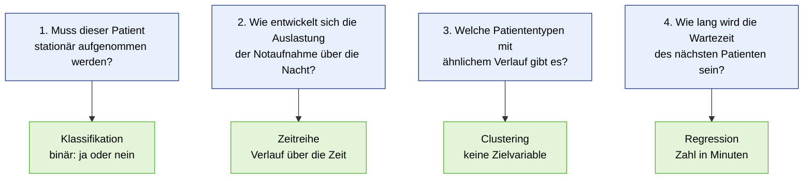
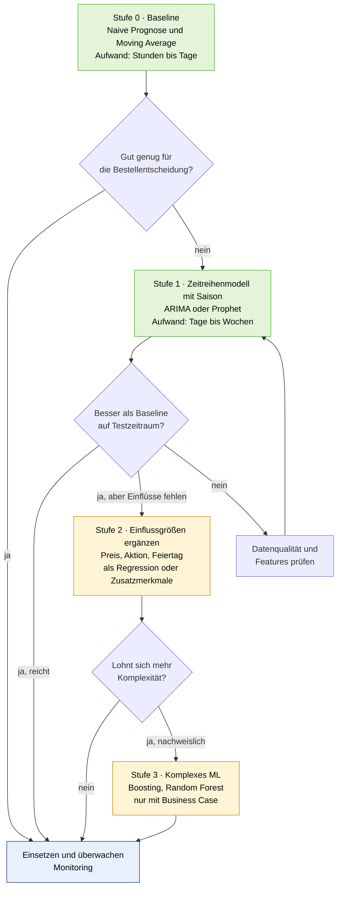
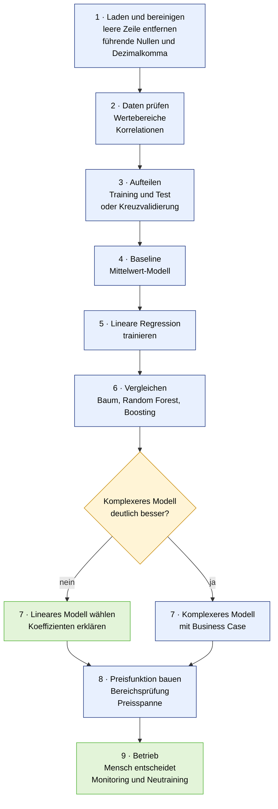

# UE 2 und UE 3 · Modellauswahl: Lösungsentwurf Arbeitsauftrag 1 und 2

*Arbeitsdatei, Basis: `05_01_UE1_ModellAuswahl.pdf`, Aufgaben in `05_02_UE2_Arbeitsauftrag1.pdf` und `05_03_UE3_Arbeitsauftrag2.pdf`. Allgemeine Begriffe und Formeln stehen im `00_Kompendium_Predictive_Analytics.md` (Abschnitte 7 und 8).*

> Bewertungen, Punktwerte und Annahmen zu den Szenarien sind begründete Einschätzungen, keine Messwerte. Sie sind als **Annahme** markiert und sollten vor einer Abgabe an eure Gruppe angepasst werden.

---

## 0. Das Handwerkszeug aus UE 1 in einer Seite

**Grundlogik:** Nicht mit dem Modell starten, sondern mit dem **Problem**. Die **Zielvariable bestimmt den Modelltyp**, nicht die verfügbaren Daten.


| Zielgröße | Problemtyp | Leitfrage | Beispiel-Verfahren (Folien) |
| --- | --- | --- | --- |
| **Zahl** | Regression | „Wie viel?" | lineare Regression, Entscheidungsbaum, Random Forest, Gradient Boosting |
| **Kategorie** | Klassifikation (binär oder mehrklassig) | „Welche Klasse?" | Baum, Random Forest, Boosting, **logistische Regression** (liefert Wahrscheinlichkeit, **Schwelle** macht daraus die Klasse) |
| **Verlauf über die Zeit** | Zeitreihe | „Wie entwickelt es sich?" | naive Prognose, Moving Average, ARIMA, Prophet |
| **keine Zielvariable** | Clustering (unüberwachtes Lernen) | „Welche Gruppen gibt es?" | Gruppen werden vom Modell selbst gefunden |

**Orientierungsraster (Folie 4 von UE 2):**
1. Ist die Zielgröße eine **Zahl**, eine **Kategorie** oder eine **Entwicklung über die Zeit**?
2. Gibt es **überhaupt** eine vorgegebene Zielvariable?
3. Welche **historischen Daten** würden für diese Vorhersage benötigt?

**Einflussfaktoren auf die Modellwahl (Folie 21):** Datenmenge und -qualität · Interpretierbarkeit vs. Genauigkeit · Rechenaufwand und Geschwindigkeit · Geschäftsanforderung.

**Wichtige Begriffe:** *Vorhersage* (möglichst treffsicher, „Was wird passieren?", Erklärbarkeit zweitrangig) gegen *Erklärung* (Zusammenhänge verstehen, „Warum passiert es?", wichtig für Maßnahmen) · überwachtes Lernen (mit Zielvariable) gegen unüberwachtes (ohne) · Underfitting (zu einfach, schlecht überall) gegen Overfitting (zu komplex, lernt Rauschen, schlecht auf neuen Daten).

---

# Teil 1 · Arbeitsauftrag 1: Vier Fragestellungen, welcher Problemtyp passt?

**Szenario:** Notaufnahme eines Krankenhauses. **Aufgaben:** (1) jeder Fragestellung einen Problemtyp zuordnen, (2) die Zuordnung begründen, (3) benennen, welche Daten jeweils nötig wären.

## 1.1 Überblick der Zuordnung



| # | Fragestellung | Problemtyp | Zielgröße | Lernart |
| --- | --- | --- | --- | --- |
| 1 | Muss dieser Patient stationär aufgenommen werden? | **Klassifikation** (binär) | Aufnahme ja / nein | überwacht |
| 2 | Wie entwickelt sich die Auslastung der Notaufnahme über die Nacht? | **Zeitreihe** | Auslastung je Zeitpunkt (z. B. stündlich) | überwacht (zeitlich geordnet) |
| 3 | Welche Patiententypen mit ähnlichem Verlauf gibt es? | **Clustering** | keine | unüberwacht |
| 4 | Wie lang wird die Wartezeit des nächsten Patienten sein? | **Regression** | Wartezeit in Minuten | überwacht |

## 1.2 Frage 1: Stationäre Aufnahme ja oder nein → Klassifikation (binär)

**Begründung**
- Orientierungsraster: Die Zielgröße ist eine **Kategorie mit zwei Ausprägungen** (aufnehmen / nicht aufnehmen). Es gibt eine vorgegebene Zielvariable und historische Fälle mit bekanntem Ausgang.
- Frage „**Welche Klasse?**", nicht „Wie viel?".
- Das Modell liefert in der Praxis eine **Wahrscheinlichkeit** („Aufnahme mit 87 %"), eine **Schwelle** macht daraus die Entscheidung.

**Daten**

| Datenart | Beispiele | Hinweis |
| --- | --- | --- |
| **Zielvariable (Label)** | historische Entscheidung: stationär aufgenommen ja/nein | zuverlässig und einheitlich dokumentiert? |
| **Patientenmerkmale** | Alter, Geschlecht, Vorerkrankungen, Medikation | Stammdaten |
| **Befunde bei Ankunft** | Triage-Stufe, Vitalwerte (Puls, Blutdruck, Sauerstoffsättigung, Temperatur), Leitsymptom/Beschwerde, Ankunftsart (Rettungsdienst, selbst) | **nur Werte, die zum Entscheidungszeitpunkt bekannt sind** |
| **Kontext** | Uhrzeit, Wochentag, Auslastung | optional |

**Wichtig**
- **Data Leakage vermeiden:** Die spätere Entlassdiagnose oder der Behandlungsverlauf wären nur nach der Aufnahme bekannt und dürfen nicht als Eingabe dienen.
- **Schwelle:** Übersehen eines Patienten, der aufgenommen werden müsste, ist teurer als ein Fehlalarm. Daher **niedrige Schwelle**, Metrik **Recall** (zusätzlich Precision, F1, ROC-AUC). Accuracy täuscht, falls eine Klasse selten ist.
- **Erklärbarkeit:** Medizinische Entscheidungen müssen nachvollziehbar sein (Folie 28/32: Erklärbarkeit kann Pflicht sein). Passend sind eher **logistische Regression oder Entscheidungsbaum**. Das Modell **unterstützt** die Ärztin oder den Arzt, es **ersetzt** die Entscheidung nicht.
- **Datenschutz:** Gesundheitsdaten sind besonders geschützte Daten (DSGVO, Art. 9). Zweckbindung, Pseudonymisierung und Zugriffsregeln sind Voraussetzung.

## 1.3 Frage 2: Auslastung über die Nacht → Zeitreihe

**Begründung**
- Die Zielgröße **verändert sich über die Zeit**, die **Reihenfolge der Werte zählt** (Abend → Nacht → Morgen).
- Gesucht ist eine **Entwicklung**, nicht ein einzelner Wert. **Trend, Saisonalität und Zyklen** (Tagesrhythmus, Wochentag) zählen (Folie 16).
- Abgrenzung zur Regression: Die Auslastung ist zwar eine Zahl, aber die **Zeit selbst** ist die tragende Information. Mit einer Regression ohne Zeitbezug würden Tagesmuster übersehen.

**Daten**

| Datenart | Beispiele |
| --- | --- |
| **Zielgröße als Verlauf** | Auslastung in kurzen Abständen (z. B. 15 Min. oder stündlich): belegte Behandlungsplätze, Anzahl wartender Patienten |
| **Historie** | mindestens mehrere Monate, besser **über ein Jahr** (Saison: Grippewelle, Sommer, Ferien) |
| **Zeitmerkmale** | Wochentag, Feiertag, Ferien, Uhrzeit |
| **Einflussgrößen** | Rettungsdienst-Einsätze, Großveranstaltungen, Wetter (Glatteis), Epidemielage, Personalbesetzung in der Nacht |

**Verfahren:** Als Basis die **naive Prognose** („nächster Wert ist der letzte") bzw. **Moving Average** (Durchschnitt der letzten *n* Werte), danach saisonale Modelle (**ARIMA, Prophet**). Neuere Werte erhalten mehr Gewicht.

**Praxis:** Training und Test **zeitlich trennen** (früher lernen, später prüfen), nicht zufällig mischen. Metriken: MAE, RMSE, MAPE (Vorsicht bei Werten nahe 0, z. B. leere Notaufnahme).

## 1.4 Frage 3: Patiententypen mit ähnlichem Verlauf → Clustering

**Begründung**
- Es gibt **keine vorgegebene Zielvariable**. Niemand sagt dem Modell vorher, welche Typen existieren.
- Das Modell soll **Gruppen selbst finden** (unüberwachtes Lernen, Folie 18/19). Frage „Welche Gruppen gibt es?".
- Clustering ist **oft Vorstufe für weitere Modelle** (z. B. später je Gruppe eine eigene Wartezeit-Prognose oder gezielte Prozesse).

**Daten**

| Datenart | Beispiele |
| --- | --- |
| **Verlaufsdaten je Patient** | Aufenthaltsdauer, Anzahl und Art der Untersuchungen (Labor, Bildgebung), Behandlungsschritte, Verlegung/Entlassung |
| **Patientenmerkmale** | Alter, Triage-Stufe, Leitsymptom, Vorerkrankungen |
| **Ressourcenverbrauch** | Personalaufwand, Zeit bis zur ersten Untersuchung |
| **Zeitmerkmale** | Ankunftszeit, Wochentag |

**Wichtig**
- Clustering ist **abstandsbasiert**. Merkmale vorher **skalieren** (z. B. Standardisierung) und Kategorien **kodieren**, sonst dominiert z. B. die Aufenthaltsdauer in Minuten gegenüber dem Alter in Jahren.
- **Bewertung:** Silhouette-Koeffizient (technisch) **und fachliche Deutung** mit dem Klinikpersonal: Ergeben die Gruppen medizinisch oder organisatorisch Sinn?
- Die **Anzahl der Gruppen** ist eine Entscheidung (mehrere Varianten testen und vergleichen).

## 1.5 Frage 4: Wartezeit des nächsten Patienten → Regression

**Begründung**
- Die Zielgröße ist eine **kontinuierliche Zahl** (Minuten). Frage „**Wie viel?**". Das Ergebnis ist ein konkreter Wert.
- Das Modell soll aus Eingaben (Warteschlange, Triage, Personal) einen Wert für **einen** Fall berechnen. Der Verlauf über die Zeit ist hier nicht die Zielgröße, sondern nur Eingabe (Uhrzeit, aktuelle Auslastung).

**Daten**

| Datenart | Beispiele |
| --- | --- |
| **Zielvariable** | gemessene Wartezeit je Patient (Ankunft bis Behandlungsbeginn, in Minuten) |
| **Zustand bei Ankunft** | Anzahl wartender Patienten, deren Triage-Stufen, belegte Plätze |
| **Patient selbst** | Triage-Stufe (höhere Priorität überholt), Leitsymptom |
| **Kapazität** | Anzahl verfügbarer Ärztinnen/Ärzte und Pflegekräfte, Schichtbeginn |
| **Zeit** | Uhrzeit, Wochentag, Feiertag |

**Hinweis zur Abgrenzung (Diskussionspunkt):** Man könnte die Wartezeit auch als **Zeitreihe** der Wartezeiten modellieren. Gefragt ist aber die Wartezeit **des nächsten Patienten**, also ein Einzelwert aus aktuellen Eingaben. Das spricht für **Regression** (mit Zeitmerkmalen). Die Zuordnung ist hier **kontextabhängig** und sollte im Plenum begründet werden (vgl. Folie 27: „Zeitreihe oder Regression").

**Metriken:** MAE (Fehler in Minuten leicht verständlich), RMSE (große Fehler zählen stärker). Patienten reagieren auf deutlich zu kurze Angaben besonders empfindlich, daher ist die **Fehlerrichtung** zu beachten.

## 1.6 Zusammenfassung: Orientierungsraster angewendet

| Frage | Zahl, Kategorie oder Zeit? | Vorgegebene Zielvariable? | Benötigte historische Daten | Besonderes |
| --- | --- | --- | --- | --- |
| 1 Aufnahme | **Kategorie** (binär) | ja | Fälle mit Befunden und tatsächlicher Aufnahme | Leakage, Schwelle, Erklärbarkeit, Datenschutz |
| 2 Auslastung | **Entwicklung über Zeit** | ja (Auslastung selbst) | Auslastung in kurzem Takt über ≥ 1 Jahr | Saison, Wochentag, zeitliche Trennung |
| 3 Patiententypen | – | **nein** | Verlaufs- und Ressourcendaten je Patient | Skalieren, fachliche Deutung |
| 4 Wartezeit | **Zahl** | ja | gemessene Wartezeiten + Zustand bei Ankunft | Abgrenzung zur Zeitreihe |

## 1.7 Einordnung nach den Einflussfaktoren (Folie 5 von UE 2)

| Frage | Datenmenge und -qualität | Interpretierbarkeit vs. Genauigkeit | Geschäftsanforderung |
| --- | --- | --- | --- |
| 1 Aufnahme | Label-Qualität entscheidend (Dokumentation) | **Interpretierbarkeit hoch** (medizinisch, ggf. regulatorisch) | Entscheidungsunterstützung am Behandlungsplatz, Übersehen vermeiden |
| 2 Auslastung | Lücken und Ausreißer prüfen, Historie über Saison | Genauigkeit wichtiger, Erklärbarkeit mittel | Personalplanung der Nacht |
| 3 Typen | Viele Merkmale, Skalierung | Deutbarkeit der Gruppen wichtiger als Zahl | Prozesse und Kapazitäten nach Typ planen |
| 4 Wartezeit | ausreichend Einzelfälle | Genauigkeit mittel, einfach erklärbar | Patienten informieren, Erwartung steuern |

---

# Teil 2 · Arbeitsauftrag 2: Modellwahl und Abwägung

**Aufgaben:** (1) jede Option bewerten (Eignung, Aufwand), (2) eine begründete Entscheidung treffen, (3) Risiken falscher Modellwahl benennen.

## 2.1 Szenario Nachfrageprognose

**Drei Optionen:** A) einfaches Regressionsmodell · B) komplexes Machine-Learning-Modell · C) Zeitreihenmodell.
**Rahmenbedingungen:** Datenqualität **mittelmäßig** · Zeitdruck **hoch** · Budget **begrenzt**.

**Problemdefinition (Annahme, siehe Folie 27 UE 1):**
- Geschäftsproblem: Lager optimal füllen.
- Zielvariable: **verkaufte Menge je Woche** (je Produkt oder Produktgruppe), eine Zahl über die Zeit.
- Handlung: bedarfsgerecht bestellen.

Da die Zielgröße **sowohl eine Zahl als auch ein Verlauf** ist, kommen laut Folie 27 „Zeitreihe oder Regression" in Frage. Entscheidend ist, ob die **Zeit selbst** (Trend, Saison) oder **Einflussgrößen** (Preis, Aktion) im Vordergrund stehen.

## 2.2 Bewertung der Optionen

### Was steckt hinter den Optionen?

| Option | Beschreibung | Typische Verfahren |
| --- | --- | --- |
| **A) Einfaches Regressionsmodell** | Absatz als Funktion von Einflussgrößen (Preis, Aktion, Monat, Feiertag) | lineare Regression, Entscheidungsbaum |
| **B) Komplexes ML-Modell** | viele Merkmale, nichtlineare Muster | Random Forest, Gradient Boosting, neuronales Netz |
| **C) Zeitreihenmodell** | lernt Trend und Saisonalität aus der eigenen Historie und schreibt sie fort | naive Prognose, Moving Average, ARIMA, Prophet |

### Bewertung nach Kriterien

Skala 1 (ungünstig) bis 5 (günstig). Die Punkte sind eine **begründete Schätzung**.

| Kriterium | Gewicht (Annahme) | A) Regression | B) Komplexes ML | C) Zeitreihe |
| --- | :---: | :---: | :---: | :---: |
| **Eignung für die Zielgröße** (Absatz je Woche mit Saison) | 30 % | 3 | 4 | **5** |
| **Aufwand / Umsetzungsgeschwindigkeit** (Zeitdruck) | 25 % | 4 | 1 | **4** |
| **Kosten** (Budget) | 15 % | 4 | 2 | **4** |
| **Robustheit bei mittelmäßiger Datenqualität** | 15 % | 4 | 2 | 3 |
| **Erklärbarkeit** (Einkauf, Management) | 15 % | **5** | 1 | 4 |
| **Gewichtete Summe (max. 5,0)** | 100 % | **3,85** | **2,20** | **4,15** |

*Rechenweg Beispiel C:* 0,30·5 + 0,25·4 + 0,15·4 + 0,15·3 + 0,15·4 = 1,5 + 1,0 + 0,6 + 0,45 + 0,6 = **4,15**.
*A:* 0,30·3 + 0,25·4 + 0,15·4 + 0,15·4 + 0,15·5 = 0,9 + 1,0 + 0,6 + 0,6 + 0,75 = **3,85**.
*B:* 0,30·4 + 0,25·1 + 0,15·2 + 0,15·2 + 0,15·1 = 1,2 + 0,25 + 0,3 + 0,3 + 0,15 = **2,20**.

> Die Rangfolge **C > A > B** hängt nicht an den genauen Gewichten: Verschiebt man die Gewichte moderat, bleibt B wegen Aufwand und Erklärbarkeit unter den Rahmenbedingungen deutlich hinten. Das ist der eigentliche Befund.

### Eignung und Aufwand im Überblick (Aufgabe 1)

| | **Eignung** | **Aufwand** | Stärken | Schwächen |
| --- | --- | --- | --- | --- |
| **A) Regression** | **mittel** | **gering bis mittel** | einfach, schnell, **sehr gut erklärbar**, robust bei wenig Daten (Folie 23: einfache Modelle, weniger Overfitting) | **kennt die Zeit nicht von sich aus**: Trend und Saison nur über selbst gebaute Features (Monat, Lag, Feiertag) |
| **B) Komplexes ML** | **mittel bis hoch** (nur bei guter Datenlage) | **hoch** | kann nichtlineare Zusammenhänge und viele Einflussgrößen verarbeiten, potenziell höchste Genauigkeit | **Black Box**, braucht **viele und gute Daten**, aufwändiges Feature Engineering und Tuning, Overfitting-Gefahr, hoher Zeit- und Kostenbedarf |
| **C) Zeitreihe** | **hoch** | **gering bis mittel** | **passt direkt zur Zielgröße** (Verlauf, Trend, Saison), schon die Baselines (naiv, Moving Average) sind in **Stunden** umgesetzt, benötigt nur die Absatzhistorie | reagiert schwach auf externe Einflüsse (Aktion, Preis), braucht ausreichend lange und lückenfreie Historie, Strukturbrüche stören |

## 2.3 Begründete Entscheidung (Aufgabe 2)

**Empfehlung: Option C (Zeitreihenmodell) als Einstieg, stufenweise ausgebaut. Option A als Ergänzung für Einflussgrößen. Option B erst später und nur bei nachgewiesenem Nutzen.**



**Begründung (Argumente, jeweils mit Folienbezug)**

1. **Zielvariable entscheidet (Folie 6, 27):** Die Menge je Woche ist ein **Verlauf mit Trend und Saison**. Ein Zeitreihenmodell bildet das direkt ab. Ein reines Regressionsmodell würde Trend und Saison übersehen (Folge: Spitzen unterschätzt, Flauten überschätzt).
2. **Zeitdruck hoch:** Naive Prognose und Moving Average sind sofort lauffähig und liefern eine **erste belastbare Zahl**, mit der Einkauf bereits arbeiten kann. Das Projekt liefert früh Nutzen und wird iterativ verbessert.
3. **Budget begrenzt:** Ein Zeitreihenmodell braucht nur die Absatzhistorie, keine aufwändige Datenbeschaffung und kein großes Feature-Engineering. Komplexes ML verursacht hohen Entwicklungs-, Rechen- und Wartungsaufwand.
4. **Datenqualität mittelmäßig (Folie 23):** Bei mäßigen Daten sind **einfache, robuste Modelle** im Vorteil, weil komplexe Modelle Rauschen und Fehler „auswendig lernen" (Overfitting). Zuerst Lücken und Ausreißer prüfen.
5. **Erklärbarkeit:** Einkauf und Management müssen der Zahl vertrauen. Einfache Modelle lassen sich in einem Satz erklären („Absatz entspricht dem Vorjahr plus Trend"). Komplexes ML ist schwer erklärbar (Folie 11, 22).
6. **Management-Sicht (Folie 28/29):** Die Entscheidung ist nicht nur technisch. Es gibt **kein „bestes" Modell**, nur das beste im Kontext aus Daten, Ziel und Anforderungen. **Kontext schlägt Ideologie.**
7. **Overengineering vermeiden (Folie 24):** Der häufige Fehler ist, mit dem anspruchsvollsten Modell zu starten statt mit dem Problem.

**Wann wechselt man zu B?** Wenn (a) Stufe 1/2 **nachweislich** nicht genügt (Fehler bleibt trotz Baseline-Vergleich zu hoch), (b) ausreichend **Daten und Qualität** vorliegen, (c) der **Mehrnutzen** (weniger Lagerkosten, weniger Ausverkauf) den Aufwand **rechtfertigt** und (d) **Erklärbarkeit** nicht verpflichtend ist.

**Wie wird die Entscheidung abgesichert?**
- **Baseline-Vergleich:** Jedes komplexere Modell muss die naive Prognose schlagen.
- **Zeitliche Trennung:** Training auf früheren, Test auf späteren Wochen. Zufälliges Mischen wäre Data Leakage.
- **Metriken:** MAE (in Stück), RMSE (große Fehlbestände stärker gewichtet), MAPE (Prozent, nicht bei Absatz nahe 0).
- **Monitoring:** Abweichung zwischen Prognose und Ist laufend beobachten (Drift).

## 2.4 Risiken durch falsche Modellwahl (Aufgabe 3)

### 2.4.1 Risiko je Option, wenn sie die falsche Wahl wäre

| Wenn wir wählen … | … und es war falsch, weil … | Konsequenz |
| --- | --- | --- |
| **A) Regression statt Zeitreihe** | Trend und Saison nicht abgebildet | Frühjahrsspitze unterschätzt (Ausverkauf), Herbst überschätzt (Ware bleibt liegen): **genau das Ausgangsproblem bleibt** |
| **B) Komplexes ML** bei mittelmäßigen Daten, wenig Zeit und Geld | Datenmenge/-qualität reichen nicht, Aufwand zu hoch | **Overfitting** (glänzt im Training, versagt in der Praxis), Black Box ohne Vertrauen, Projekt **zu spät** oder abgebrochen, Budget verbrannt (Overengineering) |
| **C) Zeitreihe** | externe Einflüsse dominieren (Aktionen, Preissprünge) oder Strukturbruch (neue Produktgruppen) | Prognose reagiert zu langsam, Aktionen verfehlt. Gegenmaßnahme: Einflussgrößen ergänzen (Stufe 2) |
| **Zu einfaches Modell** | Muster werden nicht erfasst | **Underfitting**: schlecht überall |

### 2.4.2 Typische Fehler der Praxis (Folie 24) und was sie hier bedeuten

| Fehler | Beispiel im Szenario |
| --- | --- |
| **Falsche Problemdefinition** | „Absatz" prognostiziert, obwohl die **Nachfrage** gebraucht wird: bei Ausverkauf sieht man nur den Absatz, nicht die verpasste Nachfrage |
| **Overengineering** | Komplexes ML als Startpunkt trotz Zeitdruck und mittelmäßiger Daten |
| **Geschäftsanforderung ignoriert** | Hohe Genauigkeit, aber Einkauf kann die Zahl nicht nachvollziehen und vertraut ihr nicht |
| **Mit dem Modell statt dem Problem starten** | „Wir brauchen ein neuronales Netz" statt „Wir müssen Bestände planen" |

### 2.4.3 Weitere Risiken

| Risiko | Auswirkung | Gegenmaßnahme |
| --- | --- | --- |
| **Data Leakage** (z. B. Zufallssplit bei Zeitreihen, Wochensumme als Feature) | Test sieht gut aus, Betrieb enttäuscht | zeitliche Trennung, Features nur aus der Vergangenheit |
| **Kein Monitoring** | Drift bleibt unbemerkt (Konsumverhalten ändert sich) | laufender Vergleich Prognose gegen Ist, Neutraining |
| **Schlechte Datenqualität** | Garbage in, garbage out, auch beim besten Modell | Cleaning vor Modellierung, Lücken und Ausreißer prüfen |
| **Vertrauensverlust** | Fachbereich lehnt Prognose ab | einfach starten, Ergebnisse erklären, gemeinsam validieren |
| **Zeit- und Kostenverlust** | Neustart des Projekts bei falscher Wahl | Stufenmodell mit Entscheidungspunkten, früh Nutzen zeigen |
| **Scheinsicherheit** | Gute Kennzahl auf Trainingsdaten | immer auf ungesehenen Zeiträumen testen |

**Kernaussage:** Eine falsche Modellwahl kostet **Zeit, Vertrauen und Budget**. Das Risiko sinkt, wenn man **mit dem Problem startet**, **einfach beginnt**, **gegen eine Baseline testet** und **bewusst eskaliert**.

---

# Teil 3 · Arbeitsauftrag 2 auf den Notebook-Daten: Preisempfehlung

*Das Aufgabenpaket zu UE 3 enthält zwei Szenarien: die **Preisempfehlung für Notebooks** (Folie 2, mit CSV mit 500 Zeilen `05_Notebookpreise_Arbeitsauftrag.csv`) und die **Nachfrageprognose** (Folie 3, Teil 2 oben). Die drei Aufgaben (Modellwahl bewerten, begründet entscheiden, Risiken benennen) lassen sich auf beide anwenden. Dieser Teil wendet sie auf die **echten Notebook-Daten** an. Alle Zahlen stammen aus dem Skript `05_Notebookpreise_Modell.py`, das sich mit dem Befehl am Ende dieses Teils neu erzeugen lässt.*

## 3.1 Problemdefinition

| Frage | Antwort |
| --- | --- |
| Geschäftsproblem | Für ein neues Notebook einen **marktgerechten Verkaufspreis** empfehlen |
| Zielvariable | `Preis_EUR` (stetige Zahl) |
| Eingaben | `Display_Zoll`, `Akku_Wh`, `RAM_GB`, `SSD_GB`, `Gewicht_g` (alle numerisch) |
| Daten | **500** Notebooks mit bekanntem Preis |
| Spielt die Zeit eine Rolle? | **nein**, jede Zeile ist ein eigenes Gerät, es gibt keine Datumsspalte |
| **Problemtyp** | **Regression** („Wie viel?"), überwachtes Lernen |
| Handlung | Vertrieb setzt auf Basis der Empfehlung den Preis fest |

Damit scheidet **Option C (Zeitreihe)** aus: Es gibt keinen Verlauf über die Zeit. Übrig bleiben **A) einfache Regression** und **B) komplexes ML**.

## 3.2 Datencheck (gemessen)

| Prüfung | Befund | Folge |
| --- | --- | --- |
| Zeilen | 501 gelesen, **1 leere Zeile am Ende** (`,,,,,,`, ein Excel-Artefakt wie beim Bestelldaten-Export) | `dropna(how="all")`, danach **500** |
| `Display_Zoll` | Werte wie `00000000014` (führende Nullen), nur **13, 14, 15, 16, 17** | als Zahl einlesen (`pd.to_numeric`) |
| `Preis_EUR` | Dezimalkomma in Anführungszeichen (`"899,00"`) | Komma durch Punkt ersetzen, dann Zahl |
| Fehlende Werte | **0** | kein Imputing nötig |
| Duplikate | **0** (Modellnamen und Merkmalskombinationen) | nichts zu entfernen |
| Wertebereich | RAM 8 bis 64 GB (4 Stufen), SSD 256 bis 2048 GB (4 Stufen), Gewicht 1010 bis 2400 g, Preis 699 bis 2048 € | Modell gilt **nur in diesem Bereich** |

**Zusammenhänge mit dem Preis (Korrelation):**

| Merkmal | Korrelation mit Preis |
| --- | :---: |
| `RAM_GB` | **0,77** |
| `SSD_GB` | **0,62** |
| `Gewicht_g` | 0,27 |
| `Display_Zoll` | 0,22 |
| `Akku_Wh` | 0,17 |

**Korrelation der Merkmale untereinander (Multikollinearität):** `Display_Zoll` und `Gewicht_g` 0,71, `Display_Zoll` und `Akku_Wh` 0,63, `Akku_Wh` und `Gewicht_g` 0,50. **RAM und SSD sind praktisch unabhängig** voneinander (0,02) und voneinander unabhängig vom Gehäuse. Der Preis wird also vor allem von zwei „unabhängigen Hebeln" getrieben, Gehäusemerkmale (Display, Akku, Gewicht) bewegen sich gemeinsam.

| RAM | Anzahl | Ø Preis | | SSD | Anzahl | Ø Preis |
| --- | :---: | ---: | --- | --- | :---: | ---: |
| 8 GB | 130 | 988 € | | 256 GB | 119 | 1.030 € |
| 16 GB | 117 | 1.116 € | | 512 GB | 129 | 1.135 € |
| 32 GB | 127 | 1.267 € | | 1024 GB | 132 | 1.276 € |
| 64 GB | 126 | 1.630 € | | 2048 GB | 120 | 1.564 € |

## 3.3 Aufgabe 1: Optionen bewerten (Eignung, Aufwand), mit Messwerten

**Vorgehen der Messung:** 5-fache Kreuzvalidierung auf allen 500 Zeilen. Das Modell wird fünfmal auf 400 Zeilen trainiert und jeweils auf 100 **ungesehenen** Zeilen geprüft. **Baseline** ist ein „Modell", das immer den mittleren Preis nennt.

| Modell | Option | MAE (€) | Streuung MAE | R² |
| --- | :---: | ---: | ---: | ---: |
| Baseline: immer der Mittelwert | – | 267,39 | 15,49 | −0,01 |
| **Lineare Regression** | **A** | **33,10** | 1,02 | **0,98** |
| Entscheidungsbaum (Tiefe 4) | A/B | 58,33 | 4,13 | 0,95 |
| Random Forest (200 Bäume) | B | 40,35 | 2,82 | 0,97 |
| Gradient Boosting | B | 37,23 | 2,12 | 0,98 |

*MAE = mittlerer absoluter Fehler in Euro, R² = Anteil der erklärten Schwankung (1,0 ist perfekt). Alle Modelle mit Standardeinstellungen, ohne Feintuning.*

| | **Eignung** | **Aufwand** | Stärken | Schwächen |
| --- | --- | --- | --- | --- |
| **A) Einfache (lineare) Regression** | **hoch**: MAE 33 € bei Preisen um 1.250 € (rund 2,6 %) | **gering**: wenige Zeilen Code, Training in Millisekunden | beste Genauigkeit im Test, jeder Koeffizient in Euro erklärbar, robust, kein Tuning | nur lineare Zusammenhänge, Koeffizienten korrelierter Merkmale nur vorsichtig deutbar |
| **B) Komplexes ML (Random Forest, Boosting)** | **hoch**, aber **nicht besser** als A | **mittel bis hoch**: Tuning, Validierung, mehr Rechenzeit | erfasst Nichtlinearität und Wechselwirkungen automatisch | **im Test schlechter als A** (37 und 40 € gegen 33 €), Black Box, mit 500 Zeilen Overfitting-Gefahr |
| **C) Zeitreihe** | **nicht anwendbar** | – | – | keine Zeitachse in den Daten |

## 3.4 Aufgabe 2: Begründete Entscheidung

**Empfehlung: Option A, lineare Regression.** Random Forest oder Boosting nur als Vergleich im Hintergrund behalten.

**Begründung**
1. **Messbar am besten:** Die lineare Regression hat den **kleinsten Fehler (33 €)**, der Unterschied zu Boosting (37 €) ist aber klein. Wichtiger ist die geringe Streuung zwischen den fünf Durchläufen (1 €), das Modell ist **stabil**.
2. **Passend zur Datenlage (Folie 23):** Mit nur 500 Zeilen und 5 Merkmalen im Verhältnis zur Aufgabe sind einfache Modelle im Vorteil. Das komplexere Modell findet **kein Muster, das die lineare Gerade übersieht**, und zahlt dafür mit Overfitting-Risiko.
3. **Erklärbarkeit (Folie 21, 28):** Eine Preisempfehlung muss gegenüber Vertrieb und Kunden begründbar sein. Das lineare Modell liefert sie fertig (siehe Tabelle unten).
4. **Aufwand und Wartung:** Ein einfaches Modell lässt sich schnell einführen, prüfen und übergeben. **Kontext schlägt Ideologie:** Hier ist das einfache Modell das genauere **und** das erklärbare. Das ist der Idealfall, kein Zufall: Der Preis hängt in diesen Daten offenbar nahezu linear an RAM und SSD.
5. **Baseline-Regel eingehalten:** Jedes Modell schlägt den Mittelwert um Welten (267 € gegen 33 €). Das komplexe Modell schlägt aber die **einfache Alternative nicht**, damit gibt es keinen Grund für B (Overengineering vermeiden, Folie 24).

**Was das Modell gelernt hat (Hold-out 80/20, Regressionsgleichung):**

$$\text{Preis} \approx 162{,}3 + 27{,}8\cdot\text{Display} + 1{,}64\cdot\text{Akku} + 10{,}9\cdot\text{RAM} + 0{,}286\cdot\text{SSD} - 0{,}027\cdot\text{Gewicht}$$

| Merkmal | Koeffizient | Lesart für den Vertrieb | Wichtigkeit (Permutation) |
| --- | ---: | --- | ---: |
| `RAM_GB` | +10,88 € je GB | 16 GB mehr Arbeitsspeicher: **etwa +174 €** | **225** |
| `SSD_GB` | +0,286 € je GB | 1 TB mehr Speicher: **etwa +293 €** | **167** |
| `Display_Zoll` | +27,84 € je Zoll | ein Zoll mehr: etwa +28 € | 21 |
| `Akku_Wh` | +1,64 € je Wh | 10 Wh mehr: etwa +16 € | 3 |
| `Gewicht_g` | −0,027 € je g | 100 g schwerer: etwa −2,7 € | 0,6 |

*Wichtigkeit = um wie viele Euro der Fehler (MAE) steigt, wenn man das Merkmal durchmischt. Je größer, desto mehr stützt sich das Modell darauf.*

**Aussagen daraus**
- **RAM und SSD bestimmen den Preis.** Zusammen erklären sie praktisch das ganze Modell. Display, Akku und Gewicht tragen kaum etwas bei.
- **Vorsicht bei der Deutung von Gewicht und Akku:** Sie hängen eng mit dem Display zusammen (Korrelation 0,5 bis 0,7). Das negative Vorzeichen beim Gewicht heißt **nicht**, dass leichtere Geräte teurer *sind*, sondern dass bei gleichem Display, Akku, RAM und SSD ein Gramm mehr kaum Preis bringt. Einzelne Koeffizienten korrelierter Merkmale sind **unsicher**. Die Empfehlung ist dennoch stabil, weil sie auf der Summe beruht.
- **Mögliche Vereinfachung (nicht getestet):** Gewicht und Akku weglassen und prüfen, ob der Fehler gleich bleibt. Das wäre ein einfacheres, gleich gutes Modell.

**Beispiel:** Notebook mit 15 Zoll, 65 Wh, 16 GB RAM, 512 GB SSD, 1400 g → empfohlener Preis **969 €**.

**Genauigkeit im Test (Hold-out, 100 Notebooks):** MAE **33,6 €**, RMSE 42,9 €, R² 0,981. **97 %** der Prognosen liegen innerhalb von ±100 €, größte Abweichungen 129 € (Unterschätzung) und 114 € (Überschätzung), mittlere Verzerrung −4 €. Das ist **ein** Datensplit, mit anderer Zufallsaufteilung ändern sich diese Werte leicht.

## 3.5 Aufgabe 3: Risiken durch falsche Modellwahl

| Wenn wir wählen … | Risiko im Notebook-Szenario | Gegenmaßnahme |
| --- | --- | --- |
| **B) Komplexes ML** | Mehr Aufwand ohne Mehrnutzen (im Test sogar schlechter). **Black Box:** Vertrieb kann den Preis nicht erklären. Overfitting bei nur 500 Zeilen. | Nur nehmen, wenn es A in der Validierung **deutlich** schlägt |
| **A) Lineare Regression** | Bei **Wechselwirkungen oder Sprüngen** im Markt (z. B. Spitzenmodelle mit Premiumaufschlag) systematisch zu niedrige oder zu hohe Preise an den Rändern | Residuen (Prognose minus Ist) nach RAM und SSD prüfen, bei Mustern Entscheidungsbaum oder Boosting vergleichen |
| **C) Zeitreihe** | Passt nicht zur Aufgabe (keine Zeitachse). Wäre eine **falsche Problemdefinition** | Zielvariable und Datenstruktur zuerst prüfen |
| **Zu einfach** | **Underfitting**: wichtige Einflüsse fehlen | Fehler gegen Baseline und komplexere Modelle vergleichen |

**Weitere Risiken, speziell hier**

| Risiko | Auswirkung | Gegenmaßnahme |
| --- | --- | --- |
| **Fehlende Merkmale** | Marke, Prozessor, Grafikkarte und Display-Qualität prägen reale Preise stark, hier aber nicht vorhanden. R² von 0,98 ist **auffällig sauber**, vermutlich ein vereinfachter Übungsdatensatz. In der Realität bliebe mehr Restfehler. | Zusätzliche Merkmale beschaffen, Erwartung an die Genauigkeit realistisch halten |
| **Extrapolation** | Das Modell kennt nur RAM 8 bis 64 GB, SSD 256 bis 2048 GB, Display 13 bis 17 Zoll. Für ein 128-GB-Gerät rechnet es **blind** weiter. | Eingaben auf den Wertebereich prüfen, außerhalb **keine** automatische Empfehlung |
| **Marktveränderung (Drift)** | Komponentenpreise und Wettbewerb ändern sich, das Modell veraltet | regelmäßig neu trainieren, Prognose mit aktuellen Verkaufspreisen vergleichen |
| **Falsche Verantwortung** | Preis wird blind übernommen | Empfehlung ist ein **Vorschlag**, der Mensch entscheidet |
| **Datenfehler beim Einlesen** | Führende Nullen und Dezimalkomma als Text: Spalten werden nicht als Zahl gelesen, Modell läuft mit falschen Daten oder bricht ab | Einlesen mit expliziter Konvertierung und Prüfung (siehe Skript) |
| **Scheinsicherheit** | Gute Kennzahl nur auf Trainingsdaten | immer auf **ungesehenen** Daten testen (Hold-out, Kreuzvalidierung) |

## 3.6 Umsetzung: so setzt ihr die Empfehlung um



### Schritt für Schritt

| # | Schritt | Konkret | Ergebnis |
| --- | --- | --- | --- |
| 1 | **Laden und bereinigen** | CSV als Text einlesen, leere Zeile entfernen, `Display_Zoll` und `Preis_EUR` in Zahlen umwandeln (Dezimalkomma ersetzen) | saubere Tabelle mit 500 Zeilen |
| 2 | **Prüfen** | fehlende Werte, Duplikate, Wertebereiche, Korrelationen ansehen | Wissen über Daten und Grenzen |
| 3 | **Aufteilen** | `train_test_split` 80/20 oder Kreuzvalidierung | Daten fürs Testen bleiben ungesehen |
| 4 | **Baseline** | `DummyRegressor` (Mittelwert) | Messlatte: 267 € Fehler |
| 5 | **Linear trainieren** | `LinearRegression` (mit `StandardScaler` nur, wenn man Koeffizienten vergleichen oder regularisieren will) | erster Kandidat |
| 6 | **Vergleichen** | Baum, Random Forest, Boosting mit den gleichen Daten und Metriken | Tabelle wie in 3.3 |
| 7 | **Entscheiden** | Kriterien: Fehler **und** Erklärbarkeit **und** Aufwand | hier: Linear |
| 8 | **Funktion bauen** | `empfehle_preis(...)` mit Eingabeprüfung und Preisspanne | nutzbar für den Vertrieb |
| 9 | **Betrieb** | Empfehlung als Vorschlag, regelmäßig mit echten Verkäufen vergleichen, neu trainieren | langfristig verlässlich |

### Code-Kern (vollständig in `05_Notebookpreise_Modell.py`)

```python
import pandas as pd
from sklearn.linear_model import LinearRegression
from sklearn.model_selection import KFold, cross_validate

MERKMALE = ["Display_Zoll", "Akku_Wh", "RAM_GB", "SSD_GB", "Gewicht_g"]

# 1 · Laden und bereinigen
df = pd.read_csv("05_Notebookpreise_Arbeitsauftrag.csv", dtype=str).dropna(how="all")
for spalte in MERKMALE:
    df[spalte] = pd.to_numeric(df[spalte])                      # "00000000014" -> 14
df["Preis_EUR"] = pd.to_numeric(df["Preis_EUR"].str.replace(",", ".", regex=False))

# 3-5 · Kreuzvalidierung der linearen Regression
X, y = df[MERKMALE], df["Preis_EUR"]
cv = KFold(n_splits=5, shuffle=True, random_state=42)
ergebnis = cross_validate(LinearRegression(), X, y, cv=cv, scoring="neg_mean_absolute_error")
print("MAE:", round(-ergebnis["test_score"].mean(), 1), "EUR")   # ca. 33 EUR

# 8 · Preisfunktion mit Bereichsprüfung
modell = LinearRegression().fit(X, y)
GRENZEN = {s: (X[s].min(), X[s].max()) for s in MERKMALE}

def empfehle_preis(display_zoll, akku_wh, ram_gb, ssd_gb, gewicht_g, spanne=100):
    neu = pd.DataFrame([dict(zip(MERKMALE, [display_zoll, akku_wh, ram_gb, ssd_gb, gewicht_g]))])
    for spalte, (unten, oben) in GRENZEN.items():
        if not unten <= neu[spalte].iloc[0] <= oben:
            raise ValueError(f"{spalte} außerhalb des Trainingsbereichs {unten}..{oben}")
    preis = float(modell.predict(neu)[0])
    return round(preis), (round(preis - spanne), round(preis + spanne))

print(empfehle_preis(15, 65, 16, 512, 1400))   # (970, (870, 1070))
```

*Der Code-Kern ist gekürzt aus dem Skript. Die Preisfunktion trainiert hier auf allen 500 Zeilen (daher 970 € statt 969 € beim 80/20-Modell). Das ist erst **nach** der Validierung in Schritt 3 bis 7 sinnvoll. Die Spanne von ±100 € beruht auf dem Test-Split (97 % der Prognosen innerhalb davon), sie ist keine statistische Garantie.*

### Ausführen

```bash
.venv/bin/python 05_Notebookpreise_Modell.py
```

Das Skript gibt in sechs Abschnitten Datencheck, Zusammenhänge, Modellvergleich, Deutung, Fehleranalyse und ein Beispiel aus.

### Verbesserungen für später (nicht getestet)

| Idee | Zweck |
| --- | --- |
| Gewicht und Akku weglassen | einfacheres Modell, gleicher Fehler? |
| Wechselwirkung `RAM × SSD` als Merkmal | prüfen, ob Premiumgeräte nichtlinear teurer sind |
| Logarithmus des Preises als Ziel | relative statt absolute Fehler, falls teure Geräte stärker streuen |
| Random Forest und Boosting **abstimmen** (Tiefe, Lernrate) | fairer Vergleich, denn hier liefen alle mit Standardwerten |
| Marke, CPU, GPU ergänzen | größter erwarteter Zugewinn in der Praxis |

**Kernaussage Teil 3:** Auf **diesen** Daten ist das **einfachste Modell das beste**: genauer als die komplexen, vollständig erklärbar und schnell umgesetzt. Genau das meint die Folie „Es gibt kein bestes Modell": Man entscheidet **mit Messung und Kontext**, nicht mit Vorliebe für Komplexität.

---

# Gesamtübersicht und Diskussionsvorbereitung

## Kernaussagen

| # | Aussage |
| --- | --- |
| 1 | Die **Zielvariable** entscheidet über den Modelltyp (Zahl → Regression, Kategorie → Klassifikation, Verlauf → Zeitreihe, keine → Clustering). |
| 2 | **Nicht mit dem Modell starten, mit dem Problem.** Erst Geschäftsfrage, dann Zielgröße, dann Modell. |
| 3 | Es gibt **kein „bestes" Modell**, nur das beste im Kontext aus Daten, Ziel und Anforderungen. |
| 4 | **Einfach beginnen**, gegen eine **Baseline** testen, nur bei **nachgewiesenem Nutzen** komplexer werden. |
| 5 | **Interpretierbarkeit gegen Genauigkeit** ist der zentrale Trade-off. Wo Erklärbarkeit Pflicht ist (Medizin, Kredit), gewinnt das erklärbare Modell. |
| 6 | Modellwahl ist eine **Managemententscheidung**: Sie prägt Entscheidungen und Risiken, das Management muss die Konsequenzen verstehen. |

## Wo könnten Zuordnungen abweichen?

- **Notaufnahme Frage 2 und 4:** Beide haben mit Zeit zu tun. Frage 2 fragt nach dem **Verlauf** (Zeitreihe), Frage 4 nach einem **Einzelwert** für den nächsten Fall (Regression). Man kann Frage 4 auch als Zeitreihe lesen, wenn man die Warteschlange fortschreibt.
- **Nachfrageprognose A und C:** „Verkaufte Menge je Woche" ist Zahl **und** Verlauf. Entscheidend ist, ob Zeit oder Einflussgrößen im Vordergrund stehen. Die Praxis kombiniert beides.
- **Arbeitsauftrag 2, welches Szenario?** Das Paket enthält Notebook-Preise (Folie 2) und Nachfrageprognose (Folie 3 mit den Optionen A bis C). Die Optionen mit Zeitreihe passen nur zur Nachfrage, deshalb sind beide Szenarien bearbeitet (Teil 2 und Teil 3). Zeigt die Gruppe nur eines, das andere weglassen.
- **Frage 1:** Man könnte statt „ja/nein" auch den **Risikoscore** (Zahl) vorhersagen. Die Entscheidung am Ende ist aber ja/nein, daher Klassifikation mit Schwelle.

## Checkliste Modellwahl (Folie 30)

- [ ] Ist das **Geschäftsproblem** klar definiert?
- [ ] Welcher Typ ist die **Zielvariable**?
- [ ] Wie wichtig ist **Erklärbarkeit**?
- [ ] Reichen **Datenmenge und -qualität**?

---

## Hinweis zur Entstehung

Der Entwurf stützt sich auf die Folien UE 1 bis UE 3 (Modellauswahl). Die **Notaufnahme-Daten**, die **Gewichte und Punktwerte** der Bewertungsmatrix und das **Stufenmodell** sind Annahmen und Ergänzungen, die in der Gruppe diskutiert werden sollten. Teil 3 (Notebook-Preise) rechnet dagegen mit den **echten 500 Zeilen** der CSV, alle Zahlen stammen aus `05_Notebookpreise_Modell.py`. Die Modelle liefen mit Standardeinstellungen ohne Tuning. Die Mermaid-Diagramme wurden nicht gerendert.
