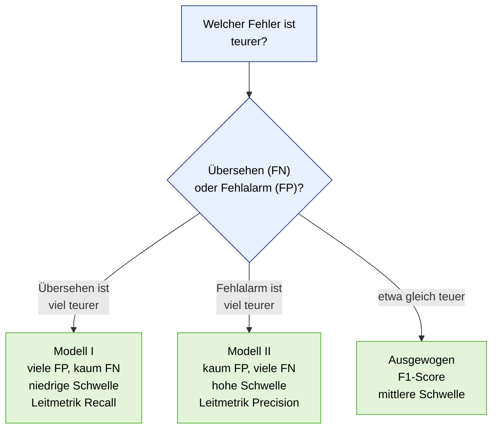
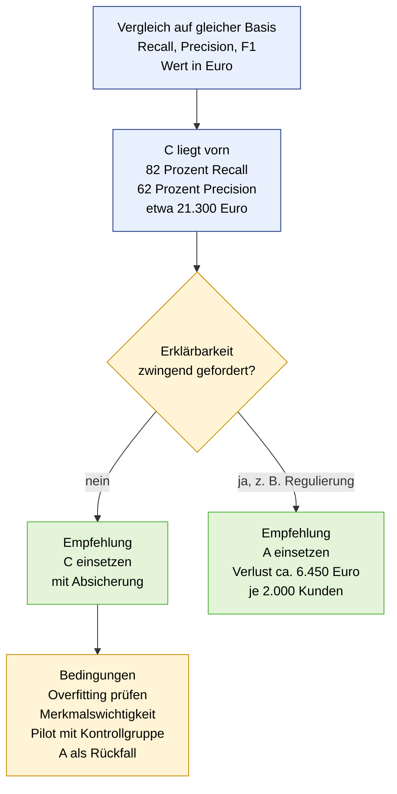

# UE 2 und UE 3 · Modellbewertung: Lösungsentwurf Arbeitsauftrag 1 und 2

*Arbeitsdatei, Basis: `06_01_UE1_Modellewertung.pdf`, Aufgaben in `06_02_UE2_Arbeitsauftrag1.pdf` und `06_03_UE3_Arbeitsauftrag2.pdf`. Allgemeine Begriffe und Formeln stehen im [`Kompendium`](../00_Kompendium/00_Kompendium_Predictive_Analytics.md) (Abschnitt 8, Metriken).*

> **Annahmen:** Die Szenarien in Teil 1 sind eigene Beispiele. In Teil 2 sind die Zahlen der Folie gegeben, die **Kostenwerte** (30 € je Halteangebot, 25 % Erfolgsquote, 540 € Kundenwert) sind **Annahmen**, übernommen aus der Fallstudie TeleCom. Sie sind begründete Einschätzungen und vor einer Abgabe in der Gruppe anzupassen.

---

## 0. Das Handwerkszeug aus UE 1 in einer Seite

**Vier Ergebnisse einer Ja/Nein-Vorhersage** (Lesart: *Positive/Negative* = was das Modell sagt, *True/False* = stimmt es?)

| | Tatsächlich **ja** | Tatsächlich **nein** |
| --- | :---: | :---: |
| **Modell sagt ja** | **TP** (Treffer) | **FP** (Fehlalarm) |
| **Modell sagt nein** | **FN** (übersehen) | **TN** (richtig durchgelassen) |

| Metrik | Frage | Formel |
| --- | --- | --- |
| **Accuracy** | Wie viele Vorhersagen stimmen insgesamt? | (TP + TN) / alle |
| **Precision** | Wie viele **Alarme** sind echt? (wenige Fehlalarme) | TP / (TP + FP) |
| **Recall** | Wie viele **echte Fälle** werden gefunden? (wenig Übersehenes) | TP / (TP + FN) |
| **F1-Score** | beides in einem Wert (harmonisches Mittel) | 2 · P · R / (P + R) |
| **ROC-AUC** | Wie gut trennt der Score Fälle von Nicht-Fällen, über **alle** Schwellen? | Fläche unter der ROC-Kurve (0,5 = Münzwurf, 1,0 = perfekt) |

**Merksätze:** Precision und Recall ignorieren TN. Accuracy täuscht bei seltenen Ereignissen („Immer nein" ist bei 1 % Betrug zu 99 % richtig, aber nutzlos). Die **Metrik muss zum Geschäftsziel passen** (Folie 27). Nur **ungesehene** Daten zeigen die echte Güte, ein großer Abstand zwischen Training und Test ist ein **Warnsignal** (Overfitting).

| Situation | Leitmetrik | Warum |
| --- | --- | --- |
| Betrug, Krankheit, Sicherheitsrisiko | **Recall** | Übersehen ist teuer |
| Teure Folgeaktion (Prüfung, Kampagne) | **Precision** | Fehlalarme kosten Geld |
| Seltene Klasse, beide Fehler wichtig | **F1** | Balance |
| Modelle vor der Schwellenwahl vergleichen | **ROC-AUC** | bewertet alle Schwellen |
| Klassen ausgeglichen, Fehler gleich teuer | **Accuracy** | einfach und verständlich |

---

# Teil 1 · Arbeitsauftrag 1: Welche Ungenauigkeit?

**Aufgabe:** Zwei Modelle werden beschrieben. Für jedes ein Szenario beschreiben, in dem es **akzeptabel** ist, und eines, in dem es **auf keinen Fall akzeptabel** ist, jeweils begründen, warum die Ungenauigkeit **nicht so schwerwiegend** bzw. **doch schwerwiegend** ist.

| | Modell I (Folie „Welche Ungenauigkeit?") | Modell II (Folie „Welche Ungenauigkeit II?") |
| --- | --- | --- |
| Fehlerbild | **viele FP**, praktisch **keine FN** | praktisch **keine FP**, **viele FN** |
| Mit anderen Worten | schlägt **zu oft** Alarm | schlägt **zu selten** Alarm |
| Kennzahlen | **hoher Recall**, **niedrige Precision** | **hohe Precision**, **niedriger Recall** |
| Schwelle | eher **niedrig** (im Zweifel Alarm) | eher **hoch** (nur bei Sicherheit Alarm) |
| Charakter | **vorsichtig, sensibel** | **zurückhaltend, selektiv** |

**Entscheidende Frage in beiden Fällen:** Was kostet **ein Fehlalarm**, und was kostet **ein übersehener Fall**? Welcher Fehler akzeptabel ist, hängt am **Preis des Fehlers**, nicht an der Zahl.



## 1.1 Modell I: viele Fehlalarme, fast nichts übersehen

### Szenario, in dem es **akzeptabel** ist: Erstscreening auf eine schwere, aber behandelbare Krankheit

**Beschreibung:** Ein Vorsorge-Screening (z. B. Brustkrebs-Früherkennung per Bildanalyse). Das Modell markiert **alle** auffälligen Befunde. Wer markiert ist, bekommt eine **Zweituntersuchung** (zusätzliche Aufnahme, Ultraschall, Facharzt).

**Warum die Ungenauigkeit nicht so schwerwiegend ist:**
- **Übersehen (FN) ist katastrophal:** Ein übersehener Tumor wird zu spät entdeckt. Genau das soll das Modell vermeiden, deshalb der hohe Recall.
- **Fehlalarm (FP) ist verkraftbar:** Er kostet eine weitere Untersuchung und kurz Sorge, danach folgt die Entwarnung. Ein **zweiter Filter** (Fachärztin oder Facharzt) korrigiert die Fehler.
- Das Modell ist ein **Vorfilter**, nicht die Endentscheidung. Seine Aufgabe ist, **nichts durchzulassen**.

**Weitere Beispiele:** Brandmelder, Sicherheitskontrolle am Flughafen, erste Stufe der Betrugserkennung mit nachgelagerter manueller Prüfung.

### Szenario, in dem es **auf keinen Fall** akzeptabel ist: automatische Sanktion bei Betrugsverdacht

**Beschreibung:** Eine Behörde oder Bank **sperrt automatisch** Konten oder Leistungen, sobald das Modell Betrug vermutet, ohne menschliche Prüfung.

**Warum die Ungenauigkeit hier schwerwiegend ist:**
- **Jeder Fehlalarm trifft einen Unschuldigen** direkt und hart: gesperrtes Konto, ausbleibendes Geld, Reputationsschaden, Rechtsstreit.
- Bei **seltenen Ereignissen** sind die meisten Alarme falsch (siehe Basisrate unten). Die Mehrheit der Betroffenen wäre **zu Unrecht** getroffen.
- Es gibt **keinen zweiten Filter**, der den Fehler vor der Wirkung korrigiert.
- **Rechtlich und ethisch** problematisch: Betroffene müssen sich nachträglich rechtfertigen, die Beweislast kippt.

**Weitere Beispiele:** automatische Kündigungen, automatisierte Bußgeldbescheide, Strafverfolgung allein auf Basis des Scores, Medikamentengabe oder Operation auf Modellbasis ohne ärztliche Prüfung.

### Warum die Basisrate alles verändert (Zahlenbeispiel)

Bei **100.000 Personen** und **1 %** Erkrankten (1.000 Fälle) findet ein Modell mit **Recall 100 %** und **5 % Fehlalarmquote** bei den Gesunden:
- TP = 1.000 · 1,0 = **1.000**
- FP = 99.000 · 0,05 = **4.950**
- **Precision = 1.000 / 5.950 ≈ 17 %**: Nur **jeder sechste Alarm** ist echt, fünf von sechs sind falsch.

Beim Screening mit Zweituntersuchung ist das tragbar. Bei einer automatischen Sanktion träfen **4.950 Unschuldige**.

## 1.2 Modell II: kaum Fehlalarme, aber viel übersehen

### Szenario, in dem es **akzeptabel** ist: Spam-Filter

**Beschreibung:** Ein Mailfilter sortiert Spam in den Spam-Ordner (Positive = „ist Spam"). Er ist **sehr vorsichtig**: Er verschiebt nur, wenn er **sehr sicher** ist.

**Warum die Ungenauigkeit nicht so schwerwiegend ist:**
- **Fehlalarm (FP) wäre schlimm:** Eine wichtige Mail (Bewerbung, Rechnung, Vertrag) im Spam-Ordner kann echten Schaden anrichten. Das soll kaum passieren, daher die hohe Precision.
- **Übersehen (FN) ist nur lästig:** Ein Spam im Posteingang löscht man mit einem Klick. Kein Schaden, die Nutzer bleiben zufrieden.
- Ungleiche Kosten: **Falsch verschoben ist teuer, falsch durchgelassen ist billig.**

**Weitere Beispiele:** teure oder aufdringliche Kampagne an wenige Kunden mit hoher Wahrscheinlichkeit, Empfehlungen („nur wenn wirklich passend"), Einstufungen, die Handlungen mit Kosten auslösen und bei denen es **andere Sicherungen** für die übersehenen Fälle gibt.

### Szenario, in dem es **auf keinen Fall** akzeptabel ist: Brandmelder, Krebsfrüherkennung, Sicherheitskontrolle

**Beschreibung:** Ein Brandmelder oder ein Tumor-Screening, das **fast nie** Alarm schlägt und dafür **viele echte Fälle übersieht**.

**Warum die Ungenauigkeit hier schwerwiegend ist:**
- **Jeder übersehene Fall kann Leben kosten** (Brand nicht gemeldet, Tumor nicht erkannt, Waffe nicht entdeckt).
- Die **Folge ist nicht umkehrbar**, ein Fehlalarm dagegen wäre harmlos.
- Es entsteht **falsche Sicherheit**: Menschen verlassen sich auf das System, weil es „kaum Fehlalarme hat", und handeln nicht selbst.
- Die schönen Zahlen (hohe Precision) **verschleiern** das eigentliche Problem.

**Weitere Beispiele:** Sepsis-Warnung auf der Intensivstation, Betrug mit hohem Einzelschaden, Qualitätskontrolle sicherheitskritischer Teile (Bremsen, Airbags).

## 1.3 Zusammenfassung

| | **Modell I** (viele FP, kaum FN) | **Modell II** (kaum FP, viele FN) |
| --- | --- | --- |
| **Akzeptabel, wenn …** | Übersehen **sehr teuer**, Fehlalarm **billig** und es gibt einen **zweiten Filter** | Fehlalarm **sehr teuer**, Übersehen **billig** oder durch **andere Sicherungen** aufgefangen |
| **Beispiel** | Vorsorge-Screening, Brandmelder, Vorfilter | Spam-Filter, teure Kampagne |
| **Nicht akzeptabel, wenn …** | Fehlalarm **direkt Menschen trifft** (Sanktion, Sperrung), kein zweiter Filter | Übersehen **Leben oder hohe Werte** gefährdet |
| **Beispiel** | automatische Konto- oder Leistungssperre | Brandmelder, Tumorerkennung, Sepsis-Warnung |
| **Leitmetrik** | **Recall** | **Precision** |
| **Schwelle** | niedrig | hoch |

## 1.4 Zwei Denkfallen

1. **Trivialmodelle erreichen diese Extreme leicht.** „**Immer ja**" hat **keine FN** (aber nur so viele richtige Alarme, wie es Fälle gibt, Precision = Basisrate). „**Immer nein**" hat **keine FP** und nützt nichts. Aus diesem Grund reicht **eine** Zahl nie, man schaut **beide Fehlerarten** an (Folie F1: „Nur 5 Alarme, alle echt" hat Precision 1,00 und F1 0,10).
2. **Es ist oft dasselbe Modell mit anderer Schwelle.** Modell I und II unterscheiden sich häufig nur durch den **Schwellenwert**. Die **ROC-Kurve** zeigt alle Einstellungen, die **AUC** sagt, wie gut das Modell trennt, aber **nicht**, welche Schwelle richtig ist. Die Schwelle ist eine **Geschäftsentscheidung** aus den Fehlerkosten.

---

# Teil 2 · Arbeitsauftrag 2: Churn, drei Modelle im Vergleich

**Szenario:** Ein Mobilfunkanbieter will Kündiger früh erkennen. Wer als gefährdet gilt, erhält ein **Halteangebot**. Drei Teams haben je ein Modell auf **denselben** Testkunden geprüft. **Test: 2.000 Kunden, davon 300 Kündiger** (15 %).

| Modell | Recall | Weitere Angaben des Teams |
| --- | :---: | --- |
| **A)** Logistische Regression | 70 % | Precision 47 %, Accuracy 83,5 % |
| **B)** Entscheidungsbaum | 60 % | F1-Score 0,57, Accuracy 86,5 % (Test), **97 % (Training)** |
| **C)** Black-Box ML-Modell | 82 % | Precision 62 %, AUC 0,91 |

**Aufgaben:** (1) Modelle vergleichen, (2) Angaben auf **Warnsignale** prüfen, (3) **aus Business-Sicht** entscheiden und begründen. **Leitfragen:** Welches Modell, und wie begründet? Wie wurden die Modelle vergleichbar gemacht? Welche Rolle spielte die Erklärbarkeit?

## 2.1 Aufgabe 1: Modelle vergleichbar machen

**Problem:** Jedes Team nennt **andere Kennzahlen**. A nennt Precision und Accuracy, B F1 und Accuracy, C Precision und AUC. Man kann die Modelle so **nicht** vergleichen („Äpfel mit Birnen").

**Lösung:** Aus den gegebenen Werten die **vollständige Confusion Matrix je Modell rekonstruieren** und danach **für alle dieselben Metriken** berechnen. Das geht, weil die Testmenge bekannt ist: 300 positiv (Kündiger), 1.700 negativ.

### Rekonstruktion

**Grundidee:** Die 2.000 Testkunden bestehen aus **300 echten Kündigern** und **1.700 echten Bleibern**. Jeder echte Kündiger landet in genau einem von zwei Feldern: das Modell findet ihn (**TP**) oder übersieht ihn (**FN**). Ein Drittes gibt es nicht. Genauso landet jeder echte Bleiber in genau einem von zwei Feldern: richtig als Bleiber erkannt (**TN**) oder fälschlich als Kündiger markiert (**FP**). Deshalb kann man jedes Feld als „Rest" der jeweiligen Gruppe ausrechnen: **Gruppe − bekanntes Feld = unbekanntes Feld.**

**Lesehilfe für TP, FP, FN, TN:** „Positive" heißt hier nicht „gut", sondern „das, wonach wir suchen": **Positive = das Modell sagt „kündigt"**, **Negative = das Modell sagt „bleibt"**. Dass „Churn" selbst schon negativ klingt, ist reiner Zufall und führt leicht zu einer gefühlten doppelten Verneinung. Man liest jeden Begriff **von hinten nach vorn**:

1. Das **zweite Wort** (Positive/Negative) sagt, **was das Modell gesagt hat**.
2. Das **erste Wort** (True/False) sagt, **ob das Modell damit recht hatte**.

| Begriff | Modell sagt | Modell hat recht? | Wirklichkeit | Bedeutung |
| --- | --- | :---: | --- | --- |
| **TP** | kündigt | ja | kündigt | Kündiger gefunden |
| **FP** | kündigt | **nein** | bleibt | **Fehlalarm**: fälschlich als Kündiger erkannt |
| **FN** | bleibt | **nein** | kündigt | **übersehener Kündiger**: fälschlich als Bleiber erkannt |
| **TN** | bleibt | ja | bleibt | Bleiber richtig erkannt |

*Merkhilfe:* **FP = falscher Alarm** (das Modell ruft „Wolf!", es ist keiner da). **FN = durchs Netz gerutscht** (ein Kündiger wurde nicht bemerkt).

**Modell A** (gegeben: Recall 70 %, Accuracy 83,5 %)

- TP = 70 % · 300 = **210**
  *Recall ist der Anteil der echten Kündiger, die das Modell findet. 70 % von 300 echten Kündigern sind 210 gefundene.*
- FN = 300 − 210 = **90**
  *Wir ziehen die 210 gefundenen (TP) von allen 300 echten Kündigern ab. Was übrig bleibt, sind die echten Kündiger, die das Modell nicht gefunden hat, und genau das sind die FN.*
- richtig klassifiziert = 83,5 % · 2.000 = 1.670
  *Accuracy ist der Anteil richtiger Antworten an allen 2.000 Kunden. „Richtig" sind die gefundenen Kündiger (TP) und die erkannten Bleiber (TN) zusammen.*
- TN = 1.670 − 210 = **1.460**
  *Die 1.670 richtigen Antworten bestehen aus TP + TN. Ziehen wir die 210 TP ab, bleiben die richtig erkannten Bleiber.*
- FP = 1.700 − 1.460 = **240**
  *Wir ziehen die 1.460 richtig erkannten Bleiber von allen 1.700 echten Bleibern ab. Der Rest wurde fälschlich als Kündiger markiert, das sind die Fehlalarme (FP).*
- *Kontrolle:* Precision = 210 / (210 + 240) = 46,7 % ✓ (47 %)
  *Precision ist der Anteil echter Kündiger unter allen Alarmen. Alarme sind TP + FP. Die Zahl stimmt mit der Angabe des Teams überein, die Rechnung geht also auf.*

**Modell B** (gegeben: Recall 60 %, Accuracy 86,5 %, F1 0,57)

- TP = 60 % · 300 = **180**
  *60 % der 300 echten Kündiger werden gefunden.*
- FN = 300 − 180 = **120**
  *Von allen 300 echten Kündigern ziehen wir die 180 gefundenen ab. Der Rest wurde übersehen (FN).*
- richtig klassifiziert = 86,5 % · 2.000 = 1.730
  *Accuracy mal alle Kunden ergibt die Zahl der richtigen Antworten (TP + TN).*
- TN = 1.730 − 180 = **1.550**
  *Von den richtigen Antworten ziehen wir die 180 TP ab. Übrig bleiben die richtig erkannten Bleiber.*
- FP = 1.700 − 1.550 = **150**
  *Von allen 1.700 echten Bleibern ziehen wir die 1.550 richtig erkannten ab. Der Rest sind die Fehlalarme (FP).*
- *Kontrolle:* Precision = 180 / (180 + 150) = 54,5 %, F1 = 2 · 0,545 · 0,6 / (0,545 + 0,6) = 0,57 ✓
  *F1 ist das harmonische Mittel aus Precision und Recall. Es stimmt mit der Angabe von Team B überein.*

**Modell C** (gegeben: Recall 82 %, Precision 62 %, AUC; keine Accuracy)

- TP = 82 % · 300 = **246**
  *82 % der 300 echten Kündiger werden gefunden.*
- FN = 300 − 246 = **54**
  *Von allen 300 echten Kündigern ziehen wir die 246 gefundenen ab. Der Rest wurde übersehen (FN).*
- Alarme insgesamt = TP / Precision = 246 / 0,62 ≈ 397
  *Precision = TP / Alarme. Stellen wir das nach „Alarme" um, teilen wir die 246 echten Treffer durch die Precision. So viele Kunden hat das Modell insgesamt als Kündiger markiert.*
- FP = 397 − 246 ≈ **151**
  *Die Alarme bestehen aus echten Treffern (TP) und Fehlalarmen (FP). Ziehen wir die 246 TP ab, bleiben die Fehlalarme.*
- TN = 1.700 − 151 ≈ **1.549**
  *Von allen 1.700 echten Bleibern ziehen wir die 151 fälschlich markierten ab. Der Rest wurde richtig als Bleiber erkannt.*
- *Accuracy* (nicht angegeben): (246 + 1.549) / 2.000 ≈ 89,8 %
  *Richtige Antworten (TP + TN) geteilt durch alle Kunden. Das ist die Zahl, die Team C nicht genannt hat.*

| Modell | TP | FN | FP | TN |
| --- | :---: | :---: | :---: | :---: |
| **A** | **210** | 90 | **240** | 1.460 |
| **B** | **180** | 120 | **150** | 1.550 |
| **C** | **246** | 54 | **≈ 151** | ≈ 1.549 |

*Die Rekonstruktion ist wegen gerundeter Angaben auf wenige Fälle genau. Alle Rückrechnungen stimmen mit den Angaben der Teams überein, die Zahlen der Teams sind also in sich stimmig.*

### Vergleich auf gleicher Basis

| Kennzahl | A) Logistische Regression | B) Entscheidungsbaum | C) Black-Box |
| --- | :---: | :---: | :---: |
| **Recall** (Kündiger gefunden) | 70 % (210 von 300) | 60 % (180 von 300) | **82 % (246 von 300)** |
| **Precision** (Alarme echt) | 47 % | 54,5 % | **62 %** |
| **F1-Score** | 0,56 | 0,57 | **0,71** |
| **Accuracy** | 83,5 % | 86,5 % | ≈ 89,8 % |
| **Alarme insgesamt** | 450 | 330 | ≈ 397 |
| **Übersehene Kündiger (FN)** | 90 | 120 | **54** |
| **Fehlalarme (FP)** | 240 | **150** | ≈ 151 |
| ROC-AUC | nicht angegeben | nicht angegeben | 0,91 |

**Befund:** **C ist in Recall, Precision und F1 vorn.** Es findet die meisten Kündiger (246) **bei weniger Fehlalarmen als A** (≈ 151 gegen 240). B hat ähnlich wenige Fehlalarme wie C, übersieht aber **66 Kündiger mehr** (120 gegen 54). C **dominiert** sogar beide anderen: gegenüber B mehr Treffer bei gleich vielen Fehlalarmen, gegenüber A mehr Treffer **und** weniger Fehlalarme. Es gibt also keinen Zielkonflikt, der gegen C spricht (der bleibt die Erklärbarkeit, siehe 2.3).

**Fairer Vergleich bedeutet** (Folie 30): gleiche Test-Daten, gleiche Metriken für alle Kandidaten, **nicht nur Genauigkeit**, auch Erklärbarkeit und Aufwand betrachten.

## 2.2 Aufgabe 2: Warnsignale prüfen

| Warnsignal | Modell | Was auffällt | Bewertung |
| --- | :---: | --- | --- |
| **Accuracy täuscht** | A, B, C | Die Basisrate der Nicht-Kündiger beträgt **85 %** (1.700 von 2.000). Ein „Modell", das **immer „bleibt"** sagt, hat **85 % Accuracy** und findet **keinen** Kündiger. A (**83,5 %**) liegt **unter dieser Messlatte**, B (**86,5 %**) knapp darüber. | **Accuracy ist hier wertlos.** Nur Recall, Precision und F1 zählen. A wirkt nach Accuracy „schlechter als nichts", ist aber mit 70 % Recall nützlich. |
| **Overfitting** | **B** | Accuracy **97 % im Training**, **86,5 % im Test**: **10,5 Prozentpunkte Abstand**. Der Baum hat Trainingsdaten teilweise **auswendig gelernt**. | **Deutliches Warnsignal** (Folie 28: „Großer Abstand ist ein Warnsignal"). Test-Werte sind ehrlich, aber im Betrieb ist weiterer Abfall möglich. Baum ist instabil, Tiefe begrenzen oder Wald verwenden. |
| **Nicht vergleichbare Angaben** | alle | Jedes Team nennt andere Kennzahlen. | Rekonstruktion der Confusion Matrix (2.1), einheitlich neu rechnen. |
| **Fehlende Angaben** | C | Keine **Trainingskennzahlen**, also **kein Overfitting-Check** möglich. Nur Recall, Precision und AUC. | Nachfordern: Trainings- gegen Testgüte, Kreuzvalidierung. |
| **AUC nicht überinterpretieren** | C | AUC 0,91 sagt, dass der Score gut trennt, aber **nicht**, welche Schwelle gewählt wurde und **wie viele Fehlalarme im Betrieb** entstehen. Bei seltenen Klassen wirkt sie oft **zu gut**. Die 15 % Kündiger sind aber nicht extrem selten. | Gute Trennschärfe, aber für die Entscheidung zählen Recall und Precision **bei der gewählten Schwelle**. |
| **Black Box** | C | Kein Einblick, **warum** jemand als gefährdet gilt. | Erklärbarkeit nachrüsten (siehe 2.3), unabhängige Prüfung. |
| **Kleine Stichprobe** | alle | Nur **300 Kündiger**. Recall hat daher eine Unsicherheit von etwa **±5 Prozentpunkten** (95 %-Intervall: A 70 % ± 5,2, B 60 % ± 5,5, C 82 % ± 4,3). | Der Vorsprung von C (12 Punkte vor A) ist **größer als die Streuung**, die Rangfolge A gegen B ist knapper. **Ein** Testlauf ersetzt keine Kreuzvalidierung. |
| **Test auf denselben Daten** | alle | Wurden Schwellen oder Parameter **am Test** abgestimmt? Dann sind die Werte zu optimistisch. | Nachfragen, ob eine **dritte, unberührte Prüfmenge** existiert. |
| **Passt das Label zum Business?** | alle | Was heißt „Kündiger" und welcher Zeitraum? Wurden Merkmale **nach** der Kündigung genutzt (Data Leakage)? | Leakage-Prüfung vor der Einführung, vgl. Fallstudie TeleCom. |

## 2.3 Aufgabe 3: Entscheidung aus Business-Sicht

### Geschäftsrechnung (Annahmen)

Kosten und Nutzen eines **Halteangebots**: **K = 30 €** je Angebot, **Erfolgsquote q = 25 %** der echten Kündiger werden gehalten, **Kundenwert W = 540 €**.

- **Nutzen je echtem Kündiger, der ein Angebot bekommt (TP):** q · W − K = 0,25 · 540 − 30 = **+105 €** (erwarteter gehaltener Wert abzüglich Kosten).
- **Kosten je Fehlalarm (FP):** **−30 €** (Angebot an jemanden, der gar nicht gehen wollte).
- **Übersehene Kündiger (FN):** keine Maßnahmekosten, aber **entgangene Chance** (nicht gehalten).

$$ \text{Wert} = TP \cdot (q \cdot W - K) \;-\; FP \cdot K $$

| Modell | TP | FP | Rechnung | **Wert je 2.000 Kunden** |
| --- | :---: | :---: | --- | ---: |
| A) Logistische Regression | 210 | 240 | 210 · 105 − 240 · 30 = 22.050 − 7.200 | **14.850 €** |
| B) Entscheidungsbaum | 180 | 150 | 180 · 105 − 150 · 30 = 18.900 − 4.500 | **14.400 €** |
| **C) Black-Box** | 246 | ≈ 151 | 246 · 105 − 151 · 30 = 25.830 − 4.530 | **≈ 21.300 €** |

**C bringt etwa 6.450 € mehr als A**, je 2.000 geprüfte Kunden. Der Ertrag steigt vor allem durch **mehr gefundene Kündiger** (+36 gegenüber A), nicht durch weniger Fehlalarme.

### Ist die Rangfolge robust? (Sensitivität)

| Annahme | A | B | C | Beste Wahl |
| --- | ---: | ---: | ---: | --- |
| K = 10 € | 23.850 | 21.000 | 29.240 | **C** |
| K = 20 € | 19.350 | 17.700 | 25.270 | **C** |
| **K = 30 € (Basis)** | 14.850 | 14.400 | 21.300 | **C** |
| K = 50 € | 5.850 | 7.800 | 13.360 | **C** |
| K = 100 € | −16.650 | −8.700 | −6.490 | **C** (aber **alle** negativ) |
| Erfolgsquote q = 10 % | −2.160 | −180 | 1.374 | **C** (A und B rechnen sich nicht) |
| Erfolgsquote q = 15 % | 3.510 | 4.680 | 8.016 | **C** |
| Erfolgsquote q = 40 % | 31.860 | 28.980 | 41.226 | **C** |

**Lehre:** **C liegt in allen getesteten Fällen vorn.** Wichtiger ist die Erkenntnis, dass die **Kampagne selbst** nur bei einer ausreichenden Erfolgsquote und moderaten Kosten **überhaupt** lohnt. Bei K = 100 € (oder q = 10 % für A und B) rechnet sich **gar kein** Modell. Das ist ein Grund für einen **Pilot mit Kontrollgruppe**, bevor man skaliert. Die Schwelle wird ebenso wirtschaftlich gewählt: Kontaktieren, wenn p · q · W > K.

### Empfehlung



**Entscheidung: Modell C, unter Bedingungen. Modell A als erklärbare Alternative bereithalten. Modell B nicht verwenden.**

**Begründung aus Business-Sicht**
1. **Es findet die meisten Kündiger** (246 von 300, 82 %), das ist das Ziel („Kündiger früh erkennen"). Übersehene Kündiger kosten den vollen Kundenwert.
2. **Es verschwendet nicht mehr Angebote** als die Alternativen: Die Hälfte der Alarme ist richtig, bessere Precision (62 %) als A (47 %) und B (54,5 %).
3. **Es rechnet sich am besten** (≈ 21.300 € gegen 14.850 € und 14.400 €), und das in **allen** getesteten Kostenannahmen.
4. **B scheidet aus**, weil es **schlechter findet** (60 % Recall), dazu ein klares **Overfitting-Signal** (97 % gegen 86,5 %) und trotz der „guten" Accuracy keinen Mehrwert. Die höhere Accuracy von B gegenüber A ist ein **Scheinvorteil**.
5. **A ist der solide Mittelweg:** erklärbar, robust, stabil, aber 36 gefundene Kündiger weniger als C und 90 Fehlalarme mehr.

**Bedingungen für den Einsatz von C (Risiken abfedern)**
- **Overfitting prüfen:** Trainings- gegen Testgüte, Kreuzvalidierung, unberührte dritte Prüfmenge.
- **Erklärbarkeit nachrüsten:** Merkmalswichtigkeit, Erklärung je Kunde (z. B. SHAP), damit der Fachbereich Maßnahmen ableiten kann.
- **Pilot mit Kontrollgruppe:** Einige gefährdete Kunden erhalten **kein** Angebot. Nur so sieht man, ob das Angebot wirkt (Vorhersage ≠ Wirkung).
- **Monitoring:** Drift prüfen, Modell regelmäßig neu trainieren.
- **A als Rückfallebene:** läuft parallel als Vergleich, wird bei Vertrauensproblemen oder Regulierungsdruck eingesetzt.

### Antworten auf die Leitfragen

| Leitfrage | Antwort |
| --- | --- |
| **Welches Modell wurde gewählt und wie begründet?** | **C (Black-Box)**, weil es bei **gleichem Test** den **höchsten Recall (82 %)**, die **höchste Precision (62 %)** und den höchsten **Geschäftswert** liefert, mit Bedingungen (Overfitting-Check, Erklärung, Pilot). A als erklärbarer Rückfall. B nicht (Overfitting, schwächster Recall). |
| **Wie wurden die Modelle vergleichbar gemacht?** | Aus den Angaben der Teams wurden die **Confusion Matrices rekonstruiert** (Testmenge: 300 Kündiger, 1.700 andere). Für alle drei die **gleichen Metriken** (Recall, Precision, F1, Accuracy) berechnet, dazu ein **Kostenmodell in Euro** mit Sensitivitätsprüfung. Gleiche Testkunden waren bereits gegeben. |
| **Welche Rolle spielte die Erklärbarkeit?** | **Sie ist ein Kriterium, kein Totschlagargument.** Hier ist sie **nicht ausdrücklich gefordert**, deshalb darf die höhere Güte von C den Ausschlag geben. Die **Kosten der Erklärbarkeit** lassen sich beziffern: Der Verzicht auf C zugunsten von A kostet rund **6.450 €** je 2.000 Kunden. Wo Erklärbarkeit **Pflicht** ist (z. B. Regulierung), gewinnt A. Außerdem kann man C **teilweise erklären** (Merkmalswichtigkeit, SHAP). |

---

## 3. Nachrechnen in Python

Das Skript rekonstruiert die Confusion Matrices und berechnet den Geschäftswert. Es lief fehlerfrei durch und reproduziert die Zahlen oben.

```python
N, P = 2000, 300            # Testkunden, davon Kündiger
NEG = N - P                 # 1.700 Nicht-Kündiger
K, q, W = 30, 0.25, 540     # Annahmen: Kosten je Angebot, Erfolgsquote, Kundenwert

def matrix(recall, accuracy=None, precision=None):
    tp = round(recall * P)
    if accuracy is not None:
        tn = round(accuracy * N) - tp
        fp = NEG - tn
    else:
        fp = round(tp / precision - tp)
        tn = NEG - fp
    return tp, P - tp, fp, tn   # TP, FN, FP, TN

modelle = {
    "A Logistische Regression": matrix(0.70, accuracy=0.835),
    "B Entscheidungsbaum":      matrix(0.60, accuracy=0.865),
    "C Black-Box":              matrix(0.82, precision=0.62),
}

print("Immer 'bleibt': Accuracy", NEG / N)
for name, (tp, fn, fp, tn) in modelle.items():
    precision, recall = tp / (tp + fp), tp / P
    f1 = 2 * precision * recall / (precision + recall)
    wert = tp * (q * W - K) - fp * K
    print(f"{name:26s} TP={tp} FN={fn} FP={fp} TN={tn} | "
          f"Precision {precision:.1%} Recall {recall:.0%} F1 {f1:.2f} "
          f"Accuracy {(tp + tn) / N:.1%} | Wert {wert:,.0f} EUR")
```

---

## 4. Kernaussagen

| # | Aussage |
| --- | --- |
| 1 | **Welcher Fehler akzeptabel ist, hängt am Preis des Fehlers:** FP und FN kosten je nach Szenario sehr unterschiedlich. Viele FP sind beim Vorfilter ok, bei der automatischen Sanktion nicht. Viele FN sind beim Spam-Filter ok, beim Brandmelder nicht. |
| 2 | **Eine Zahl reicht nie.** „Immer ja" und „immer nein" erzeugen die Extremfälle von selbst. Beide Fehlerarten ansehen. |
| 3 | **Accuracy täuscht bei ungleichen Klassen:** Bei 85 % Nicht-Kündigern schlägt „immer bleibt" Modell A. |
| 4 | **Vergleichbar machen:** Confusion Matrix rekonstruieren und für alle dieselben Metriken rechnen. |
| 5 | **Warnsignal Overfitting:** 97 % Training gegen 86,5 % Test beim Baum. Große Abstände immer hinterfragen. |
| 6 | **Entscheiden mit Geschäftswert:** Metriken in Euro übersetzen, Sensitivität prüfen. Das beste Modell ist das **beste im Kontext**. |
| 7 | **Erklärbarkeit hat einen Preis:** Man kann ihn beziffern, und ob er sich lohnt, ist eine Managemententscheidung. |

## 5. Wo könnten Antworten abweichen?

- **Szenarien in Teil 1:** Es gibt viele gültige Beispiele. Entscheidend ist die **Begründung mit den Fehlerkosten**.
- **Entscheidung in Teil 2:** Eine Gruppe kann **A** wählen (Erklärbarkeit und Robustheit, ohne Overfitting-Risiko eines Black-Box-Modells ohne Trainingskennzahlen). Das ist vertretbar, wenn die Begründung **den Preis beziffert** (rund 6.450 € je 2.000 Kunden) und Erklärbarkeit ausdrücklich zählt. Aus dem Fehlen der Trainingskennzahlen bei C kann man auch einen **Vorbehalt** ableiten.
- **Annahmen im Kostenmodell:** Andere Werte für K, q und W verändern die Euro-Beträge, im getesteten Bereich aber nicht die Rangfolge.

## Checkliste Modellbewertung

- [ ] Wurde auf **ungesehenen** Daten geprüft? Abstand Training zu Test?
- [ ] Passt die **Metrik** zum Geschäftsziel (Recall, Precision, F1, AUC)?
- [ ] Ist die **Basisrate** berücksichtigt (Accuracy, „immer nein")?
- [ ] Sind die Modelle **gleich** geprüft (gleiche Daten, gleiche Metriken)?
- [ ] Ist die **Schwelle** nach den Fehlerkosten gewählt?
- [ ] Ist der **Geschäftswert** in Euro gerechnet, mit Sensitivität?
- [ ] Wie wichtig ist **Erklärbarkeit**, und was kostet sie?

---

*Hinweis zur Entstehung: Entwurf auf Basis der Folien UE 1 bis UE 3 zur Modellbewertung. Gegeben sind nur die Zahlen der Folie. Alles andere (Beispielszenarien, Kosten, Erfolgsquote, Kundenwert, Rekonstruktion der Confusion Matrices auf gerundeten Angaben) sind Annahmen und Ergänzungen. Die Mermaid-Diagramme wurden nicht gerendert.*
