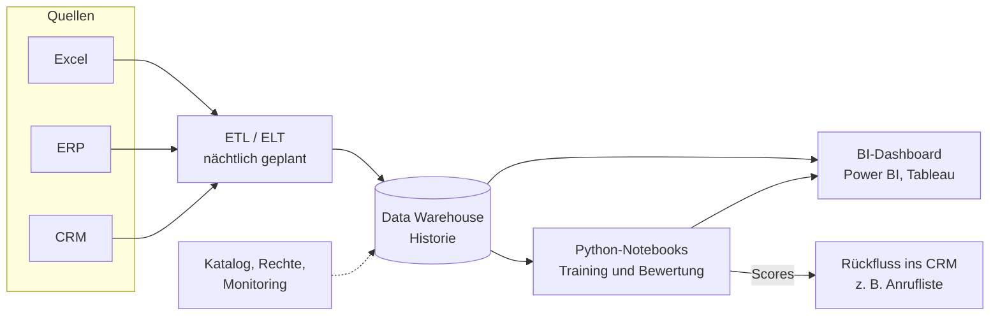

# Tag 9 · Plattformen: Lösungen Arbeitsauftrag 0, 1 und 2

> **Inhalt:** Arbeitsauftrag 0 (Immobilien, Zielwert), Arbeitsauftrag 1 (Lücken und Zielarchitektur) und Arbeitsauftrag 2 (Toolentscheid) sind gelöst.

| Arbeitsauftrag | Thema | Stand |
| --- | --- | --- |
| **0** | Immobilien-Szenario: Zielspalte „attraktiv“ erzeugen | gelöst |
| **1** | Lücken in der Analytics-Landschaft (Excel, ERP, CRM), Zielarchitektur | gelöst |
| **2** | Toolentscheid: BI-Lösung, Cloud-Plattform oder Eigenentwicklung | gelöst |

---

# Arbeitsauftrag 0: Welches Objekt lohnt sich?

**Szenario (Folien „Arbeitsauftrag 0“):** Ein Investor prüft 12 Wohnungen für den Kauf. Vorhanden sind Kaufpreis, Fläche, Jahresmiete, Baujahr und Lage. Die Tabelle sagt aber **nicht, welches Objekt gut ist**: Es gibt keine Spalte „attraktiv“. Gewünscht ist ein Modell, das attraktive Objekte erkennt.

**Aufgaben der Folie:**

1. Eine neue Spalte mit einem geeigneten **Zielwert** erzeugen.
2. Evtl. **Klassen** festlegen: ab wann „attraktiv“? (z. B. ≥ 5 %)
3. Zielwert als **Prozentzahl (Regression)** oder als **Klasse**?
4. Welche Spalten legen den Zielwert bereits fest, welche könnten ihn **vorhersagen**?

Daten: `0900_UE0_Arbeitsauftrag0_Daten.csv` (12 Objekte).

> **Hinweis zur CSV:** Die Datei beginnt mit einem BOM (unsichtbares Zeichen, deshalb `encoding="utf-8-sig"` beim Einlesen) und hat eine **leere letzte Zeile** (`,,,,,`). Diese Zeile muss vor jeder Rechnung entfernt werden (`dropna(how="all")`), sonst entsteht ein 13. „Objekt“ ohne Werte.

> **Annahmen:** Die Schwelle von 5 % kommt als Beispiel von der Folie. Die Kostenquote in Abschnitt 5.2 (20 bis 25 % der Miete) ist eine **Annahme** und nicht aus den Folien.

---

## Das Ergebnis in Kürze

| Frage der Folie | Antwort |
| --- | --- |
| **1. Zielwert** | **Bruttomietrendite** = Jahresmiete / Kaufpreis · 100 (in %) |
| **2. Klassen** | **attraktiv, wenn Rendite ≥ 5 %** → 6 Objekte attraktiv (O02, O04, O06, O08, O10, O12), 6 nicht |
| **3. Regression oder Klasse?** | **Zuerst Regression** (die Rendite in %), die Klasse wird daraus abgeleitet. So geht keine Information verloren, und die Schwelle lässt sich später ändern. |
| **4. Welche Spalten?** | **Kaufpreis und Jahresmiete legen den Zielwert fest** (sie *sind* die Formel), dürfen also nicht als Merkmale dienen, wenn beide bekannt sind. Vorhersagen könnten ihn **Fläche, Baujahr und Lage**. |

---

## 1. Der Zielwert: Bruttomietrendite

**Die Frage hinter „attraktiv“:** Ein Objekt lohnt sich für einen Investor, wenn die **Miete im Verhältnis zum Preis** hoch ist. Die übliche Kennzahl dafür ist die **Bruttomietrendite**:

```
Rendite = Jahresmiete / Kaufpreis · 100 %
```

Beispiel O01: 10.800 € / 240.000 € = 0,045 = **4,50 %**. Man bekommt pro Jahr 4,50 € Miete je 100 € Kaufpreis.

**Warum diese Kennzahl und nicht Preis oder Miete allein?** Ein teures Objekt hat meist auch eine hohe Miete. Der Preis allein sagt also nichts über „lohnt sich“, die Miete allein auch nicht. Erst das **Verhältnis** vergleicht Objekte unterschiedlicher Größe fair. Eine gleichwertige Schreibweise ist der **Kaufpreisfaktor** (Kaufpreis / Jahresmiete, in „Jahresmieten“). Er ist der Kehrwert: Faktor 20 entspricht einer Rendite von 5 %. Wir bleiben bei der Rendite, weil die Folie in Prozent denkt.

### 1.1 Die neue Spalte

| Objekt | Kaufpreis (€) | Jahresmiete (€) | Rechnung | **Rendite** |
| --- | ---: | ---: | --- | ---: |
| O01 | 240.000 | 10.800 | 10.800 / 240.000 | **4,50 %** |
| O02 | 180.000 | 9.600 | 9.600 / 180.000 | **5,33 %** |
| O03 | 320.000 | 12.000 | 12.000 / 320.000 | **3,75 %** |
| O04 | 150.000 | 9.900 | 9.900 / 150.000 | **6,60 %** |
| O05 | 410.000 | 14.400 | 14.400 / 410.000 | **3,51 %** |
| O06 | 205.000 | 11.400 | 11.400 / 205.000 | **5,56 %** |
| O07 | 275.000 | 11.760 | 11.760 / 275.000 | **4,28 %** |
| O08 | 132.000 | 9.240 | 9.240 / 132.000 | **7,00 %** |
| O09 | 360.000 | 13.200 | 13.200 / 360.000 | **3,67 %** |
| O10 | 190.000 | 10.200 | 10.200 / 190.000 | **5,37 %** |
| O11 | 225.000 | 9.000 | 9.000 / 225.000 | **4,00 %** |
| O12 | 168.000 | 9.600 | 9.600 / 168.000 | **5,71 %** |

Die Renditen reichen von 3,51 % (O05) bis 7,00 % (O08), der Mittelwert liegt bei 4,94 %, der Median bei 4,92 %.

In pandas:

```python
import pandas as pd

df = pd.read_csv("0900_UE0_Arbeitsauftrag0_Daten.csv", encoding="utf-8-sig")
df = df.dropna(how="all")                       # leere letzte Zeile entfernen
df["Rendite_Prozent"] = df["Jahresmiete_EUR"] / df["Kaufpreis_EUR"] * 100
df["attraktiv"] = (df["Rendite_Prozent"] >= 5).astype(int)
```

---

## 2. Klassen: ab wann „attraktiv“?

Die Folie schlägt **≥ 5 %** vor. Das ist eine **Festlegung des Investors**, kein Naturgesetz. Mit 5 % ergibt sich:

| Rang | Objekt | Rendite | Klasse (≥ 5 %) | Lage |
| ---: | --- | ---: | :-: | :-: |
| 1 | O08 | 7,00 % | **attraktiv** | C |
| 2 | O04 | 6,60 % | **attraktiv** | C |
| 3 | O12 | 5,71 % | **attraktiv** | C |
| 4 | O06 | 5,56 % | **attraktiv** | B |
| 5 | O10 | 5,37 % | **attraktiv** | B |
| 6 | O02 | 5,33 % | **attraktiv** | C |
| 7 | O01 | 4,50 % | nicht attraktiv | B |
| 8 | O07 | 4,28 % | nicht attraktiv | B |
| 9 | O11 | 4,00 % | nicht attraktiv | B |
| 10 | O03 | 3,75 % | nicht attraktiv | A |
| 11 | O09 | 3,67 % | nicht attraktiv | A |
| 12 | O05 | 3,51 % | nicht attraktiv | A |

**Ergebnis:** 6 attraktive und 6 nicht attraktive Objekte. Die Klassen sind genau **ausgeglichen** (50 : 50). Das ist für ein Klassifikationsmodell angenehm, weil die Accuracy dann nicht durch eine seltene Klasse in die Irre führt (siehe Tag 6).

### 2.1 Wie stark hängt das Ergebnis an der Schwelle?

| Schwelle | Attraktive Objekte | Anmerkung |
| ---: | ---: | --- |
| ≥ 4 % | 9 von 12 | Fast alles zählt als gut, kaum Trennschärfe |
| **≥ 5 %** | **6 von 12** | Die Wahl der Folie, ausgeglichen |
| ≥ 5,5 % | 4 von 12 | O02 und O10 fallen heraus |
| ≥ 6 % | 2 von 12 | Nur O04 und O08 |

Die Schwelle entscheidet also, wie wählerisch der Investor ist. Auffällig sind **O02 (5,33 %) und O10 (5,37 %)**: Sie liegen nur knapp über der Grenze. Eine Veränderung der Schwelle um 0,4 Prozentpunkte macht aus ihnen „nicht attraktiv“. Für solche Grenzfälle ist die Klasse ein **grobes Maß**.

> **Merke:** Die Schwelle gehört zur **Geschäftsentscheidung**, nicht zum Modell. Sie sollte aus dem Anspruch des Investors folgen (z. B. Zinsniveau, Alternativanlage, Eigenkapitalkosten). Das ist dieselbe Idee wie bei den Fehlerkosten und Schwellen von Tag 8.

---

## 3. Prozentzahl (Regression) oder Klasse?

| | **Regression** (Rendite in %) | **Klassifikation** (attraktiv ja/nein) |
| --- | --- | --- |
| **Zielwert** | Zahl, z. B. 5,33 | Klasse, z. B. 1 |
| **Information** | behält die Abstände (7,00 ist viel besser als 5,01) | wirft sie weg (5,01 und 7,00 sind beide „1“) |
| **Schwelle** | später frei wählbar, ohne neu zu trainieren | fest im Training verankert |
| **Rangliste der Objekte** | ja, direkt (Rendite sortieren) | nur grob (Wahrscheinlichkeit sortieren) |
| **Kleine Datenmenge** | nutzt jede Zeile voll aus | nutzt nur „drüber/drunter“ |
| **Vermittelbarkeit** | „Wir erwarten 5,3 %“ | „attraktiv: ja“ |
| **Metrik** | MAE, RMSE (Tag 7) | Recall, Precision, Accuracy (Tag 6) |

**Empfehlung: Regression, die Klasse wird abgeleitet.**

1. **Mehr Information:** Bei nur 12 Objekten ist jede Zeile kostbar. Die Klasse wirft für jede Zeile die Information weg, *wie weit* das Objekt von der Grenze entfernt ist.
2. **Schwelle später änderbar:** Ändert der Investor den Anspruch von 5 % auf 5,5 %, genügt ein neuer Vergleich `Rendite >= 5.5`. Das Modell bleibt dasselbe.
3. **Rangliste:** Der Investor will nicht nur „ja/nein“, sondern wissen, **welches von mehreren guten Objekten das beste ist**. Das liefert nur die Zahl.

**Wann die Klasse trotzdem passt:** Wenn die Entscheidung wirklich nur „anschauen ja/nein“ heißt und nur eine feste Regel gilt, ist die Klassifikation einfacher zu erklären. Eine Zwischenlösung: Rendite vorhersagen und dann `Vorhersage ≥ 5 %` als Klasse lesen.

> **Folie-Frage „Prozentzahl oder Klasse?“:** Die Kennzahl ist *von Natur aus* eine Prozentzahl. Die Klasse entsteht erst durch eine Entscheidung (die Schwelle). Deshalb ist die Prozentzahl der ehrlichere Zielwert.

---

## 4. Welche Spalten legen den Zielwert fest, welche könnten ihn vorhersagen?

### 4.1 Spalten, die den Zielwert festlegen

```
Rendite = Jahresmiete / Kaufpreis · 100 %
```

**Kaufpreis und Jahresmiete sind die Formel.** Wer sie als Merkmale ins Modell gibt, lässt das Modell die Division nachbauen, die wir gerade selbst gerechnet haben. Es erreicht scheinbar eine perfekte Genauigkeit, ohne etwas gelernt zu haben. Das ist ein Fall von **Data Leakage** (Tag 7: Information, die den Zielwert schon enthält).

| Spalte | Rolle |
| --- | --- |
| **Kaufpreis_EUR** | geht direkt in den Zielwert ein (Nenner) |
| **Jahresmiete_EUR** | geht direkt in den Zielwert ein (Zähler) |

Auch **abgeleitete Größen aus diesen beiden** zählen dazu, etwa Preis je m² (Kaufpreis / Fläche) oder Miete je m². Sie stecken den Zielwert zur Hälfte schon in sich.

<div style="background:#d9f2ef; border-left:6px solid #0f8b8d; border-radius:6px; padding:12px 16px; margin:16px 0; color:#0b3d3a;">

**Merksatz: Nicht jedes Merkmal darf ins Training.**

Zwei Arten von Spalten bleiben draußen, wenn man eine Zielvariable vorhersagt:

1. **Die Spalte *ist* der Zielwert oder steckt in seiner Formel.** Beispiel: Rendite = Jahresmiete / Kaufpreis. Nimmt man Miete *und* Preis als Merkmal, baut das Modell nur die Division nach und wirkt perfekt, ohne etwas gelernt zu haben.
2. **Die Spalte ist zum Vorhersagezeitpunkt noch nicht bekannt.** Beispiel: der Kündigungsgrund, den es erst nach der Kündigung gibt.

Beides heißt **Data Leakage**. Alle anderen Spalten (hier Fläche, Baujahr, Lage) dürfen und sollen als Merkmale dienen.

**Prüffrage vor jedem Merkmal:** *Kenne ich diesen Wert schon, wenn ich vorhersagen muss, und steckt der Zielwert nicht bereits darin?*

</div>

### 4.2 Spalten, die ihn vorhersagen könnten

| Spalte | Warum sie die Rendite erklären könnte |
| --- | --- |
| **Lage** (A, B, C) | Gute Lagen haben hohe Preise, Mieten steigen nicht im gleichen Maß: die Rendite sinkt. |
| **Baujahr** | Neuere Objekte sind teurer, die Miete je m² steigt weniger stark. |
| **Fläche_m2** | Größe beeinflusst Preis und Mietniveau (kleine Wohnungen haben meist eine höhere Miete je m²). |

Das lässt sich an den Daten **ablesen**: Die Lage-Mittelwerte der Rendite:

| Lage | Objekte | Mittlere Rendite | Spanne |
| :-: | ---: | ---: | --- |
| **A** | 3 | 3,64 % | 3,51 bis 3,75 % |
| **B** | 5 | 4,74 % | 4,00 bis 5,56 % |
| **C** | 4 | 6,16 % | 5,33 bis 7,00 % |

Jedes A-Objekt liegt **unter 4 %**, jedes C-Objekt **über 5 %**. Nur die Mitte (Lage B) streut.

### 4.3 Der sinnvolle Aufbau des Modells

Die Frage hinter dem Modell ist: **In welcher Situation ist die Rendite *nicht* bekannt?**

| Situation | Zielwert | Merkmale | Sinn des Modells |
| --- | --- | --- | --- |
| **Preis und Miete sind bekannt** | Rendite | – | **Kein Modell nötig.** Man teilt zwei Zahlen. |
| **Preis aus dem Inserat bekannt, Miete unbekannt** (leerstehende oder eigengenutzte Wohnung) | Rendite (oder Jahresmiete) | Kaufpreis, Fläche, Baujahr, Lage | Das Modell schätzt die **erzielbare Miete** aus den Eigenschaften und damit die Rendite. Das ist der echte Anwendungsfall. |
| **Nur Lage, Baujahr, Fläche bekannt** (Vorauswahl) | Rendite | Fläche, Baujahr, Lage | Grobe Vorsortierung, welche Gegenden und Baujahre sich lohnen. |

**Fazit:** Ein „Modell, das attraktive Objekte erkennt“, hat nur dann Mehrwert, wenn die Miete (oder der Preis) beim Vorhersagezeitpunkt **nicht** vorliegt. Sonst ist die Rendite eine einfache Rechnung. Das ist die gleiche Prüfung wie in Tag 7: *Waren alle Merkmale zum Zeitpunkt der Vorhersage schon bekannt?* und *Folgt aus der Vorhersage eine Handlung?*

### 4.4 Ein kleiner Test (nur zur Orientierung)

Mit nur **12 Zeilen** lässt sich kein belastbares Modell bauen. Als Orientierung habe ich trotzdem eine lineare Regression mit **Leave-One-Out** gerechnet (jedes Objekt wird einmal weggelassen und aus den übrigen elf vorhergesagt). Vergleichsmaß: Wer immer die mittlere Rendite rät, liegt im MAE um 0,99 Prozentpunkte daneben.

| Merkmale | MAE (Leave-One-Out) |
| --- | ---: |
| nur Baujahr | 0,32 |
| Fläche, Baujahr, Lage | 0,43 |
| Kaufpreis, Fläche, Baujahr, Lage | 0,48 |
| nur Lage | 0,62 |
| *Nur den Mittelwert raten (Vergleich)* | *0,99* |

Die Merkmale erklären die Rendite deutlich besser als der Mittelwert, **aber** mit 12 Zeilen sind die Zahlen sehr zufällig. Die Reihenfolge der Merkmalsmengen sollte man nicht überbewerten.

**Wichtige Beobachtung: Baujahr und Lage sind fast dasselbe.** In den Daten gilt:

| Lage | Baujahr |
| :-: | --- |
| A | 2010 bis 2015 |
| B | 1985 bis 2004 |
| C | 1968 bis 1979 |

Die Lage lässt sich praktisch aus dem Baujahr ablesen (und umgekehrt). Man spricht von **Multikollinearität**: Zwei Merkmale tragen fast dieselbe Information. In diesem kleinen Datensatz kann das Modell nicht unterscheiden, ob „neu“ oder „gute Lage“ die niedrige Rendite verursacht. Für eine ehrliche Aussage bräuchte man mehr Objekte, bei denen sich beide trennen (alte Gebäude in guter Lage, neue in schlechter).

---

## 5. Was bei der Interpretation zu beachten ist

### 5.1 Korrelation ist keine Ursache

Die Lage C hat die höchste Rendite, **aber das heißt nicht, dass ein Kauf in C „besser“ ist**. Hohe Renditen bedeuten oft auch ein höheres Risiko (Leerstand, Instandhaltung, schwächere Nachfrage). Die Daten zeigen *Rendite*, nicht *Risiko*. Das ist dieselbe Grenze wie in Tag 7: Das Modell sagt, welche Objekte eine hohe Rendite *haben*, nicht, ob sie sich *lohnen*.

### 5.2 Brutto ist nicht netto

Die Bruttorendite berücksichtigt **keine Kosten**. Bei einer vermieteten Wohnung kommen Instandhaltung, Verwaltung, Leerstand und nicht umlagefähige Nebenkosten dazu. Zur Veranschaulichung eine **Annahme** (nicht aus den Folien): Kosten von 20 bis 25 % der Jahresmiete.

```
Nettorendite ≈ Bruttorendite · (1 − Kostenquote)
Beispiel O02:  5,33 % · (1 − 0,25) = 4,00 %
```

Mit dieser Annahme entspricht eine 5-%-Schwelle bei der *Nettorendite* einer Bruttorendite von 5 % / 0,80 = **6,25 %** (bei 20 % Kosten) bzw. 5 % / 0,75 = **6,67 %** (bei 25 % Kosten). Dann wären bei 20 % Kosten nur noch O04 (6,60 %) und O08 (7,00 %) attraktiv, bei 25 % Kosten nur noch O08. Wichtig ist, **vorher zu klären, welche Rendite die Schwelle meint**. Die Folie spricht nur von „%“.

### 5.3 Grenzen des Datensatzes

- **12 Objekte** sind zu wenig für ein Modell, das man in der Praxis einsetzt. Die Aufgabe dient der **Zielwert-Konstruktion**, nicht der Modellgüte.
- Keine Angaben zu Zustand, Mietentwicklung, Leerstand, Stadt: Wichtige Einflüsse fehlen (Tag 8: „Bilden die Daten alle wichtigen Einflüsse ab?“).
- Alle Objekte sind **Momentaufnahmen**. Die Rendite von heute sagt nichts über die Entwicklung.

---

## Kernaussagen Arbeitsauftrag 0

1. **Fehlt die Zielspalte, muss man sie bauen.** Aus Preis und Miete entsteht die **Bruttomietrendite** = Jahresmiete / Kaufpreis.
2. **Die Klasse „attraktiv“ ist eine Entscheidung**, kein Messwert. Mit der Schwelle ≥ 5 % werden 6 von 12 Objekten attraktiv. Die Schwelle gehört dem Investor.
3. **Erst die Zahl, dann die Klasse.** Die Regression (Rendite in %) behält die Abstände, erlaubt eine Rangliste und eine spätere Schwellenänderung.
4. **Kaufpreis und Jahresmiete legen den Zielwert fest** und dürfen nicht als Merkmale dienen, wenn beide bekannt sind (Leakage). Vorhersagen könnten ihn Lage, Baujahr und Fläche.
5. **Ein Modell lohnt nur, wo die Rendite nicht ausgerechnet werden kann**, z. B. wenn die Miete unbekannt ist.
6. **Lage und Baujahr sind in diesen Daten fast deckungsgleich** (Multikollinearität). Bei 12 Zeilen lassen sich ihre Wirkungen nicht trennen.

---

## Wo könnten Antworten abweichen?

- **Anderer Zielwert:** Statt der Bruttorendite wäre auch der Kaufpreisfaktor (Kaufpreis / Jahresmiete) oder der Preis je m² im Verhältnis zur Miete je m² möglich. Es gilt nur: Der Zielwert muss Preis und Miete **ins Verhältnis setzen**.
- **Andere Schwelle:** 4,5 %, 5,5 % oder 6 % sind genauso begründbar. Mit der Schwelle ändert sich die Zahl der attraktiven Objekte (siehe 2.1).
- **Mehrere Klassen statt zwei:** z. B. „schwach (< 4 %), mittel (4 bis 5,5 %), stark (> 5,5 %)“. Das gibt mehr Information als ja/nein.
- **Netto statt brutto:** Wer Kosten einrechnet, bekommt andere Renditen und eine andere Rangfolge (nur wenn die Kostenquote je Objekt verschieden ist).
- **Zielwert anders herum:** Wer lieber die **Miete** vorhersagt (und die Rendite daraus rechnet), kommt zum gleichen Ergebnis. Der Vorteil: Die Miete ist die eigentlich unbekannte Größe.

---

# Arbeitsauftrag 1: Lücken in der Analytics-Landschaft

**Ausgangslage (Folien „Arbeitsauftrag 1“):** Ein Unternehmen nutzt aktuell

- **Excel:** manuelle Auswertungen und Berichte,
- **ERP-System:** Transaktionsdaten und Geschäftsprozesse,
- **CRM-System:** Kundendaten und Vertriebsaktivitäten.

*Die Frage: Reicht das für Predictive Analytics? Was fehlt, und was ist bereits vorhanden, aber ungenutzt?*

**Aufgaben:**

1. **Lücken** in der Analytics-Landschaft identifizieren.
2. Welche **Tools fehlen** für Predictive Analytics?
3. Eine einfache **Zielarchitektur** skizzieren.

**Orientierungsraster der Folie:** Welche Funktionen (Datenintegration, Modelltraining, Visualisierung etc.) fehlen aktuell? Welche Datenquellen sind heute schon vorhanden, aber ungenutzt? Wie könnte ein minimaler, aber wirksamer Ausbau aussehen?

> **Annahmen:** Die Folien nennen **kein konkretes Unternehmen**, nur die drei Systeme. Wir denken uns ein **mittelständisches Unternehmen** (einige hundert Beschäftigte, kleine IT-Abteilung), das dieselbe Ausgangslage hat. Konkrete Produktnamen (Power BI, Snowflake, Databricks und andere) kommen aus dem Foliensatz „Plattformen“ (Folie 6) und sind **Beispiele**, keine Empfehlung für ein bestimmtes Produkt.

---

## Das Ergebnis in Kürze

| Frage der Folie | Antwort |
| --- | --- |
| **Reicht das für Predictive Analytics?** | **Nein.** Die drei Systeme *erzeugen* Daten, aber nichts *verbindet, speichert, modelliert oder verteilt* sie. |
| **Welche Lücken?** | Keine zentrale **Datenintegration** (Excel, ERP, CRM bleiben isoliert). Keine **analytische Speicherung**. Keine **Modelltraining- oder ML-Komponente**. **Reporting rudimentär** (Excel statt BI-Tool). Dazu Governance und Monitoring. |
| **Ungenutzte Daten?** | ERP: Transaktions- und Bestellhistorie. CRM: Kundenhistorie und Vertriebsaktivitäten. Excel: Planzahlen und manuelle Korrekturen. Besonders wertvoll: die **Verknüpfung ERP und CRM über den Kunden**. |
| **Zielarchitektur** | Quellen → Integration (ETL/ELT) → Data Warehouse → Notebooks/ML → BI-Dashboard. **Minimal starten**: Warehouse, ein Integrationsjob, ein BI-Tool, Python-Notebooks, ein Pilot-Use-Case. |

---

## 1. Was die vorhandenen Systeme leisten und wo sie enden

| System | Aufgabe heute | Was gut ist | Grenze für Predictive Analytics |
| --- | --- | --- | --- |
| **Excel** | manuelle Auswertungen und Berichte | flexibel, jeder kennt es, schnell für Einzelfragen | Handarbeit, Fehler schwer zu finden, nicht reproduzierbar, **Größenlimit**, keine Versionierung, kein Modelltraining im Sinne von Predictive Analytics |
| **ERP** | Transaktionsdaten und Geschäftsprozesse (Aufträge, Bestand, Rechnungen) | verlässliche, strukturierte Daten, lange Historie | **operative Datenbank (OLTP)**: für viele kleine Buchungen gebaut, nicht für große Auswertungen. Analysen belasten das Tagesgeschäft. |
| **CRM** | Kundendaten und Vertriebsaktivitäten | Kundenstamm, Kontakte, Angebote | getrennt vom ERP: Wer *kauft* (ERP) und wer *angesprochen wird* (CRM) steht an zwei Stellen, ohne Verbindung. |

**Lesehilfe:** Die Folie „Operative Datenbank oder Data Warehouse?“ (Folie 9) beschreibt genau diese Grenze. Das ERP wickelt das **Tagesgeschäft** ab (aktueller Stand, eine Quelle, Sachbearbeitung). Predictive Analytics braucht eine **Historie über Jahre aus vielen Quellen** (Data Warehouse, OLAP).

**Warnbeispiel Public Health England (Folie 2 und 3):** Laborergebnisse liefen durch eine Excel-Datei, die ihre Maximalgröße erreichte. Neue Fälle fielen weg (15.841 positive Tests, eine Woche lang unbemerkt). Die dauerhafte Lösung ist **c) eine Datenbank, die jede Lieferung automatisch auf Vollständigkeit prüft**. Ein schnellerer Rechner (a), eine neuere Excel-Version (b) oder mehr Personal (d) schieben das Problem nur hinaus: Es fehlte **die Prüfung und das Monitoring**, nicht Leistung. Das ist das Muster „Datei als Plattform“.

---

## 2. Teilaufgabe 1: Lücken in der Analytics-Landschaft

Wir prüfen den **Funktionsfluss einer Plattform** (Folie 24: Integrieren, Verarbeiten, Modellieren, Bereitstellen) und die **Schichten** (Folie 5: Quellen, Speicherung, Verarbeitung & ML, Visualisierung & BI).

| Funktion / Schicht | Heute vorhanden? | Lücke |
| --- | --- | --- |
| **Datenquellen** | ja: Excel, ERP, CRM | – |
| **Datenintegration** (Quellen anbinden, ETL/ELT) | **nein**, höchstens Copy-and-Paste und Excel-Exporte | **Excel, ERP, CRM bleiben isoliert.** Kein gemeinsamer Kundenschlüssel, keine automatische Zusammenführung. |
| **Speicherung für Analysen** (Data Warehouse oder Lake) | **nein**, nur die operativen Datenbanken hinter ERP und CRM | Keine **Historie über Jahre** an einem Ort, keine Trennung von Tagesgeschäft und Analyse. |
| **Aufbereiten und Transformieren** | **manuell** in Excel | Nicht automatisiert, nicht wiederholbar, fehleranfällig. |
| **Modelltraining und Bewertung** (ML-Komponente) | **nein** | **Keine Modelltraining- oder ML-Komponente.** Es gibt nur Beschreibung der Vergangenheit, keine Vorhersage. |
| **Bereitstellung** (Scores in den Prozess bringen, Monitoring) | **nein** | Auch ein fertiges Modell käme nicht in die Prozesse (Tag 7: Handlung als Teil des Use Cases). |
| **Visualisierung und BI** | **rudimentär**: Excel-Diagramme | Kein Dashboard, kein Self-Service. **Reporting nur rudimentär (Excel statt BI-Tool).** |
| **Datenkatalog und Governance** (Zugriffsrechte, Datenschutz, Nachvollziehbarkeit) | **nein** | Niemand weiß, was wo liegt und wer was darf (Vorschau auf Modul 8). |
| **Datenqualität / Monitoring** | **nein** | Fehler wie bei Public Health England bleiben unbemerkt. |

**Die vier Hauptlücken in einem Satz** (wie in der Musterlösung der Folie, ergänzt):

1. **Keine zentrale Datenintegration.** Excel, ERP und CRM bleiben isoliert.
2. **Keine analytische Speicherung.** Es gibt keine Historie an einem Ort.
3. **Keine Modelltraining- oder ML-Komponente.** Vorhersagen sind nicht möglich.
4. **Reporting nur rudimentär.** Excel statt BI-Tool.

---

## 3. Vorhandene, aber ungenutzte Datenquellen

Die Daten gibt es bereits. Sie liegen nur nicht dort, wo man sie für Modelle braucht. Wir ordnen sie den Use Cases aus Tag 7 und 8 zu:

| Quelle | Was steckt darin (ungenutzt) | Möglicher Use Case (Zielgröße) |
| --- | --- | --- |
| **ERP** | Bestell- und Absatzhistorie je Artikel und Tag, Lagerbestände, Rechnungen und Zahlungseingänge | Absatzprognose (Stück je Artikel und Woche), Lageroptimierung, Tage bis zur Zahlung |
| **CRM** | Kundenhistorie, Kontakte, Angebote, Vertriebsaktivitäten | Abwanderung (Kündigung in 90 Tagen), Abschlusswahrscheinlichkeit von Angeboten |
| **Excel** | Planzahlen, manuelle Korrekturen, Sonderlisten, lokales Wissen, das nirgends sonst steht | Merkmale wie „Aktion geplant“, Plan-gegen-Ist-Vergleiche |
| **ERP + CRM verknüpft** | Wer kauft wie viel, und wann wurde der Kunde zuletzt angesprochen? | Kundenwert (Umsatz in 3 Jahren), Cross-Selling, Kundenwert-orientiertes Treuebudget |

**Der größte ungenutzte Schatz ist die Verknüpfung.** Jedes System kennt einen Teil des Kunden. Erst die Zusammenführung über einen gemeinsamen Kundenschlüssel zeigt zum Beispiel: „Der Kunde hat seit 90 Tagen nichts bestellt (ERP) und wurde seit 6 Monaten nicht kontaktiert (CRM)“.

**Zum Datenschutz:** Kundendaten sind personenbezogen. Vor der Zusammenführung sind Zweck, Rechtsgrundlage und Zugriffsrechte zu klären (Tag 8 und Modul 8).

---

## 4. Teilaufgabe 2: Welche Tools fehlen?

Wir ordnen jeder Lücke eine **Werkzeugart** zu (Beispielprodukte aus Folie 6, ohne Empfehlung):

| Lücke | Fehlende Werkzeugart | Beispielprodukte (Folie 6) | Priorität |
| --- | --- | --- | --- |
| Keine Integration | **ETL/ELT-Werkzeug** oder Integrationsdienst | in Cloud-Plattformen enthalten (AWS, Azure, Google Cloud) | **1** |
| Keine analytische Speicherung | **Data Warehouse** (später ggf. Data Lake) | Snowflake, Amazon Redshift, Amazon S3 | **1** |
| Reporting rudimentär | **BI-Tool** | Power BI, Tableau | **2** |
| Keine ML-Komponente | **ML am Arbeitsplatz** zum Start, später eine **ML-Plattform** | Python-Notebooks, KNIME, Orange; später Databricks, SageMaker, Azure ML | **3** (nach den Daten) |
| Keine Governance | **Datenkatalog und Zugriffsrechte** | AWS Glue, Databricks Unity Catalog | begleitend |
| Kein Monitoring | **Datenqualitätsprüfung und Überwachung** | Teil der Plattform | begleitend |

**Warum diese Reihenfolge?** *Ohne Daten kein Modell* (Tag 7 und 8). Zuerst muss etwas zum Modellieren vorhanden sein. Ein BI-Tool auf dem Warehouse bringt schnell sichtbaren Nutzen („Quick Win“), ein ML-Pilot braucht saubere Daten.

**Nicht nötig am Anfang:**

- ein großer Data Lake (Rohdaten jeder Art),
- eine eigene Streaming-Plattform,
- eine eigene ML-Plattform in der Produktion.

Die Daten von ERP und CRM sind **strukturiert** (Tabellen) und passen gut in ein **Data Warehouse**. Ein Lake lohnt sich erst, wenn Sensordaten, Bilder oder Texte dazukommen (Folien 11 bis 13).

---

## 5. Teilaufgabe 3: Eine einfache Zielarchitektur

Die Zielarchitektur folgt dem Muster der Folien: **Quelle → Plattform → Modell → Dashboard** (Folie 4 des Arbeitsauftrags 2).



**Die Schichten und ihre Aufgabe:**

| Schicht | Aufgabe | Minimale Umsetzung |
| --- | --- | --- |
| **Quellen** | Daten entstehen | Excel, ERP, CRM, wie bisher |
| **Integration** | Daten automatisch holen, bereinigen, zusammenführen | ein geplanter Job (z. B. nachts) mit gemeinsamem Kundenschlüssel |
| **Speicherung** | Historie sammeln und ordnen | ein **Data Warehouse** (Cloud-Dienst, nutzungsbasiert abgerechnet) |
| **Verarbeitung und ML** | Merkmale bauen, Modelle trainieren und bewerten | **Python-Notebooks** (Folie 29: „kein eigener Server nötig, gut für Piloten“) |
| **Visualisierung und BI** | Ergebnisse sichtbar machen | ein **BI-Tool** mit zwei bis drei Dashboards |
| **Rückfluss** | Das Ergebnis in den Prozess bringen | Score als Liste oder Spalte zurück ins CRM, an die Vertriebsmitarbeitenden |
| **Governance** | Rechte, Katalog, Datenqualität | einfache Rollen, ein Verzeichnis der Tabellen, automatische Vollständigkeitsprüfung |

**Was in diesem Bild geändert wird:** Excel bleibt für Einzelfragen erlaubt, ist aber **nicht mehr die Plattform**. Die Auswertungen laufen aus dem Warehouse.

---

## 6. Ein minimaler, aber wirksamer Ausbau

Statt alles auf einmal zu bauen, ein **Stufenplan** (Folie „Vom Pilot zur Skalierung“, Tag 8: erst Pilot, dann ausrollen):

| Phase | Dauer (Annahme) | Inhalt | Ergebnis |
| --- | --- | --- | --- |
| **1. Daten verbinden** | etwa 2 bis 3 Monate | Warehouse einrichten, ERP und CRM anbinden, Kundenschlüssel klären, Vollständigkeitsprüfung | eine gemeinsame Datenbasis |
| **2. Sichtbar machen** | etwa 1 bis 2 Monate | BI-Tool mit 2 bis 3 Dashboards (z. B. Umsatz je Kunde und Monat) | Quick Win, Vertrauen aufbauen |
| **3. Pilot-Modell** | etwa 2 bis 3 Monate | **ein** Use Case in Notebooks (z. B. Abwanderung oder Absatz), mit Vorher/Nachher-Messung | belegter Nutzen in Euro |
| **4. Betreiben und ausbauen** | laufend | Scores in den Prozess, Monitoring, nächste Use Cases | nur nach belegtem Pilot |

**Warum klein anfangen?**

- **Das Risiko sinkt.** Der Pilot zeigt, ob sich das Ganze lohnt, bevor man sich langfristig bindet (Folie 35: Proof of Concept).
- **Die Daten sind der Engpass**, nicht das Modell. Fast die ganze Arbeit liegt in Phase 1.
- **Die Kosten sind größer als das Angebot** (Folie 34). Im Beispiel der Folie steht ein Lizenzpreis von 60.000 €, die Kosten über 3 Jahre liegen bei **185.000 €**, weil Betrieb, Schulung, Datenmigration und Anbindung an ERP und CRM hinzukommen. Die Anbindung ist hier genau unsere Phase 1.

---

## 7. Risiken und Fallstricke

| Risiko | Beschreibung | Gegenmaßnahme |
| --- | --- | --- |
| **Excel bleibt heimliche Plattform** | Alte Berichte laufen weiter, Zahlen weichen ab | Berichte schrittweise aus dem Warehouse ziehen, eine „Quelle der Wahrheit“ |
| **Kein gemeinsamer Kundenschlüssel** | ERP und CRM verwenden andere Nummern, Dubletten | früh klären, Zuordnungstabelle pflegen |
| **Datenqualität** | Lücken, Fehler, uneinheitliche Formate | Qualitätsprüfung beim Laden, Monitoring (Lehre von Public Health England) |
| **Data Swamp** | Daten landen ohne Ordnung im System, keiner findet oder vertraut ihnen | Datenkatalog, Zuständigkeiten |
| **Vendor Lock-in** | Abhängigkeit vom Anbieter | offene Formate (z. B. Parquet) und Standard-SQL bevorzugen |
| **Knappe IT-Ressourcen** | Betrieb bindet das kleine Team | verwaltete Cloud-Dienste statt Eigenbetrieb, externe Unterstützung für den Aufbau |
| **Akzeptanz** | Fachbereiche nutzen das BI-Tool nicht | früh einbinden, Schulung, erst Fragen der Nutzer lösen |
| **Datenschutz** | Kundendaten zusammenführen | Rechtsgrundlage und Zugriffsrechte vor dem Start klären |

---

## Kernaussagen Arbeitsauftrag 1

1. **Excel, ERP und CRM reichen für Predictive Analytics nicht aus.** Sie erzeugen Daten, aber verbinden, speichern und modellieren sie nicht.
2. **Vier Hauptlücken:** keine Datenintegration, keine analytische Speicherung, keine ML-Komponente, rudimentäres Reporting (plus Governance und Monitoring).
3. **Die Daten sind schon da.** Ungenutzt sind vor allem Transaktions- und Kundenhistorie und ihre **Verknüpfung**.
4. **Reihenfolge: erst Daten, dann BI, dann ML.** Ohne Datenbasis kein Modell.
5. **Minimale Zielarchitektur:** Quellen → ETL/ELT → Data Warehouse → Notebooks → BI-Dashboard, mit Rückfluss der Scores in den Prozess.
6. **Mit einem Pilot starten.** Der Aufwand liegt in der Anbindung und im Betrieb, nicht im Lizenzpreis (TCO).

---

## Wo könnten Antworten bei Arbeitsauftrag 1 abweichen?

- **Data Lake statt Warehouse:** Kommen Sensordaten, Bilder oder Texte dazu, ist ein Lake (oder ein Lakehouse) sinnvoll. Für reine ERP- und CRM-Daten genügt ein Warehouse.
- **Andere Produkte:** Power BI oder Tableau, Snowflake oder Redshift sind austauschbar. Entscheidend sind die **Funktionen**, nicht der Name.
- **ELT statt ETL:** Bei Cloud-Warehouses wird oft erst geladen und dann im Warehouse umgewandelt (Folie 23).
- **ML-Plattform früher:** Gibt es viele Modelle und mehrere Data Scientists, lohnt eine ML-Plattform früher. Im kleinen Team sind Notebooks genug.
- **Anderes Unternehmen:** Die genaue Lückenliste hängt von der Branche ab. Das Raster (Funktionen, ungenutzte Daten, minimaler Ausbau) bleibt gleich.

---

# Arbeitsauftrag 2: Toolentscheid (Optionen und Entscheid)

**Aufgabe (Folien „Arbeitsauftrag 2“):** Ein Unternehmen steht vor drei Optionen:

| Option | Kurzbeschreibung der Folie |
| --- | --- |
| **A) Einfache BI-Lösung** | schnell einführbar, begrenzte Analytics-Tiefe |
| **B) Cloud-basierte Analytics-Plattform** | skalierbar, Anbieterabhängigkeit |
| **C) Individuelle Eigenentwicklung** | hohe Kontrolle, hoher Aufwand |

**Rahmenbedingungen:** Budget begrenzt · IT-Ressourcen knapp · Wachstum erwartet.

**Aufgaben:**

1. Jede Option nach **Skalierbarkeit, Kosten und Integrationsfähigkeit** bewerten.
2. Eine **Entscheidung** treffen.
3. Diese aus **strategischer Sicht** begründen.

**Ergebnis laut Folie:** eine **priorisierte Option mit Begründung**. **Leitfragen:** Welche Option wurde gewählt und warum? Wie wurden Budget, IT-Ressourcen und Wachstum berücksichtigt? Welche Annahmen wurden über die Zukunft getroffen?

**Kernbotschaft der Folie:** *Es gibt keine objektiv „richtige“ Plattformwahl, nur eine zur Strategie passende. Wachstum verändert die Anforderungen, die Entscheidung sollte das berücksichtigen.*

> **Annahmen und Herkunft:** Die **Punkte (1 bis 5)**, die **Gewichte** und die **groben Kostenwerte** sind **Annahmen** und kein Folieninhalt. Sie machen die Abwägung nachvollziehbar und lassen sich austauschen. Im Zweifel gilt die Argumentation, nicht die Zahl.

---

## Das Ergebnis in Kürze

| Frage | Antwort |
| --- | --- |
| **Entscheidung** | **Option B: Cloud-basierte Analytics-Plattform**, aber **klein gestartet** (Proof of Concept an einem Use Case) und mit **offenen Standards** als Schutz gegen Lock-in. |
| **Rangfolge** | **1. B** (4,00) · **2. A** (3,00) · **3. C** (2,60) bei den Gewichten 35 / 35 / 30 |
| **Warum B?** | Es passt zu **allen drei** Rahmenbedingungen: Kosten **nutzungsbasiert** (Budget begrenzt), Betrieb **vom Anbieter** (IT knapp), **skaliert mit** (Wachstum). |
| **Warum nicht A?** | Schnell und billig, aber die **Analytics-Tiefe reicht nicht** für Predictive Analytics und wird bei Wachstum zum Engpass. |
| **Warum nicht C?** | Maximale Kontrolle, aber **hoher Aufwand** bindet die knappe IT und sprengt das Budget. |
| **Was kippt die Entscheidung?** | Wenn das **Budget** das alles Entscheidende ist (Gewicht etwa 67 % und mehr), gewinnt A. |

---

## 1. Die drei Kriterien und Rahmenbedingungen

Die Rahmenbedingungen legen fest, **wie wichtig** jedes Kriterium ist:

| Rahmenbedingung | Folge für die Bewertung |
| --- | --- |
| **Budget begrenzt** | **Kosten** zählen stark, und zwar die **Gesamtkosten (TCO)** über die Laufzeit, nicht der Lizenzpreis (Folie 34: 185.000 € statt 60.000 €). |
| **IT-Ressourcen knapp** | Lösungen mit hohem **Betriebsaufwand** sind teuer, auch wenn sie nichts kosten: Die Zeit des Teams ist der Engpass. |
| **Wachstum erwartet** | **Skalierbarkeit** zählt stark. Was heute reicht, genügt in drei Jahren nicht mehr. |

**Die drei Bewertungskriterien:**

| Kriterium | Frage |
| --- | --- |
| **Skalierbarkeit** | Wächst die Lösung mit (mehr Daten, mehr Nutzende, mehr Use Cases), ohne dass man neu bauen muss? |
| **Kosten** | Was kostet sie über die ganze Laufzeit (Lizenz, Betrieb, Schulung, Migration, Anbindung)? Passt das zum Budget? |
| **Integrationsfähigkeit** | Lässt sie sich an Excel, ERP, CRM und spätere Quellen anbinden? Passt sie ins Umfeld? |

---

## 2. Bewertung der drei Optionen

### 2.1 Option A: Einfache BI-Lösung

| Kriterium | Einschätzung | Punkte |
| --- | --- | :-: |
| **Skalierbarkeit** | Reicht für Berichte, aber **begrenzte Analytics-Tiefe**: kein Modelltraining. Bei Wachstum (mehr Daten, Prognosen) stößt sie an Grenzen und muss ersetzt werden. | **2** |
| **Kosten** | **Niedrige Einstiegskosten**, schnell einführbar, wenig Betrieb. Aber: Wird später doch Predictive Analytics gebraucht, kommen **Wechselkosten** dazu. | **4** |
| **Integration** | Bindet gängige Quellen an, aber oft nur als Berichtsansicht, nicht als gemeinsame Datenbasis. | **3** |

**Passt zu:** Rahmenbedingung **Budget** und **knappe IT**. **Passt nicht zu:** **Wachstum** und dem Ziel Predictive Analytics.

### 2.2 Option B: Cloud-basierte Analytics-Plattform

| Kriterium | Einschätzung | Punkte |
| --- | --- | :-: |
| **Skalierbarkeit** | **Schnell skalierbar**, Speicher und Rechenleistung wachsen bei Bedarf (Folie 28). Deckt alle Schichten ab (Speicher, ML, BI). | **5** |
| **Kosten** | **Nutzungsbasiert**, keine hohen Fixkosten, aber **TCO-Falle** (Betrieb, Schulung, Migration, Anbindung) und Kosten können mit der Nutzung wachsen. | **3** |
| **Integration** | Viele fertige Anschlüsse an ERP und CRM, alle Schichten aus einer Hand. **Anbieterabhängigkeit** (Vendor Lock-in) ist der Preis. | **4** |

**Passt zu:** **Wachstum**, **knappe IT** (Betrieb übernimmt der Anbieter) und **begrenztes Budget** (kein großer Vorabbetrag). **Risiko:** Lock-in und schwer planbare Kosten.

### 2.3 Option C: Individuelle Eigenentwicklung

| Kriterium | Einschätzung | Punkte |
| --- | --- | :-: |
| **Skalierbarkeit** | Grundsätzlich möglich, aber **jede Erweiterung ist Eigenleistung** (Infrastruktur, Wartung, Sicherheit). | **3** |
| **Kosten** | **Hoher Aufwand**: Entwicklung und Betrieb binden Personal über Jahre. Sprengt Budget und knappe IT. | **1** |
| **Integration** | **Maßgeschneidert** auf die eigenen Systeme, volle Kontrolle. Dafür müssen alle Anschlüsse selbst gebaut und gepflegt werden. | **4** |

**Passt zu:** wenn **Kontrolle** und Sonderanforderungen im Vordergrund stehen. **Passt nicht zu:** **Budget** und **knappe IT**. Die Folie nennt dies „Kern selbst bauen“: nur sinnvoll, wenn es **Kernkompetenz** ist.

### 2.4 Grobe Kostenordnung (nur zur Veranschaulichung)

Die Folie zeigt, dass der Angebotspreis nicht die Gesamtkosten sind. Wir übertragen die Kostenarten der Folie (Lizenz, Betrieb, Schulung, Migration, Anbindung) auf die drei Optionen. **Die Werte sind Annahmen zur Größenordnung**, nur B entspricht dem Folienbeispiel:

| Option | Typische Kostentreiber (3 Jahre) | Grobe Größenordnung (Annahme) |
| --- | --- | ---: |
| **A) BI-Lösung** | Lizenz, wenig Betrieb, geringe Anbindung. **Später:** Wechselkosten, wenn Analytics nicht reicht | etwa 100 T€ (+ spätere Migration) |
| **B) Cloud-Plattform** | Lizenz/Nutzung 60 T€, Betrieb 45 T€, Schulung 15 T€, Migration 25 T€, Anbindung 40 T€ (**Folienbeispiel**) | **185 T€** |
| **C) Eigenentwicklung** | **Personal** für Entwicklung und Betrieb über 3 Jahre, dazu Infrastruktur | 500 T€ und mehr |

**Lesehilfe:** Bei C ist der Euro-Betrag nicht der Kern. Der Kern ist die **gebundene Arbeitszeit** der knappen IT. Jede Stunde im Eigenbau fehlt für andere Aufgaben.

---

## 3. Bewertungsmatrix und Entscheidung

### 3.1 Gewichtung

Aus den Rahmenbedingungen leiten wir die Gewichte ab (Annahme):

| Kriterium | Gewicht | Begründung |
| --- | ---: | --- |
| **Skalierbarkeit** | 35 % | „Wachstum erwartet“: die Anforderungen werden sich ändern |
| **Kosten** | 35 % | „Budget begrenzt“, und „IT knapp“ macht Betriebsaufwand zum Kostenfaktor |
| **Integration** | 30 % | Der Nutzen entsteht erst, wenn Excel, ERP und CRM zusammenkommen (Arbeitsauftrag 1) |

### 3.2 Ergebnis

Punkte von 1 (schlecht) bis 5 (sehr gut). Gewichteter Wert = Summe aus Punkte · Gewicht.

| Kriterium (Gewicht) | **A) BI** | **B) Cloud** | **C) Eigenbau** |
| --- | :-: | :-: | :-: |
| Skalierbarkeit (35 %) | 2 | **5** | 3 |
| Kosten (35 %) | **4** | 3 | 1 |
| Integration (30 %) | 3 | **4** | **4** |
| **Gesamt** | **3,00** | **4,00** | **2,60** |

Rechnung am Beispiel Option B:

```
B = 0,35 · 5 + 0,35 · 3 + 0,30 · 4 = 1,75 + 1,05 + 1,20 = 4,00
A = 0,35 · 2 + 0,35 · 4 + 0,30 · 3 = 0,70 + 1,40 + 0,90 = 3,00
C = 0,35 · 3 + 0,35 · 1 + 0,30 · 4 = 1,05 + 0,35 + 1,20 = 2,60
```

**Priorisierung: 1. Option B, 2. Option A, 3. Option C.**

### 3.3 Wie stabil ist das Ergebnis?

Wir prüfen mit anderen Gewichten (Skalierbarkeit / Kosten / Integration):

| Gewichtung | A | B | C | Sieger |
| --- | ---: | ---: | ---: | :-: |
| **35 / 35 / 30** (Basis) | 3,00 | **4,00** | 2,60 | B |
| 33 / 33 / 34 (gleich) | 3,00 | **4,00** | 2,68 | B |
| 50 / 25 / 25 (Wachstum zuerst) | 2,75 | **4,25** | 2,75 | B |
| 20 / 40 / 40 (Kosten und Integration) | 3,20 | **3,80** | 2,60 | B |
| 20 / 60 / 20 (Budget dominiert) | 3,40 | **3,60** | 2,00 | B (knapp) |
| 10 / 70 / 20 (Budget fast alles) | **3,60** | 3,40 | 1,80 | A |

**Aussagen:**

- **B gewinnt in fast allen Gewichtungen.** Es ist die einzige Option ohne ein sehr schwaches Kriterium.
- **A überholt B erst, wenn Kosten etwa zwei Drittel des Gewichts haben** (bei gleichmäßig verteiltem Rest ab etwa 67 %). Dann zählt nur das Budget, und die Folge ist ein späterer Wechsel, wenn Analytics wichtiger wird.
- **C ist nie vorn.** Selbst bei sehr hohem Gewicht auf Integration (25 / 25 / 50) erreicht C nur einen Gleichstand mit A (je 3,00), B bleibt mit 4,00 vorn.
- Wichtig: Die Zahlen sind **Annahmen**. Verlässlicher ist die Struktur: B gleicht die Schwächen von A (Tiefe) und C (Aufwand) aus.

---

## 4. Begründung aus strategischer Sicht

**Entscheidung:** Option B, die Cloud-basierte Analytics-Plattform, **schrittweise eingeführt**.

### 4.1 Wie wurden die drei Rahmenbedingungen berücksichtigt?

| Rahmenbedingung | Wie B darauf antwortet |
| --- | --- |
| **Budget begrenzt** | **Nutzungsbasierte Kosten** statt hoher Vorabinvestition. Mit klein beginnen: erst ein Use Case, dann ausbauen. TCO von Anfang an mitrechnen. |
| **IT-Ressourcen knapp** | Betrieb, Sicherheit und Wartung liegen beim **Anbieter**. Das kleine Team arbeitet an Daten und Modellen statt an Servern. |
| **Wachstum erwartet** | **Skaliert bei Bedarf**: mehr Daten, mehr Nutzer, mehr Use Cases, ohne neu zu bauen. |

### 4.2 Die strategischen Argumente

1. **Predictive Analytics braucht mehr als BI.** Option A deckt Berichte ab, aber nicht Modelltraining und Bereitstellung. Wer Prognosen will, müsste später ohnehin wechseln.
2. **Entscheidung für den Weg, nicht für den Ist-Zustand.** Wachstum verändert die Anforderungen (Kernbotschaft der Folie). Eine Lösung, die nur heute passt, wird zur Altlast.
3. **Kernkompetenz beachten (Build vs. Buy).** Eine eigene Plattform zu bauen ist nicht das Kerngeschäft. **Standard kaufen, Kern selbst bauen**: Die Plattform wird gemietet, die Modelle und Merkmale (das eigene Wissen) bleiben im Haus.
4. **Ecosystem statt Einzellösung.** B liefert die ganze Kette Quelle → Plattform → Modell → Dashboard aus einer Hand. **Integration ist der Schlüssel**, und sie ist hier schon vorgebaut.
5. **Hybrid ist möglich.** Eigenbau bleibt für einzelne Spezialfälle offen, die Plattform trägt das Übrige.

### 4.3 Der Preis von B und wie man ihn begrenzt

| Risiko von B | Gegenmaßnahme |
| --- | --- |
| **Vendor Lock-in** (Wechsel teuer, Verhandlungsmacht sinkt) | **Offene Standards** nutzen: offene Dateiformate (z. B. Parquet), Standard-SQL, Python-Code, der nicht an den Anbieter gebunden ist. Daten und Modelle bleiben exportierbar. |
| **Kosten laufen davon** | Kostenobergrenzen und Überwachung der Nutzung, TCO über 3 Jahre vorab (Lizenz, Betrieb, Schulung, Migration, Anbindung) |
| **Zu große Abhängigkeit vom Anbieter** | Exit-Plan: Was kostet ein Wechsel? Daten regelmäßig sichern |
| **Datenschutz und Datenstandort** | Rechtsgrundlage und Serverstandort prüfen (Modul 8, DSGVO) |
| **Fehlkauf** | **Proof of Concept** an einem echten Use Case, bevor man sich langfristig bindet (Folie 35) |

### 4.4 Vorgehen: Wie man B einführt

1. **Proof of Concept (8 bis 12 Wochen):** Ein Use Case (z. B. Absatzprognose oder Abwanderung), Aufwand, Bedienbarkeit und Ergebnis prüfen.
2. **Entscheidungspunkt:** Erfüllt der PoC die vorher festgelegten Kriterien (Nutzen in Euro, Aufwand, Akzeptanz)? Wenn nein, aufhören, bevor viel investiert ist.
3. **Schrittweise ausbauen:** Daten verbinden (Arbeitsauftrag 1, Phase 1), BI-Dashboards, dann weitere Modelle.
4. **Regelmäßig überprüfen:** Passt die Wahl noch zu Budget und Wachstum?

---

## 5. Annahmen über die Zukunft (Leitfrage der Folie)

Jede Entscheidung unterstellt etwas über die Zukunft. Wir nennen unsere Annahmen offen und sagen, **was passiert, wenn sie nicht eintreffen**:

| Annahme | Wenn sie nicht eintrifft |
| --- | --- |
| **Wachstum kommt** (mehr Daten, Kunden, Use Cases) | Bleibt das Unternehmen klein und Predictive Analytics unwichtig, wäre **A** günstiger und genug. |
| **Predictive Analytics wird gebraucht** (nicht nur Berichte) | Bleibt der Bedarf bei Berichten, ist **A** die richtige Wahl. |
| **Die IT bleibt knapp** | Gibt es später ein großes Entwicklungsteam, wird **C** für Kernteile interessant (Hybrid). |
| **Cloud-Kosten bleiben beherrschbar** | Steigen sie stark, hilft der Exit-Plan oder der Teilumstieg auf Eigenbetrieb. |
| **Der Anbieter bleibt am Markt und stabil im Preis** | Sonst greift die Wechselstrategie über offene Standards. |
| **Datenschutz erlaubt Cloud-Nutzung** | Strenge Vorgaben könnten **On-Premise** oder eine europäische Lösung nötig machen (Folie 28). |

**Wie man damit umgeht:** Die Entscheidung ist **reversibel**, weil klein gestartet wird und offene Standards verwendet werden. Statt zu wetten, dass die Zukunft wie erwartet kommt, schafft man **Optionen**. Das ist die strategische Antwort auf „Wachstum verändert die Anforderungen“.

---

## Kernaussagen Arbeitsauftrag 2

1. **Die Rahmenbedingungen bestimmen die Gewichte.** Budget begrenzt → Kosten (TCO), IT knapp → Betriebsaufwand, Wachstum → Skalierbarkeit.
2. **Entscheidung: B (Cloud-Plattform), klein gestartet.** B ist die einzige Option ohne ein sehr schwaches Kriterium.
3. **A ist zu flach für Predictive Analytics, C zu aufwendig für ein knappes Team.**
4. **Gesamtkosten statt Lizenzpreis.** Betrieb, Schulung, Migration und Anbindung sind oft größer als das Angebot (185.000 € statt 60.000 €).
5. **Lock-in begrenzen:** Proof of Concept, offene Standards, Exit-Plan.
6. **Es gibt keine objektiv richtige Wahl, nur eine zur Strategie passende.** Die Annahmen über die Zukunft gehören offen auf den Tisch.

---

## Wo könnten Antworten bei Arbeitsauftrag 2 abweichen?

- **Option A als Start:** Wer Predictive Analytics zunächst nicht braucht und strikt auf das Budget schaut, kann mit A beginnen und später wechseln. Dann ist der Wechselpunkt (wann reicht A nicht mehr?) vorab festzulegen.
- **Hybrid:** Eine Kombination (BI-Tool für Berichte, Cloud für Modelle, Eigenbau für den Kern) ist ebenfalls gut begründbar.
- **Andere Punkte oder Gewichte:** Bei anderen Annahmen verschieben sich die Zahlen. Entscheidend ist, dass **Kriterien, Gewichte und Annahmen offen** stehen.
- **Option C bei besonderen Anforderungen:** Hat das Unternehmen sehr spezielle Prozesse, strengen Datenschutz oder ein starkes Entwicklungsteam, kann der Eigenbau Sinn ergeben.

---

*Hinweis: Alle Punkte, Gewichte und Kostengrößen in Arbeitsauftrag 2 sind Annahmen. Die Gewichtungsergebnisse (Abschnitt 3) wurden mit Python nachgerechnet. Das Architekturbild ist ein Mermaid-Diagramm (GitHub und viele Markdown-Vorschauen zeigen es als Grafik, sonst erscheint der Quelltext).*
