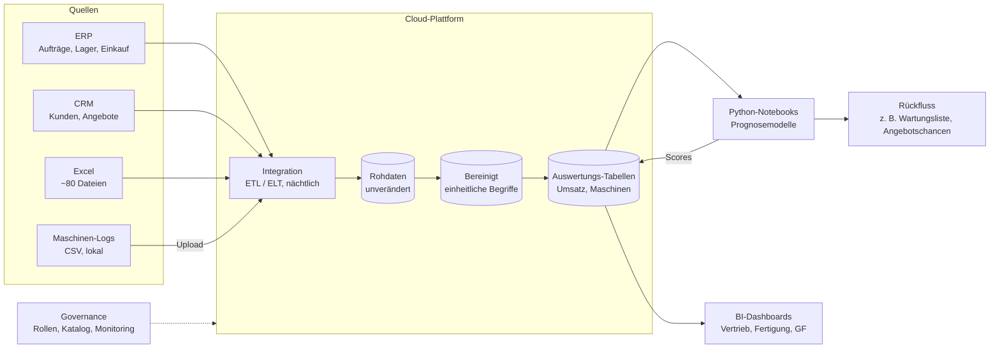

# Tag 9 · Plattformen: Lösung Fallstudie Schmidt (UE 5–6)

Quelle: `09_05a_UE5_6_Fallstudie_Aufgabenstellung.pdf` (Maschinenbau Schmidt GmbH).
Aufgabe laut Folie 6: **1. Anforderungen analysieren, 2. Datenfluss & Plattformstrategie entwerfen, 3. Entscheidung begründen.** Dazu kommen laut Folie 5 die Governance und die Reflexion.

| Teil | Inhalt | Abschnitt |
|---|---|---|
| 1 | Anforderungen an die Plattform analysieren | 2 |
| 2 | Datenfluss und Plattformstrategie entwerfen | 3 und 4 |
| 3 | Entscheidung begründen | 5 |
| Zusatz | Governance mitdenken, Reflexion | 6 und 7 |

---

## Das Ergebnis in Kürze

- **Empfehlung:** eine **gemanagte Cloud-Plattform** (Warehouse mit BI), die ERP, CRM, Excel und Maschinen-Logs automatisch zusammenführt. Modelle entstehen bei Bedarf in **Python-Notebooks** auf den Daten des Warehouses.
- **Build oder Buy:** **Buy für alles, was jeder Betrieb braucht** (Speicherung, Integration, Dashboards), **Build nur dünn** für die Modelle, die Schmidts Maschinenwissen brauchen (z. B. Ausfallvorhersage aus den Maschinen-Logs).
- **Cloud oder On-Premise:** Cloud, weil das IT-Team nur 2 Personen hat und die Daten um 30 % pro Jahr wachsen. Die Maschinen-Logs werden von lokal in die Cloud geladen.
- **Eine Lösung oder Ecosystem:** eine **Kernplattform mit offenen Schnittstellen** (SQL, Python, offene Dateiformate). Das ist weder ein Alleskönner eines einzigen Anbieters noch ein Baukasten aus zehn Werkzeugen, den zwei Personen nicht betreuen können.
- **Der engste Punkt ist das Geld:** Ein Cloud-Angebot kostet laut Folie 34 über 3 Jahre rund 185 T€ (nicht nur den Lizenzpreis). Das Budget von 3 · 60 T€ = 180 T€ reicht dafür kaum. Deshalb **klein starten** (Proof of Concept) und stufenweise ausbauen.
- **Governance von Anfang an:** Rollen und Rechte, Datenverantwortliche je Quelle, EU-Region, Dokumentation der Modelle und eine Regel, was mit den ~80 Excel-Dateien geschieht.

---

## 1. Die Ausgangslage

| Merkmal | Wert | Was daraus folgt |
|---|---|---|
| Größe | 220 Mitarbeitende | Mittelstand, überschaubare Zahl an Nutzern |
| IT-Team | 2 Personen | **Wenig Betriebskapazität.** Alles, was gewartet werden muss, ist teuer |
| IT-Budget | 60 T€ pro Jahr | **Enge Grenze** für Lizenz, Betrieb, Schulung und Migration |
| Datenwachstum | +30 % pro Jahr | Nach 3 Jahren das 2,2-fache (1,3³ ≈ 2,2), nach 5 Jahren das 3,7-fache |
| Struktur | ERP, CRM, Excel, Maschinen-Logs | Vier Quellen mit **verschiedenen Formaten und Orten** |

Die vier Datenquellen im Detail:

| Quelle | Inhalt | Ablage | Besonderheit |
|---|---|---|---|
| ERP | Aufträge, Lager, Einkauf | Datenbank | Strukturiert, gut abfragbar, Basis für Umsatz und Lieferfähigkeit |
| CRM | Kunden, Angebote | Cloud | Schon in der Cloud, meist über eine Schnittstelle (API) erreichbar |
| Excel-Dateien | Auswertungen, Reports | ~80 Dateien auf dem Netzlaufwerk | **Wildwuchs:** Versionen, Formeln und Zuständigkeit sind unklar |
| Maschinen-Logs | Laufzeiten | CSV, lokal | Wächst am schnellsten, liegt nicht zentral, Rohdaten |

> **Die Kernschwäche:** Es gibt keine durchgängige Plattform. Dieselbe Frage (z. B. „Welche Kunden bringen den größten Deckungsbeitrag?“) braucht heute Daten aus ERP *und* CRM und wird von Hand in Excel zusammengebaut. Das ist langsam, fehleranfällig und nicht wiederholbar.

---

## 2. Teil 1: Anforderungen an die Plattform

Die Folie 7 ordnet die Anforderungen in drei Gruppen: **Daten integrieren, Modelle trainieren, Ergebnisse visualisieren.** Dazu kommt, was im Hintergrund laufen muss.

### 2.1 Funktionale Anforderungen

| Gruppe | Anforderung | Warum bei Schmidt | Priorität |
|---|---|---|---|
| **Daten integrieren** | Automatischer Import aus ERP, CRM, Excel, Maschinen-Logs | Das Zusammenführen geschieht heute von Hand | **Muss** |
| | Zentrale Speicherung mit Historie | Entwicklungen über die Zeit sind nur mit gespeicherten Ständen auswertbar | **Muss** |
| | Einheitliche Begriffe (Kunde, Auftrag, Maschine) | Sonst liefern zwei Excel-Dateien zwei Umsätze | **Muss** |
| | Datenqualität prüfen (Dubletten, Lücken, Formate) | Excel und Logs sind die unsauberen Quellen | Soll |
| **Modelle trainieren** | Python-Notebooks auf den zentralen Daten | Bekanntes Werkzeug, offener Standard, kein Aufbau eigener Software | Soll |
| | Ergebnisse (Scores) zurückspeichern | Prognosen müssen im Dashboard oder im CRM ankommen | Soll |
| | Erste Anwendungsfälle: Ausfallvorhersage Maschinen, Absatzprognose, Angebotschancen | Typische Use Cases im Maschinenbau (Folie 8: „Welche Funktionen muss die Plattform abdecken?“) | Kann (später) |
| **Visualisieren** | Dashboards für Vertrieb, Fertigung, Geschäftsführung | Hier sehen die meisten Nutzer den Nutzen | **Muss** |
| | Self-Service für Fachabteilungen | Entlastet die 2 IT-Personen, setzt gute Daten und Schulung voraus (Folie 27) | Soll |

### 2.2 Nicht-funktionale Anforderungen

| Anforderung | Konkret | Folge für die Wahl |
|---|---|---|
| **Betrieb mit wenig Personal** | Möglichst wenig eigene Wartung, Updates, Backups | Spricht für **gemanagte Dienste** |
| **Kosten** | Gesamtkosten (TCO) im Rahmen von 60 T€ pro Jahr | Spricht für **nutzungsbasierte Preise und kleinen Start** |
| **Skalierbarkeit** | +30 % Daten pro Jahr, Logs wachsen schneller | Spricht für **Cloud-Speicher** statt eigener Server |
| **Integration** | ERP-Datenbank, Cloud-CRM, Dateien | Es müssen **fertige Anschlüsse (Konnektoren)** vorhanden sein |
| **Bedienbarkeit** | Fachanwender und 2 IT-Personen | Dashboards ohne Code, Notebooks nur für wenige |
| **Datenschutz und Sicherheit** | Kundendaten im CRM, Mandanten- und Rechtekonzept | EU-Rechenzentrum, Rollen, Protokollierung |
| **Unabhängigkeit** | Wechsel zu einem anderen Anbieter muss möglich bleiben | Offene Standards, Daten exportierbar |

### 2.3 Die vier Auswahlkriterien (Folie 31) auf Schmidt angewendet

| Kriterium | Frage | Antwort für Schmidt |
|---|---|---|
| **Skalierbarkeit** | Wächst sie mit? | Ja, nötig: das Datenvolumen verdoppelt sich in knapp 3 Jahren |
| **Bedienbarkeit** | Wer arbeitet damit? | Kleines IT-Team plus Fachanwender, also wenig Code und viel Self-Service |
| **Integration** | Passt sie ins Umfeld? | ERP-Datenbank, Cloud-CRM, Dateien und CSV müssen anschließbar sein |
| **Kosten** | Lizenz und Betrieb? | Gesamtkosten, nicht Lizenzpreis. Budget von 60 T€ pro Jahr ist die harte Grenze |

---

## 3. Teil 2a: Der Datenfluss von der Quelle zum Dashboard

### 3.1 Was in jedem Schritt geschieht

| Schritt | Aufgabe | Schmidt-spezifisch |
|---|---|---|
| **Quellen** | Daten entstehen im Tagesgeschäft | Vier Quellen, keine wird verändert |
| **Integration (ETL/ELT)** | Automatisch lesen, in die Plattform laden, zeitlich geplant | ERP und CRM über Konnektoren, Excel und Logs über einen Ordner, in den sie abgelegt werden |
| **Rohdaten** | Unveränderte Kopie, nie überschreiben | Wenn später etwas schiefgeht, kann man neu aufbauen |
| **Bereinigt** | Typen, Dubletten, einheitliche Begriffe | „Kunde“ heißt in ERP und CRM dasselbe, Kundennummern passen zusammen |
| **Auswertungs-Tabellen** | Fertig aufbereitet für Fragen | Umsatz je Kunde und Monat, Laufzeit und Stillstand je Maschine |
| **Dashboards** | Antworten für Fachabteilungen | Ein Zahlenstand für alle, statt 80 Excel-Dateien |
| **Notebooks** | Modelle für Prognosen | Läuft auf den Auswertungs-Tabellen, nicht auf Kopien auf dem Laptop |
| **Rückfluss** | Ergebnis dorthin, wo gehandelt wird | Wartungsliste an die Instandhaltung, Angebotschancen ins CRM |

> **Der Weg der Maschinen-Logs** ist der einzige, der aktiv angestoßen werden muss, weil die CSV-Dateien lokal liegen. Am einfachsten: ein kleines geplantes Skript lädt neue Dateien jede Nacht in einen Cloud-Ordner hoch. Aus dem Ordner übernimmt die Integration sie. Die Dateien liegen dort im Rohformat und werden beim Bereinigen in ein platzsparendes Spaltenformat übersetzt.

### 3.2 Warum Warehouse und nicht gleich ein großer Data Lake?

Schmidt hat überwiegend strukturierte Daten (Aufträge, Kunden, Laufzeiten) und kaum Bilder, Texte oder Sensor-Rohströme. Ein **Data Warehouse** mit einer Rohdaten-Zone reicht und ist für zwei Personen deutlich einfacher zu betreiben als ein Lake mit Eigenbau. Wenn die Maschinen-Logs später in sehr fein aufgelöste Sensordaten übergehen, kann man ein Lakehouse prüfen (Lake mit Warehouse-Funktionen, siehe Folien zu den Plattformarten). Heute ist das nicht nötig.

---

## 4. Teil 2b: Die Plattformstrategie

Die Folie 7 nennt drei Entscheidungen. Jede wird einzeln getroffen.

### 4.1 Build oder Buy?

Die Folie 32 sagt: **Build** ist für Kernkompetenzen, **Buy** für Standardfälle.

| Baustein | Kernkompetenz von Schmidt? | Entscheidung | Begründung |
|---|---|---|---|
| Speicherung der Daten | Nein | **Buy** (gemanagtes Warehouse) | Jeder Betrieb braucht dasselbe, kein Wettbewerbsvorteil |
| Integration ERP/CRM | Nein | **Buy** (fertige Konnektoren) | Eigene Schnittstellen müssen bei jedem Update gewartet werden |
| Dashboards | Nein | **Buy** (BI-Werkzeug) | Standardfunktion |
| Bereinigung und Begriffe | Teils | **Hybrid** (SQL-Regeln selbst, Werkzeug gekauft) | Das *Wissen* über Aufträge und Kunden steckt bei Schmidt |
| Ausfall- und Absatzmodelle | **Ja:** Maschinenwissen | **Build, aber dünn** (Python-Notebooks, Standardbibliotheken) | Die Modelle nutzen eigenes Wissen, aber keine eigene Plattform |
| Eigene Plattform von Grund auf | Nein | **Nicht bauen** | Wäre für 2 Personen kaum zu betreiben und würde das Budget sprengen |

### 4.2 Cloud oder On-Premise?

Die Folie 28 stellt gegenüber: On-Premise = volle Kontrolle, hohe Fixkosten. Cloud = schnell skalierbar, nutzungsbasierte Kosten.

| Kriterium | On-Premise | Cloud | Gewinner bei Schmidt |
|---|---|---|---|
| Betrieb | Server, Updates, Backups durch das Team | Vom Anbieter | **Cloud** (nur 2 Personen) |
| Startkosten | Hardware, Lizenz, Einrichtung | Gering, nutzungsbasiert | **Cloud** (Budget 60 T€ pro Jahr) |
| Wachstum | Hardware vorab kaufen | Nach Bedarf | **Cloud** (+30 % pro Jahr) |
| Laufende Kosten | Planbar, aber hohe Fixkosten | Können bei Dauerlast steigen | Gleichstand, Cloud braucht **Kostenkontrolle** |
| Kontrolle und Datenschutz | Maximal | Mit EU-Region und Verträgen gut machbar | Leichter Vorteil On-Premise |
| Ausfallsicherheit | Eigene Verantwortung | Vom Anbieter abgesichert | **Cloud** |

**Entscheidung: Cloud**, mit EU-Rechenzentrum und einer Kostenobergrenze. Das ERP bleibt dort, wo es ist: Es wird nicht umgezogen, sondern nur *gelesen*.

### 4.3 Eine Lösung oder Ecosystem?

| Variante | Vorteil | Nachteil |
|---|---|---|
| **Eine Lösung aus einer Hand** | Alles passt zusammen, ein Ansprechpartner | Hohe Abhängigkeit (Vendor Lock-in, Folie 33), Preis nach Anbieterwillen |
| **Ecosystem aus vielen Werkzeugen** | Beste Einzellösung je Aufgabe, leicht austauschbar | Viel Integrationsaufwand, mehr Wartung, braucht Know-how |
| **Kernplattform mit offenen Schnittstellen** (empfohlen) | Wenig Aufwand, aber Wechsel bleibt möglich | Braucht Disziplin bei Standards |

**Entscheidung: Kernplattform mit offenen Schnittstellen.** Konkret heißt das: Daten in einem Warehouse, das **Standard-SQL** spricht; Modelle in **Python**; Dateien in **offenen Formaten** (CSV, Parquet); ein BI-Werkzeug, das auf Standard-SQL aufsetzt. So bleibt ein Wechsel eines Teils möglich, ohne alles neu aufzubauen. Weniger als 4 bis 5 Werkzeuge insgesamt, sonst ist das Team überfordert.

### 4.4 Die Kosten im Rahmen halten

Aus Folie 34 (Beispiel, nicht Schmidts echte Zahlen):

| Kostenart (3 Jahre) | Im Angebot? | Betrag |
|---|---|---|
| Lizenz | ja | 60.000 € |
| Betrieb und Wartung | teilweise | 45.000 € |
| Schulung | selten | 15.000 € |
| Datenmigration | nein | 25.000 € |
| Anbindung an ERP und CRM | nein | 40.000 € |
| **Gesamt (TCO)** | | **185.000 €** |

Das Budget von Schmidt beträgt 3 · 60.000 € = **180.000 €** in 3 Jahren. Die Folienrechnung liegt knapp darüber. Dabei ist angenommen, dass das gesamte IT-Budget für das Projekt zur Verfügung steht, was unrealistisch ist, denn ERP und Arbeitsplätze kosten ebenfalls. Daraus folgt:

1. **Klein starten:** Ein Proof of Concept (Folie 35) mit ein bis zwei Quellen und einem Dashboard kostet nur einen Bruchteil.
2. **Nutzungsbasiert zahlen und Obergrenzen setzen:** Kostenwarnungen und ein Monatslimit im Konto.
3. **Schulung und Migration einplanen,** sie fehlen im Angebot und treiben die Kosten.
4. **Eigenleistung nutzen:** Konnektoren statt Eigenentwicklung, SQL-Wissen des Teams.
5. **Förderung prüfen:** Für Digitalisierung im Mittelstand gibt es teils Programme (nicht geprüft, nur als Hinweis).

---

## 5. Teil 3: Die Entscheidung begründen

### 5.1 Bewertung der Alternativen

Dieselben Kriterien und Gewichte wie in Arbeitsauftrag 2 (Skalierbarkeit 35 %, Kosten 35 %, Integration 30 %), Skala 1 (schlecht) bis 5 (sehr gut).

| Option | Skalierbarkeit | Kosten | Integration | Gewichtet |
|---|---|---|---|---|
| **A) Einfache BI-Lösung auf den bestehenden Daten** | 2 | 4 | 3 | 0,35·2 + 0,35·4 + 0,30·3 = **3,00** |
| **B) Gemanagte Cloud-Plattform** (empfohlen) | 5 | 3 | 4 | 0,35·5 + 0,35·3 + 0,30·4 = **4,00** |
| **C) Eigenentwicklung / On-Premise** | 3 | 1 | 4 | 0,35·3 + 0,35·1 + 0,30·4 = **2,60** |

Die Bewertung ist eine begründete Einschätzung, keine Messung. Sie ist plausibel, weil:

- **A** ist billig und schnell, löst aber das Wachstumsproblem nicht. Die Maschinen-Logs und die Historie passen nicht in ein reines BI-Werkzeug auf Excel-Basis.
- **B** skaliert, braucht wenig eigenen Betrieb und hat fertige Konnektoren. Die Kosten sind der Schwachpunkt (siehe 4.4).
- **C** passt am besten zu individuellen Wünschen, braucht aber mehr Personal, als Schmidt hat. Die Folie 32 sagt: Build ist für Kernkompetenzen. Eine Plattform ist bei Schmidt keine.

### 5.2 Die Argumente für B

1. **Das Team ist der Engpass, nicht die Technik.** Zwei Personen können eine gemanagte Plattform betreuen, aber keine selbst gebaute.
2. **Wachstum.** Bei +30 % pro Jahr wird jede feste Hardware knapp. Cloud wächst mit.
3. **Gesamtkosten statt Lizenzpreis.** Die Entscheidung basiert auf dem TCO, nicht auf dem Angebot.
4. **Risikoarm einführbar.** Mit einem Proof of Concept ist ein Abbruch früh und günstig möglich.
5. **Anschluss an Modelle.** Python-Notebooks setzen direkt auf den Daten auf und machen Prognosen ohne Zusatzwerkzeug möglich.

### 5.3 Wann würde sich die Entscheidung ändern?

| Wenn … | dann … |
|---|---|
| Kostengewicht über etwa 67 % steigt (Budget wichtiger als alles andere) | wird **A** besser als B (Rechnung aus Arbeitsauftrag 2) |
| Das Cloud-Angebot weit über 60 T€ pro Jahr liegt | zuerst Umfang kürzen (nur ERP und CRM), dann B später ausbauen |
| Verträge oder Kunden verlangen, dass Daten das Haus nicht verlassen | On-Premise oder Hybrid prüfen |
| Die Maschinendaten wachsen auf sehr feine Sensorwerte | Lakehouse prüfen |
| Eine Prognose bringt klaren Mehrwert und muss in Echtzeit laufen | Betrieb und Monitoring ausbauen (Pipelines, Modellüberwachung) |

---

## 6. Governance mitdenken

Die Folie 36 nennt: Zugriffsrechte und Datenschutz, wer welche Daten nutzen darf, Nachvollziehbarkeit von Modellen.

| Thema | Maßnahme bei Schmidt | Verantwortung |
|---|---|---|
| **Rollen und Rechte** | Rollen: Lesen (Fachabteilung), Bearbeiten (Analyst), Administrieren (IT). Vertriebsdaten nur für Vertrieb, Preise und Margen nur für berechtigte Personen | IT plus Fachbereichsleitung |
| **Datenverantwortliche** | Je Quelle eine Person („Data Owner“): ERP = Einkauf/Logistik, CRM = Vertrieb, Logs = Fertigung | Geschäftsführung legt fest |
| **Datenschutz (DSGVO)** | Personenbezug im CRM (Ansprechpartner), EU-Region, Auftragsverarbeitungsvertrag mit dem Anbieter, Löschfristen | Datenschutzbeauftragte(r) |
| **Excel-Wildwuchs** | Die ~80 Dateien sichten: Welche werden gebraucht? Wichtige Auswertungen wandern ins Dashboard, der Rest wird archiviert | Fachabteilungen mit IT |
| **Datenkatalog und Begriffe** | Eine Liste: Was bedeutet „Umsatz“, „aktiver Kunde“, „Maschinenstillstand“? | Data Owner |
| **Modelle nachvollziehbar** | Pro Modell eine Seite: Zweck, Trainingsdaten, Version, Kennzahlen, Ansprechperson | Analyst |
| **Monitoring** | Läuft der nächtliche Import? Stimmen die Zahlen? Wird die Prognose schlechter? | IT |
| **Kostenkontrolle** | Monatslimit, Warnungen, Quartalsbericht | IT |
| **Datensicherung und Ausstieg** | Regelmäßiger Export in offene Formate | IT |

> **Zentrale Regel:** Governance ist kein Zusatz am Ende, sondern gehört in Phase 1. Wer erst ein Dashboard baut und danach die Rechte regelt, hat Daten bereits an Stellen gezeigt, an denen sie nicht hingehören.

---

## 7. Umsetzung in Stufen

| Phase | Dauer (Annahme) | Inhalt | Ergebnis |
|---|---|---|---|
| **0 Vorbereitung** | 2 bis 4 Wochen | Ziele, Use Case wählen (z. B. Absatz- und Auftragsübersicht), Data Owner benennen, Excel sichten | Entscheidungsgrundlage |
| **1 Proof of Concept** | 6 bis 8 Wochen | ERP + CRM anschließen, ein Dashboard, Rechte | Beweis, dass Datenfluss und Nutzen funktionieren |
| **2 Ausbau** | 3 Monate | Maschinen-Logs, Excel-Ablösung, Self-Service, Schulung | Eine Zahlenbasis für alle |
| **3 Modelle** | ab Monat 6 | Ausfallvorhersage, Absatzprognose in Notebooks | Erste Prognose im Einsatz |
| **4 Betrieb** | laufend | Monitoring, Kostenkontrolle, Modellpflege | Verlässlicher Betrieb |

Die Dauern sind Annahmen. Der Proof of Concept hat ein klares Abbruchkriterium (z. B. „Dashboard liefert die Vertriebszahlen in 5 Minuten statt 2 Tagen und die Zahlen stimmen mit ERP überein“).

---

## 8. Reflexion (Folie 1, Punkt 3)

**Was war die schwierigste Abwägung?** Kosten gegen Wachstum. Die billigste Lösung (A) löst das Wachstumsproblem nicht, die wachstumsfähige (B) liegt am Budgetrand. Die Antwort ist kein Entweder-oder, sondern **klein starten und das Risiko begrenzen.**

**Was wurde angenommen und nicht gewusst?**

| Annahme | Risiko | Wie prüfen? |
|---|---|---|
| Kosten laut Folienbeispiel gelten für Schmidt | Realer Preis kann stark abweichen | Angebote einholen, TCO selbst rechnen |
| Das ganze IT-Budget ist verfügbar | Meist nicht, Bestandskosten laufen weiter | Mit der Geschäftsführung klären |
| Excel-Dateien lassen sich ersetzen | Manche enthalten Wissen und Sonderregeln | Mit den Anwendern sichten |
| Maschinen-Logs haben brauchbare Qualität | Lücken, wechselnde Formate | Stichprobe im Proof of Concept |
| Zwei Personen reichen für den Betrieb | Urlaub, Krankheit, Abgänge | Dokumentation, Vertretung, evtl. Dienstleister |

**Was könnte schiefgehen?**

1. **Technik vor Nutzen:** Eine Plattform wird gebaut, aber niemand benutzt sie. Gegenmittel: Mit einem konkreten Use Case und einer Fachabteilung starten.
2. **Kosten laufen aus dem Ruder:** Nutzungsbasierte Preise steigen mit dem Datenvolumen. Gegenmittel: Limits und Warnungen.
3. **Wissen steckt in zwei Köpfen.** Gegenmittel: Dokumentation, Standardwerkzeuge.
4. **Schlechte Daten:** Auch die beste Plattform macht aus fehlerhaften Excel-Daten keine guten Prognosen. Gegenmittel: Qualitätsprüfungen schon bei der Integration.
5. **Lock-in:** Wechsel wird teuer. Gegenmittel: offene Standards, Exportplan.

**Was würde ich beim nächsten Mal anders machen?** Das Budget vor der Plattformwahl klären (reales Projektbudget, nicht IT-Gesamtbudget) und den Use Case mit dem höchsten Nutzen bereits im Kriterienkatalog festschreiben.

---

## Kernaussagen

1. **Anforderungen vor Werkzeugen.** Erst klären, was integriert, trainiert und visualisiert werden soll, dann das Werkzeug wählen.
2. **Das Team entscheidet mit.** Zwei Personen können nur betreiben, was gemanagt ist. Das spricht für Cloud und Buy.
3. **Buy für Standard, Build für Kernwissen.** Selbst gebaut werden nur die Modelle, nicht die Plattform.
4. **Offene Standards halten die Tür offen.** SQL, Python, offene Dateiformate.
5. **Gesamtkosten statt Lizenzpreis.** Folie 34: 185.000 € statt 60.000 €. Das Budget ist die engste Grenze.
6. **Klein starten mit Proof of Concept.** Das begrenzt Fehlinvestitionen.
7. **Governance von Anfang an.** Rollen, Datenverantwortliche, Datenschutz, Dokumentation.

---

## Wo könnten Antworten abweichen?

- **Die Bewertungszahlen** in 5.1 sind Einschätzungen. Eine andere Gruppe kann zu anderen Punkten und damit zu einer anderen Reihenfolge kommen. Wichtig ist, dass die Begründung trägt.
- **Die Kosten für A und C** sind Annahmen, nur die B-Zahlen stammen aus dem Folienbeispiel.
- **Hybrid statt reine Cloud:** Gruppen mit Datenschutzbedenken können das ERP und die Logs lokal halten und nur Auswertungstabellen in die Cloud schieben. Das ist vertretbar, kostet aber mehr Betriebsaufwand.
- **Die Phasendauern** sind geschätzt.
- **Ob ein Data Lake nötig ist,** hängt davon ab, wie fein die Maschinendaten sind. Hier ist ein Warehouse mit Rohdaten-Zone angenommen.
- **Das Diagramm** in Abschnitt 3 ist ein Mermaid-Diagramm und wurde nicht gerendert getestet.
