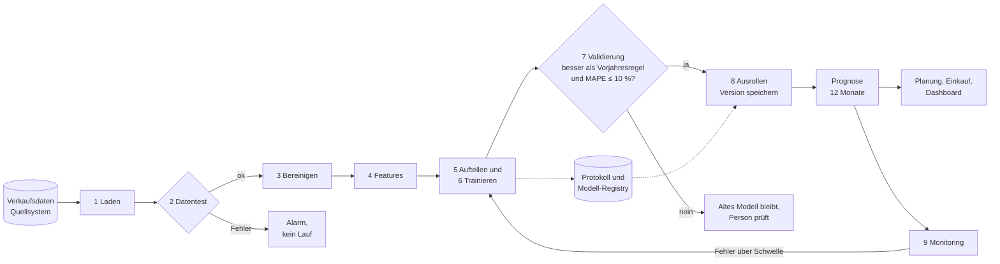

# Tag 10 · MLOps: Lösung Arbeitsauftrag 1 (Nachfrageprognose automatisieren)

Quelle: `10_02_UE2_Arbeitsauftrag1.pdf`, Konzepte aus `10_01_UE1_MLOPS.pdf`.
Daten für den optionalen Teil: `10_02_UE2_Arbeitsauftrag1_Daten.csv` (Fluggäste je Monat 1949 bis 1960).
Skript zum Durchspielen: [`10_Pipeline_Nachfrageprognose.py`](10_Pipeline_Nachfrageprognose.py).

**Ausgangslage:** Ein Unternehmen will eine automatische Nachfrageprognose einführen. Die Daten sind historische Verkaufszahlen mit Saisonalität. Ziel ist, möglichst viele Schritte zu automatisieren.

| Teilaufgabe (Folie 3) | Abschnitt |
|---|---|
| 1. Schritt-für-Schritt-Vorgehen für das Modelltraining | 2 |
| 2. Einfache Automatisierungs-Pipeline skizzieren | 3 |
| 3. Welche Tools? | 4 |
| Optional: an echten Daten durchspielen | 5 |
| Orientierungsraster: wo automatisieren, wo nicht? | 3.2 |

---

## Das Ergebnis in Kürze

- **Vorgehen in 8 Schritten:** Daten laden, prüfen, bereinigen, Features bauen, **zeitlich** aufteilen, trainieren mit Kreuzvalidierung, auf Testdaten validieren, bei Erfolg ausrollen und überwachen.
- **Automatisieren:** alles, was jede Nacht oder jeden Monat gleich abläuft (Laden, Prüfen, Features, Training, Validierung, Prognose, Monitoring). **Nicht automatisieren:** die Freigabe eines neuen Modells bei Auffälligkeiten, die Ursachenforschung bei Alarm und die Entscheidung, was die Prognose für Einkauf und Planung bedeutet.
- **Das Tor:** Ein neues Modell geht nur live, wenn es auf den Testdaten **besser als die einfache Vergleichsregel** („so viel wie im Vorjahr“) ist und der Fehler unter einer vorher festgelegten Schwelle liegt.
- **Tools:** **Airflow** für den Ablauf, **MLflow** für Läufe und Modellversionen, **Monitoring** für Technik, Daten und Güte. Kubeflow und Feature Store sind für diesen Fall zu groß (Begründung in Abschnitt 4).
- **Durchgespielt an den Fluggastdaten:** bestes Modell „Vorjahr + Vormonat + Monat“, Testfehler **MAE 16,1** (MAPE 3,5 %) gegen **47,6** für die Vorjahresregel. Beim Durchspielen fielen drei Dinge auf, die man auf dem Papier nicht sieht (Abschnitt 5.3).

---

## 1. Was die Aufgabe verlangt

Der Kern der Folien 2 bis 6: Aus einem Notebook, das einmal läuft, soll ein **Ablauf** werden, der **jeden Monat zuverlässig** läuft, ohne dass jemand Schritte von Hand ausführt (Folie 7 der Vorlesung: „Notebook auf dem Laptop“ gegen „nächtlicher Lauf auf der Plattform“). Dabei gilt: Der ML-Code ist der kleinste Teil (Folie 5). Das meiste Gewicht liegt bei Daten, Ablauf, Bereitstellung und Überwachung.

---

## 2. Teilaufgabe 1: Schritt-für-Schritt-Vorgehen für das Modelltraining

| Nr. | Schritt | Was geschieht | Besonderheit bei Nachfrage mit Saison |
|---|---|---|---|
| 1 | **Daten laden** | Verkaufszahlen aus dem Quellsystem lesen | Immer dieselbe Quelle und dasselbe Format, sonst bricht der Lauf |
| 2 | **Daten prüfen** (Datentest) | Vollständig? Plausibel? Keine Dubletten? | Lückenlose Monatsreihe, keine negativen Mengen, 12 Monate je Jahr |
| 3 | **Bereinigen** | Leere Zeilen entfernen, Datum bilden, sortieren | Bei Zeitreihen zählt die **Reihenfolge** |
| 4 | **Features berechnen** | Vorjahreswert, Vormonat, Monat, Trend | **Nur Information aus der Vergangenheit** (Leakage vermeiden) |
| 5 | **Aufteilen** | Training und Test | **Zeitlich:** die letzten Monate sind der Test. Nicht zufällig mischen |
| 6 | **Trainieren und auswählen** | Mehrere Modelle, Auswahl per Kreuzvalidierung | Kreuzvalidierung **entlang der Zeit** (immer die Zukunft vorhersagen) |
| 7 | **Validieren** | Güte auf Testdaten, Vergleich mit einfacher Regel | Das Modell muss die Vorjahresregel schlagen |
| 8 | **Ausrollen** | Modell speichern, Version, Prognose erzeugen | Mit allen Daten neu anpassen, damit der jüngste Verlauf eingeht |
| 9 | **Überwachen** | Fehler im Betrieb messen, Drift beobachten | Neue Ist-Werte mit der Prognose vergleichen |
| 10 | **Neu trainieren** | Bei Schwellenunterschreitung oder nach Plan | Mit aktuellen Daten, wieder durch dasselbe Tor |

Das Skript nummeriert etwas feiner (Prognose und Protokoll sind eigene Schritte, siehe Abschnitt 5.2). Die Reihenfolge ist dieselbe.

> **Wichtig bei Zeitreihen:** Zufälliges Aufteilen (wie bei Kunden-Daten üblich) wäre hier ein Fehler. Das Modell würde Monate aus der Zukunft zum Lernen sehen und im Test „vorhersagen“, was es schon kennt. Die Güte wäre zu gut, im Betrieb enttäuscht sie.

### 2.1 Die Entscheidungen, die vor dem ersten Lauf feststehen müssen

| Entscheidung | Beispiel | Warum vorher? |
|---|---|---|
| Zielgröße und Horizont | Monatsmenge je Produkt, 12 Monate voraus | Bestimmt Features und Test |
| Gütemaß | MAE und MAPE | Muss zur Handlung passen (siehe Tag 8) |
| Vergleichsregel | „So viel wie im Vorjahr“ | Sonst weiß man nicht, ob das Modell etwas bringt |
| Freigabeschwelle | MAPE ≤ 10 % **und** besser als die Vergleichsregel | „Schwellen festlegen, bevor es brennt“ (Folie 31) |
| Zuständigkeit | Eine Person, nicht „das Team“ | Folie 31 |

---

## 3. Teilaufgabe 2: Eine einfache Automatisierungs-Pipeline



Dieselbe Pipeline als Ablaufplan für Airflow (ein **DAG**, Folie 15): Jeder Kasten ist ein Task, die Pfeile sind die Abhängigkeiten. Der Plan läuft zum Beispiel am 1. jedes Monats um 02:00 Uhr.

### 3.1 Was zwischen den Schritten weitergegeben wird

| Übergang | Weitergabe | Wird gespeichert? |
|---|---|---|
| Laden → Prüfen | Rohtabelle | Ja, unverändert (Rohdaten nie überschreiben) |
| Features → Training | Feature-Tabelle | Ja, mit Datenstand |
| Training → Validierung | Modell und Kennzahlen | Ja, im Protokoll |
| Validierung → Ausrollen | Freigabe-Entscheidung | Ja, mit Begründung |
| Ausrollen → Prognose | Modell-Version | Ja, in der Registry |
| Prognose → Planung | Tabelle mit Prognosewerten | Ja, mit Versionsnummer (Audit-Frage, Folie 34) |

### 3.2 Wo automatisieren, wo nicht? (Orientierungsraster, Folie 5)

| Schritt | Automatisieren? | Begründung |
|---|---|---|
| Laden, Bereinigen, Features | **Ja** | Läuft jedes Mal gleich, Handarbeit ist die häufigste Fehlerquelle (Knight Capital, Folie 38) |
| Datentest | **Ja, mit Abbruch** | Schlechte Daten dürfen nicht lautlos ins Modell fließen |
| Training und Kreuzvalidierung | **Ja** | Rechenarbeit, reproduzierbar |
| Validierung gegen die Schwelle | **Ja** | Das Tor ist eine feste Regel (Folie 19: Modelltest) |
| Ausrollen bei bestandenem Tor | **Ja, schrittweise** | Eine getestete Version ist jederzeit auslieferbar (CD, Folie 18) |
| Prognose erzeugen | **Ja** | Batch reicht, wenn nur monatlich geplant wird (Folie 20) |
| Monitoring und Alarm | **Ja** | Laufend messen statt auf Beschwerden warten |
| **Freigabe, wenn das Tor knapp verfehlt wird** | **Nein, Mensch** | Eine Person entscheidet, ob eine Ausnahme sinnvoll ist |
| **Ursache bei Alarm klären** | **Nein, Mensch** | Drift, Datenfehler oder echte Veränderung? Das erfordert Wissen über das Geschäft |
| **Umgang mit Sonderereignissen** | **Nein, Mensch** | Aktion, Lieferausfall, Pandemie: Das Modell kennt sie nicht (Instacart, Folie 26) |
| **Entscheidung, was bestellt wird** | **Nein, Mensch** (oder Regel mit Grenzen) | Die Prognose ist eine Grundlage, keine Bestellung |

> **Faustregel aus dem Kompendium:** Eindeutig und umkehrbar → automatisch. Wenn ein Fehler Geld oder Haftung betrifft → Mensch entscheidet, Alarm, Rohdaten bleiben unverändert.

### 3.3 Rollout und Rückfall

Ein neues Modell wird **nicht auf einmal** für alle freigeschaltet (Canary, Folie 21): erst für wenige Produktgruppen oder Standorte, zwei bis vier Wochen beobachten, dann ausweiten. Das **alte Modell bleibt abrufbereit**, der Rückweg ist ein Knopfdruck. Bei Nachfrageprognosen kann man auch parallel laufen lassen und die Fehler vergleichen (A/B-Test, Folie 23).

### 3.4 Retraining: wann?

| Auslöser | Beispiel |
|---|---|
| **Nach Plan** | Jeden Monat, weil neue Ist-Werte eintreffen |
| **Nach Schwelle** | MAPE der letzten 6 Monate über 15 % |
| **Nach Ereignis** | Neue Produktlinie, Preisänderung, neuer Vertriebskanal |

Auch das neu trainierte Modell geht **durch dasselbe Tor** (Schritt 7). Ein Retraining ersetzt das alte Modell nicht automatisch, sondern nur, wenn es die Prüfung besteht.

---

## 4. Teilaufgabe 3: Welche Tools?

Die Tabelle von Folie 12 („Sie brauchen es, wenn …“) auf diesen Fall angewendet:

| Werkzeug | Was es tut | Brauchen wir es? | Begründung |
|---|---|---|---|
| **Apache Airflow** | Startet Schritte nach Plan, in fester Reihenfolge | **Ja** | Jeden Monat laufen mehrere Schritte nacheinander. Genau dafür ist der DAG gedacht |
| **MLflow** | Protokolliert Läufe, verwaltet Modellversionen (Tracking und Registry) | **Ja** | Ohne es weiß bald niemand mehr, welches Modell läuft (Lauf 14, 15, 16 auf Folie 9) |
| **Monitoring** (Dashboard, Alarm) | Misst Laufzeit, Datenverteilung und Güte | **Ja** | Folie 24: Technik, Daten, Güte, Wirkung |
| **Versionierung von Daten und Code** (Git, Datenstand) | Reproduzierbarkeit | **Ja** | Nur so lässt sich Lauf 15 nachbauen (Folie 10) |
| **CI/CD** (z. B. GitHub Actions) | Tests bei jeder Änderung, automatisches Ausrollen | **Ja, schlank** | Datentest, Modelltest, Integrationstest (Folie 19) |
| **Feature Store** | Dieselben Features für Training und Betrieb | **Noch nicht** | Hier rechnet nur eine Pipeline die Features. Er lohnt sich, wenn Training und Betrieb getrennt rechnen |
| **Kubeflow** | Pipelines auf Kubernetes für viele Modelle | **Nein** | Ein Modell, ein monatlicher Batch. Der Betriebsaufwand wäre größer als der Nutzen |

**Wenn die Firma klein ist** und Airflow zu schwer wirkt: Ein geplanter Job (Cron oder der Aufgabenplaner der Cloud-Plattform) mit dem Skript aus Abschnitt 5 plus MLflow ist ein vernünftiger Anfang. Das Prinzip ist dasselbe, nur der Ablaufplaner ist einfacher.

**Die Wahl passt zu Tag 9:** Gemanagte Plattform, offene Standards (Python, SQL), wenig Eigenbetrieb.

---

## 5. Optional: an den Fluggastdaten durchgespielt

Das Skript [`10_Pipeline_Nachfrageprognose.py`](10_Pipeline_Nachfrageprognose.py) enthält jeden Schritt als eigene Funktion, jeweils mit einem Kommentarblock „SCHRITT n“. Ausführen im Kursordner:

```
.venv/bin/python 10_MLOPS/10_Pipeline_Nachfrageprognose.py
```

### 5.1 Ergebnis des Laufs

Kreuzvalidierung auf den Trainingsdaten (MAE, kleiner ist besser; Fluggäste in Tausend):

| Modell | Features | MAE in der Kreuzvalidierung |
|---|---|---|
| **Linear (gewählt)** | **Vorjahr, Vormonat, Monat** | **12,0** |
| Linear | Vorjahr, Vormonat | 16,9 |
| Linear | laufende Nummer (Trend), Monat | 23,4 |
| Gradient Boosting (Bäume) | Vorjahr, Vormonat, Monat | 25,9 |

Auf den letzten 24 Monaten (1959 bis 1960), die beim Training und bei der Auswahl nicht benutzt wurden:

| Größe | Wert |
|---|---|
| MAE des gewählten Modells | **16,1** |
| MAPE | **3,5 %** |
| MAE der Vergleichsregel „wie im Vorjahr“ | 47,6 |
| Tor bestanden (MAPE ≤ 10 % und besser als die Regel)? | **Ja** |

Danach wird das Modell mit allen Daten neu angepasst, als `modell_<Zeitstempel>.joblib` mit einer `.json`-Datei (Version, Datenstand, Prüfsumme der Datei, Kennzahlen) gespeichert und eine Prognose für 1961 erzeugt. Das Protokoll `laeufe.csv` bekommt eine Zeile je Lauf. Das ist die Mini-Version der Tabelle „Lauf 14, 15, 16“ von Folie 9. Die Prognose zeigt den Gipfel im August (ca. 661) und den Tiefpunkt im Februar (ca. 434), also die Saison.

Die erzeugten Dateien liegen in `10_MLOPS/artefakte/` und stehen in der `.gitignore`, denn sie entstehen bei jedem Lauf neu.

### 5.2 Wie das Skript die Folienbegriffe umsetzt

| Folienbegriff | Im Skript |
|---|---|
| Datentest (Folie 19) | Schritt 2: bricht bei fehlenden Werten, Dubletten, unvollständigen Jahren ab |
| Modelltest (Folie 19) | Schritt 7: besser als die Vorjahresregel und MAPE ≤ 10 % |
| Experiment-Tracking (Folie 8) | Schritt 10: `laeufe.csv` je Lauf |
| Modell-Registry (Folie 8) | `modell_<Version>.joblib` mit `.json` |
| Reproduzierbarkeit (Folie 10) | Prüfsumme der Datendatei, feste Zufallszahl, Versionsnummer |
| Lineage (Folie 33) | Die `.json` verbindet Daten, Modell und Kennzahlen |
| Monitoring der Güte (Folie 24) | `ueberwache()`: Fehler der letzten 6 Monate gegen Schwelle 15 % |
| Tor vor dem Deployment | Bei „nicht bestanden“ kein Speichern, altes Modell bleibt |

### 5.3 Was beim Durchspielen auffiel (Folie 4: „fehlende Schritte fallen so auf“)

1. **Die Datei hat Fallen.** Sie beginnt mit einem BOM (ohne `encoding="utf-8-sig"` heißt die erste Spalte `year`) und endet mit einer leeren Zeile (`,,`), die `year` zu Dezimalzahlen macht. Ohne den **Datentest** und das Bereinigen scheitert die Pipeline oder liefert Unsinn. Das ist der Grund, warum Schritt 2 automatisch laufen muss.
2. **Baummodelle können keinen Trend fortschreiben.** Das Boosting ist hier das schlechteste Modell (MAE 25,9). Bäume geben nur Werte zurück, die sie im Training gesehen haben. Die Fluggäste wachsen aber immer weiter. Hätte man ein Baummodell mit den Rohwerten gewählt, wäre die Prognose für 1961 zu niedrig. Die Vorjahres- und Vormonatswerte als Features lösen das Problem, weil sie das Niveau mitbringen.
3. **Nur zeitlich aufteilen.** Die Kreuzvalidierung läuft mit `TimeSeriesSplit`: immer in der Zukunft prüfen. Zufälliges Mischen hätte das Ergebnis geschönt.

Außerdem: Die Prognose für mehrere Monate nutzt **die eigene Prognose als „Vormonat“** (Schritt 9). Fehler können sich dabei aufschaukeln, deshalb sinkt die Genauigkeit mit dem Horizont. Für das Monitoring heißt das: den Fehler **je Prognosehorizont** beobachten, nicht nur insgesamt.

### 5.4 Vergleich mit klassischen Zeitreihenmodellen (statsmodels)

Skript: [`10_Vergleich_Zeitreihenmodelle.py`](10_Vergleich_Zeitreihenmodelle.py). Es braucht `statsmodels` (`.venv/bin/pip install statsmodels`). Das Hauptskript braucht es nicht.

**Fairer Vergleich:** Von fünf Stichtagen aus (Ende 1955 bis Ende 1959) sagt jedes Modell die **nächsten 12 Monate** vorher, ohne deren Ist-Werte zu kennen, und wird dafür jeweils neu angepasst. Das sind 60 Prognosemonate. So läuft die Prognose auch im Betrieb.

| Modell | MAE gesamt | MAPE | Fehler im 1. Monat | Fehler im 12. Monat |
|---|---|---|---|---|
| **Holt-Winters, multiplikative Saison** | **14,1** | 3,5 % | 3,5 | 16,3 |
| SARIMA (0,1,1)(0,1,1,12) auf dem Logarithmus | 16,4 | 4,1 % | 5,3 | 26,4 |
| Holt-Winters, additive Saison | 18,3 | 4,6 % | 6,3 | 18,3 |
| Linear (Modell der Pipeline) | 21,0 | 5,4 % | 6,3 | 26,1 |
| Vorjahresregel (Vergleich) | 38,4 | 9,7 % | 35,0 | 30,8 |

**Was man daraus lernt:**

1. **Das klassische Modell gewinnt hier.** Holt-Winters mit multiplikativer Saison passt zu den Daten: Die Saison-Ausschläge wachsen mit dem Niveau (im Sommer fliegen mehr Menschen, und zwar proportional mehr). Es bringt Trend und Saison von Haus aus mit und braucht kein Feature-Bauen.
2. **Unser Pipeline-Modell ist unter fairen Bedingungen schlechter, als der Testwert in 5.1 sagt.** Dort kam MAE 16,1 heraus, weil der Test jeden Monat die **echten** Vormonats- und Vorjahreswerte benutzt (Ein-Schritt-Prognose). Im Betrieb sagt die Pipeline aber 12 Monate voraus und füttert sich mit **eigenen Prognosen**. Der Fehler wächst mit dem Horizont (6,3 im ersten, 26,1 im zwölften Monat). Das ist ein Fehler im **Validierungs-Design**: Die Prüfung muss so ablaufen wie der spätere Einsatz.
3. **Alle echten Modelle schlagen die Vorjahresregel deutlich.** Das Tor aus Schritt 7 würde jedes von ihnen passieren.
4. **Kleine Testmengen täuschen.** Mit nur 1959 und 1960 lag Holt-Winters additiv vor SARIMA, mit fünf Stichtagen ist es umgekehrt. Die Rangfolge zwischen den drei oder vier guten Modellen ist wackelig. Belastbar ist nur: die Klasse „klassisches Saisonmodell“ ist hier mindestens so gut wie das Feature-Modell und bringt Prognosen mit viel weniger Aufwand.
5. **Ein Modell nach Datenlage wählen.** Hätte die Reihe unregelmäßige Einflüsse (Aktionen, Preise, Feiertage), könnte das Feature-Modell mit zusätzlichen Spalten wieder vorne liegen. Holt-Winters kennt nur die Reihe selbst.

**Folge für die Pipeline:** Schritt 7 sollte die Validierung als Prognose über 12 Monate aus Stichtagen rechnen (wie im Vergleichsskript), und Holt-Winters gehört als Kandidat in die Auswahl. Das Hauptskript ist noch nicht entsprechend angepasst, das wäre der nächste Schritt.

---

## 6. Kernaussagen

1. **Ein Notebook ist keine Pipeline.** Die Pipeline ist der Ablauf: laden, prüfen, trainieren, validieren, ausrollen, überwachen.
2. **Ein Tor vor dem Ausrollen.** Ein neues Modell muss eine feste Prüfung bestehen. Das ist der wichtigste Automatisierungsschutz.
3. **Zeitreihen: zeitlich teilen.** Kein Zufallsmischen, Features nur aus der Vergangenheit.
4. **Immer eine einfache Vergleichsregel mitführen.** Sonst weiß man nicht, ob das Modell etwas bringt.
5. **Automatisieren, was gleich abläuft. Menschen entscheiden bei Ausnahmen, Ursachen und Folgen.**
6. **Alles ist nachvollziehbar.** Daten, Code, Parameter und Modell sind versioniert, jede Prognose hat eine Versionsnummer.
7. **Werkzeug nach Größe wählen.** Airflow und MLflow reichen, Kubeflow und Feature Store erst bei mehr Modellen und getrenntem Betrieb.

---

## Wo könnten Antworten abweichen?

- **Die Zahl der Schritte** ist Geschmackssache. Man kann Aufteilen und Training zusammenfassen oder das Monitoring als eigenen Kreislauf zeichnen. Wichtig sind die Reihenfolge, das Tor und die Rückkopplung.
- **Die Schwellen** (MAPE ≤ 10 %, Alarm bei 15 %) sind Annahmen. Sie sollten aus den Kosten der Fehlprognose folgen (Tag 8).
- **Die Tools:** Andere Gruppen wählen Kubeflow oder einen Feature Store, wenn sie viele Produkte mit eigenen Modellen annehmen. Dann ist das Argument die Zahl der Modelle, nicht die Technik.
- **Die Modellauswahl** in Abschnitt 5 hängt von den Kandidaten ab. Andere Modelle (z. B. klassische Zeitreihenmodelle wie ETS oder SARIMA) sind für saisonale Reihen ebenfalls üblich. Sie sind in Abschnitt 5.4 getestet.
- **Das Mermaid-Diagramm** in Abschnitt 3 wurde nicht gerendert getestet.
- **Die Fluggastdaten sind ein Lehrbeispiel.** Eine echte Nachfrageprognose hat mehrere Produkte, Aktionen, Preise und Feiertage als weitere Merkmale.
