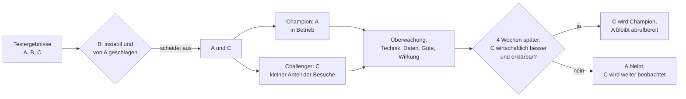

# Tag 10 · MLOps: Lösung Arbeitsauftrag 2 (GrünKorb: Welches Modell geht in Betrieb?)

Quelle: `10_03_UE3_Arbeitsauftrag2.pdf`, Konzepte aus `10_01_UE1_MLOPS.pdf`.

**Ausgangslage:** Der Onlineshop GrünKorb GmbH (Gartenbedarf, 1,2 Mio. Besuche im Jahr) gibt bisher allen Besuchern einen 10-%-Gutschein. Das ist teuer. Künftig soll nur der Gutschein bekommen, wer sonst wohl nicht kaufen würde. Das Modell entscheidet beim Seitenaufruf. Drei Modelle sind trainiert und getestet.

| Aufgabe (Folie 5) | Abschnitt |
|---|---|
| 1. A bis C anhand der Testergebnisse bewerten | 2 |
| 2. Scheidet ein Modell wegen Echtzeit aus? | 3 |
| 3. Was kostet jedes Modell im Betrieb? | 4 |
| 4. Entscheiden, mit einer Antwort an alle drei Stimmen | 5 bis 7 |

---

## Das Ergebnis in Kürze

- **Modell B scheidet aus,** aber nicht wegen der Echtzeit. Es ist in jeder Größe schlechter als A und dabei **instabil** (AUC schwankt um ± 0,05 je Monat).
- **Kein Modell scheidet wegen Echtzeit aus.** Auch C braucht nur 0,6 ms je Prognose. Eine Seite lädt viele hundert Millisekunden, und im ganzen Jahr sind das für C zusammen etwa 12 Minuten Rechenzeit.
- **Betriebskosten:** Der Unterschied liegt nicht bei Rechenzeit oder Speicher (Euro-Beträge im einstelligen bis niedrigen dreistelligen Bereich), sondern bei **Erklären, Überwachen und Aufwand für Menschen.**
- **Mehrumsatz von C gegenüber A:** 102.000 € im Jahr (+11 %). Nach Abzug der Marge bleibt davon ein Gewinn von etwa 15.000 bis 31.000 €, dem ein Mehraufwand von grob 12.000 bis 15.000 € gegenübersteht. Der Vorteil von C ist **real, aber dünn** und hängt an Annahmen.
- **Entscheidung:** **Modell A (Logistische Regression) geht in Betrieb.** **C läuft als Herausforderer** im A/B-Test und löst A ab, wenn er sich nach Marge und Erklärbarkeit bewährt (Abschnitt 6).

---

## 1. Die Zahlen auf Jahresebene

Die Tabelle von Folie 3 sagt „Mehr Käufe je 10.000 Besuche“. Bei 1,2 Mio. Besuchen sind das 120 Blöcke zu 10.000.

| Größe | A) Logistische Regression | B) Entscheidungsbaum | C) Random Forest |
|---|---|---|---|
| Mehr Käufe je 10.000 Besuche | 118 | 96 | 131 |
| Mehr Käufe im Jahr (· 120) | 14.160 | 11.520 | 15.720 |
| Mehrumsatz im Jahr | 920.000 € | 749.000 € | 1.022.000 € |
| Mehrumsatz je zusätzlichem Kauf | 64,97 € | 65,02 € | 65,01 € |

Die letzte Zeile ist eine **Stimmigkeitsprobe:** Bei allen drei Modellen kommt ein zusätzlicher Kauf auf etwa **65 €** Umsatz. Die Folie rechnet also in sich konsistent, und der Mehrumsatz folgt allein aus der Zahl der zusätzlichen Käufe.

**Wichtig:** Das ist **Umsatz, kein Gewinn.** Er ist auch nicht um die Kosten der verschenkten Gutscheine bereinigt. Aus der Folie geht nicht hervor, ob das schon berücksichtigt ist (siehe Abschnitt 8).

---

## 2. Teilaufgabe 1: Bewertung anhand der Testergebnisse

| Kriterium | A) Logistische Regression | B) Entscheidungsbaum | C) Random Forest | Beste |
|---|---|---|---|---|
| AUC im Test | 0,78 | 0,74 | **0,80** | C |
| Stabilität (AUC-Schwankung je Monat) | ± 0,01 | ± 0,05 | ± 0,02 | **A** |
| Spannweite der AUC in den Monaten | 0,77 bis 0,79 | **0,69** bis 0,79 | 0,78 bis 0,82 | C (A eng) |
| Mehr Käufe je 10.000 Besuche | 118 | 96 | **131** | C |
| Mehrumsatz im Jahr | 920.000 € | 749.000 € | **1.022.000 €** | C |
| Rechenzeit je Prognose | 0,02 ms | 0,01 ms | 0,6 ms | B (belanglos) |
| Modellgröße | 4 KB | 60 KB | 85 MB | A (belanglos) |
| Training pro Nacht | 20 s | 15 s | 12 min | B (belanglos) |
| Erklärbarkeit (Einschätzung) | gut | gut | schwach | A/B |

### 2.1 Lesehilfe

- **AUC** ist die Wahrscheinlichkeit, dass das Modell einen Käufer höher einstuft als einen Nicht-Käufer (0,5 = Raten, 1,0 = perfekt). Der Unterschied 0,78 gegen 0,80 wirkt klein, übersetzt sich aber laut Tabelle in 13 Käufe je 10.000 Besuche.
- **Die Schwankung ist das eigentliche Warnsignal.** Ein Modell mit ± 0,05 hat in schlechten Monaten eine AUC von 0,69. Das liegt **unter dem schlechtesten Monat von A (0,77)**. Mit B weiß man im Voraus nicht, wie gut das Modell nächsten Monat arbeitet. Für den Betrieb ist ein verlässliches Modell oft mehr wert als ein knapp besseres im Mittel.
- **Die Geschwindigkeitsspalten gewinnt B,** aber diese Vorteile sind im Betrieb wertlos (Abschnitt 3 und 4).

### 2.2 Warum B ausscheidet

B ist von A in allem geschlagen, was zählt:

| Vergleich B gegen A | Ergebnis |
|---|---|
| Trefferleistung | A besser (AUC 0,78 gegen 0,74, 118 gegen 96 Käufe) |
| Stabilität | A viel besser (± 0,01 gegen ± 0,05) |
| Mehrumsatz | A besser (+ 171.000 € im Jahr) |
| Erklärbarkeit | gleichwertig (beide verständlich) |
| Einzige Vorteile | Rechenzeit 0,01 ms und Training 15 s: im Betrieb ohne Wert |

Ein Modell, das in allen entscheidenden Punkten unterlegen ist und nur in unwichtigen gewinnt, ist **dominiert.** Es kommt nicht in Frage, auch nicht als Rückfall.

---

## 3. Teilaufgabe 2: Scheidet ein Modell wegen Echtzeit aus?

**Nein.** Die Leitfrage der Folie lautet: „Was rechnet das Modell für eine Prognose, und wie lange lädt die Seite ohnehin?“

| Größe | Wert |
|---|---|
| Rechenzeit C je Prognose | 0,6 ms |
| Ladezeit einer Shopseite (Annahme) | 1 bis 3 Sekunden, also 1.000 bis 3.000 ms |
| Anteil von C an der Ladezeit | 0,02 bis 0,06 % |
| Besuche im Jahr | 1,2 Mio. |
| Im Durchschnitt pro Sekunde | 1,2 Mio. / (365 · 86.400) = 0,04 |
| Bei 100-facher Spitze (Annahme) | etwa 4 Anfragen pro Sekunde |
| Ein Rechenkern schafft mit C | etwa 1.600 Prognosen pro Sekunde (1 / 0,6 ms) |
| Gesamte Rechenzeit C im Jahr | 1,2 Mio. · 0,6 ms = 720 s, also 12 Minuten |

Die Reserve ist riesig. **Kein Modell ist durch die Reaktionszeit gefährdet.**

**Wo der Engpass in Wirklichkeit liegen kann:** nicht im Modell, sondern bei den **Eingaben.** Das Modell braucht beim Seitenaufruf Merkmale wie bisherige Besuche, Warenkorb und Herkunft. Wenn diese erst aus einer Datenbank geholt werden müssen, kostet das schnell mehr als 0,6 ms. Genau dafür gibt es einen Feature Store (Folie 17: Kontext „abrufbar in Millisekunden“). Bei dieser Größe reicht zunächst eine schnelle Abfrage aus dem Speicher des Shops.

Auch **85 MB** sind kein Hindernis: Das Modell wird einmal beim Start des Dienstes geladen und liegt im Arbeitsspeicher.

---

## 4. Teilaufgabe 3: Was kostet jedes Modell im Betrieb?

Die Leitfrage: „Training, Überwachung, Erklären, Rollback: Wo ist welches Modell aufwendig?“

### 4.1 Aufwand je Betriebsaufgabe

| Aufgabe | A) Logistische Regression | B) Entscheidungsbaum | C) Random Forest |
|---|---|---|---|
| **Training** (jede Nacht) | 20 s: unproblematisch | 15 s: unproblematisch | 12 min: passt locker in die Nacht, aber 36-mal länger. Läuft es schief, ist der Zeitpuffer kleiner |
| **Prüfen vor dem Ausrollen** (Modelltest, Folie 19) | Schnell, wenige Zahlen | Schnell | Länger, mehr Vergleiche |
| **Überwachen** (Folie 24) | Einfach: Koeffizienten lassen sich pro Lauf vergleichen, Drift ist leicht zu sehen | Mittel: Baumstruktur kann bei kleinen Datenänderungen **umspringen** | Aufwendig: kein direkter Blick ins Modell, nur Verteilungen der Ein- und Ausgaben |
| **Erklären** (Datenschutz) | **Leicht:** Jeder Faktor hat ein Gewicht und eine Richtung | Leicht: Pfad durch den Baum | **Schwer:** Hunderte Bäume, Erklärung nur über Zusatzverfahren (z. B. SHAP) und mit Näherung |
| **Rollback** (Zurück in Minuten) | 4 KB, trivial | 60 KB, trivial | 85 MB: technisch ebenfalls in Minuten, aber ein größerer Artefaktspeicher |
| **Versionieren** (Folie 10) | Winzig | Klein | 85 MB je Nacht: etwa 30 GB im Jahr, wenn jede Nacht eine Version aufbewahrt wird |
| **Fehlersuche** | Einfach | Einfach | Schwerer |

### 4.2 Was das in Euro bedeutet

| Posten | A | C | Anmerkung |
|---|---|---|---|
| Rechenzeit Training im Jahr | 20 s · 365 ≈ 2 Stunden | 12 min · 365 ≈ 73 Stunden | Bei einem Cloud-Preis von etwa 1 € je Stunde sind das 2 € gegen 73 €. **Vernachlässigbar** |
| Rechenzeit Prognosen | 24 s im Jahr | 12 min im Jahr | Vernachlässigbar |
| Speicher | Kilobytes | etwa 30 GB bei voller Aufbewahrung | Wenige Euro im Jahr |
| **Personal: Überwachung, Erklären, Pflege** | gering | deutlich höher | **Hier liegen die Kosten** |

Als Maßstab dient die Rechnung von Folie 36 (PhysioNord): 0,3 Stelle kosten 24.000 € im Jahr, also etwa 80.000 € je Stelle (Annahme für GrünKorb ähnlich). Annahme für den **Mehraufwand von C gegenüber A:** 0,15 Stelle für den Erklärungsweg, die engere Überwachung und die Fehlersuche, das sind etwa **12.000 € im Jahr.** Dazu kommt einmalig der Aufbau der Erklärungsfunktion.

> **Lehre:** Die Rechenkosten spielen keine Rolle, die Kosten der Menschen schon. Wer nur „85 MB und 12 Minuten“ sieht, vergleicht das Falsche.

---

## 5. Lohnt der Mehrumsatz den Aufwand?

C gegenüber A:

| Größe | Wert |
|---|---|
| Mehr Käufe im Jahr | + 1.560 (15.720 gegen 14.160) |
| Mehrumsatz | **+ 102.000 €** im Jahr (+ 11 %) |
| Mehrumsatz ist Umsatz, nicht Gewinn | Gewinn = Mehrumsatz · Marge |

### 5.1 Break-even

Der Mehraufwand von C beträgt etwa 12.000 € im Jahr (Annahme, Abschnitt 4.2); zur Sicherheit rechnen wir mit 15.000 €.

| Marge auf den Mehrumsatz | Zusatzgewinn durch C | Abzüglich Mehraufwand 15.000 € |
|---|---|---|
| 15 % | 15.300 € | **ca. 0 €** |
| 20 % | 20.400 € | + 5.400 € |
| 30 % | 30.600 € | + 15.600 € |
| 40 % | 40.800 € | + 25.800 € |

Formel: Break-even-Marge = Mehraufwand / Mehrumsatz = 15.000 € / 102.000 € ≈ 14,7 %.

**Ergebnis:** C lohnt sich finanziell **ab einer Marge von etwa 15 %,** bei üblichen Handelsmargen von 20 bis 40 % bleibt ein Gewinn von einigen 1.000 bis 25.000 € im Jahr. Das ist ein **positiver, aber kleiner Vorteil,** der von drei unsicheren Größen abhängt:

1. **Marge** (nicht gegeben).
2. **Mehraufwand** (geschätzt).
3. **Ob die 102.000 € im Betrieb wirklich erreicht werden.** Die Testzahl stammt aus einem Test. Im Betrieb zählt die Stabilität der Leistung (Drift), und C ist hier etwas stärker gefährdet, weil man Fehlentwicklungen schlechter sieht.

### 5.2 Was die Rechnung nicht enthält

- **Gutscheinkosten:** Wie viele Gutscheine verteilt jedes Modell? Ein genaueres Modell kann **weniger** Gutscheine verschenken, was den Vorteil von C vergrößert, oder mehr, was ihn verkleinert. Die Folie gibt dazu nichts an.
- **Rechtliches Risiko:** Ein nicht erklärbares Modell kann eine Beschwerde nach sich ziehen, die mehr kostet als der Vorteil (siehe Datenschutz, Abschnitt 6).

---

## 6. Die Entscheidung und die Antworten an die drei Stimmen

### 6.1 Die Entscheidung

> **A (Logistische Regression) geht in Betrieb. C läuft als Herausforderer parallel und löst A ab, wenn zwei Bedingungen erfüllt sind:**
> 1. **Wirtschaftlich:** C bringt im A/B-Test nach Marge mindestens 5.000 € im Jahr mehr als A (Hochrechnung aus echten Daten, nicht aus dem Test).
> 2. **Erklärbar:** Der Datenschutz hat die Erklärung für C (z. B. mit SHAP) an Beispielkunden geprüft und für verständlich befunden.

### 6.2 Warum A und nicht gleich C?

| Argument | Begründung |
|---|---|
| **Der Vorteil von C ist klein und unsicher** | 102.000 € Umsatz, nach Marge und Mehraufwand wenige 1.000 bis etwa 25.000 € (Abschnitt 5) |
| **Erklärbarkeit ist eine Pflicht,** keine Option | Der Datenschutz fragt: „Warum bekam ich keinen Gutschein?“ A beantwortet das direkt |
| **Stabilität** | A hat ± 0,01, C ± 0,02. Beide sind in Ordnung, A ist die ruhigere |
| **Einfachheit im Betrieb** | Weniger Aufwand bei Überwachung, Fehlersuche und Rollback |
| **Das Risiko ist begrenzt** | Der Herausforderer C läuft von Anfang an mit. Der mögliche Mehrumsatz wird also gemessen, nicht nur vermutet, und der Wechsel ist jederzeit möglich |

**Ehrlich zu sagen:** Das ist eine Abwägung. Wenn GrünKorb eine hohe Marge hat und der Datenschutz mit einer SHAP-Erklärung zufrieden ist, ist **C die richtige Wahl.** Die Entscheidung für A ist darum nicht endgültig, sondern der risikoärmere Start.

### 6.3 Antwort an Marketing

> „Jeder Prozentpunkt Treffsicherheit ist Umsatz.“ – Will das genaueste Modell.

- **Ja, C ist das genaueste Modell** (AUC 0,80, 131 zusätzliche Käufe je 10.000 Besuche, + 102.000 € Umsatz gegenüber A).
- **Aber:** Umsatz ist nicht Gewinn. Nach Marge und Mehraufwand schrumpft der Vorteil auf einen kleinen Betrag. Der Unterschied zu A beträgt 13 Käufe je 10.000 Besuche.
- **Das Angebot:** C läuft sofort als Herausforderer mit einem Teil der Besuche mit. Nach vier Wochen entscheidet die gemessene Wirkung. **Marketing bekommt C, sobald die Zahlen es tragen.**
- A bringt laut Test bereits **920.000 €** Mehrumsatz im Jahr, also rund 90 % dessen, was C erreicht (920.000 / 1.022.000).

### 6.4 Antwort an den Datenschutz

> „Ein Kunde fragt, warum er keinen Gutschein bekam.“ Die Antwort muss verständlich sein.

- A liefert die Antwort aus dem Modell selbst. Jedes Merkmal hat ein Gewicht und eine Richtung, die wichtigsten Gründe lassen sich benennen.
- **Beispielantwort:** „Ihre Kaufwahrscheinlichkeit wurde als hoch eingeschätzt, vor allem weil Sie bereits mehrfach bei uns bestellt haben und Ihr Warenkorb gut gefüllt war. Gutscheine gehen an Besucher, bei denen ein Kauf unwahrscheinlicher ist.“ (Die Merkmale sind hier Beispiele.)
- **Nachvollziehbarkeit** (Lineage, Folie 33): Für jede Entscheidung werden Modellversion, Eingabewerte und Schwelle gespeichert. Damit lässt sich die Audit-Frage von Folie 34 beantworten.
- **Zu prüfen mit der Rechtsabteilung** (keine Rechtsberatung): ob für die personalisierte Gutscheinvergabe Informationspflichten zur Logik der Entscheidung bestehen, auf welcher Rechtsgrundlage die Merkmale (z. B. Besuchsverhalten) verarbeitet werden und ob eine Einwilligung zum Tracking vorliegt.

### 6.5 Antwort an den IT-Betrieb

> „Jede Nacht trainieren, prüfen, versionieren. Zurück zur Vorversion in Minuten.“

- A trainiert in 20 Sekunden, ist 4 KB groß und lässt sich jederzeit zurücksetzen. Alle drei Anforderungen sind erfüllt, ohne Sonderlösung.
- **Pipeline wie in Arbeitsauftrag 1:** Daten prüfen, trainieren, Modelltest (Tor), Versionieren, schrittweise ausrollen, überwachen.
- **Rollback:** Die vorherige Version bleibt in der Registry (MLflow) abrufbar, der Wechsel ist eine Konfigurationsänderung.
- **Wichtig:** Nächtliches Training heißt nicht „nächtlicher Austausch“. Das neu trainierte Modell geht erst live, wenn es das Tor besteht und nicht schlechter ist als das laufende.

---

## 7. Betrieb: Wie wird A überwacht und C getestet?

### 7.1 Vier Überwachungsebenen (Folie 24)

| Ebene | Frage | Beispiel für GrünKorb | Alarm bei |
|---|---|---|---|
| **Technik** | Läuft es? | Antwortzeit pro Prognose, Fehlerquote des Dienstes | über 50 ms oder Ausfall |
| **Daten** | Sehen die Eingaben aus wie im Training? | Verteilung der Merkmale (z. B. Anteil Neukunden, Anteil mobiler Besuche) | deutliche Abweichung |
| **Güte** | Trifft die Prognose noch? | AUC je Woche | unter 0,75 (Annahme) |
| **Wirkung** | Hilft es dem Geschäft? | Käufe und Gutscheinkosten je 10.000 Besuche, im Vergleich zu einer Kontrollgruppe | Wirkung fällt unter den Break-even |

### 7.2 Eine Kontrollgruppe gehört dazu

Die AUC misst nur, wie gut das Modell Käufer einordnet. Der Nutzen steckt aber im Satz „**mehr** Käufe“: Käufe, die ohne Gutschein ausgeblieben wären. Das lässt sich nur im Vergleich messen:

- Ein kleiner Anteil der Besuche (z. B. 5 %) bekommt **zufällig** entweder keinen Gutschein oder wie früher einen für alle, und dient als Vergleichsgruppe.
- Nur so sieht man, ob die Wirkung im Betrieb erhalten bleibt (Concept Drift, Folie 25), etwa wenn ein Konkurrent eigene Gutscheine verschickt.
- Dieselbe Idee wie die Kontrollgruppe in Tag 8, Fall A.

### 7.3 Der Test von C als Herausforderer

| Phase | Vorgehen |
|---|---|
| Start | C bekommt 10 % der Besuche (nach Zufall), A 90 %, Folie 22 (Canary) |
| Dauer | Mindestens 4 Wochen (Folie 23: A/B-Test), damit Wochentage und Aktionen mitgemittelt werden |
| Messen | Zusätzliche Käufe, Umsatz, Gutscheinkosten, Beschwerden zur Erklärung |
| Entscheiden | Nach den zwei Bedingungen aus Abschnitt 6.1, durch eine benannte Person (Owner) |
| Rückweg | A bleibt jederzeit abrufbar |

### 7.4 Retraining

- **Nach Plan:** Jede Nacht neu trainieren (wie vorgegeben), aber **nur austauschen, wenn das Tor bestanden ist.**
- **Nach Schwelle:** AUC der Woche unter der Alarmgrenze → Ursache klären (Datenfehler, Drift, Aktion), dann neu trainieren.
- **Zuständigkeit:** Eine Person ist für Alarme verantwortlich, mit einem Runbook (Folie 31).

---

## 8. Offene Punkte und Annahmen

| Annahme | Warum wichtig | Wie klären |
|---|---|---|
| Mehrumsatz ist **Umsatz,** nicht Gewinn | Entscheidet über den Break-even | Marge und Gutscheinkosten beim Controlling erfragen |
| Der Mehrumsatz ist **netto nach Gutscheinen** | Sonst ist der Vorteil kleiner | Berechnungsweise der Folie klären |
| Mehraufwand C = 12.000 bis 15.000 € im Jahr | Basis für den Break-even | Aufwand für Erklärfunktion und Überwachung schätzen |
| Ladezeit der Seite 1 bis 3 s | Basis für die Echtzeit-Aussage | Messen |
| Alarmgrenze AUC 0,75 | Muss zur Handlung passen | Aus den Kosten einer Fehlentscheidung ableiten |
| Gleiche Testbedingungen für A, B, C | Sonst sind die Zahlen nicht vergleichbar | Test-Protokoll prüfen |
| Modelle sind nicht diskriminierend | Personalisierte Preise können unfair wirken | Merkmale prüfen, keine sensiblen Merkmale |

---

## Kernaussagen

1. **Das genaueste Modell ist nicht automatisch das beste für den Betrieb.** Auf Stabilität, Erklärbarkeit, Aufwand und Wirkung kommt es auch an.
2. **Instabilität schlägt Durchschnitt.** B zeigt, dass eine schwankende Leistung ein Ausschlusskriterium sein kann.
3. **Echtzeit ist selten das Problem.** 0,6 ms sind gegenüber einer Seitenladezeit von Sekunden nichts. Der Engpass liegt eher bei den Eingaben als beim Modell.
4. **Betriebskosten sind Personalkosten.** Rechenzeit und Speicher fallen kaum ins Gewicht, Überwachung, Erklärung und Pflege schon.
5. **Umsatz ist nicht Gewinn.** Vor der Entscheidung Marge und Mehraufwand gegenüberstellen (Break-even).
6. **Erklärbarkeit ist Teil der Anforderung,** nicht Zugabe. Dafür braucht es Nachvollziehbarkeit (Lineage) und Protokoll.
7. **Champion und Challenger.** Ein sicheres Modell in Betrieb, das bessere parallel testen und nur bei nachgewiesenem Vorteil umschalten.
8. **Eine Kontrollgruppe misst die echte Wirkung,** denn die AUC allein sagt nichts über zusätzliche Käufe.

---

## Wo könnten Antworten abweichen?

- **A oder C:** Beide Entscheidungen sind vertretbar. Wer C wählt, braucht eine belastbare Erklärung für den Datenschutz (SHAP oder ein vereinfachtes Ersatzmodell) und einen Beleg, dass der Mehrumsatz die Marge trägt. Wer A wählt, sollte den Weg zu C offen halten. Nicht vertretbar ist B.
- **Die Euro-Beträge für den Mehraufwand** (12.000 bis 15.000 €) und die Marge sind Annahmen. Mit anderen Annahmen verschiebt sich der Break-even.
- **Die Spanne der monatlichen AUC** habe ich als Mittelwert ± Schwankung gelesen. Die Folie lässt offen, ob die Schwankung eine Standardabweichung oder eine Spannweite ist. Bei einer Standardabweichung wären die schlechten Monate noch weiter vom Mittel entfernt.
- **Der Datenschutz-Teil** ist keine Rechtsberatung. Welche Informationspflichten gelten, hängt von Rechtsgrundlage, Art der Entscheidung und Einwilligung ab.
- **Das Mermaid-Diagramm** in Abschnitt 6.1 wurde nicht gerendert getestet.
