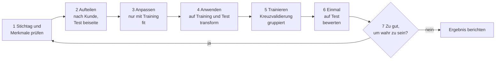

# Tag 11 · Modelltraining: Lösung Zusatzaufgabe A11-1 (Data Leakage)

Quelle: `11_Zusatz_A11-1_Data-Leakage.pdf`, Begriffe aus `11_01_UE1_Modelltraining.pdf` (Folien 14 und 15: Stratifizierung, Leakage, drei Beispiele).
Simulation zum Nachrechnen: [`11_Demo_Data_Leakage.py`](11_Demo_Data_Leakage.py).

**Ausgangslage:** Ein Team meldet **98 % Genauigkeit** für die Vorhersage von Kundenkündigungen. Das klingt nach einem Spitzenmodell, aber so hohe Werte sind selten echt. Vier Stellen der Pipeline sind verdächtig:

| Stelle | Beschreibung | Gruppe |
|---|---|---|
| a | Merkmal „Vertrag bereits gekündigt“ | Merkmale |
| b | Skalierung über alle Daten vor dem Split | Ablauf |
| c | Gleicher Kunde in Training und Test | Ablauf |
| d | Merkmal „Umsatz der Folgemonate“ | Merkmale |

| Aufgabe (Folie 4) | Abschnitt |
|---|---|
| 1. Jede Stelle prüfen: Leakage, ja oder nein? | 2 |
| 2. Erklären, wie die Güte dadurch geschönt wird | 2 und 3 |
| 3. Die Schritte in die richtige Reihenfolge bringen | 4 |
| Leitfrage: Woran erkennt man 98 % als „zu gut“? | 5 |

---

## Das Ergebnis in Kürze

- **Alle vier Stellen sind Leakage.** Sie sind aber nicht gleich schwer.
- **a und d (die Merkmale) sind die schweren Fälle:** Sie enthalten Wissen, das es zum Vorhersagezeitpunkt noch nicht gibt. Das Modell liest die Antwort ab, statt sie vorherzusagen.
- **c (gleicher Kunde in Training und Test) ist ein mittlerer Fall:** Das Modell erkennt Kunden wieder, statt etwas Allgemeines zu lernen.
- **b (Skalierung vor dem Split) ist ein leichter Fall:** Es ist ein echter Fehler im Ablauf, der die Güte aber meist nur wenig verschiebt. Er ist **nicht** die Ursache der 98 %.
- **Merksatz zur Reihenfolge** (passend zu den drei Stichworten der Titelfolie): **Aufteilen → Sauber (nur mit Trainingsdaten anpassen) → Trainieren.**
- **Die 98 % sind verdächtig,** weil sich ein einfacher Vergleich verbietet: Wer immer „bleibt“ sagt, hat bei einem Kündigeranteil von rund 20 % schon etwa 80 % Genauigkeit. Echte Modelle für Kündigungen liegen meist deutlich darunter.

---

## 1. Der Grundgedanke

Eine Prognose ist nur ehrlich, wenn das Modell **nur Wissen benutzt, das zum Vorhersagezeitpunkt wirklich da ist.** Die Leitfragen der Folie lauten:

1. **Welche Information wäre zum Vorhersagezeitpunkt real da?**
2. **Was gehört erst nach den Split?**
3. **Woran erkennt man 98 % als „zu gut“?**

Zwei Arten von Leakage kommen hier vor:

| Art | Bedeutung | Stellen |
|---|---|---|
| **Merkmals-Leakage** (Target Leakage) | Ein Merkmal enthält die Antwort oder entsteht erst nach dem Ereignis | a, d |
| **Ablauf-Leakage** | Der Ablauf lässt Wissen aus dem Test ins Training fließen | b, c |

Dieselbe Idee wie bei der Mietrendite (Tag 9): Spalten, die den Zielwert festlegen oder erst danach entstehen, dürfen nicht ins Training.

**Vorhersagezeitpunkt festlegen.** Zuerst muss klar sein, **wann** die Prognose gemacht wird, z. B. 30 Tage vor einem möglichen Vertragsende. Alles, was nach diesem Stichtag entsteht, ist verboten.

---

## 2. Teilaufgabe 1 und 2: Die vier Stellen einzeln

### 2.1 Stelle a: Merkmal „Vertrag bereits gekündigt“

| Frage | Antwort |
|---|---|
| **Leakage?** | **Ja,** Merkmals-Leakage. Schwer |
| **Warum?** | Das Merkmal entsteht **erst nach der Kündigung.** Zum Vorhersagezeitpunkt läuft der Vertrag noch, der Eintrag „gekündigt“ existiert noch nicht. Es ist fast eine Kopie des Zielwerts |
| **Wie wird die Güte geschönt?** | Das Modell muss nichts vorhersagen, es **liest die Antwort ab.** Wo das Merkmal „ja“ sagt, kündigt der Kunde |
| **Wirkung im Test** | Genauigkeit von 82 % auf 99 % (Simulation, Abschnitt 3). Recall der Kündiger von 38 % auf 95 % |
| **Gegenmittel** | Merkmal entfernen. Prüffrage: „Kenne ich diesen Wert am Stichtag schon?“ |

Auffälligkeit im Alltag: Der Name verrät es („bereits gekündigt“), aber in großen Tabellen mit 100 Spalten ist so etwas schwer zu sehen. Oft heißt es auch harmlos „Status“ oder „Vertragsende_Datum“.

### 2.2 Stelle b: Skalierung über alle Daten vor dem Split

| Frage | Antwort |
|---|---|
| **Leakage?** | **Ja,** Ablauf-Leakage. **Leicht** |
| **Warum?** | Mittelwert und Standardabweichung werden aus **allen** Zeilen berechnet, auch aus den späteren Testzeilen. Das Training „weiß“ dadurch etwas über die Testdaten, nämlich deren Lage und Streuung |
| **Wie wird die Güte geschönt?** | Nur sehr wenig. Das Modell sieht **keine Antwort,** nur leicht verschobene Zahlen. Der Effekt ist meist klein |
| **Wirkung im Test** | Hier praktisch null: Random Forest 81,6 % in beiden Fällen, KNN 78,4 % gegen 78,3 % (Simulation) |
| **Warum trotzdem falsch?** | Es ist eine Gewohnheit, die bei anderen Schritten teuer wird: **Merkmalsauswahl,** **Target Encoding** und **Oversampling.** Diese Schritte sehen die **Zielspalte,** deshalb ist der Effekt dort groß (Zahlen in Abschnitt 2.2a). Die Imputation mit dem Mittelwert ist dagegen ähnlich harmlos wie die Skalierung. Außerdem gilt das Prinzip „Test ist tabu“ |
| **Gegenmittel** | Erst teilen, dann `fit` nur auf den Trainingsdaten, `transform` auf beide. Am sichersten mit einer `Pipeline` |

> **Wichtig für die Antwort:** Die Frage lautet „Leakage, ja oder nein?“. Es ist **ja,** aber es erklärt die 98 % nicht. Wer b als Hauptursache nennt, hat die Größenordnung nicht verstanden. Bei einem Random Forest ist die Skalierung ohnehin unnötig, weil Bäume nur Rangfolgen der Werte nutzen.

#### 2.2a Warum ist b harmlos, aber andere Schritte nicht?

Der Unterschied: Die Skalierung rechnet **nur mit den Merkmalen** (Mittelwert und Streuung einer Spalte). Sie kennt die Antwort nicht. Schritte, die die **Zielspalte** benutzen, tragen die Antwort des Tests direkt ins Training. Kleine Versuche mit Zufallsdaten (die echte Güte ist 50 % beziehungsweise 0 %):

| Schritt | Falsch (vor dem Split, auf allen Daten) | Richtig (nur Training) | Warum |
|---|---|---|---|
| **Merkmalsauswahl** (1.000 Zufallsmerkmale, 100 Zeilen, die 10 „besten“ behalten) | 76 % Genauigkeit | 62 % (Wahrheit: 50 %) | Die Auswahl sucht die Merkmale, die mit der Antwort **zufällig** zusammenhängen, auch aus den Testzeilen. Das Modell „weiß“ dann, welche Spalten bei diesen Zeilen passen |
| **Target Encoding** (Postleitzahl durch den mittleren Zielwert je PLZ ersetzen) | 71 % | 46 % (Wahrheit: 50 %) | Der Mittelwert je PLZ enthält den Zielwert der Testzeilen selbst. Bei vielen Kategorien mit wenigen Zeilen steht die Antwort fast im Merkmal |
| **Oversampling** (seltene Klasse vor dem Split kopieren) | Recall 100 % | Recall 0 % | Kopien derselben Zeile landen in Training **und** Test. Das Modell erkennt die Kopie wieder |
| **Mittelwert-Imputation** (20 % Fehlwerte) | 68,3 % | 68,7 % | Rechnet wie die Skalierung nur mit Spaltenmittelwerten. Kein Unterschied |

Bei den ersten drei Schritten entsteht eine Güte, die auf **reinen Zufallsdaten** gar nicht möglich wäre. Das zeigt: Die Zahl stammt nicht aus dem Modell, sondern aus dem Leck. Bei der Skalierung und der einfachen Imputation passiert das nicht.

Noch ein Punkt zur Imputation: Verfahren, die mehr aus den Daten lernen (KNN-Imputation, iterative Verfahren), können Testzeilen stärker einfließen lassen als der Mittelwert. Als Regel gilt deshalb für alle: **Was aus Daten lernt, wird nur auf dem Training angepasst.** Bei der Skalierung ist der Unterschied ein Prinzip, bei den anderen ein echter Zahlenunterschied.

*(Die Werte sind je ein Zufallsversuch mit festem Startwert und deshalb nur Größenordnungen. Der Wert 62 % bei der richtigen Merkmalsauswahl liegt über 50 %, weil 100 Zeilen sehr wenig sind und die Kreuzvalidierung dann schwankt.)*

### 2.3 Stelle c: Gleicher Kunde in Training und Test

| Frage | Antwort |
|---|---|
| **Leakage?** | **Ja,** Ablauf-Leakage (Gruppen-Leakage). **Mittel** |
| **Wann tritt es auf?** | Wenn ein Kunde **mehrere Zeilen** hat, z. B. eine pro Monat, oder Dubletten in den Daten stehen, und die Zeilen **zufällig** auf Training und Test verteilt werden |
| **Warum?** | Die Zeilen eines Kunden ähneln sich stark (Alter, Tarif, Laufzeit ändern sich kaum). Das Modell erkennt den Kunden im Test an diesen Werten wieder und **erinnert sich an sein Ergebnis** aus dem Training |
| **Wie wird die Güte geschönt?** | Das Modell wird für **Wiedererkennen** belohnt, nicht für **Verallgemeinern.** Im Betrieb kommen aber neue Kunden, die es nie gesehen hat |
| **Wirkung im Test** | Genauigkeit von 81,6 % auf 90,4 %, Recall der Kündiger von 38 % auf 69 % (Simulation) |
| **Gegenmittel** | Nach **Kunden-ID** teilen, sodass alle Zeilen eines Kunden im selben Teil landen (`GroupShuffleSplit`, `GroupKFold`). Dubletten vorher entfernen. Bei zeitlichen Daten zusätzlich nach Zeit teilen (Folie 13) |

Das ist dieselbe Falle wie bei den Röntgenbildern (Folie 15): Das Modell lernt die Klinik, nicht die Lunge. Hier lernt es den Kunden, nicht die Kündigung.

### 2.4 Stelle d: Merkmal „Umsatz der Folgemonate“

| Frage | Antwort |
|---|---|
| **Leakage?** | **Ja,** Merkmals-Leakage (Information aus der Zukunft). Schwer |
| **Warum?** | Der Umsatz der **Folgemonate** ist zum Vorhersagezeitpunkt per Definition **noch nicht bekannt.** Außerdem hängt er direkt vom Zielwert ab: Wer kündigt, zahlt danach wenig oder nichts |
| **Wie wird die Güte geschönt?** | Das Merkmal ist eine **Folge** der Kündigung, nicht eine Ursache. Das Modell erkennt Kündiger an ihrem fehlenden Umsatz |
| **Wirkung im Test** | Genauigkeit von 82 % auf 96 %, Recall von 38 % auf 86 % (Simulation) |
| **Unterschied zu a** | Weniger offensichtlich: Es sieht aus wie eine normale Kennzahl. Es ist **keine Kopie** des Zielwerts, aber eine **Konsequenz.** Deshalb ist der Effekt etwas kleiner und schwerer zu erkennen |
| **Gegenmittel** | Nur Umsätze **bis zum Stichtag** verwenden (z. B. letzte 3 Monate davor). Spaltennamen mit „Folge“, „nach“, „next“ besonders prüfen |

---

## 3. Wie stark schönen die Fehler die Güte?

Simulation mit künstlichen Kundendaten: 1.000 Kunden mit je 6 Monatszeilen, 22 % Kündiger, Random Forest. Das Skript [`11_Demo_Data_Leakage.py`](11_Demo_Data_Leakage.py) erzeugt die Daten und rechnet jede Stelle einzeln.

| Fall | Genauigkeit | Recall (Kündiger) | Einordnung |
|---|---|---|---|
| Immer „bleibt“ sagen (Vergleichswert) | 78 % | 0 % | die Messlatte |
| **Sauber:** Split nach Kunde, Skalierung nur auf Training | **81,6 %** | 38,3 % | ehrliche Güte: knapp über der Messlatte |
| b) Skalierung über alle Daten (Random Forest) | 81,6 % | 38,3 % | kein Unterschied |
| b) Skalierung über alle Daten (KNN, sauber 78,4 %) | 78,3 % | 44,2 % | kein Unterschied |
| c) Gleicher Kunde in Training und Test | 90,4 % | 69,0 % | deutlich zu gut |
| d) + Umsatz der Folgemonate | 96,2 % | 86,1 % | stark zu gut |
| a) + „Vertrag bereits gekündigt“ | 98,6 % | 95,0 % | fast perfekt |
| Alle vier Fehler zusammen | 99,5 % | 97,7 % | Traumwert |

Wichtige Beobachtungen:

1. **Die ehrliche Güte ist mäßig.** Die echten Merkmale sagen die Kündigung nur schwach voraus (Genauigkeit 82 % bei 78 % Messlatte, Recall 38 %). Das ist bei Kündigungsmodellen realistisch.
2. **Die Merkmale a und d bringen ein Modell in die Nähe von 98 %,** so wie in der Meldung des Teams. Auch c allein erreicht 90 %.
3. **b ändert fast nichts.** Das ist kein Grund, sie zu ignorieren, siehe oben.
4. **Die Zahlen sind Simulation, keine echten Kundendaten.** Sie zeigen die Richtung und Größenordnung. Im echten Fall hängt alles von den Daten ab.

---

## 4. Teilaufgabe 3: Die Schritte in die richtige Reihenfolge

Die Folie nennt die Schritte nicht einzeln, sondern nur die Stichworte der Titelfolie: **Aufteilung, Sauber, Trainieren.** Die folgende Reihenfolge leitet sich daraus ab.

### 4.1 Die falsche Reihenfolge (so lief es im Team)

1. Alle Merkmale nehmen, auch „Vertrag gekündigt“ und „Umsatz Folgemonate“
2. Alle Daten skalieren
3. Zufällig in Training und Test teilen
4. Trainieren
5. Auf dem Test bewerten: **98 %** 🎉

### 4.2 Die richtige Reihenfolge

| Nr. | Schritt | Was geschieht | Behebt |
|---|---|---|---|
| 1 | **Vorhersagezeitpunkt und Merkmale klären** | Stichtag festlegen, jede Spalte prüfen: „Kenne ich das am Stichtag?“ Verbotene Merkmale entfernen | a, d |
| 2 | **Aufteilen** | Test beiseitelegen, **nach Kunden** (und bei Zeitdaten nach Zeit) teilen. Bei seltenen Klassen **stratifizieren** | c |
| 3 | **Sauber: auf dem Training anpassen** | Skalierer, Imputer, Encoder mit `fit` **nur auf Trainingsdaten** | b |
| 4 | **Auf Training und Test anwenden** | Dieselben Werte mit `transform` auf beide Teile | b |
| 5 | **Trainieren und auswählen** | Modell trainieren, Kreuzvalidierung nur im Training, ebenfalls nach Kunden gruppiert | c |
| 6 | **Einmal auf dem Test bewerten** | Genauigkeit zusammen mit Recall und Precision, Vergleich mit der Messlatte | – |
| 7 | **Plausibilität prüfen** | Ist das Ergebnis glaubwürdig? Welches Merkmal trägt es? | alle |



Die Kernregel: **Alles, was aus Daten „lernt“ (Skalierer, Imputer, Modell), lernt nur aus dem Training.** Der Test kommt nur zum Bewerten.

### 4.3 Der Ablauf in Code

```python
from sklearn.model_selection import GroupShuffleSplit, GroupKFold, cross_val_score
from sklearn.pipeline import make_pipeline
from sklearn.preprocessing import StandardScaler
from sklearn.ensemble import RandomForestClassifier

# 1. Verbotene Merkmale gar nicht erst ins X nehmen
merkmale = ["alter", "laufzeit_monate", "grundpreis", "beschwerden"]
X, y, kunde = df[merkmale], df["kuendigung"], df["kunde"]

# 2. Aufteilen: alle Zeilen eines Kunden bleiben zusammen
teiler = GroupShuffleSplit(n_splits=1, test_size=0.3, random_state=42)
train, test = next(teiler.split(X, y, groups=kunde))

# 3. bis 5. Skalierer und Modell in EINER Pipeline: fit sieht nur Trainingsdaten
modell = make_pipeline(StandardScaler(), RandomForestClassifier(random_state=42))
cross_val_score(modell, X.iloc[train], y.iloc[train], groups=kunde.iloc[train],
                cv=GroupKFold(n_splits=5))            # Kreuzvalidierung, nach Kunde gruppiert

# 6. Einmal auf dem Test bewerten
modell.fit(X.iloc[train], y.iloc[train])
print(modell.score(X.iloc[test], y.iloc[test]))
```

Die `Pipeline` sorgt dafür, dass in jedem Kreuzvalidierungs-Durchlauf der Skalierer neu und nur mit dem jeweiligen Lernteil angepasst wird.

---

## 5. Woran erkennt man 98 % als „zu gut“?

| Prüfung | Was man sieht | Hier |
|---|---|---|
| **Messlatte (Baseline)** | Mit welchem dummen Modell kommt man schon weit? | „Alle bleiben“ ergibt etwa 78 %. 98 % wären +20 Punkte durch ein paar Spalten |
| **Fachliche Plausibilität** | Ist die Vorhersage von Kündigungen so leicht? Was ist üblich in der Branche? | Kündigungen hängen an vielen unvorhersehbaren Gründen. Fast fehlerfrei ist verdächtig (Erfahrungswert, nicht aus der Folie) |
| **Eine Spalte trägt alles** | Merkmalswichtigkeit: ein Merkmal dominiert | „Vertrag gekündigt“ oder „Umsatz Folgemonate“ stehen ganz oben |
| **Weglassen-Test** | Merkmal entfernen, Güte neu messen | Bricht sie von 98 % auf 82 % ein, war das Merkmal der Grund |
| **Einfaches Modell reicht** | Schon eine logistische Regression erreicht fast dasselbe | Dann braucht es kein Spitzenmodell, die Daten verraten die Antwort |
| **Test-Training-Lücke** | Test viel besser als zu erwarten, oder umgekehrt nach der Einführung viel schlechter | Der Test ist zu leicht, oder im Betrieb fehlt das Wissen |
| **Neuer Zeitraum** | Das Modell auf einem späteren Monat testen (Folie 13) | Leaks aus der Zukunft brechen sofort weg |
| **Andere Metrik** | Recall und Precision statt nur Genauigkeit | Bei 22 % Kündigern kann Genauigkeit täuschen |
| **Prüfen der Datenherkunft** | Wann wird jede Spalte befüllt? | Spalten, die erst nach dem Ereignis gefüllt werden, sind verdächtig |

> **Faustregel:** Wenn ein Ergebnis auffällig gut ist, **zuerst Fehler suchen,** nicht feiern. Die Folie 12 sagt es ähnlich: Fehler beim Abstimmen bleiben verborgen, der Test ist die letzte Stelle, an der sie auffallen.

---

## 6. Antwort für das Team (in einem Absatz)

> „Die 98 % sind nicht belastbar. Zwei Merkmale enthalten Wissen aus der Zukunft: ‚Vertrag bereits gekündigt‘ ist fast eine Kopie der Antwort, ‚Umsatz der Folgemonate‘ ist eine Folge der Kündigung. Beides ist am Vorhersagezeitpunkt nicht bekannt. Dazu kommt, dass derselbe Kunde in Training und Test steht, sodass das Modell Kunden wiedererkennt. Die Skalierung über alle Daten ist ebenfalls ein Fehler, ändert die Güte aber kaum. Bitte beide Merkmale entfernen, nach Kunden aufteilen, Skalierung und alle anderen Schritte nur mit den Trainingsdaten anpassen und neu messen. Wir erwarten eine deutlich niedrigere Genauigkeit, die dafür im Betrieb gilt. Bewertet wird dann nicht nur die Genauigkeit, sondern Recall und Precision der Kündiger gegen die einfache Messlatte.“

---

## Kernaussagen

1. **Leakage heißt: Wissen, das im Einsatz fehlt.** Entscheidend ist die Frage „Kenne ich das am Vorhersagezeitpunkt?“
2. **Merkmale** (a, d) und **Ablauf** (b, c) sind zwei Quellen. Merkmale verraten die Antwort, der Ablauf lässt Testwissen ins Training.
3. **Nicht jeder Fehler wiegt gleich.** a und d sind schwer, c ist mittel, b ist meist leicht. Man muss alle beheben, aber nicht jeder erklärt die 98 %.
4. **Gleicher Kunde in beiden Teilen** belohnt Wiedererkennen statt Verallgemeinern. Nach Kunden-ID teilen.
5. **Reihenfolge: Aufteilen → Sauber (fit nur auf Training) → Trainieren → einmal testen.** Eine `Pipeline` erzwingt das.
6. **Zu gute Werte sind ein Alarmzeichen.** Vergleich mit der Messlatte, Merkmalswichtigkeit, Weglassen-Test und ein späterer Zeitraum decken es auf.
7. **Die ehrliche Güte ist oft bescheiden,** aber sie hält im Betrieb.

---

## Wo könnten Antworten abweichen?

- **Bewertung von b:** Manche nennen b „kein Leakage“, weil das Modell keine Antwort sieht. Streng genommen fließt aber Testwissen ins Training, das ist Leakage mit kleiner Wirkung. In der Antwort sollte stehen, warum die Wirkung klein ist.
- **Bewertung von c:** Ob c Leakage ist, hängt davon ab, dass es **mehrere Zeilen je Kunde** gibt oder Dubletten. Hat jeder Kunde genau eine Zeile, entfällt das Problem.
- **Schwere der Fälle:** Die Einteilung in schwer, mittel und leicht ist meine Einschätzung. Die Simulation stützt sie, aber mit anderen Daten ändern sich die Zahlen.
- **Die Reihenfolge** in Abschnitt 4 ist abgeleitet, weil die Folie keine Einzelschritte nennt. Andere Gruppen teilen Schritt 3 und 4 zusammen oder nehmen die Merkmalsprüfung als eigenen Schritt vor dem Aufteilen.
- **Die Simulationszahlen** stammen von künstlichen Daten (zufällig erzeugt, feste Startzahl 42). Sie zeigen die Wirkung, sind aber keine Messung an echten Kunden.
- **Das Mermaid-Diagramm** in Abschnitt 4 wurde nicht gerendert getestet.
