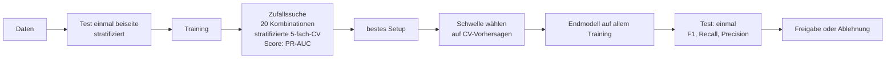

# Tag 12, Fallstudie RetailSmart: Random Forest gezielt verbessern

**Ausgangslage:** Die RetailSmart GmbH hat ein Random-Forest-Modell im Einsatz. Seltene Ereignisse machen etwa 5 % der Daten aus. Das Modell stagniert bei mittlerer Güte, Rechenzeit ist knapp (rund 1 Stunde Trainingsbudget), Geschäftsentscheidungen hängen daran.

| Metrik | Heute | Ziel |
|---|---:|---:|
| F1 | 0,62 | ≥ 0,75 |
| Recall | 0,58 | ≥ 0,80 |
| Precision | 0,67 | ≥ 0,70 |

**Aufgabe:** (1) Optimierungsansatz wählen, (2) passende Metriken festlegen, (3) Overfitting-Strategie benennen.

Die Fallstudie liefert keine Daten. Ein kleines Simulationsskript (`12_Demo_Fallstudie_RetailSmart.py`, künstliche Daten mit ca. 6 % Ereignissen) zeigt den Ablauf. **Die Zahlen daraus sind nicht die von RetailSmart.**

> [!NOTE]
> **Ergebnis in Kürze**
>
> - **Ansatz:** Zufallssuche (`RandomizedSearchCV`) über fünf Stellschrauben mit 20 Kombinationen und stratifizierter 5-fach-CV, danach **Entscheidungsschwelle** auf Validierungsvorhersagen wählen. Passt in die Stunde.
> - **Metriken:** Zielgröße **F1**, gesteuert über **Recall und Precision**, Tuning-Score **PR-AUC**. **Nicht Accuracy** (95 % trivial).
> - **Overfitting:** Test einmal beiseite, Tuning nur mit CV auf dem Training, Schwelle nicht auf dem Test wählen, Streuung der Folds beachten, Rechenbudget begrenzt die Zahl der Versuche.
> - **Realistische Erwartung:** Das Tuning bringt vermutlich weniger als die **Schwelle**. In der Simulation hob die Schwelle den Recall von 0,39 auf 0,55, die Hyperparameter fast nichts. Das Ziel (F1 0,75) ist **nicht garantiert**, ehrlich als Spanne berichten.
> - **Zielwerte prüfen:** Precision 0,70 und Recall 0,80 ergeben zusammen nur **F1 0,747**. Die drei Ziele sind nicht ganz konsistent.

---

## 0. Was gehört alles zu „Validierung" im Trainingsprozess?

„Validierung" heißt im weiten Sinn: **prüfen, ob etwas das tut, was es soll, mit Daten oder Ergebnissen, die nicht zum Anpassen benutzt wurden.** Es ist kein einzelner Schritt, sondern kommt auf mehreren Ebenen vor, in einer festen Reihenfolge.

| # | Ebene | Frage | Typische Mittel | Tag |
|---:|---|---|---|---|
| 1 | **Datenvalidierung** | Sind die Eingangsdaten in Ordnung? | Datentests (Schema, Wertebereiche, Duplikate, fehlende Werte) | 10 |
| 2 | **Validierungsstrategie festlegen** | Wie teile ich ehrlich auf? | Hold-out, Stratifizierung, Gruppen, `TimeSeriesSplit`, Stichtag | 5, 11 |
| 3 | **Validierung beim Entwickeln** (engeres „Validierung") | Welches Modell, welche Einstellung ist die beste? | Validierungsset oder Cross-Validation, Lernkurven, `validation_curve`, Grid- und Random Search | 5, 12 |
| 4 | **Diagnose** | Unter- oder Überanpassung? | Abstand Training ↔ Validierung, Streuung der Folds | 12 |
| 5 | **Leakage-Prüfung** | Ist das Ergebnis zu gut? | Merkmalswichtigkeit, Weglassen-Test, Reihenfolge Aufteilen vor Anpassen | 11 |
| 6 | **Abnahme (Test)** | Wie gut ist das fertige Modell wirklich? | Testset, **einmal** benutzt (oder Nested CV zum Vergleich von Verfahren) | 5, 12 |
| 7 | **Fachliche Validierung** | Hilft es dem Geschäft? | Kostenmatrix, Schwelle, Plausibilität, Erklärbarkeit, Fairness, Datenschutz | 7, 8 |
| 8 | **Freigabe vor dem Betrieb** | Darf es ausgerollt werden? | Qualitätstor (besser als Baseline und Mindestgüte), Champion/Challenger, Canary, A/B-Test | 10 |
| 9 | **Validierung im Betrieb** | Stimmt es heute noch? | Monitoring (Technik, Daten, Güte, Wirkung), Drift, Retraining-Auslöser | 10 |

Den Datenteilen entspricht je eine Rolle:

```
Gesamtdaten
├── Training       → Modell lernt (Parameter)
├── Validierung    → Auswahl und Tuning (Hyperparameter, Schwelle), mehrfach benutzbar (CV)
└── Test           → ehrliche Endnote, einmal
                                     ↓
                     Betrieb: neue echte Daten → Monitoring (die laufende Validierung)
```

> [!IMPORTANT]
> **Der Kern in einem Satz:** Training, Validierung und Test sind drei **Rollen**, nicht drei Wörter für dasselbe. Wer auf dem Test auswählt, hat ihn zur Validierung gemacht und besitzt keine unabhängige Endnote mehr.

**Abgrenzung zu verwandten Wörtern:**

| Begriff | Meint |
|---|---|
| **Validierung** (eng) | Zwischenprüfung während der Entwicklung, mit Daten, die nicht ins Training des geprüften Modells gehen. Darf oft wiederholt werden. |
| **Test** | Abschlussprüfung auf unberührten Daten, einmal. |
| **Cross-Validation** | Verfahren, das die Validierung k-mal mit wechselnden Teilen macht, damit jede Zeile einmal validiert. |
| **Evaluation** | Oberbegriff für das Messen der Güte (Metriken). |
| **Monitoring** | Validierung im Betrieb auf echten, neuen Daten. |

---

## 1. Herausforderungen einordnen

| Herausforderung | Was dahintersteckt | Folge für das Vorgehen |
|---|---|---|
| **Modell stagniert** | Entweder falsche Einstellungen (Tuning), falsche Schwelle, zu wenige Signale in den Merkmalen oder das Muster ist ausgeschöpft | Erst **diagnostizieren**: Abstand Training ↔ Validierung, Lernkurve, Merkmale. Tuning ist nur eine von drei Stellschrauben. |
| **Unbalancierte Daten** (~5 %) | Accuracy ist wertlos (95 % ohne etwas zu lernen), das Modell sieht zu wenige Ereignisse, die Schwelle 0,5 ist unpassend | Metrik wechseln, stratifizieren, Klassengewichte oder Resampling, **Schwelle** wählen |
| **Overfitting-Risiko** | Je mehr Kombinationen geprüft werden, desto eher gewinnt eine zufällig (Winner's Curse), seltene Ereignisse sind wenige Fälle | Saubere Rollen von Training, Validierung, Test; begrenzte Suche; Streuung beachten |
| **Begrenzte Rechenzeit** | ~1 Stunde | Zufallssuche statt Gitter, Läufe vorher ausrechnen |
| **Geschäftsentscheidungen hängen daran** | Fehler kosten Geld, die Güte muss belastbar berichtet werden | Spanne statt Einzelzahl, Kosten von FN und FP, Freigabe über Qualitätstor |

---

## 2. Aufgabe 1: Optimierungsansatz

### 2.1 Welche Stellschrauben gibt es?

| Hebel | Beispiele | Wirkung | Priorität |
|---|---|---|---|
| **Entscheidungsschwelle** | statt 0,5 z. B. 0,25 | Verschiebt Recall gegen Precision, kostet **kein** Training | **hoch** (billig, wirksam) |
| **Klassengewichtung** | `class_weight="balanced"` oder `"balanced_subsample"` | Seltene Fehler zählen stärker | hoch |
| **Hyperparameter des Waldes** | `max_depth`, `min_samples_leaf`, `max_features`, `n_estimators` | Komplexität und Stabilität | mittel |
| **Resampling** | Oversampling (SMOTE), Undersampling | Mehr Ereignisse im Training | mittel (nur im Training, nach dem Split, in der Pipeline) |
| **Merkmale** | neue Merkmale, Auswahl, Bereinigung | Mehr Signal | oft **der größte Hebel**, aber aufwändiger |
| **Anderes Verfahren** | Gradient Boosting | Eventuell besser bei Tabellen | als Vergleich |

### 2.2 Gewählter Ansatz: Zufallssuche mit stratifizierter CV, danach Schwelle

**Warum Zufallssuche (`RandomizedSearchCV`) und kein vollständiges Grid?**

| Kriterium | Grid Search | **Zufallssuche** |
|---|---|---|
| Kosten | Produkt aller Werte, wächst schnell (5 Stellschrauben mit 3–4 Werten: über 400 Kombinationen) | **Fest wählbar** (z. B. 20) |
| Treffer | Prüft alles, auch Aussichtsloses | Meist nahezu so gut, weil nur wenige Parameter stark wirken |
| Passt in 1 Stunde | nur mit sehr kleinem Grid | **Ja** |

Die Bayes-Optimierung wäre eine Alternative, lohnt aber bei kurzen Trainings (Sekunden bis Minuten) kaum (siehe Cheatsheet).

**Suchraum (Beispiel):**

| Hyperparameter | Werte | Begründung |
|---|---|---|
| `class_weight` | None, balanced, balanced_subsample | seltene Ereignisse stärker gewichten |
| `max_depth` | 6, 10, 15, None | Begrenzung gegen Overfit |
| `min_samples_leaf` | 1, 3, 5, 10 | größere Blätter glätten, wichtig bei seltener Klasse |
| `max_features` | sqrt, 0,3, 0,5 | Vielfalt der Bäume |
| `n_estimators` | 200, 400, 600 | genug Bäume, mehr bringt kaum etwas |

**Rechenzeit:** Die Fallstudie nennt die Dauer eines Laufs nicht. **Annahme:** 20 Sekunden je Lauf (wie bei Bohnenwerk).

```
Zufallssuche:  20 Kombinationen × 5 Folds = 100 Läufe   × 20 s = 2.000 s  ≈ 33 Minuten
Endtraining:    1 Lauf                                   × 20 s =    20 s
Schwelle (cross_val_predict, 5 Läufe)                    × 20 s =   100 s
Gesamt                                                          ≈ 36 Minuten  (Budget: 60)
```

Reserve: gut 20 Minuten. Reicht sie nicht, reduziere `n_iter` oder k (k = 3 spart 40 %) und prüfe ein Rennen (`HalvingRandomSearchCV`).

### 2.3 Ablauf



(Das Diagramm habe ich nicht gerendert.)

Zeitliche Daten: Falls die Ereignisse an die Zeit gebunden sind (Retail: Saison, Aktionen), wird **nach Zeit** getrennt (`TimeSeriesSplit`, letzter Zeitraum als Test) und nicht zufällig gemischt. Die Fallstudie sagt dazu nichts, das ist eine Rückfrage.

---

## 3. Aufgabe 2: Metriken

### 3.1 Warum nicht Accuracy?

Bei 5 % Ereignissen erreicht ein Modell, das **immer „kein Ereignis"** sagt, **95 % Accuracy** und Recall 0. Die Zahl ist hübsch und wertlos.

### 3.2 Die Metriken und ihre Rolle

| Metrik | Rolle | Warum |
|---|---|---|
| **Recall** | Zielgröße (≥ 0,80) | Wie viele der echten Ereignisse findet das Modell? Entscheidend, wenn ein **übersehenes** Ereignis teuer ist. |
| **Precision** | Zielgröße (≥ 0,70) | Wie viele Alarme stimmen? Entscheidend, wenn **Fehlalarme** Arbeit oder Kosten verursachen. |
| **F1** | Gesamtziel (≥ 0,75) | Harmonisches Mittel von Precision und Recall, ein Wert für den Vergleich. |
| **PR-AUC** (`average_precision`) | **Score beim Tuning** | Misst die Rangfolge über **alle** Schwellen, unabhängig von einer Schwelle. Bei seltenen Ereignissen aussagekräftiger als ROC-AUC. |
| Confusion Matrix | Begleiter | Zeigt TP, FP, FN, TN in absoluten Zahlen. |
| ROC-AUC | nur ergänzend | Wirkt bei seltener Klasse oft zu gut, weil die vielen TN es füllen. |

**Warum PR-AUC zum Tunen und F1 zum Berichten?** F1 hängt an der Schwelle. Wer F1 mit Schwelle 0,5 optimiert, vermischt zwei Aufgaben. PR-AUC bewertet das Modell schwellenunabhängig, danach wählt man die Schwelle gesondert.

### 3.3 Die Zielwerte prüfen

```
F1 = 2 · P · R / (P + R)

Heute:                   P = 0,67, R = 0,58  →  F1 = 0,622  (stimmt mit 0,62 überein)
Beide Ziele genau erreicht: P = 0,70, R = 0,80  →  F1 = 0,747   (< 0,75!)
Für F1 = 0,75 bei R = 0,80 nötig:  P ≥ 0,706
```

> [!WARNING]
> **Die drei Zielwerte sind knapp inkonsistent.** Wer Precision 0,70 und Recall 0,80 genau trifft, verfehlt F1 0,75 leicht. Bei der Präsentation klären, welches Ziel zählt: ein **Recall von 0,80 mit Precision von mindestens etwa 0,71** erfüllt alle drei.

### 3.4 Schwelle nach Kosten

Die Fallstudie nennt keine Kosten. Allgemein gilt: Flaggen, wenn `p > C_FP / (C_FP + C_FN)`. Kostet ein verpasstes Ereignis das Zehnfache eines Fehlalarms, liegt die Schwelle bei 1/11 ≈ 9 %. Die Recall-Forderung von 0,80 spricht dafür, dass FN teurer sind als FP, also für eine **Schwelle unter 0,5**. Die Kosten wären eine Rückfrage an RetailSmart.

---

## 4. Aufgabe 3: Overfitting-Strategie

Beim Optimieren droht Overfitting auf **zwei Ebenen**: das Modell an die Trainingsdaten und die Auswahl an die Validierungsdaten (je mehr Kombinationen, desto eher gewinnt eine durch Zufall).

| Maßnahme | Schutz wovor |
|---|---|
| **Test einmal beiseite** (stratifiziert), erst am Ende benutzen | Optimismus der Auswahl |
| **Stratifizierte k-fache CV** (`StratifiedKFold`, k = 5) auf dem Training | Zufall eines einzelnen Splits, zu wenige Ereignisse je Fold |
| **Resampling nur im Training**, je Fold (Pipeline), nie vor dem Split | Leakage durch Kopien derselben Zeile in Training und Validierung |
| **Schwelle auf CV-Vorhersagen**, nicht auf dem Test | Test wird zur Validierung |
| **Abstand Training ↔ Validierung beobachten** (`return_train_score=True`) | erkennen, ob das Modell auswendig lernt |
| **Streuung der Folds ansehen**, kleine Verbesserungen im Rauschen nicht feiern | Zufallsgewinne |
| **Komplexität begrenzen** (`max_depth`, `min_samples_leaf`) | Overfit im Modell |
| **Begrenzte Suche** (Budget, 20 Kombinationen) | zu viele Versuche = Winner's Curse |
| **Optional: Nested CV** | ehrliche Güte des Verfahrens „Tuning + Training"; teuer (5 × 5 × 20 = 500 Läufe, ~2,8 Stunden bei 20 s), daher nur bei Bedarf |
| **Nach Freigabe: Monitoring** | Drift, die der Test nicht kannte |

---

## 5. Was die Simulation zeigt

Künstliche Daten, 20.000 Zeilen, 6,4 % Ereignisse (80/20-Aufteilung stratifiziert, Test 4.000 Zeilen, 256 Ereignisse). Erzeugt mit `12_Demo_Fallstudie_RetailSmart.py`, die Zahlen sind nicht die von RetailSmart.

| Stufe | F1 | Recall | Precision | PR-AUC |
|---|---:|---:|---:|---:|
| Standard-Random-Forest, Schwelle 0,5 (**Test**) | 0,56 | 0,39 | 0,97 | 0,642 |
| Getuntes Modell, Schwelle 0,25 (**Test**) | 0,62 | 0,55 | 0,72 | 0,638 |

Zufallssuche: 20 Kombinationen × 5 Folds = 100 Läufe in 287 Sekunden auf diesem Rechner. Bestes Setup: 200 Bäume, `max_depth` 15, `min_samples_leaf` 1, `max_features` sqrt, `class_weight` None. Beste Schwelle laut CV: 0,25.

**Was daran lehrreich ist:**

- **Die Hyperparameter haben die Güte kaum verändert.** PR-AUC auf dem Test 0,642 (Standard) gegen 0,638 (getunt): kein Unterschied im Rauschen. Die Qualität des Rankings ist im Wesentlichen durch Daten und Merkmale gegeben.
- **Der Gewinn kam von der Schwelle.** Recall stieg von 0,39 auf 0,55, Precision fiel von 0,97 auf 0,72, F1 stieg von 0,56 auf 0,62. Standard-Schwelle 0,5 ist für 6 % Ereignisse zu zögerlich.
- **Der Test bestätigte die CV:** CV-Schätzung bei Schwelle 0,25 war F1 0,60 / Recall 0,54 / Precision 0,67, Test 0,62 / 0,55 / 0,72. Die Schwelle wurde nicht am Test gewählt und trägt trotzdem.
- **Ziel verfehlt:** Recall 0,55 liegt weit unter 0,80. Für den Zielbereich bräuchte es mehr Signal (Merkmale), nicht nur Tuning.

> [!TIP]
> **Reihenfolge der Hebel bei seltenen Ereignissen:** zuerst **Metrik und Schwelle** (kostet kein Training), dann **Klassengewichte**, dann **Hyperparameter**, parallel **Merkmale** verbessern. Wer zuerst das Gitter durchprobiert, verbraucht die Rechenzeit am Hebel mit dem kleinsten Ertrag.

*Zufallsdaten und ein einzelner Lauf:* Dass die Hyperparameter hier fast nichts brachten, ist ein Befund dieser Simulation und kein Gesetz. Bei echten Daten kann das Tuning mehr bewirken.

---

## 6. Empfehlung an RetailSmart

1. **Diagnose zuerst** (1 Tag): Abstand Training ↔ Validierung, Lernkurve, Merkmalswichtigkeit. Zeigt, ob Tuning überhaupt der Hebel ist.
2. **Metrik umstellen** auf PR-AUC (Tuning) und F1/Recall/Precision (Berichten), Accuracy streichen.
3. **Schwelle** nach Kosten von FN und FP neu festlegen (vermutlich unter 0,5).
4. **Zufallssuche** mit 20 Kombinationen, stratifizierte 5-fach-CV, ca. 35 Minuten.
5. **Einmal auf dem Test** prüfen, Ergebnis als **Spanne** berichten (z. B. Recall 0,55 bis 0,65), nicht als Einzelzahl.
6. **Freigabe über Qualitätstor** (besser als das heutige Modell: F1 0,62), danach Champion/Challenger und Monitoring.
7. Wenn das Ziel (F1 0,75, Recall 0,80) so nicht erreichbar ist: **mehr Signal** besorgen (neue Merkmale, mehr Ereignisse, bessere Daten) und die Erwartung offen darlegen.

## Kernaussagen

> [!TIP]
> - **Validierung ist kein Schritt, sondern eine Kette:** Daten prüfen, Strategie festlegen, validieren und tunen, auf Leakage prüfen, einmal testen, vor dem Rollout freigeben, im Betrieb überwachen.
> - **Bei 5 % Ereignissen Accuracy streichen.** Tuning mit PR-AUC, Berichten mit F1, Recall und Precision.
> - **Die Schwelle ist ein Hebel, kein Detail.** Sie kostet kein Training und hat in der Simulation mehr gebracht als das ganze Tuning.
> - **Zufallssuche statt Gitter** bei knapper Rechenzeit, Läufe vorher ausrechnen.
> - **Der Test bleibt tabu bis zum Schluss.** Auch die Schwelle wird auf Validierungsdaten gewählt.
> - **Zielwerte nachrechnen:** Precision 0,70 und Recall 0,80 ergeben zusammen nur F1 0,747.

## Abweichungen und Annahmen

- Die Fallstudie liefert **keine Daten und keine Laufzeit je Training.** Die 20 Sekunden je Lauf sind eine Annahme (wie bei Bohnenwerk). Die Simulation läuft auf diesem Rechner schneller, sie zeigt den Ablauf und keine RetailSmart-Ergebnisse.
- Die Simulationsdaten haben 6,4 % Ereignisse (nicht genau 5 %), weil `make_classification` durch das Rauschen (`flip_y`) die Rate verschiebt.
- Kosten von Fehlalarm und verpasstem Ereignis sind unbekannt, die Schwelle unter 0,5 ist daher eine begründete Vermutung (Recall-Ziel höher als Precision-Ziel).
- Ob die Daten zeitlich geordnet sind, nennt die Fallstudie nicht. Ich nehme eine zufällige stratifizierte Aufteilung an und weise auf `TimeSeriesSplit` hin, falls es Zeitdaten sind.
- Die Aussage „Hyperparameter bringen wenig, Schwelle viel" stammt aus **einem** Simulationslauf (`random_state=42`).
- Gerendert habe ich weder die Hinweisboxen noch das Mermaid-Diagramm.
