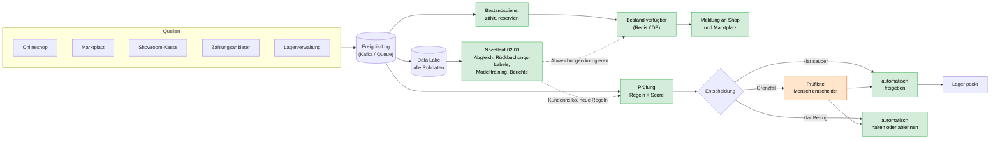

# Tag 13 · Arbeitsauftrag 1: Seilschaft Outdoor GmbH (Echtzeit, Datenfluss)

Aufgabe: Ereignisse in „Echtzeit ja/nein“ einteilen, den Datenfluss von den Quellen bis zur Entscheidung skizzieren, jedem Baustein ein Werkzeug zuordnen und markieren, was das System und was ein Mensch entscheidet.

> [!NOTE]
> **Ergebnis in drei Sätzen:** Alles, was den **verkaufbaren Bestand** oder die **Bestellprüfung** verändert, fließt in Echtzeit (Sekunden). Alles, was nur Auswertung, Lernen oder Kontrolle ist (Rückbuchungen, Abgleich, Berichte), darf im Nachtlauf bleiben. Der 02:00-Abgleich wird nicht abgeschafft, sondern zur **Kontrolle** des Echtzeitbestands.

> [!TIP]
> **Realitätscheck der Größe:** Die Last ist klein: etwa 6.600 Ereignisse pro Tag (0,08 pro Sekunde), in der Samstagsspitze etwa 0,25 pro Sekunde. Das Problem ist nicht der Durchsatz, sondern **Aktualität und Konsistenz** (ein Bestand, drei Kanäle). Eine kleine, gut gewählte Lösung reicht (siehe Abschnitt 4). Rechnung: `13_Demo_Realtime_Rechnungen.py`.

---

## 1. Was heute schiefläuft (und warum)

| Vorfall | Ursache | Was fehlt |
|---|---|---|
| Sa 14.03., 11:04: letzter Klettergurt „Vertex M“ wird im Showroom verkauft, der Marktplatz verkauft ihn abends noch dreimal | Marktplatz zeigt den **zuletzt gemeldeten** Bestand; die Meldung kommt erst um 02:00 | Kassen-Bon muss **sofort** den Bestand ändern und an den Marktplatz gehen |
| Di 03.06., 23:40: drei Bestellungen mit je vier Lawinen-Suchgeräten, drei Namen, dieselbe Packstation, drei ausländische Karten; am Morgen übersehen, 4.100 € Rückbuchung | Prüfung erst morgens und von Hand, unter 900 Bestellungen | **Sofortige** Regel/Score auf Muster über mehrere Bestellungen |
| Jeden Abend: wer nach 18 Uhr bestellt, wartet auf die Prüfung | Prüfung wird erst morgens gemacht | Automatische Freigabe der klaren Fälle |
| 2025: 290 Stornos „nicht lieferbar“, Rückbuchungen 38.000 € | beides oben | Sperre droht ab 2 % Stornos |

> [!WARNING]
> **Zahlen in der Aufgabe passen nicht ganz zusammen:** 290 Stornos entsprechen 0,20 % der Marktplatz-Bestellungen (400/Tag × 365) bzw. 0,05 % aller Bestellungen, nicht 1,8 %. Vermutlich zählt die 1,8 % mehr Stornogründe oder eine andere Basis. Für die Lösung ist das unerheblich, die Richtung stimmt.

---

## 2. Ereignisliste: Echtzeit ja oder nein, und wofür

| Ereignis | Quelle | Echtzeit? | Wofür | Bestand | Prüfung |
|---|---|---|---|:---:|:---:|
| Bestellung (neu, ändern) | Shop, Marktplatz | **ja** (Sekunden) | Bestand reservieren; Betrugsprüfung starten | x | x |
| Storno | Shop, Marktplatz | **ja** | Reservierung freigeben; Muster (Bestellen und Stornieren) | x | x |
| Kassen-Bon | Showroom | **ja, höchste Priorität** | Ware ist physisch weg, Bestand sofort verringern und an alle Kanäle melden | x | |
| Zahlung bestätigt | Zahlungsanbieter | **ja** | Prüfung abschließen, Reservierung bestätigen, Lager freigeben | x | x |
| Zahlung abgelehnt | Zahlungsanbieter | **ja** | Reservierung freigeben; Signal für die Prüfung | x | x |
| Wareneingang | Lager | ja, aber Minuten genügen | Bestand erhöhen (zu spät kostet nur Verkäufe, keine Fehler) | x | |
| Paket gepackt | Lager | ja, Minuten | Status von reserviert auf ausgebucht | x | |
| Retoure ins Regal | Lager | nein, Mini-Batch (z. B. stündlich) oder Nachtlauf | Bestand erhöhen; zu niedriger Bestand ist harmlos | x | |
| **Rückbuchung** (Wochen später) | Zahlungsanbieter | **nein, Nachtlauf** | **Label** („war Betrug“) für Modelltraining und Kundenrisiko | | (x) lernen |
| Abgleich der drei Kanäle | Nachtlauf | nein (bleibt um 02:00) | **Kontrolle** und Korrektur von Abweichungen | Kontrolle | |
| Berichte, Kennzahlen, Modelltraining | Nachtlauf | nein | Auswertung | | |

**Beantwortung der Leitfragen:**

1. **Woher weiß der Marktplatz im Moment der Bestellung, wie viel noch da ist?** Gar nicht „im Moment“: er kennt nur die **zuletzt gemeldete Zahl**. Deshalb meldet Seilschaft bei **jeder Bestandsänderung** sofort per Schnittstelle (Push), nicht mehr einmal nachts. Zusätzlich braucht es einen Puffer: ab Bestand ≤ 2 meldet man dem Marktplatz 0 oder ein festes Kontingent, weil zwischen Verkauf und Meldung immer Sekunden liegen. Die Kasse und der Shop reservieren zentral und atomar (ein Bestandsdienst als einzige Wahrheit); beim Marktplatz bleibt ein Restrisiko, das der Puffer klein macht.
2. **Welche Ereignisse braucht der Bestand, welche die Prüfung, welche beide?** Siehe Spalten Bestand/Prüfung oben. **Beide:** Bestellung, Storno, Zahlung bestätigt/abgelehnt. **Nur Bestand:** Kassen-Bon, Wareneingang, gepackt, Retoure. **Nur Prüfung (und Lernen):** die Rückbuchung.
3. **Was weiß man beim Bezahlen, was erst Wochen später?**

   | Beim Bezahlen bekannt (Merkmale) | Erst Wochen später bekannt |
   |---|---|
   | Betrag, Artikel, Menge, Uhrzeit | **Rückbuchung = ob es Betrug war** |
   | Karte (Land), Zahlung bestätigt/abgelehnt | |
   | Lieferadresse (Packstation, neu?), Kundenhistorie (Neukunde?) | |
   | Zahl der Bestellungen je Packstation/Karte in den letzten Stunden | |

> [!IMPORTANT]
> Das Ergebnis („Rückbuchung“) kennt man erst nach Wochen. Für das Training braucht man deshalb ein **Reifefenster**: nur Bestellungen verwenden, bei denen die Rückbuchungsfrist schon abgelaufen ist, sonst scheinen junge Bestellungen fälschlich „sauber“. Die Rückbuchung darf nie als **Merkmal** in die Echtzeitprüfung (Data Leakage, Tag 11).

4. **Was passiert mit Ereignissen, die eintreffen, während ein Baustein neu startet?** Sie dürfen nicht verloren gehen. Der Datenstrom wird in einem **persistenten Log** (Kafka o. Ä.) gespeichert; der Baustein merkt sich, wie weit er gelesen hat (Offset/Checkpoint) und liest nach dem Neustart weiter. Weil dabei Ereignisse doppelt ankommen können („mindestens einmal“), muss die Verarbeitung **idempotent** sein (jede Meldung hat eine Ereignis-ID, doppelte werden erkannt). Die Reihenfolge je Artikel bleibt erhalten, wenn man nach Artikelnummer partitioniert.

---

## 3. Datenfluss (Kästen und Pfeile)

Zwei Farben: **grün = das System entscheidet**, **orange = ein Mensch entscheidet**.

> [!NOTE]
> **Merke:** „Hold“ (Bestellung zurückhalten) ist billiger und umkehrbar, „ablehnen“ nicht. Bei Grenzfällen in der Nacht wird nicht gepackt, bis ein Mensch entschieden hat. Die Zahlung wird nur **autorisiert**, die Abbuchung und der Versand folgen erst nach der Prüfung. Das ist der Fall vom 03.06., 23:40.

---

## 4. Werkzeug je Baustein mit einem Satz Begründung

| Baustein | Werkzeug (Beispiel) | Begründung |
|---|---|---|
| Ereignis-Log | **Apache Kafka** (oder verwaltet: Confluent Cloud, Azure Event Hubs, AWS Kinesis) | Speichert Ereignisse dauerhaft und lässt sie nach einem Neustart erneut lesen; Reihenfolge je Artikel. |
| Bestandsdienst | **Kafka Streams** oder **Apache Flink** (Zustand je Artikel) | Zählt zustandsbehaftet und genau-einmal-sicher, mit Latenz im Sekundenbereich. |
| Verfügbarer Bestand | **Redis** (mit Persistenz) oder PostgreSQL | Abfrage in Millisekunden, atomare Zähler für „reservieren“. |
| Meldung an Kanäle | Marktplatz-API und Shop-Schnittstelle, **Retry mit Warteschlange** | Jede Änderung wird gemeldet; bei Fehlern erneut senden statt verlieren. |
| Prüfung | Regeln (z. B. Drools / eigener Regelcode) + **Score-Modell** (scikit-learn, als Dienst) | Regeln für klare Muster (Packstation + Namen), Modell für Feinheiten; beides in Millisekunden. |
| Prüfliste | **Ticket-/Workflow-Werkzeug** (z. B. Jira Service, einfache Web-Oberfläche) | Mensch sieht Fall, Gründe und Entscheidungsknopf; jede Entscheidung wird gespeichert. |
| Data Lake | **S3 / Azure Blob** mit Parquet | Billig, unveränderlich, Grundlage für Nachtlauf und Modelltraining. |
| Nachtlauf | **Apache Airflow** + **Spark** oder **dbt** + Data Warehouse | Plant und wiederholt den Abgleich, die Berichte und das Training. |

> [!WARNING]
> **Kafka + Flink wäre hier überdimensioniert:** 0,08 bis 0,25 Ereignisse pro Sekunde schafft auch eine Datenbank mit Ereignistabelle oder eine verwaltete Queue (AWS SQS, Google Pub/Sub) mit Postgres/Redis. Die Kursantwort (Kafka/Flink) zeigt das Muster; für 45 Mitarbeitende ohne Betriebsteam wäre die **verwaltete, schlanke Variante** die ehrliche Empfehlung. Wichtig sind nicht die Namen, sondern die Eigenschaften: dauerhaftes Log, ein zentraler Bestand, idempotente Verarbeitung.

---

## 5. Wer entscheidet was?

| Entscheidung | System | Mensch | Begründung |
|---|:---:|:---:|---|
| Bestand zählen, reservieren, an Kanäle melden | x | | hohe Frequenz, klare Regel, Fehler gering und korrigierbar |
| Klar sauber (kleiner Score): freigeben, packen | x | | verhindert die Wartezeit über Nacht und die 1.500 Handprüfungen |
| Klar auffällig (Muster wie 03.06.): **halten** | x | | umkehrbar, schützt vor 4.100 € Schaden |
| Grenzfall: freigeben oder ablehnen | | x | Mehrdeutigkeit, Fehler in beide Richtungen teuer |
| Regeln und Schwellen pflegen, neue Muster | | x | Verantwortung und Lernen aus Rückbuchungen |
| Rückbuchung bearbeiten | | x | Einzelfall mit Zahlungsanbieter |
| Restbestand-Puffer anpassen | | x | betriebswirtschaftliche Abwägung (Verkauf gegen Storno) |

> [!TIP]
> **Wirkung (grobe Schätzung, nicht aus der Aufgabe):** Wenn die Automatik 95 % der Bestellungen sicher freigibt, bleiben von 1.500 Bestellungen etwa 75 am Tag für die Mitarbeiterin. Wer abends bestellt, bekommt die Freigabe sofort, und der Express-Versand geht am selben Abend raus.

---

## Kernaussagen

> [!IMPORTANT]
> 1. **Echtzeit nur, wo eine späte Antwort Geld kostet:** Bestand und Prüfung. Alles andere bleibt im Nachtlauf.
> 2. Der **02:00-Abgleich** bleibt als Kontrolle; Echtzeit ersetzt ihn nicht, sondern entlastet ihn.
> 3. Ein **zentraler Bestand** mit **Puffer** löst das „Vertex M“-Problem; der externe Marktplatz bleibt ein Restrisiko.
> 4. **Rückbuchungen** kommen Wochen später und sind das Label fürs Modell, nie ein Merkmal.
> 5. **Nicht verlieren, nicht doppelt zählen:** persistentes Log plus idempotente Verarbeitung.
> 6. **Hold statt Ablehnen**, wenn jemand erst später prüfen kann.

## Abweichungen und Annahmen

- Annahme: die 400 Marktplatz-Bestellungen pro Tag sind in den 1.500 enthalten; Zahlungsmeldungen im Mittel 2 je Bestellung.
- Puffer „ab Bestand ≤ 2 melden wir 0“ und „95 % automatisch“ sind Beispielwerte, keine Vorgaben.
- Werkzeugnamen sind Beispiele; passende Alternativen sind jeweils genannt.
- Mermaid und die GitHub-Hinweisboxen wurden hier nicht gerendert.
