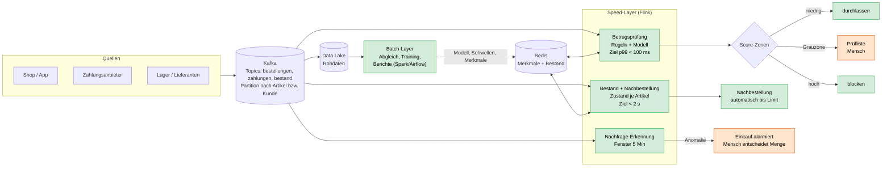

# Tag 13 · Fallstudie: QuickRetail AG (Realtime-Architektur, Entscheidungshierarchie, Werkzeuge)

Aufgabe: eine Realtime-Architektur entwerfen, die Entscheidungshierarchie (Automatik oder Mensch) festlegen, Werkzeuge zuordnen und vier Situationen entscheiden.

Eckdaten: Spitze ca. 5.000 Bestellungen/h, ca. 2.000 Events/s, Betrugsquote ca. 0,5 %.

| Entscheidung | Max. Latenz | Automatisierung |
|---|---|---|
| Zahlungs-/Betrugsprüfung | < 100 ms | automatisch |
| Bestand & Nachbestellung | < 2 s | automatisch |
| Grenzfälle / Eskalation | Minuten | Mensch |

> [!NOTE]
> **Ergebnis in drei Sätzen:** Eine Pipeline mit **Ereignis-Log → Stream-Verarbeitung → Entscheidungsstufen** (Regel, Modell, Mensch) und parallel ein **Batch-Weg** für Genauigkeit und Lernen. Die Betrugsprüfung darf **nie** gesampelt werden und hat den knappsten Zeitplan; der Bestand darf als Erstes langsamer werden. Im Ausfall gilt **abgestuft** statt „alles blocken“ oder „alles durchlassen“: Kleinbeträge offen, Risiko-Fälle halten, nichts geht verloren.

---

## 1. Realtime-Architektur

**Latenzbudget für die Betrugsprüfung (Beispiel, Annahme: Summe < 100 ms):**

| Schritt | Budget |
|---|---|
| Ereignis im Log ankommen | ca. 5 ms |
| Merkmale aus Redis holen | ca. 5 ms |
| Regeln + Modell | ca. 20 bis 40 ms |
| Entscheidung zurückschreiben/antworten | ca. 10 ms |
| **Reserve für Spitzen** | der Rest |

> [!NOTE]
> Die 100 ms sind ein **Antwortbudget im Bezahlvorgang**: Der Kunde wartet. Was länger dauert, darf nur **zusätzlich** nachlaufen (Zahlung autorisieren, Versand erst nach vollständiger Prüfung).

---

## 2. Entscheidungshierarchie

Vier Stufen, von oben nach unten:

| Stufe | Wer | Was | Beispiel |
|---|---|---|---|
| 0 | **Harte Regel** | einfach, transparent, billig | Sperrliste, Kleinbetrag < 20 € frei, Bestand 0 = nicht verkaufbar |
| 1 | **Modell** (Score) | erkennt Muster, die Regeln nicht kennen | Betrugs-Score aus Verlauf, Gerät, Karte, Adresse |
| 2 | **Mensch** | Grenzfälle, hohe Beträge, Mehrdeutigkeit | Score 0,30 bis 0,90 bei hohem Warenwert |
| 3 | **Notbetrieb** | Rückfallmodus bei Ausfall | abgestuft, siehe Situation 4 |

> [!TIP]
> **Regel als Leitplanke, Modell zur Feinsteuerung, Mensch für das Mehrdeutige.** Je höher Risiko und Mehrdeutigkeit, desto weiter nach unten wandert die Entscheidung. Je häufiger und klarer der Fall, desto weiter nach oben.

---

## 3. Werkzeugzuordnung

| Baustein | Werkzeug | Begründung |
|---|---|---|
| Ereignis-Log | **Apache Kafka** | hoher Durchsatz (12.000/s sind machbar), dauerhaft gespeichert, wiederholbar nach Ausfall |
| Stream-Verarbeitung | **Apache Flink** | zustandsbehaftet, niedrige Latenz, Checkpoints, genau-einmal-Verarbeitung |
| Merkmale und Bestand | **Redis** | Zugriff in Millisekunden; Merkmale (z. B. „Bestellungen je Karte in 1 h“) |
| Modellbetrieb | Modell im Flink-Job oder als **schlanker Dienst** (ONNX/FastAPI) | kurze Antwortzeit, gleiche Merkmale wie im Training |
| Prüfliste | Ticket-/Workflow-Werkzeug, 24/7 oder Bereitschaft | Mensch sieht Gründe und entscheidet in Minuten |
| Data Lake / Batch | **S3 + Spark + Airflow** | genaue Neuberechnung, Training, Abgleich |
| Beobachtung | Prometheus/Grafana (Latenz p99, Consumer-Lag, Fehlerquote) | man muss die Lastspitze und den Ausfall **sehen** |

---

## 4. Die vier Situationen

### ① Der virale Artikel (Bestand und Nachbestellung)

Fr 18:00, TikTok-Video: 600 Bestellungen in 15 Minuten statt ca. 40, Bestand 500, Nachbestell-Schwelle 100, Lieferzeit 5 Tage, Mindestmenge 1.000.

| Kennzahl | Wert |
|---|---|
| Nachfrage | 40 pro Minute = **15×** Normalbetrieb (ca. 2,7 pro Minute) |
| Bestand reicht | **12,5 Minuten** (normal 3,1 Stunden) |
| Schwelle 100 erreicht | nach 10 Minuten |
| Bedarf bis zur Lieferung (5 Tage) | 19.200 (Normalnachfrage) bis 288.000 (volle Hype-Rate); selbst 10 % der Hype-Rate = 28.800 |
| Mindestmenge 1.000 deckt | 6,2 Stunden Normalnachfrage |

**Entscheidung: Ja, die Automatik bestellt sofort nach, aber gestuft:**

1. Die Automatik löst **sofort die Mindestmenge (1.000)** aus. Das ist die untere Grenze und selbst bei abflauendem Trend kaum ein Risiko (in ca. 6 Stunden Normalbetrieb verkauft).
2. Die **Nachfrage-Erkennung** (Fenster von 5 Minuten gegen die Normalrate) erkennt die Anomalie (15-fach) und **alarmiert den Einkauf**. Die **Zusatzmenge** entscheidet ein Mensch, weil sie von der Trend-Einschätzung abhängt (hält der Hype oder nicht?).
3. Bis die Ware da ist: **Kaufbegrenzung je Kunde** (z. B. 2 Stück), Hinweis „Lieferung in ca. 5 Tagen“ oder Vorbestellung statt „ausverkauft“.

**Was wiegt schwerer, Ausverkauf oder 1.000 Stück Überbestand?** Der **Ausverkauf**. Über 5 Tage entgehen je nach Trend Tausende Bestellungen, die zudem zu Wettbewerbern gehen. Der Überbestand von 1.000 Stück kostet Kapitalbindung und im schlechtesten Fall einen Rabatt. Die Fehler sind **asymmetrisch**. Abgesichert wird der Überbestand durch die Mengengrenze der Automatik.

> [!WARNING]
> **Zahlen der Aufgabe:** Wenn ca. 40 Bestellungen je 15 Minuten wirklich die Normalnachfrage sind, wäre schon die Schwelle 100 im Normalbetrieb viel zu niedrig (bei 5 Tagen Lieferzeit). Die Aufgabe liefert dazu keine weiteren Angaben, deshalb rechne ich mit der wörtlichen Lesart und halte fest: **Die Schlussfolgerung hängt nicht davon ab**, weil jede plausible Lesart zeigt, dass 1.000 Stück nicht reichen.

---

### ② Der Grenzfall-Score (Zahlung und Betrug)

03:12 Uhr, 8 Smartphones, 6.400 €, neue Lieferadresse, Karte aus dem Ausland. Score 0,78, Auto-Block ab 0,90, Auto-Freigabe unter 0,30.

**Drei Zonen:**

| Zone | Score | Aktion | Wer |
|---|---|---|---|
| Durchlassen | < 0,30 | freigeben, packen | System |
| Eskalieren | 0,30 bis 0,90 | **Hold** (Zahlung autorisiert, nicht abgebucht, nicht verschickt); Prüfliste | Mensch (Minuten) |
| Blocken | ≥ 0,90 | ablehnen | System |

**Fall 03:12 Uhr:** Score 0,78 liegt in der Eskalationszone, dazu 6.400 € Warenwert, Nachtzeit, neue Adresse, Auslandskarte. Ergebnis: **Hold**, kein Versand. Nachts ist keine Person da, und das ist **unkritisch**, solange der irreversible Schritt (Versand, Abbuchung) wartet. Bei hohem Warenwert zusätzlich **Rückfrage beim Kunden** (3-D Secure, Verifikation per Mail) und Bereitschaftsmeldung an die Betrugsprüfung.

**Was kostet ein False Positive, was ein False Negative?** Rechnung mit **Annahmen** (Marge 25 %, Kundenwert 30 €, Prüfung 5 €, Rückbuchungsgebühr 15 €; nicht aus der Aufgabe):

| Warenwert | FN (Betrug durchgelassen) | FP (echten Kunden blockiert) | Blocken billiger als Durchlassen ab p = | Auto-Block lohnt erst ab p = |
|---|---|---|---|---|
| 80 € | 95 € | 50 € | 0,34 | 0,90 |
| 6.400 € | 6.415 € | 1.630 € | 0,20 | 0,997 |

Bei 6.400 € kostet **Durchlassen** im Mittel 5.004 €, **Blocken** 359 €, **Prüfen** nur 5 €. Prüfen gewinnt klar.

> [!IMPORTANT]
> **Schwellen sollten vom Warenwert abhängen.** Die Schwelle 0,90 für Auto-Block passt für einen durchschnittlichen Warenkorb (80 €), aber bei 6.400 € wäre sogar 0,90 zu früh: dort lohnt Auto-Block erst bei 0,997, und bei kleinen Werten darf die Auto-Freigabe großzügig sein. Konsequenz: **wertabhängige Schwellen**, oder der Warenwert fließt als Merkmal in die Zonenwahl ein.

> [!WARNING]
> **Ist ein Score eine Wahrscheinlichkeit?** Nicht automatisch. Bei 0,5 % Betrugsquote entspricht ein Score von 0,78 meist **nicht** 78 % Betrugswahrscheinlichkeit, sondern einem Rang. Vor der Kostenrechnung den Score **kalibrieren** (Kalibrierungskurve auf Validierungsdaten) und die Schwellen auf einem **Zeitsplit** festlegen (Tag 11 und 12).

**Wie viele Menschen braucht die Prüfliste?** Bei 5.000 Bestellungen/h und 0,5 % Betrug sind es 25 Betrugsfälle pro Stunde. Ein Modell mit Recall 90 % und Falsch-Positiv-Rate 1 % markiert 72 Fälle pro Stunde (Precision nur 31 %). Bei 5 Minuten je Fall (Annahme) sind das **6 Personen Dauerlast**; bei 0,1 % Falsch-Positiv-Rate nur 27 Fälle (Precision 82 %, 2,3 Personen). Die Schwelle ist also auch eine **Kapazitätsentscheidung**, nicht nur eine Güteentscheidung.

---

### ③ Die Lastspitze (Skalierung und Stabilität)

Black Friday: Events von 2.000/s auf 12.000/s (**6×**), Flink-Latenz p99 von 70 ms auf 340 ms (4,9×). Budget bleibt < 100 ms (340 ms sind 3,4× darüber).

| Option | Bewertung |
|---|---|
| **Mehr Partitionen/Tasks (Scale-out)** | **Erste Wahl.** Bei 6× Last mindestens 6× Parallelität plus Reserve (Annahme: lineare Skalierung). Die Kafka-Partitionen begrenzen die Parallelität und werden **vor** Black Friday geplant (das Datum ist bekannt). |
| Backpressure | **Schutz**, keine Lösung: verhindert den Absturz, erhöht aber die Latenz. Für den Bestand (Budget 2 s) tragbar, für die Betrugsprüfung nicht. |
| Sampling | **Nie für die Betrugsprüfung** (jede Zahlung muss bewertet werden). Nur für Beobachtung und Dashboards. |
| **Funktion degradieren** | Zweite Wahl: für den Pfad bei Spitzenlast **schlankes Modell oder Regeln allein**, teure Merkmale (Netzwerk-/Historienmerkmale) abschalten; die volle Prüfung läuft nachgelagert. |

**Was darf zuerst langsamer werden: Bestand oder Betrugsprüfung?** Der **Bestand**. Sein Budget (2 s) ist 20× großzügiger, und Überverkäufe einzelner Stücke lassen sich per Storno korrigieren. Die Betrugsprüfung steht im Bezahlvorgang, ihre Fehler (versandte Ware) sind unumkehrbar. Praktisch: Bestand und Betrugsprüfung in **getrennten Jobs mit eigenen Ressourcen** laufen lassen (Schottwand/Bulkhead), damit der eine den anderen nicht verdrängt.

---

### ④ Der Ausfall (Automatik unter Druck)

Ein Flink-Worker fällt aus, Kafka-Consumer-Lag wächst auf 90 s. Bei 2.000/s sind das **180.000 Ereignisse im Rückstand**, bei 12.000/s 1,08 Millionen. Die Verarbeitung läuft hinter der Realität her. Aufholzeit: 45 s bei 6.000/s Kapazität, 90 s bei 4.000/s, 180 s bei 3.000/s.

**Welche Entscheidungen dürfen jetzt nicht mehr automatisch laufen?** Alle, die auf **veraltetem Zustand** beruhen:

| Entscheidung | Warum gefährdet | Reaktion |
|---|---|---|
| Automatische Nachbestellung | Bestand ist 90 s alt, Doppel- und Fehlbestellung | pausieren oder Mensch bestätigt |
| Auto-Freigabe hoher Beträge | Zähler (z. B. „drei Bestellungen je Packstation“) sind unvollständig, Muster wie am 03.06. werden nicht erkannt | **Hold** über einem Betrag |
| Velocity-Regeln | Zähler fehlen Ereignisse | nur Regeln, die ohne Zustand funktionieren |

**Sicherer Rückfallmodus:** weder „alles blocken“ (Umsatzverlust) noch „alles durchlassen“ (Betrug) noch „alles an den Menschen“ (die Prüfliste bricht zusammen, siehe 6 Personen im Normalfall). **Abgestuft:**

1. Lag > wenige Sekunden: **Regeln ohne Zustand** direkt im Bestellvorgang (z. B. Kleinbetrag frei, Sperrliste, Auslandskarte plus neue Adresse = Hold).
2. **Kleinbeträge < 20 €: fail-open** (durchlassen), denn der Schaden ist begrenzt.
3. **Höhere Beträge: fail-safe als Hold** (Zahlung autorisieren, Versand verzögern). Der Kunde wartet, es geht nichts verloren, und nach dem Aufholen werden die Fälle regulär bewertet.
4. Alarm an Bereitschaft; nach der Wiederherstellung wird der Rückstand **in Reihenfolge** abgearbeitet (Kafka behält alle Ereignisse, Flink startet vom letzten Checkpoint).

> [!IMPORTANT]
> **Fehlerkosten entscheiden fail-safe oder fail-open:** Wo ein falsches „Ja“ billig und umkehrbar ist, offen lassen. Wo es teuer und unumkehrbar ist, zurückhalten. Der Hold ist der Kompromiss, weil er **zeitlich** verschiebt statt **inhaltlich** zu entscheiden.

---

## Kernaussagen

> [!IMPORTANT]
> 1. **Speed-Layer** (Kafka + Flink) für Betrug und Bestand, **Batch-Layer** für Genauigkeit und Training; Redis als schneller Speicher für Merkmale und Bestand.
> 2. **Vier Stufen:** harte Regel, Modell, Mensch, Notbetrieb.
> 3. **Die Latenz bestimmt den Platz im Ablauf:** 100 ms im Bezahlvorgang, 2 s für den Bestand, Minuten für den Menschen.
> 4. **Schwellen sind Kosten- und Kapazitätsentscheidungen**, abhängig vom Warenwert; ein Score muss vorher kalibriert sein.
> 5. **Bei Last:** skalieren, nicht samplen; zuerst den Bestand verlangsamen, nicht die Betrugsprüfung.
> 6. **Bei Ausfall:** abgestuft (Regeln, Kleinbetrag offen, Rest halten), nichts geht verloren.
> 7. **Das Unumkehrbare (Versand, Abbuchung) wartet,** das Umkehrbare (Autorisierung) läuft sofort.

## Abweichungen und Annahmen

- Alle Eurobeträge der Kostenrechnung (Marge, Kundenwert, Prüfkosten, Gebühr), die Latenzbudgets je Schritt, 5 Minuten je Prüffall und die lineare Skalierung sind **Annahmen**. Rechnung in `13_Demo_Realtime_Rechnungen.py`, Werte dort änderbar.
- Die Schwellen 0,30/0,90 stammen aus der Aufgabe; die wertabhängigen Schwellen sind unser Vorschlag.
- Mermaid und GitHub-Hinweisboxen wurden hier nicht gerendert.
