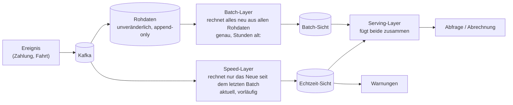
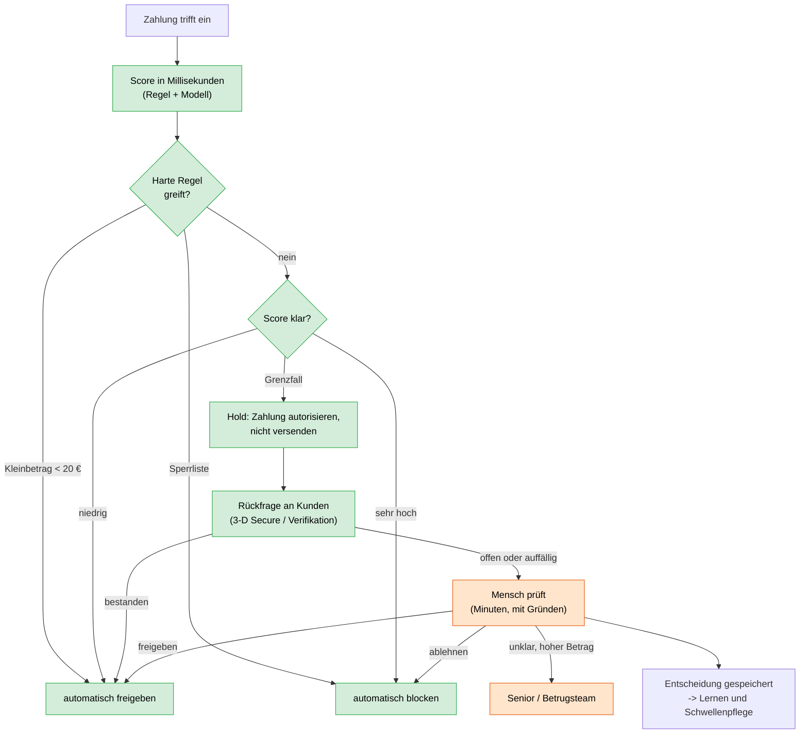

# Tag 13 · Zusatzaufgaben: Lambda (A13-1), Automatik oder Mensch (A13-3), KI-Werkzeuge (A13-4)

> [!NOTE]
> Drei kurze Vertiefungen, jeweils mit Aufgabe, Lösung und Merksatz. Die Rechenbeispiele stehen in `13_Demo_Realtime_Rechnungen.py`; Annahmen sind gekennzeichnet.

---

## A13-1 · Lambda-Architektur (Mobilitätsanbieter)

**Bedarf:** Sofort-Warnung bei auffälliger Zahlung (< 1 s) **und** korrekte, revisionssichere Tagesabrechnung. **Konflikt:** Echtzeit ist schnell, aber vorläufig; Batch ist genau, aber verzögert.

### 1. Was läuft im Speed-, was im Batch-Layer?

| | Speed-Layer | Batch-Layer |
|---|---|---|
| Aufgabe | Warnung bei auffälliger Zahlung, laufende Zähler, Dashboard | Tagesabrechnung, Revision, Korrekturen, Modelltraining |
| Eigenschaft | niedrige Latenz (< 1 s), **vorläufig** | gründlich, später, **genau** |
| Datenbasis | nur Ereignisse **seit dem letzten Batch-Lauf** | **alle Rohdaten** |
| Umgang mit Fehlern | Duplikate und späte Ereignisse nur teilweise abgefangen | dedupliziert, korrigiert, nimmt späte Ereignisse auf |

**Welche Ergebnisse dürfen vorläufig sein?** Warnungen, Zähler, Dashboards. **Nicht** vorläufig sein dürfen die Abrechnung, Rechnungen und alles Revisionspflichtige.

### 2. Wo zusammenführen, wer gewinnt bei Widerspruch?

Zusammengeführt wird im **Serving-Layer**: Antwort = Batch-Sicht (bis zum letzten Lauf) + Echtzeit-Sicht (nur der Rest danach). Bei Widerspruch **gewinnt der Batch-Layer**; er ist die Quelle der Wahrheit. Läuft der nächste Batch, deckt er den Zeitraum ab, und die entsprechenden vorläufigen Werte des Speed-Layers werden **verworfen**. Der Batch **korrigiert** also den Speed-Layer, nie umgekehrt.

### 3. Werkzeug und Datenhaltung je Layer

| Layer | Werkzeug (Beispiel) | Datenhaltung |
|---|---|---|
| Rohdaten | **Kafka** (Eingang) | **Data Lake** (S3/HDFS, Parquet), unveränderlich |
| Batch | **Spark** + **Airflow** (oder dbt) | Data Warehouse / Parquet-Tabellen |
| Speed | **Flink** oder Spark Structured Streaming | Schlüssel-Wert-Speicher im Speicher (Redis/Cassandra) mit Ablaufzeit |
| Serving | **Druid / Pinot** oder eine API, die beide Sichten verbindet | Index/Cache beider Sichten |

> [!WARNING]
> **Nachteil von Lambda:** Die Logik steht **zweimal** im Code (Stream und Batch) und muss identisch bleiben. Moderne Alternative: **Kappa-Architektur**, nur ein Stream-Weg, bei Bedarf wird das Log erneut abgespielt. Passt, wenn der Stream-Weg selbst genau sein kann.

> [!TIP]
> **Verbindung zu Aufgabe 1 (Seilschaft):** Der Echtzeitbestand ist der Speed-Layer, der Nachtlauf um 02:00 der Batch-Layer. Bei Abweichung gewinnt der Abgleich.

> [!IMPORTANT]
> **Merke:** Speed = schnell und vorläufig, Batch = genau und später, Serving verbindet beide, **bei Widerspruch gewinnt der Batch**.

---

## A13-3 · Automatik oder Mensch

Grundregel aus den Folien: **hohe Frequenz + klare Regeln → automatisch; hohes Risiko + mehrdeutig → Mensch; oft: Modell empfiehlt, Mensch entscheidet.** Regeln sind einfach und transparent, Modelle erkennen komplexe Muster; **Regel als Leitplanke, Modell zur Feinsteuerung.**

### Die fünf Fälle

| # | Fall | Automatisierungsgrad | Regel / Modell / Kombination | Teurere Fehlerart | Begründung |
|---|---|---|---|---|---|
| 1 | Kleinbetrag < 20 € freigeben | **voll automatisch** | **Regel** | Kunde fälschlich blockieren (FP) ist relativ teurer als der kleine Betrugsschaden | hohe Frequenz, klare Grenze, geringer Schaden; Betrugsversuche billig in Kauf zu nehmen |
| 2 | Zahlung mit hohem Betrugsscore | **automatisch blocken**, bei hohem Warenwert Mensch | **Modell** + Regel als Leitplanke (Betragsgrenze) | Betrug durchlassen (FN) | Score eindeutig; Auto-Block ab hoher Schwelle, Einspruch für Kunden möglich |
| 3 | Grenzfall knapp unter der Schwelle | **Mensch** | **Kombination**: Modell sortiert vor und liefert die Gründe | beide Richtungen teuer | wenige Punkte Score-Unterschied entscheiden über Kunde oder Schaden; Modell ist hier am unsichersten |
| 4 | Neukunde mit ungewöhnlichem Muster | **Hold + Rückfrage, dann Mensch** | **Modell** (Auffälligkeit ohne Historie) + Regel (Neukunden-Limit) | FP schadet der Kundengewinnung; FN ist Betrug | keine Historie, Muster mehrdeutig; Kunde über 3-D Secure/Verifikation befragen |
| 5 | Reklamation eines Kunden | **Mensch** (System unterstützt) | **Modell** nur zum Einordnen und Weiterleiten (Ticket, Textvorschlag) | Fehlentscheidung kostet Beziehung/Rechtsstreit | Mehrdeutigkeit, Kulanz, Kundenbeziehung, rechtliche Folgen |

### Eskalationspfad für Grenzfälle

> [!TIP]
> **Wer entscheidet, wenn der Mensch zu spät kommt?** Der Hold läuft weiter (nicht verschicken). Die Eskalation hat eine **Frist**; läuft sie ab, greift eine vorher festgelegte Standardregel (z. B. bei hohem Betrag ablehnen mit Möglichkeit zur Nachverifizierung).

> [!IMPORTANT]
> **Merke:** Die Entscheidung folgt **Frequenz und Regelklarheit** (Automatik), **Risiko und Mehrdeutigkeit** (Mensch) und der **teureren Fehlerart**. Kombinationen sind die Regel, nicht die Ausnahme.

---

## A13-4 · KI-Werkzeuge bei Nordlicht Reisen

Stufen: **Assistenz** (KI schlägt vor, Mensch schreibt) · **Freigabe** (KI erstellt, Mensch prüft jedes Stück) · **Stichprobe** (KI veröffentlicht, Mensch prüft eine Auswahl, z. B. 5 %) · **Automatik** (KI allein, Kennzahlen überwacht).

Kriterien für die nötige Prüfung: **Reichweite**, **Schaden** (Geld, Recht, Gesundheit), **Faktenbezug**, **Umkehrbarkeit**, **Erfahrung** (Fehlerquote schon gemessen?). Je mehr davon zutrifft, desto mehr Prüfung. **Zahlen rechnet nie die KI.**

### 1. und 2. Stufe je Fall, wer prüft was, wie oft

| # | Fall | Kriterien (Auswahl) | **Stufe** | Wer prüft was, wie oft |
|---|---|---|---|---|
| 1 | **Hoteltexte** (2.000 × 80 Wörter, auf der Website) | außen; Faktenbezug hoch (erfundene Ausstattung = Irreführung); gut korrigierbar | **Stichprobe** (am Anfang Freigabe) | KI schreibt **nur aus den Quelldaten** (Lage, Ausstattung). **Automatische Prüfung** aller Texte: jede genannte Ausstattung und jede Zahl muss in den Quelldaten stehen. Mensch: zuerst 30 bis 50 Texte komplett, danach 5 bis 10 % Stichprobe plus alle automatisch beanstandeten |
| 2 | **Social Media** (15 Beiträge/Woche, Bilder von der KI) | außen, hohe Reichweite; Bildrechte; falscher Eindruck (erfundene Urlaubsbilder zeigen kein echtes Hotel) | **Freigabe** | Mensch prüft **jeden** Beitrag vor Veröffentlichung (15 pro Woche sind machbar). Prüfung: Ton, Rechte, ob das Bild ein echtes Hotel falsch darstellt, Kennzeichnung von KI-Inhalten (rechtliche Pflichten prüfen) |
| 3 | **Wochenreport** (Buchungen, Umsatz, Kommentar) | intern; Zahlen müssen stimmen; Kommentar kann falsch deuten | **Freigabe** für den Kommentar, **Zahlen und Grafiken ohne KI** | Zahlen: BI-Abfrage/Skript mit automatischer Plausibilitätsprüfung. Grafiken: Dashboard, einmal abnehmen. Kommentar: KI-Entwurf aus den **fertigen Zahlen**, Mensch liest vor Versand. Empfehlung: Mensch |
| 4 | **Bewertungsantworten** (auch Beschwerden) | außen, öffentlich; Beschwerden bergen Zusagen, Recht, Kulanz | **Stichprobe** für lobende, **Assistenz** für Beschwerden | Automatische Sortierung nach Stimmung. Lob/neutral: KI-Entwurf, nach Pilot Stichprobe. Beschwerde: KI schlägt vor, **Mensch schreibt**, keine Zusagen und keine Entschädigung durch die KI |
| 5 | **Protokolle** interner Besprechungen | intern, geringe Reichweite, leicht korrigierbar | **Automatik** (überwacht) | KI fasst zusammen; Teilnehmende können Fehler mit einem Klick melden (Kennzahl: Korrekturen je Protokoll). **Ausnahme:** vertrauliche Besprechungen (Personal, Verträge), Datenschutz klären |
| 6 | **Newsletter** (Sonderpreise, Stornobedingungen, 300.000 Empfänger) | außen, riesige Reichweite; **Preise und Rechtliches**; nicht rückholbar | **Freigabe** (Vier-Augen) | **Preise und Stornobedingungen kommen aus der Datenbank, nicht aus der KI** (Platzhalter). KI nur für Text und Betreff. Automatischer Abgleich aller Preise vor dem Versand, Mensch prüft jeden Newsletter, Testversand an kleinen Kreis |

> [!WARNING]
> **Warum Newsletter nicht „Stichprobe“?** Ein Fehler von nur 1 % trifft bei 300.000 Empfängern **3.000 Personen**; Preise und Stornobedingungen sind rechtlich bindend, und der Versand ist nicht rückholbar. Hier zählen Reichweite, Schaden und Umkehrbarkeit gleichzeitig.

> [!NOTE]
> **Die Stufe ist nicht fest.** Starten mit hoher Stufe, **Fehlerquote messen** (30 bis 50 eigene, echte Fälle, nicht die Demo) und die Stufe senken, wenn die Quote niedrig ist. „Erfahrung“ ist selbst ein Kriterium. Beispiel Hoteltexte: Alles prüfen kostet 67 Stunden (2 Min je Text, Annahme), 5 % Stichprobe nur 3,3 Stunden.

### 3. Fall 3 (Wochenreport): kaufen oder selbst bauen?

| Kriterium | Fertige KI-Content-Suite (kaufen) | Selbst bauen (BI-Abfrage + KI-Schnittstelle) |
|---|---|---|
| Start | sofort | Wochen bis Monate (hier eher Tage, weil klein) |
| Passung | Suite ist für **Marketingtexte** gedacht, zieht **keine Zahlen** aus Buchungsdaten | eigene Datenquelle, eigene Plausibilitätsprüfung |
| Daten | Buchungs- und Umsatzdaten liegen beim Anbieter (Vertrag, Training mit Daten prüfen) | bleiben unter eigener Kontrolle |
| Kosten | Lizenz je Person, steigt mit Nutzung | einmaliger Bau, geringe Laufkosten |
| Abhängigkeit | Anbieter und Preise | eigene Fachleute (BI/Daten) |

**Empfehlung: selbst bauen, aber schlank:** Zahlen und Grafiken aus dem **vorhandenen BI-Werkzeug oder einem Skript**, nur der **Kommentar** kommt per KI-Schnittstelle aus den fertigen Zahlen, danach liest ein Mensch. Wirtschaftlichkeit (Annahmen: 8 Tage Bauaufwand, ca. 46 Arbeitswochen): der Wochenreport kostet heute 46 Tage pro Jahr; der Bau hat sich nach ca. **8 Wochen** amortisiert.

> [!TIP]
> **Checkliste für die Bewertung eines KI-Werkzeugs (aus den Folien):** mit 30 bis 50 eigenen echten Fällen testen, Fehlerquote und Korrekturzeit je Stück messen, klären wo die Daten landen und ob damit trainiert wird, Freigabeschritte einbaubar?, Kosten bei voller Nutzung rechnen (nicht im Pilot).

> [!IMPORTANT]
> **Merke:** Je größer **Reichweite, Schaden und Faktenbezug** und je schwerer **rückholbar**, desto höher die Prüfstufe. **Fakten kommen aus Daten, nicht aus der KI** (Preise, Zahlen, Bedingungen). Die Stufe senkt man erst nach **gemessener** Fehlerquote.

---

## Kernaussagen (alle drei Zusatzaufgaben)

> [!IMPORTANT]
> 1. **Lambda:** Speed und Batch parallel, **bei Widerspruch gewinnt der Batch**; Preis ist doppelte Logik (Alternative Kappa).
> 2. **Automatik oder Mensch:** Frequenz und klare Regeln → Automatik; Risiko und Mehrdeutigkeit → Mensch; **Modell empfiehlt, Mensch entscheidet** bei Grenzfällen; Hold ist billiger als Ablehnen.
> 3. **KI-Werkzeuge:** Prüfstufe nach Reichweite, Schaden, Faktenbezug, Umkehrbarkeit, Erfahrung; Zahlen und Preise nie von der KI; Stufe nach **gemessener** Fehlerquote anpassen.

## Abweichungen und Annahmen

- Prozentwerte für Stichproben (5 bis 10 %), 2 Minuten je Hoteltext, 8 Tage Bauaufwand und ca. 46 Arbeitswochen sind **Annahmen**.
- Welche Kennzeichnungs- und Datenschutzpflichten für KI-Inhalte gelten, wurde **nicht geprüft**; das ist im Einzelfall juristisch zu klären.
- Mermaid und GitHub-Hinweisboxen wurden hier nicht gerendert.
