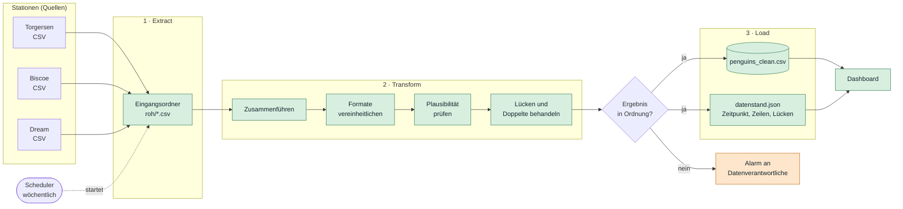
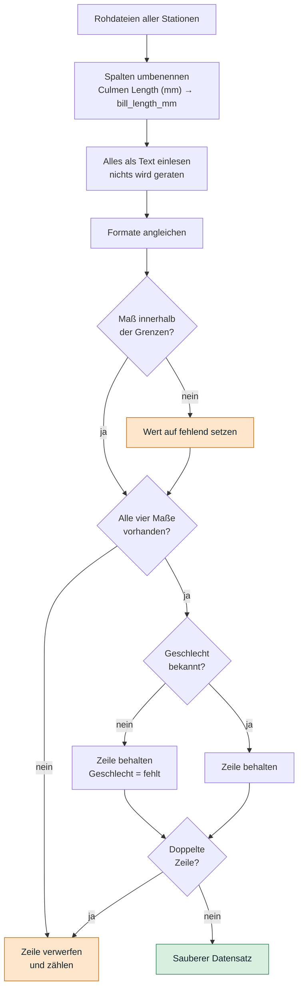
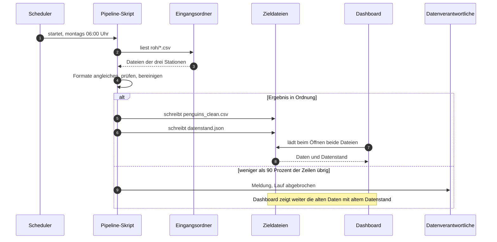
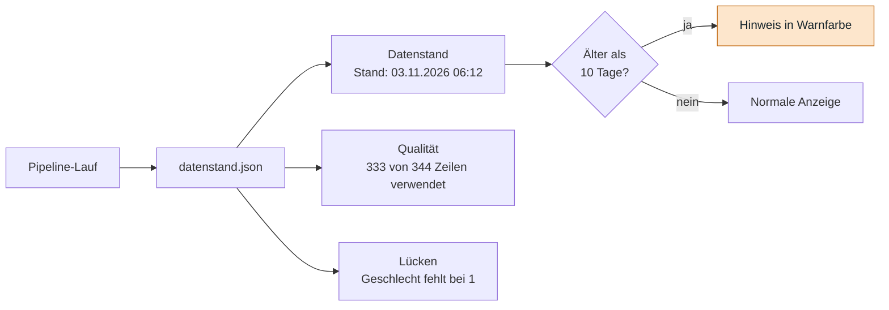

# Tag 14, Arbeitsauftrag 2: Pipeline für das Pinguin-Dashboard

**Aufgabe:** Die Pinguin-Daten kommen roh von drei Forschungsstationen (Torgersen, Biscoe, Dream), teils unvollständig. Entworfen werden soll eine Pipeline *sammeln → aufbereiten → Dashboard*, dazu die Aufbereitung (fehlende Werte, einheitliche Formate) und die Automatisierung samt Tool.

> [!NOTE]
> Die Rohdateien der Stationen liegen nicht vor. Das Format der Rohdaten (Semikolon, Dezimalkomma, lange Artnamen) ist eine **Annahme**, typisch für Stationsexporte. Die Kennzahlen zum Ergebnis (344 → 333 Pinguine) stammen aus dem Kurs und aus `penguins_clean.csv`.

## 1. Ergebnis auf einen Blick

| Frage | Antwort |
|---|---|
| Woher kommen die Daten? | Eine CSV je Station (Torgersen, Biscoe, Dream), abgelegt in einem gemeinsamen Eingangsordner |
| Wie werden sie zusammengeführt? | Alle Dateien einlesen, Spaltennamen angleichen, untereinander hängen |
| Wie aufbereitet? | Formate vereinheitlichen, Unmögliches prüfen, unvollständige Zeilen und Doppelte entfernen, Ergebnis kontrollieren |
| Wie automatisiert? | Ein Python-Skript, das ein Zeitplan startet (cron oder GitHub Actions) |
| Wie oft? | Wöchentlich, nach Lieferung der Stationen. Echtzeit ist hier nicht nötig |
| Was sieht man im Dashboard? | Die Daten **und** den Datenstand samt Qualitätskennzahlen |

## 2. Die Pipeline im Überblick



Die drei Schritte sind **Extract, Transform, Load (ETL)** wie in UE 1. Neu ist die Raute in der Mitte: Die Pipeline lädt nur, wenn das Ergebnis plausibel ist. Andernfalls bleibt das alte Dashboard stehen, und jemand bekommt eine Meldung. Das ist besser als ein Dashboard mit falschen Zahlen.

## 3. Aufbereitung

### 3.1 Ablauf



### 3.2 Regeln im Einzelnen

| Problem | Beispiel roh | Regel | Begründung |
|---|---|---|---|
| Uneinheitliche Schreibweise | `MALE`, `male`, `Male` | Kleinschreiben, dann auf `Male` und `Female` abbilden | Eine Schreibweise, sonst zählt das Dashboard drei Geschlechter |
| Lange Artnamen | `Adelie Penguin (Pygoscelis adeliae)` | Erstes Wort nehmen: `Adelie` | Der Name entspricht dem im Dashboard |
| Inselname | `biscoe`, `Biscoe ` | Leerzeichen entfernen, erster Buchstabe groß | Gleiche Insel, gleicher Name |
| Dezimalkomma | `39,1` | Komma durch Punkt ersetzen, dann in Zahl umwandeln | Sonst bleibt die Spalte Text |
| Platzhalter statt Wert | `.`, leer | Wird fehlend | Ein Punkt ist kein Geschlecht |
| Unmögliche Werte | Gewicht `99999` g | Außerhalb der Grenzen wird der Wert fehlend | Ein Tippfehler darf den Mittelwert nicht verziehen |
| Leere Zeile | Zeile ohne jeden Wert | Verwerfen | Zählt sonst als Pinguin (siehe Hinweis unten) |
| Doppelte Zeile | Station liefert dieselbe Zeile zweimal | Eine behalten | Sonst werden Tiere doppelt gezählt |

Die Grenzen sind Beispiele und sollten mit der Forschung abgestimmt werden: Schnabellänge 25–65 mm, Schnabeltiefe 10–25 mm, Flosse 150–250 mm, Gewicht 2.000–7.000 g.

> [!WARNING]
> **Beispiel aus unseren Daten.** `penguins_clean.csv` hat 334 Zeilen, davon ist die letzte komplett leer. Es sind also **333 Pinguine**. Ein Dashboard, das einfach Zeilen zählt, zeigt 334. Genau so einen Fehler fängt die Prüfung „leere Zeile verwerfen“ ab. Im Dashboard aus Arbeitsauftrag 1 ist das behoben.

### 3.3 Fehlende Werte: löschen oder auffüllen?

| Fall | Entscheidung | Warum |
|---|---|---|
| Alle Maße fehlen | Zeile verwerfen | Es bleibt nichts, was das Dashboard zeigen könnte |
| Ein Maß fehlt | Zeile verwerfen | Für ein beschreibendes Dashboard reicht die Menge. Es sind nur wenige Zeilen |
| Nur das Geschlecht fehlt | Zeile **behalten**, Geschlecht bleibt leer | Maße und Art stimmen. Nur die Auswertung nach Geschlecht lässt sie weg |
| Mit Mittelwert auffüllen | **Nein** | Erfundene Werte verengen die Verteilungen und verfälschen Vergleiche |

Von 344 Pinguinen im Original bleiben 333 übrig, es fallen also 11 Zeilen weg.

> [!TIP]
> Die Zahl der verworfenen Zeilen gehört **ins Dashboard** (siehe 5). Wer sieht, dass 11 von 344 fehlen, vertraut den Zahlen eher, als wenn die Lücken still verschwinden.

## 4. Ablauf eines Laufs



## 5. Was das Dashboard über die Pipeline zeigt

UE 1 verlangt „Datenstand sichtbar“ und „Datenqualität sichtbar machen“. Das heißt für das Pinguin-Dashboard:



Die Beträge im Diagramm sind Beispielwerte, kein echter Lauf. Das Dashboard liest die Datei `datenstand.json` aus und zeigt sie in der Fußzeile. Ein Hinweis in Warnfarbe erscheint, wenn der Lauf zu lange her ist. Die Pipeline kann also still ausfallen, ohne dass es unbemerkt bleibt.

## 6. Automatisierung und Tool

### 6.1 Wie oft?

Feldforschung liefert selten neue Daten, meist saisonweise. Ein **wöchentlicher Batch-Lauf** genügt. UE 1 sagt: Echtzeit kostet mehr und gehört nur dorthin, wo sie wirklich nötig ist. Hier ist sie das nicht.

### 6.2 Tool-Wahl

| Option | Passt, wenn | Aufwand | Kosten | Urteil |
|---|---|---|---|---|
| **Python-Skript + cron** | Ein Rechner oder Server ist vorhanden | niedrig | keine | **Empfehlung für den Start** |
| **Python-Skript + GitHub Actions** | Das Projekt liegt ohnehin auf GitHub | niedrig | kostenlos für kleine Projekte | **Gute Alternative**, kein eigener Server |
| Power Query / Dataflow in Power BI | Das Dashboard ist in Power BI gebaut | niedrig bis mittel | Lizenz | Sinnvoll, wenn das Team schon Power BI nutzt |
| Tableau Prep | Das Dashboard ist in Tableau gebaut | mittel | Lizenz | Gleiche Logik wie Power BI |
| Airflow oder Prefect | Viele Pipelines, Abhängigkeiten, Wiederholungen | hoch | Betrieb | Für drei CSVs übertrieben |
| Fivetran oder Airbyte | Quellen sind Datenbanken oder Cloud-Dienste | mittel | Lizenz | Hier nicht nötig, die Quellen sind Dateien |

**Empfehlung:** Ein Python-Skript mit pandas, das cron oder GitHub Actions wöchentlich startet. Es ist kostenlos, nachvollziehbar und versionierbar. Der Aufwand rechtfertigt keine Plattform mit Betriebskosten. Wächst die Zahl der Pipelines, lohnt sich später Airflow oder Prefect.

### 6.3 Skript (Kern)

Getestet an erfundenen Rohdateien mit Dezimalkomma, Duplikat, leerer Zeile, Tippfehler und Platzhalter: Es hat die drei fehlerhaften Zeilen entfernt und bei zu vielen Ausfällen abgebrochen.

```python
import glob
import json
import sys
from datetime import datetime

import pandas as pd

SPALTEN = {"Species": "species", "Island": "island", "Culmen Length (mm)": "bill_length_mm",
           "Culmen Depth (mm)": "bill_depth_mm", "Flipper Length (mm)": "flipper_length_mm",
           "Body Mass (g)": "body_mass_g", "Sex": "sex"}
MASSE = ["bill_length_mm", "bill_depth_mm", "flipper_length_mm", "body_mass_g"]
GRENZEN = {"bill_length_mm": (25, 65), "bill_depth_mm": (10, 25),
           "flipper_length_mm": (150, 250), "body_mass_g": (2000, 7000)}
ARTEN = {"adelie": "Adelie", "chinstrap": "Chinstrap", "gentoo": "Gentoo"}
GESCHLECHT = {"male": "Male", "female": "Female"}

# 1. Sammeln: alle Stationsdateien in einen Rahmen
teile = [pd.read_csv(p, sep=";", dtype=str) for p in sorted(glob.glob("roh/*.csv"))]
roh = pd.concat(teile, ignore_index=True).rename(columns=SPALTEN)[list(SPALTEN.values())]
bericht = {"zeilen_roh": len(roh)}

# 2. Aufbereiten: Formate vereinheitlichen
roh = roh.apply(lambda s: s.str.strip())
roh["species"] = roh["species"].str.split().str[0].str.lower().map(ARTEN)
roh["island"] = roh["island"].str.title()
roh["sex"] = roh["sex"].str.lower().map(GESCHLECHT)  # alles andere ("." oder leer) wird fehlend
for m in MASSE:
    roh[m] = pd.to_numeric(roh[m].str.replace(",", ".", regex=False), errors="coerce")

# 3. Prüfen: Unmögliches wird fehlend, Unvollständiges und Doppeltes fliegt raus
for m, (lo, hi) in GRENZEN.items():
    roh.loc[~roh[m].between(lo, hi), m] = pd.NA
sauber = roh.dropna(subset=["species", "island"] + MASSE).drop_duplicates()
bericht["zeilen_sauber"] = len(sauber)
bericht["verworfen"] = bericht["zeilen_roh"] - len(sauber)
bericht["geschlecht_fehlt"] = int(sauber["sex"].isna().sum())

# 4. Vor dem Laden: stimmt das Ergebnis überhaupt?
if len(sauber) < 0.9 * len(roh):
    sys.exit(f"Abbruch, altes Dashboard bleibt unverändert: {bericht}")

# 5. Laden: Datei und Datenstand für das Dashboard
sauber.to_csv("penguins_clean.csv", index=False)
bericht["stand"] = datetime.now().isoformat(timespec="minutes")
json.dump(bericht, open("datenstand.json", "w"), ensure_ascii=False)
```

Zum Starten genügt ein Eintrag in der Zeitplantabelle, zum Beispiel jeden Montag um 6 Uhr:

```
0 6 * * 1  cd /pfad/zum/projekt && python pipeline.py || echo "Pipeline fehlgeschlagen" | mail -s Pinguine team@example.org
```

> [!IMPORTANT]
> Die Schwelle von 90 % ist ein Beispiel. Sie schützt vor einer leeren oder abgeschnittenen Lieferung, die sonst das Dashboard mit fast nichts überschreiben würde. Bei Pinguinen ist sie sehr streng: Im Original gehen etwa 3 % verloren (11 von 344).

## 7. Wenn … dann

| Wenn … | dann … |
|---|---|
| Eine Station liefert nicht | Lauf nicht abbrechen, aber im Datenstand die fehlende Station nennen |
| Die Spaltennamen einer Station ändern sich | Der Lauf bricht beim Umbenennen ab, und die Meldung nennt die Station |
| Zu viele Zeilen fallen weg | Lauf abbrechen, altes Dashboard bleibt, Meldung an Verantwortliche |
| Der Lauf fällt mehrmals still aus | Das Dashboard zeigt den Datenstand in Warnfarbe |
| Es kommen weitere Stationen oder Arten hinzu | Eine Zeile in `ARTEN` ergänzen und die Grenzen prüfen |
| Daten werden täglich oder stündlich geliefert | Scheduler häufiger starten, bei Datenbanken als Quelle Airflow oder Prefect erwägen |

## 8. Offen und nicht geprüft

- **Annahmen zu den Rohdaten:** Format und Grenzwerte sind plausible Beispiele und nicht an echten Stationsdateien getestet.
- **Vollständigkeit der Zahlen:** Die Angabe „11 Zeilen weg“ folgt aus 344 minus 333. Welche Zeilen genau entfernt wurden, lässt sich aus der Datei nicht lesen.
- **Mermaid:** Die Diagramme wurden lokal nicht gerendert. Bitte einmal auf GitHub ansehen.
