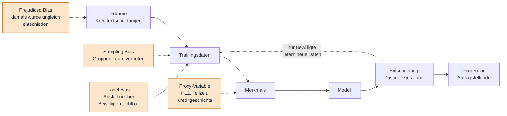
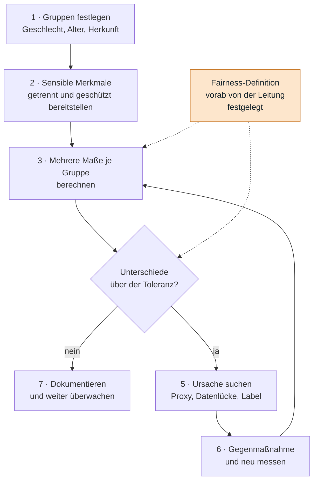
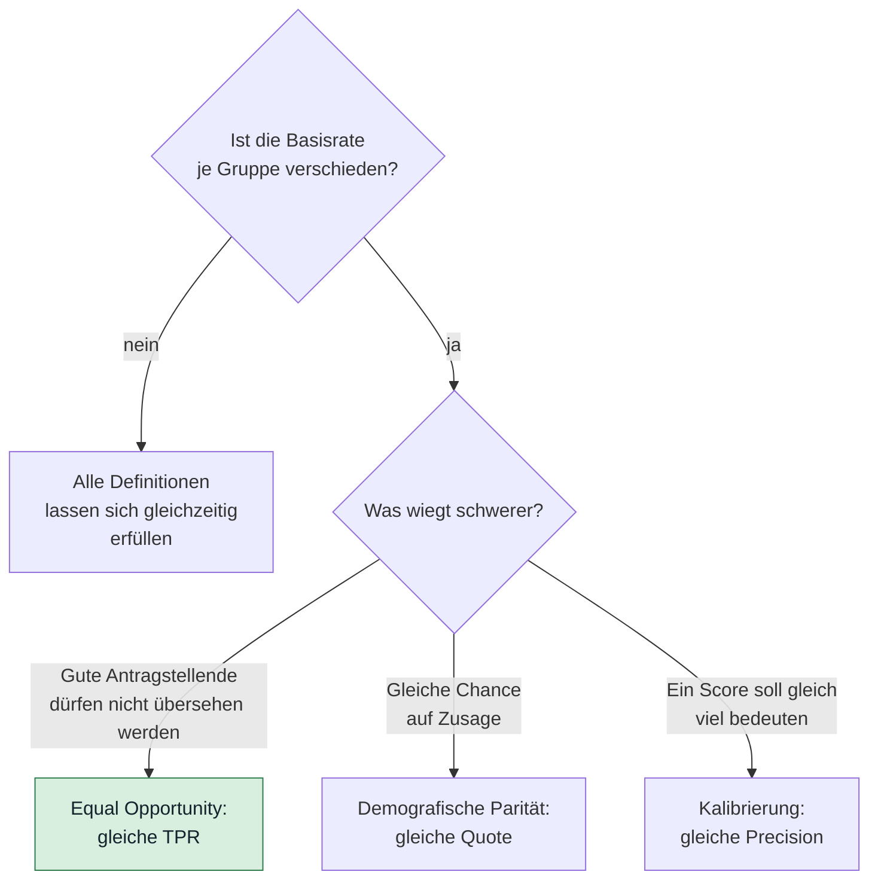
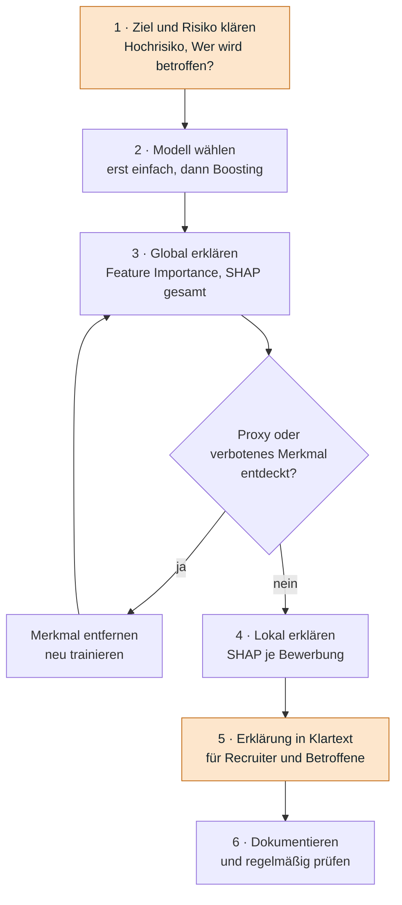
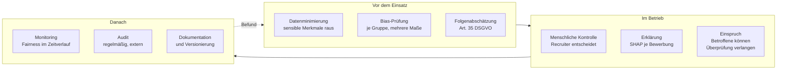
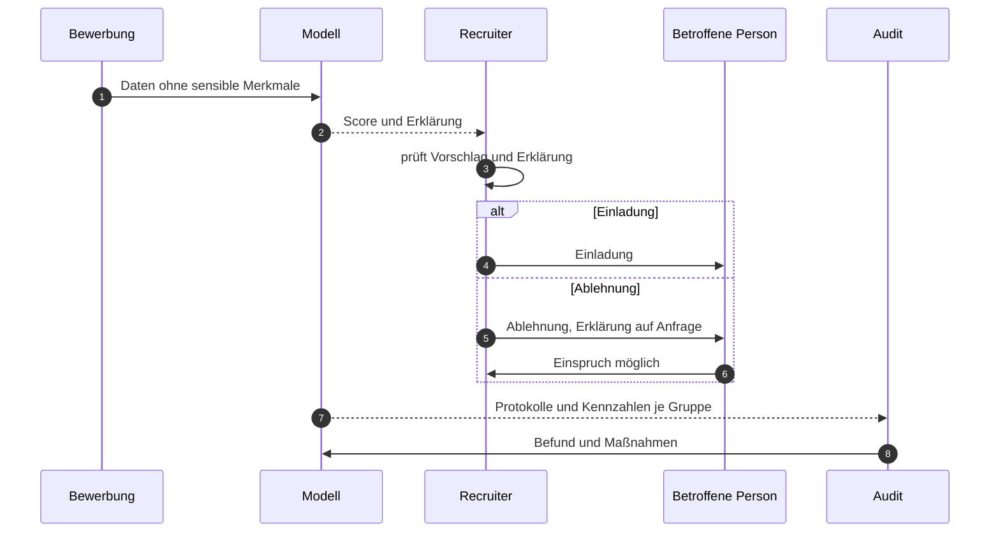

# Tag 15, Arbeitsauftrag 1 und 2: Governance

Die Arbeitsaufträge sind zwei Fälle zu einem Thema: **Wen trifft ein Modell, und wer verantwortet es?**

| | Arbeitsauftrag 1 | Arbeitsauftrag 2 |
|---|---|---|
| Fall | Kreditbewertungsmodell | Modell zur Vorauswahl von Bewerbungen (Gradient Boosting) |
| Kernfrage | Wo steckt Bias, wie wirkt er, wie messe ich Fairness? | Wie erkläre ich Entscheidungen, was verlangt die DSGVO, wie senke ich Risiken? |
| Schwerpunkt | Bias, Fairness-Definitionen, Kennzahlen | XAI, DSGVO, Risikominimierung |

> [!NOTE]
> Zu beiden Fällen liefern die Aufgabenblätter **keine Daten**. Alle Zahlen in den Beispielrechnungen sind **erfundene Rechenbeispiele**, markiert als solche. Sie zeigen den Ablauf, sie sind keine Ergebnisse. Die Kurszahlen (COMPAS, PhysioNord) stammen aus den Folien von Tag 15. Zu Rechtsnormen steht am Ende ein Hinweis, was nicht geprüft ist.

---

# Teil A · Kreditbewertung: Bias und Fairness

## A1. Wo Bias entstehen kann

Bias kann an jeder Stelle der Kette entstehen. Die vier Arten aus UE 1 (Sampling Bias, Label Bias, Prejudiced Bias, Proxy-Variable) sind unten eingetragen.



Der gestrichelte Pfeil von der Entscheidung zurück zu den Daten ist der Kern: Ein Kreditmodell sieht den Ausgang nur bei Menschen, denen es einen Kredit gegeben hat. Wer abgelehnt wurde, hat nie gezeigt, ob er hätte zahlen können. Das Modell lernt aus einer Auswahl und bestätigt sich selbst.

### Merkmale unter Verdacht

| Merkmal | Warum problematisch | Bias-Art |
|---|---|---|
| Geschlecht | Direkt als Merkmal ungeeignet, im Dienstleistungsgeschäft rechtlich nicht zulässig | Direkte Diskriminierung |
| Wohnort / Postleitzahl | Steht stellvertretend für Herkunft und Einkommen („Redlining“) | Proxy-Variable |
| Einkommen | Spiegelt Lohnunterschiede zwischen Geschlechtern und Branchen | Prejudiced Bias in den Daten |
| Teilzeit, befristete Verträge, Erwerbsunterbrechung | Trifft überproportional Frauen und Menschen mit Sorgearbeit | Proxy-Variable |
| Länge der Kredithistorie | Junge und Zugewanderte haben wenig oder keine Historie | Sampling Bias |
| Staatsangehörigkeit, Name | Direkt oder über die Schreibweise sensibel | Direkte Diskriminierung, Proxy |
| Selbstständigkeit | Schwankendes Einkommen, in Daten selten | Sampling Bias |
| Gerätetyp, Uhrzeit, Online-Verhalten | Steht für Alter und Einkommen | Proxy-Variable |
| Zielgröße „Kredit ausgefallen“ | Wer abgelehnt wurde, fehlt, und wer streng behandelt wurde, fiel seltener aus | Label Bias |

> [!IMPORTANT]
> Das Weglassen von Geschlecht oder Herkunft macht das Modell nicht fair. Das Modell lernt sie aus den Proxys zurück (UE 1: „Merkmal entfernt, Proxy bleibt, Bias wirkt trotz blindem Modell“). Prüfen muss man das Ergebnis je Gruppe.

## A2. Wie Bias die Kreditvergabe beeinflusst

| Wirkung | Beschreibung |
|---|---|
| Ablehnung | Ganze Gruppen erhalten seltener eine Zusage, obwohl sie ebenso zahlungsfähig sind |
| Preis | Gleiches Risiko, höherer Zins oder niedrigeres Limit |
| Teufelskreis | Ohne Kredit entsteht keine Kredithistorie. Die Person bleibt „dünn“ und wird wieder abgelehnt |
| Verlorene Kunden | Gute Kreditnehmer, die das Modell übersieht, gehen zur Konkurrenz |
| Recht | Beschwerden, Bußgelder, Schadensersatz, Aufsicht (siehe Teil B) |
| Vertrauen | Der Fall macht schnell Schlagzeilen, ähnlich wie bei COMPAS |

Der Zielkonflikt aus UE 1 gilt auch hier: Die höchste Gesamttrefferquote kann eine Gruppe benachteiligen, und mehr Fairness kann Treffer kosten.

## A3. Konzept zur Messung der Fairness

### Schritt für Schritt



Zwei Hinweise zum Ablauf:

- **Zum Messen braucht man die sensiblen Merkmale**, die man im Modell gerade nicht verwenden will. Sie liegen getrennt, pseudonymisiert und nur für das Audit (Art. 9 DSGVO beachten). Ohne sie bleibt jede Aussage über Fairness Raten.
- **Die Fairness-Definition legt die Leitung vorab fest**, nicht das Data-Science-Team. UE 1: „Welche gilt, ist auch eine Wertentscheidung.“

### Welche Kennzahlen

| Kennzahl | Frage | Berechnung | Definition |
|---|---|---|---|
| Genehmigungsquote | Wie viele erhalten einen Kredit? | Zusagen ÷ Anträge je Gruppe | Demografische Parität |
| Trefferquote bei Guten (TPR) | Wie viele Zahlungsfähige erhalten eine Zusage? | Zusagen unter denen, die zahlen würden | Equal Opportunity (Teil von Equalized Odds) |
| Fehlerquote bei Schlechten (FPR) | Wie viele spätere Ausfälle erhalten eine Zusage? | Zusagen unter denen, die ausfallen | Equalized Odds |
| Precision | Wie viele Genehmigte zahlen auch? | Zahler unter Genehmigten | Kalibrierung / Vorhersagegüte je Gruppe |
| Abgelehnte Gute | Wie viele Zahlungsfähige verlieren wir? | Absolute Zahl und Anteil | Geschäftswirkung |

Aus UE 1: **Nie nur ein Maß.** Mehrere Maße nebeneinander zeigen, wo der Konflikt liegt.

### Rechenbeispiel (erfunden)

Zwei Gruppen mit je 1.000 Anträgen. Gruppe A: 800 würden zahlen. Gruppe B: 700 würden zahlen.

| Maß | Gruppe A | Gruppe B | Auffälligkeit |
|---|---|---|---|
| Genehmigungsquote | 78 % | 53 % | B erhält nur 68 % der Quote von A |
| TPR (Zahler bekommen Zusage) | 0,90 | 0,70 | 20 Prozentpunkte Abstand |
| FPR (Ausfälle bekommen Zusage) | 0,30 | 0,13 | B wird auch strenger geprüft |
| Precision | 0,92 | 0,93 | praktisch gleich |
| Abgelehnte Zahlungsfähige | 80 | 210 | in B mehr als doppelt so viele |

Das Beispiel zeigt den **COMPAS-Effekt aus UE 1**: Die Precision ist in beiden Gruppen gleich, die Fehlerraten sind es nicht. Der Hersteller könnte „Das Modell trifft gleich gut“ sagen, die Betroffenen aus Gruppe B hätten trotzdem recht. Bei ungleichen Basisraten (hier 80 % gegen 70 % Zahler, bei COMPAS 51 % gegen 39 % Rückfall) sind beide Sichtweisen zugleich nicht erreichbar.

### Welche Definition für den Kredit?



**Empfehlung für den Kredit:** Als Hauptmaß **Equal Opportunity** (gleiche TPR). Eine zahlungsfähige Person soll unabhängig von der Gruppe dieselbe Chance auf Zusage haben. **Kalibrierung** (Precision je Gruppe) wird als zweites Maß geprüft, die **Genehmigungsquote** als Frühwarnsignal berichtet.

Begründung: Demografische Parität würde bei verschiedenen Zahlerquoten verlangen, in einer Gruppe auch mehr Ausfallrisiko zu akzeptieren. Das ist rechtlich und wirtschaftlich schwer zu rechtfertigen. Equal Opportunity trifft den Kern der Benachteiligung: übersehene gute Kunden.

> [!WARNING]
> Das ist eine Empfehlung, keine Entscheidung. Die Wahl der Definition gehört der Geschäftsleitung mit Rechts- und Compliance-Abteilung. Sie sollte schriftlich festgehalten werden, samt Begründung und Toleranz (z. B. „TPR-Abstand höchstens 5 Prozentpunkte“).

### Kleine Rechenhilfe

Die Kennzahlen lassen sich je Gruppe aus einer Tabelle mit `gruppe`, `zahlt` (0/1, später beobachtet) und `genehmigt` (0/1) berechnen:

```python
import pandas as pd

def kennzahlen(x):
    return pd.Series({
        "Genehmigungsquote": x.genehmigt.mean(),
        "TPR": x[x.zahlt == 1].genehmigt.mean(),
        "FPR": x[x.zahlt == 0].genehmigt.mean(),
        "Precision": x[x.genehmigt == 1].zahlt.mean(),
    })

print(df.groupby("gruppe").apply(kennzahlen))
```

Mit den erfundenen Zahlen oben ergibt das exakt die Tabelle (getestet). `zahlt` ist nur bei bewilligten Krediten beobachtbar. Für abgelehnte Fälle braucht es Näherungen (z. B. Rückfragen bei Auskunfteien) oder eine kleine Stichprobe mit bewusst bewilligten Anträgen. Das ist die Grenze jeder Kredit-Fairness-Messung.

## A4. Gegenmaßnahmen im Überblick

| Ansatz | Beispiel | Hinweis |
|---|---|---|
| Daten | Gruppen gezielt nachsammeln, Gewichte anpassen (Reweighing) | Wirkt gegen Sampling Bias |
| Merkmale | Proxys erkennen (siehe A5) und streichen | Kostet etwas Genauigkeit |
| Modell | Fairness-Randbedingung beim Training | Braucht die festgelegte Definition |
| Entscheidung | Schwellen je Gruppe angleichen | Rechtlich heikel (Ungleichbehandlung), vorher prüfen lassen |
| Mensch | Grenzfälle gehen an eine Sachbearbeitung | Schützt vor reinem Automatismus |

### A5. Proxy-Test

Ein einfacher Test: Versuche, das sensible Merkmal aus den **übrigen** Merkmalen vorherzusagen. Gelingt das deutlich besser als Raten, enthält das Modell Proxys. Feature Importance (UE 1) zeigt dann, welche Merkmale den Hauptanteil tragen, etwa Postleitzahl oder Teilzeit.

---

# Teil B · Personalrekrutierung: XAI, DSGVO, Risiken

Szenario: Bewerbungen werden automatisiert vorsortiert und bewertet, Modelltyp Gradient Boosting.

> [!WARNING]
> **Bewerbende sind hier besonders schutzbedürftig.** Ein Modell, das Bewerbungen aussortiert, ist ein klassischer Fall für diskriminierende Ergebnisse (bekanntes Beispiel: ein Bewerbungs-Tool, das Frauen benachteiligte, weil es aus früheren, männlich geprägten Einstellungen lernte). Erklärbarkeit ist hier **Pflicht**, wie die Folie sagt.

## B1. Plan zur Einführung von Explainable AI

Gradient Boosting ist eine **Black Box** (UE 1: genau, aber undurchsichtig, riskant bei sensiblen Fällen). XAI macht es deutbar. Der Plan geht in sechs Schritten vor:



| Schritt | Inhalt | Ergebnis |
|---|---|---|
| 1. Ziel und Risiko | Wozu dient das Modell? Es schlägt vor, die Entscheidung trifft ein Mensch | Einstufung als Hochrisiko-Anwendung |
| 2. Modellwahl | Zuerst ein einfaches, direkt erklärbares Modell (z. B. logistische Regression) als Vergleich. Boosting nur, wenn es merklich besser ist | Begründete Modellwahl |
| 3. Global erklären | Feature Importance und globale SHAP-Werte zeigen, was das Modell insgesamt nutzt | Proxys werden sichtbar |
| 4. Lokal erklären | SHAP für jede einzelne Bewerbung (für Baummodelle schnell berechenbar) | Beitrag jedes Merkmals zum Score |
| 5. Klartext | Die Merkmalsbeiträge werden in verständliche Sätze übersetzt, Erklärung geht nur an Recruiter, bei Ablehnung auf Verlangen an Betroffene | Nachvollziehbare Begründung |
| 6. Dokumentation | Modellkarte, Datenblatt, Version, Testergebnisse, Verantwortliche | Auditfähigkeit |

### SHAP an einer Bewerbung (erfundenes Beispiel)

So wie die Folie „Warum stand Frau K. auf der Liste?“, nur für eine Bewerbung:

| Merkmal | Wert | Beitrag (Prozentpunkte) |
|---|---|---|
| Ausgangswert | Ø aller Bewerbungen | 30 % |
| Relevante Berufserfahrung | 1 Jahr | −8 |
| Übereinstimmung der Fähigkeiten | 55 % | −5 |
| Lücke im Lebenslauf | 14 Monate | −6 |
| Entfernung Wohnort zur Arbeitsstelle | 48 km | −3 |
| Passender Abschluss | ja | +4 |
| **Vorhersage** | 30 − 8 − 5 − 6 − 3 + 4 | **12 %** |

Die Summe stimmt. Die Tabelle zeigt auch das Problem: **Lücke im Lebenslauf** und **Wohnort** sind Proxy-Kandidaten (Elternzeit, Krankheit, Herkunft, Wohnviertel). Eine Erklärung, die solche Merkmale als Grund für die Ablehnung nennt, ist ein Warnsignal. Dann fliegt das Merkmal raus, und das Modell wird neu trainiert.

> [!IMPORTANT]
> **Grenzen von SHAP und LIME.** Sie beschreiben, was das **Modell** getan hat, nicht, was in der Welt kausal wirkt. Bei stark verwandten Merkmalen verteilen sie die Beiträge unsicher. LIME kann bei wiederholten Läufen leicht abweichen. Eine Erklärung ist außerdem noch keine Rechtfertigung: Dass ein Merkmal das Ergebnis erklärt, heißt nicht, dass es verwendet werden durfte.

## B2. DSGVO-Aspekte

| Thema | Was gilt | Konsequenz für das Recruiting-Modell |
|---|---|---|
| Rechtsgrundlage (Art. 6) | Verarbeitung braucht eine Grundlage, bei Bewerbungen meist die Anbahnung des Beschäftigungsverhältnisses | Zweck vorab festlegen und dokumentieren |
| Zweckbindung | Daten nur für den klaren Zweck | Bewerberdaten nicht für andere Modelle oder Werbung nutzen |
| Datenminimierung | Nur Nötiges verwenden | Name, Foto, Geburtsdatum, Familienstand, Nationalität nicht ins Modell |
| Besondere Kategorien (Art. 9) | Herkunft, Gesundheit, Religion, Gewerkschaft u. a. sind besonders geschützt | Nicht als Merkmal verwenden, auch nicht über Proxys |
| Transparenz (Art. 12 bis 15) | Betroffene informieren, Auskunft auch zur Logik | Hinweis in der Stellenausschreibung, Auskunft auf Anfrage |
| Automatisierte Entscheidung (Art. 22) | Ausschließlich automatisierte Entscheidungen mit erheblicher Wirkung sind stark eingeschränkt, Recht auf menschliches Eingreifen | Das Modell sortiert vor, **ein Mensch entscheidet** und nimmt Ablehnungen inhaltlich in den Blick |
| Folgenabschätzung (Art. 35) | Bei hohem Risiko vorab Datenschutz-Folgenabschätzung | Vor dem Start durchführen und festhalten |
| Löschung | Recht auf Löschung, Fristen beachten | Bewerberdaten nach Abschluss des Verfahrens zeitnah löschen oder anonymisieren (häufig genannter Richtwert: sechs Monate, mit Datenschutz klären) |
| Pseudonymisierung | Bezug durch Schlüssel ersetzt | Zusätzlicher Schutz für Trainings- und Auditdaten |
| Rechenschaft (Art. 5 Abs. 2) | Die Einhaltung muss nachweisbar sein | Dokumentation der Entscheidungslogik, Protokolle |

Zwei Zusätze:

- **Recht auf Erklärung:** Aus der Folie: Betroffene dürfen Auskunft über die Logik verlangen. Das setzt voraus, dass das Unternehmen sie geben **kann**. Ohne XAI wäre das bei Gradient Boosting nicht möglich. Darum gehören DSGVO und XAI zusammen.
- **Gleichbehandlung:** Neben der DSGVO gilt das Allgemeine Gleichbehandlungsgesetz (AGG). Wer sich benachteiligt sieht und Indizien vorträgt, kann die Beweislast auf das Unternehmen verschieben. Das Unternehmen braucht dann Belege, dass das Modell nicht diskriminiert.

## B3. Methoden zur Risikominimierung



| Methode | Umsetzung | Wirkung |
|---|---|---|
| Bias-Prüfung | Vor dem Start und danach regelmäßig: Einladungsquote, TPR und Fehlalarmrate je Gruppe | Zeigt Benachteiligung früh |
| Datenminimierung | Anonymisierte Bewerbung für das Modell: ohne Name, Foto, Alter, Geschlecht, Familienstand | Weniger Angriffsfläche für Bias |
| Proxy-Test | Sensible Merkmale aus den übrigen Merkmalen vorhersagen (siehe A5) | Findet versteckte Stellvertreter |
| Mensch im Kreislauf | Modell liefert Vorschlag, Recruiter entscheidet. Kein Ablehnungsbescheid ohne menschliche Prüfung | Erfüllt Art. 22 und fängt Fehler |
| Einspruchsweg | Betroffene können eine Überprüfung verlangen | Rechtlich und fachlich nötig |
| Dokumentation | Modellkarte (Zweck, Daten, Tests, Grenzen), Version, Freigabe | Auditfähig |
| Monitoring | Fairness-Kennzahlen laufend, Alarm bei Abweichung | Erkennt Drift in der Bewerberlage |
| Audit | Geplante Prüfung von Daten, Modell, Prozess | Schafft Vertrauen |
| Mitbestimmung | Betriebsrat früh einbinden | Pflicht in vielen Betrieben und sinnvoll |

### Wer entscheidet im Ablauf?



## B4. Verantwortlichkeit im Unternehmen

Aus der Folie „Modell-Governance“: Verantwortliche benennen, Modelle dokumentieren und freigeben, Versionierung, Audits. Vorschlag für eine Aufteilung:

| Rolle | Aufgabe |
|---|---|
| Fachverantwortliche Person (HR-Leitung) | Zweck, Fairness-Definition, Freigabe |
| Data Science | Modell, Tests, SHAP, Dokumentation |
| Datenschutzbeauftragte | DSGVO, Folgenabschätzung, Auskunft |
| Recht / Compliance | AGG, KI-Verordnung, Definition der Toleranzen |
| Betriebsrat | Mitbestimmung, Einblick in Prüfergebnisse |
| Revision / extern | Regelmäßiges Audit |

Der Grundsatz aus UE 1 gilt: **Accountability heißt Wer haftet, nicht „das Modell“.**

---

# Teil C · Gemeinsame Checkliste

Aus UE 1, angewendet auf beide Fälle.

| Frage | Kredit | Recruiting |
|---|---|---|
| Wurde je Gruppe gemessen, mit mehreren Maßen? | Genehmigungsquote, TPR, FPR, Precision | Einladungsquote, TPR, Fehlalarmrate |
| Welche Definition gilt, und wer hat das entschieden? | Equal Opportunity, Leitung mit Recht | Equal Opportunity (qualifiziert → Einladung), HR-Leitung mit Recht |
| Ist die Folge für Betroffene bedacht? | Ablehnung, Zins, Teufelskreis | Aussortiert ohne Gespräch |
| Lässt sich ein Einzelfall erklären? | SHAP je Antrag | SHAP je Bewerbung |
| DSGVO und Verantwortliche geklärt? | Art. 22, 35, Auskunft | Art. 6, 9, 22, 35, AGG |

## Rechtlicher Rahmen: EU-KI-Verordnung

Beide Fälle gehören zu den **Hochrisiko-Anwendungen** der KI-Verordnung (EU AI Act): Kreditwürdigkeitsprüfung von Personen und Auswahl von Bewerbenden stehen in der Liste der Hochrisiko-Bereiche. UE 1: Hochrisiko heißt Daten, Dokumentation, menschliche Aufsicht, früh einplanen und nicht nachrüsten. Für die Kreditbewertung kommt hinzu, dass der Europäische Gerichtshof Scoring durch Auskunfteien als automatisierte Entscheidung im Sinn von Art. 22 gewertet hat, wenn Dritte sich maßgeblich darauf stützen. Das erhöht den Druck, bei der Kreditvergabe Menschen im Ablauf zu halten.

---

## Was nicht geprüft ist

- **Rechtsnormen:** Die genannten Artikel und Gesetze stammen aus allgemeinem Wissen und den Folien. Ich habe sie nicht am Gesetzestext nachgeschlagen, der Stand der KI-Verordnung (Fristen, mögliche Verschiebungen) ist offen. Für eine echte Einführung ist eine rechtliche Prüfung nötig.
- **Rechenbeispiele:** Die Zahlen in A3 (Kredit) und B1 (SHAP) sind erfunden. Die Kennzahlen in A3 habe ich mit pandas nachgerechnet.
- **Richtwerte:** „Sechs Monate Aufbewahrung“ und „5 Prozentpunkte Toleranz“ sind Beispiele, keine Vorgaben.
- **Mermaid:** Die Diagramme habe ich nicht gerendert. Bitte einmal auf GitHub ansehen.
