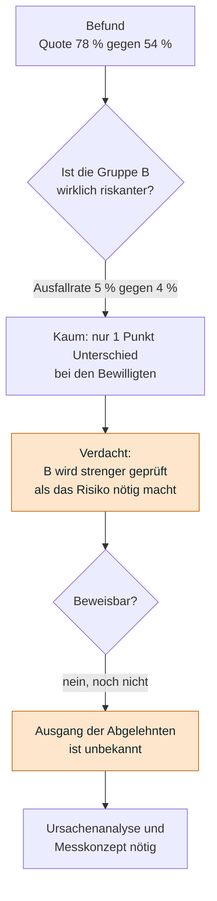
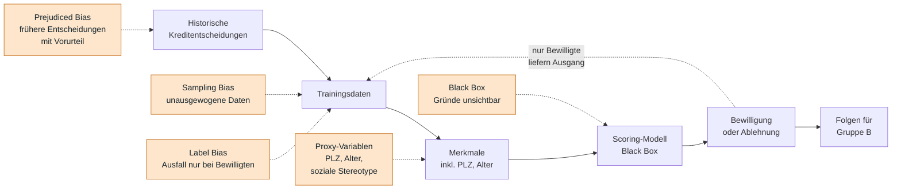
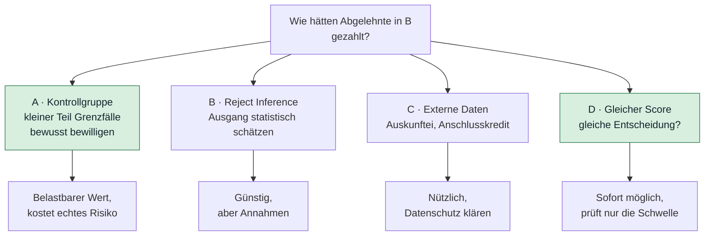
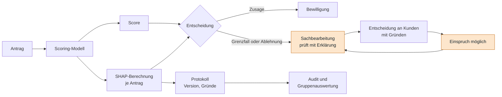
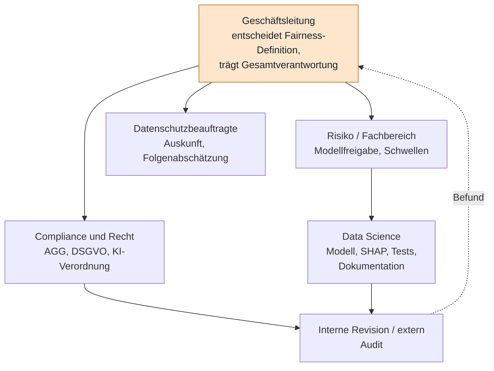
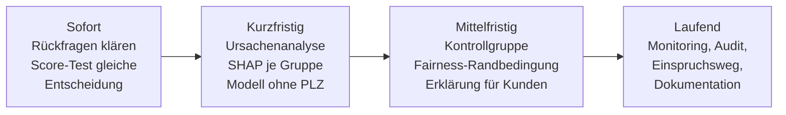

# Tag 15, Fallstudie SmartFinance AG: Bias, Fairness, Erklärbarkeit

**Auftrag:** Bias identifizieren, eine Fairness-Strategie entwickeln, Erklärbarkeit und Governance sichern. Ergebnis: Analyse der Bias-Quellen, Fairness-Strategie, Maßnahmen für Erklärbarkeit und Governance.

| Eckdaten laut Aufgabenblatt | |
|---|---|
| Unternehmen | Finanzdienstleister, Scoring-Modell (Black Box) |
| Volumen | etwa 100.000 Anträge pro Jahr |
| Merkmale | unter anderem Postleitzahl und Alter |
| Probleme | unausgewogene Trainingsdaten, soziale Stereotype in den Merkmalen, Entscheidungen müssen erklärbar sein |

| Gruppe | Bewilligungsquote | Ausfallrate |
|---|---|---|
| A | 78 % | 4 % |
| B | 54 % | 5 % |

> [!NOTE]
> Das Aufgabenblatt sagt nicht, **wer Gruppe A und B sind**, wie groß sie sind und **auf wen sich die Ausfallrate bezieht**. Ich nehme an: Die Ausfallrate gilt für bewilligte Kredite (nur dort kann man sie beobachten), und beide Gruppen sind gleich groß (je 50.000 Anträge). Beides ist eine Annahme und steht in den Rückfragen (Abschnitt 1). Rechenbeispiele mit Geld sind erfundene Werte.

---

## 1. Was die Zahlen zeigen

| Kennzahl | Gruppe A | Gruppe B | Abstand |
|---|---|---|---|
| Bewilligungsquote | 78 % | 54 % | 24 Prozentpunkte, B erreicht 69 % von A |
| Ausfallrate (bewilligte) | 4 % | 5 % | 1 Prozentpunkt |
| Bewilligt (bei 50.000 je Gruppe) | 39.000 | 27.000 | |
| Abgelehnt | 11.000 | 23.000 | in B mehr als doppelt so viele |
| Ausfälle (bei 50.000 je Gruppe) | 1.560 | 1.350 | |

### Was sich daraus sicher sagen lässt, und was nicht

| Aussage | Stimmt? | Warum |
|---|---|---|
| Die Quoten unterscheiden sich stark | Ja | 54 % gegen 78 % |
| Die Bewilligten in B sind kaum riskanter | Ja | 5 % gegen 4 % Ausfall |
| B wird unfair behandelt | **Offen** | Die Quote allein beweist nichts. Gruppen können sich legitim unterscheiden (Einkommen, Schulden) |
| Das Modell diskriminiert | **Offen** | Dafür müsste man wissen, wie viele der **abgelehnten** Antragstellenden in B gezahlt hätten |

> [!IMPORTANT]
> Das ist das Kernproblem jeder Kredit-Fairness-Prüfung: Die Ausfallrate kennt man nur bei **Bewilligten**. Die Abgelehnten haben nie gezeigt, ob sie hätten zahlen können (selektive Labels, siehe Label Bias in UE 1). Darum lassen sich die wichtigsten Fehlerraten (TPR, FPR) nicht direkt aus den Bestandsdaten berechnen.

Der Hinweis ist trotzdem deutlich: Bei gleich guten Bewilligten spricht viel dafür, dass in B Zahlungsfähige übersehen werden. Das ist ein Anfangsverdacht, kein Urteil.

### Rückfragen an SmartFinance (Phase „Lesen und Rückfragen“)

1. Wer sind Gruppe A und B (Alter, Geschlecht, Postleitzahlgebiet, Herkunft)? Wie wurden sie gebildet?
2. Wie groß sind die Gruppen?
3. Bezieht sich die Ausfallrate auf Bewilligte, und wie ist „Ausfall“ definiert (Zahlungsverzug nach wie vielen Tagen, in welchem Zeitraum)?
4. Gelten die Quoten für alle Kredite oder je Produkt und Betrag?
5. Welche Merkmale enthält das Modell genau, und wie stark ist deren Gewicht?
6. Wie hoch sind Ertrag und Verlust je Kredit (für die Wirtschaftlichkeitsrechnung)?
7. Gibt es Beschwerden, Auskunftsersuchen oder Aufsichtsanfragen?
8. Gibt es Daten über das Verhalten Abgelehnter (Auskunftei, Anschlusskredit anderswo)?

---

## 2. Aufgabe 1: Bias-Quellen identifizieren

| Quelle | Konkret bei SmartFinance | Art laut UE 1 | Wie prüfen |
|---|---|---|---|
| Unausgewogene Trainingsdaten | Gruppe B kommt in den Daten selten oder anders vor, etwa mit weniger Kredithistorie | Sampling Bias | Anteile je Gruppe in Trainingsdaten gegen die Bevölkerung der Antragstellenden |
| Soziale Stereotype in den Merkmalen | Merkmale spiegeln Rollenbilder wider (Teilzeit, Erwerbspausen, Wohnumfeld) | Proxy-Variable | Proxy-Test, Feature Importance |
| Postleitzahl | Steht für Herkunft, Einkommen, Wohnviertel („Redlining“) | Proxy-Variable | Wirkung der PLZ je Gruppe, Modell mit und ohne PLZ vergleichen |
| Alter | Direktes Merkmal, rechtlich heikel, Ältere und Junge haben andere Kreditgeschichten | Direkte Differenzierung | Rechtsprüfung, Abstand je Altersgruppe |
| Frühere Entscheidungen | Das Modell lernt die Vorlieben früherer Sachbearbeitung | Prejudiced Bias | Historische Quoten je Gruppe über die Jahre |
| Zielgröße „Ausfall“ | Nur bei Bewilligten bekannt. Wer streng ausgewählt wurde, fällt seltener aus | Label Bias | Selektionseffekt abschätzen (Abschnitt 3) |
| Black Box | Niemand sieht, wie die Merkmale zusammenwirken | Strukturproblem | SHAP, Feature Importance |

> [!WARNING]
> Die Postleitzahl ist der verdächtigste Kandidat. Sie wird gern als „neutral“ verwendet und trägt doch viel Information über Herkunft und Einkommen. Wenn Gruppe B vor allem durch die PLZ definiert ist, wäre schon das Modellmerkmal selbst das Problem.

---

## 3. Aufgabe 2: Fairness-Strategie

### 3.1 Welche Fairness-Definition?

Beide Gruppen haben fast dieselbe Ausfallrate unter den Bewilligten. Das heißt: Die **Kalibrierung** ist ungefähr erfüllt (ein bewilligter Fall ist in beiden Gruppen ähnlich sicher), die **demografische Parität** ist es klar nicht (24 Punkte Abstand). Nach UE 1 geht beides bei ungleichen Basisraten nicht zugleich.

| Definition | Was sie verlangt | Passt hier? |
|---|---|---|
| Demografische Parität | Gleiche Bewilligungsquote | Als Messwert ja, als Ziel nein: erzwingt Bewilligungen unabhängig vom Risiko |
| **Equal Opportunity** | Zahlungsfähige haben in beiden Gruppen dieselbe Chance auf Zusage | **Hauptziel.** Das trifft den Verdacht („Gute in B werden übersehen“) |
| Equalized Odds | Gleiche TPR und FPR | Zweites Ziel, später |
| Kalibrierung | Gleiche Ausfallrate bei gleichem Score | **Nebenbedingung.** Schon weitgehend erfüllt, darf nicht verloren gehen |

**Empfehlung:** Equal Opportunity als Hauptziel, Kalibrierung als Nebenbedingung, Bewilligungsquote als Überwachungswert. Die endgültige Wahl trifft die Geschäftsleitung mit Compliance und Recht. Sie wird schriftlich festgehalten.

### 3.2 Die fehlende Messgröße beschaffen

Weil der Ausgang der Abgelehnten unbekannt ist, braucht die Strategie einen Weg, ihn zu schätzen:

Mein Vorschlag: sofort **D** (Test auf gleicher Score gleiche Entscheidung, gibt einen ersten Befund), danach eine **kleine, begrenzte Kontrollgruppe (A)** mit klarem Verlustlimit und Zustimmung der Risikoleitung. **B** und **C** ergänzen.

### 3.3 Ursachenanalyse der Lücke

Die 24 Punkte lassen sich zerlegen:

| Frage | Methode | Mögliche Folge |
|---|---|---|
| Unterscheiden sich die **Scores** der Gruppen? | Verteilung des Scores je Gruppe | Wenn ja, liegt es an den Merkmalen |
| Bei gleichem Score gleiche **Entscheidung**? | Bewilligung je Score-Stufe und Gruppe | Wenn nein, liegt es an Schwelle oder Eingriff |
| **Welche Merkmale** erklären den Abstand? | SHAP je Gruppe, Unterschiede der Beiträge | Findet PLZ oder Alter als Treiber |
| Ändert sich das Bild **ohne PLZ**? | Modell ohne Verdachtsmerkmal neu trainieren | Zeigt den Proxy-Anteil |

### 3.4 Gegenmaßnahmen

| Ebene | Maßnahme | Vorsicht |
|---|---|---|
| Daten | Gruppe B gezielt nachsammeln oder gewichten (Reweighing) | Neue Daten nur mit rechtlicher Grundlage |
| Merkmale | Verdächtige Proxys entfernen oder gröber fassen (PLZ-Region statt PLZ) | Kostet etwas Genauigkeit |
| Modell | Fairness-Randbedingung beim Training oder Vergleich mit einem erklärbaren Modell | Braucht die festgelegte Definition |
| Entscheidung | Grenzfälle an Menschen geben | Der Mensch darf nicht nur bestätigen |
| Schwelle | Schwellen je Gruppe angleichen | Rechtlich heikel (Ungleichbehandlung), nur nach Prüfung |

### 3.5 Was es wirtschaftlich bedeutet (Rechenbeispiel, erfunden)

Annahmen: Kredit 10.000 €, Ertrag bei Rückzahlung 600 €, Verlust bei Ausfall 6.000 €. Dann lohnt ein Kredit, solange die Ausfallrate unter 600 ÷ (600 + 6.000) ≈ **9,1 %** bleibt. Die Bewilligten haben 4 bis 5 %. Es gibt also Spielraum.

Angenommen, die Bewilligungsquote in B steigt von 54 % auf 66 % (6.000 zusätzliche Kredite). Der Ertrag hängt davon ab, wie riskant diese Zusatzfälle sind:

| Ausfallrate der Zusatzfälle | Zusätzliche Ausfälle | Ergebnis |
|---|---|---|
| 6 % | 360 | +1,22 Mio. € |
| 8 % | 480 | +0,43 Mio. € |
| 10 % | 600 | −0,36 Mio. € |
| 12 % | 720 | −1,15 Mio. € |

Fairness und Ertrag müssen sich nicht widersprechen, solange die zusätzlich Bewilligten unter etwa 9 % bleiben. Genau das klärt die Kontrollgruppe aus 3.2. Das ist ein Rechenbeispiel, die Werte kennt nur SmartFinance.

### 3.6 Messplan im Betrieb

| Kennzahl | Je Gruppe | Zielwert (Beispiel) | Takt |
|---|---|---|---|
| Bewilligungsquote | A, B und weitere | Abstand erklären, Alarm bei großen Sprüngen | monatlich |
| TPR (Zahlungsfähige genehmigt) | A, B | Abstand höchstens 5 Prozentpunkte | vierteljährlich |
| Ausfallrate bei gleichem Score | A, B | Abstand klein halten | vierteljährlich |
| Ablehnungsgründe (SHAP) | A, B | PLZ und Alter nicht Haupttreiber | vierteljährlich |
| Einsprüche und Beschwerden | A, B | Trend beobachten | laufend |

Zum Messen braucht SmartFinance die sensiblen Merkmale. Sie liegen getrennt und pseudonymisiert beim Audit (Art. 9 DSGVO beachten).

---

## 4. Aufgabe 3: Erklärbarkeit sichern

Das Scoring-Modell ist eine Black Box. Bei Kreditentscheidungen mit erheblicher Wirkung ist Erklärbarkeit nötig, zugleich ist sie das wichtigste Prüfwerkzeug für Bias.

| Baustein | Inhalt | Nutzen |
|---|---|---|
| Globale Erklärung | Feature Importance, globale SHAP-Werte | Zeigt, was das Modell insgesamt nutzt, findet Proxys |
| Lokale Erklärung | SHAP je Antrag (Beitrag jedes Merkmals zur Entscheidung) | Begründung für den Einzelfall |
| Erklärung in Klartext | „Wesentliche Gründe: Kreditbelastung, Dauer der Kredithistorie“ statt Zahlen | Verständlich für Kunden und Sachbearbeitung |
| Vergleichsmodell | Erklärbares Modell (z. B. logistische Regression) zum Vergleich | Zeigt, ob die Black Box den Mehraufwand rechtfertigt |
| Gegenfaktische Hinweise | „Mit niedrigerer Kreditbelastung wäre der Antrag bewilligt worden“ | Hilft Antragstellenden, ohne die Modelllogik offenzulegen |
| Protokoll | Version, Eingaben, Gründe je Entscheidung | Nachweis bei Anfrage und Audit |

Beispielhafte Begründung (erfunden), in der Struktur der Folie „Warum stand Frau K. auf der Liste?“:

| Merkmal | Beitrag zur Ablehnungswahrscheinlichkeit |
|---|---|
| Ausgangswert (Ø aller Anträge) | 22 % |
| Kreditbelastung zum Einkommen | +9 |
| Kredithistorie kurz (1 Jahr) | +6 |
| Postleitzahl-Gebiet | +4 |
| Beschäftigungsdauer | −3 |
| **Vorhersage** | **38 %** |

Die Summe stimmt (22 + 9 + 6 + 4 − 3 = 38). Das **Postleitzahl-Gebiet** als Grund ist in dieser Erklärung ein Warnsignal. Ein solcher Eintrag löst die Prüfung aus, ob das Merkmal im Modell bleiben darf.

> [!IMPORTANT]
> SHAP und LIME erklären das **Modell**, nicht die Welt. Eine Erklärung ist keine Rechtfertigung: Dass ein Merkmal die Entscheidung erklärt, heißt nicht, dass es verwendet werden durfte.

---

## 5. Governance und Recht

### 5.1 Rechtlicher Rahmen

| Thema | Folge für SmartFinance |
|---|---|
| **Art. 22 DSGVO** | Rein automatisierte Entscheidungen mit erheblicher Wirkung sind eingeschränkt. Recht auf Eingreifen eines Menschen. Der Europäische Gerichtshof hat Scoring selbst als solche Entscheidung eingestuft, wenn die Kreditvergabe maßgeblich davon abhängt |
| **Transparenz (Art. 13 bis 15)** | Betroffene erhalten Auskunft und aussagekräftige Informationen zur Logik |
| **Zweckbindung, Minimierung** | Nur Merkmale, die für die Kreditwürdigkeit nötig sind |
| **Besondere Kategorien (Art. 9)** | Herkunft, Gesundheit u. a. nicht als Merkmal, auch nicht über Proxys |
| **Folgenabschätzung (Art. 35)** | Vor dem Einsatz einer solchen Bewertung durchführen |
| **Gleichbehandlung (AGG)** | Benachteiligung wegen Herkunft, Geschlecht, Alter u. a. im Massengeschäft Kredit untersagt. Über Proxys kann es mittelbare Diskriminierung sein |
| **KI-Verordnung (EU AI Act)** | Kreditwürdigkeitsprüfung von Personen gilt als Hochrisiko: Datenqualität, Dokumentation, menschliche Aufsicht |

### 5.2 Verantwortlichkeiten

Grundsatz aus UE 1: **Accountability heißt, es haftet eine benannte Person, nicht „das Modell“.**

### 5.3 Modell-Lebenszyklus

Nach dem Schema der Folie (Design, Daten, Modell, Betrieb):

| Phase | Frage | Maßnahme bei SmartFinance |
|---|---|---|
| Design | Welche Risiken und Ziele? | Fairness-Definition festlegen, Folgenabschätzung |
| Daten | Auf Bias prüfen | Sampling, Proxy-Test, Label-Effekt, Dokumentation |
| Modell | Fairness und Erklärbarkeit | Messung je Gruppe, SHAP, Vergleichsmodell |
| Betrieb | Überwachen und auditieren | Monitoring, Audit, Einspruchsweg, Modellkarte |

---

## 6. Maßnahmenplan

| Phase | Maßnahmen | Ergebnis |
|---|---|---|
| Sofort | Rückfragen (Abschnitt 1) klären, Test „gleicher Score, gleiche Entscheidung“, Verantwortliche benennen | Erste Einordnung des Verdachts |
| Kurzfristig | Ursachenanalyse (3.3), Modell ohne PLZ vergleichen, globale und lokale Erklärungen aufbauen | Quelle der Lücke benannt |
| Mittelfristig | Begrenzte Kontrollgruppe, Fairness-Randbedingung, Klartext-Erklärung für Kunden, Einspruchsweg | Messbare Chancengleichheit, rechtssichere Auskunft |
| Laufend | Monitoring je Gruppe, jährliche Audits, Modellkarte aktuell halten | Dauerhafte Governance |

---

## 7. Kurzfassung für die Präsentation im Plenum

1. **Befund:** Bewilligung 78 % gegen 54 %, Ausfall 4 % gegen 5 %. Die Bewilligten in B sind kaum riskanter. Der Verdacht: B wird strenger geprüft, als das Risiko nötig macht.
2. **Bias-Quellen:** unausgewogene Daten (Sampling), Proxys wie die Postleitzahl, frühere Entscheidungen, und ein Ausfall-Label, das nur bei Bewilligten existiert.
3. **Fairness:** Equal Opportunity als Ziel, Kalibrierung als Nebenbedingung, Bewilligungsquote als Frühwarnung. Die Definition legt die Geschäftsleitung fest.
4. **Messung:** Der Ausgang der Abgelehnten fehlt. Wir prüfen zuerst „gleicher Score, gleiche Entscheidung“ und bauen dann eine kleine Kontrollgruppe auf.
5. **Erklärbarkeit:** SHAP je Antrag, Klartext für Kunden und Sachbearbeitung, Protokolle, Einspruchsweg.
6. **Governance:** Geschäftsleitung entscheidet, Risiko und Data Science setzen um, Compliance und Datenschutz begleiten, Audit prüft.
7. **Wirtschaft:** Bis etwa 9 % Ausfall bei den Zusatzfällen lohnt sich Fairness auch finanziell (Rechenbeispiel).

---

## Was nicht geprüft ist

- **Annahmen:** gleich große Gruppen, Ausfallrate für Bewilligte, Geldwerte in 3.5. Die Rückfragen in Abschnitt 1 klären das.
- **Rechenwerte:** Alle Zahlen habe ich mit Python nachgerechnet (Anteile, 9,1 %, die Ergebnisse der Tabelle in 3.5). Die SHAP-Tabelle in Abschnitt 4 ist erfunden und addiert sich korrekt.
- **Recht:** Artikelnummern und Gesetzesangaben stammen aus dem Kurs und allgemeinem Wissen. Ich habe sie nicht am Gesetzestext nachgeschlagen. Das Urteil des Europäischen Gerichtshofs zum Scoring und der Stand der KI-Verordnung sind vor einer echten Umsetzung zu prüfen.
- **Mermaid:** Die Diagramme habe ich nicht gerendert. Bitte einmal auf GitHub ansehen.
