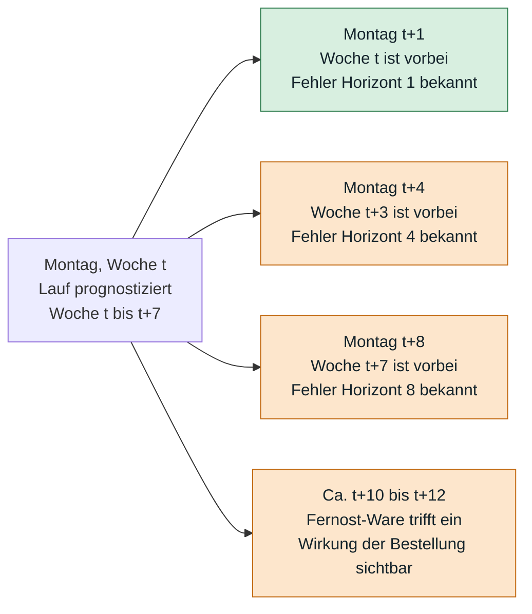
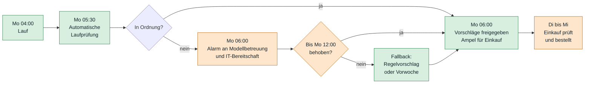
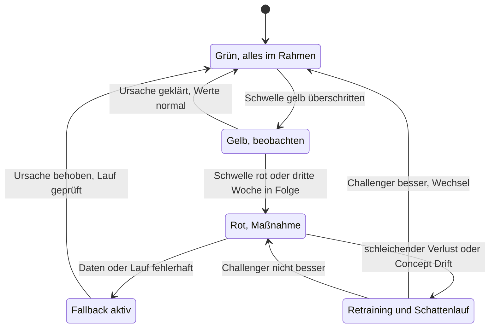
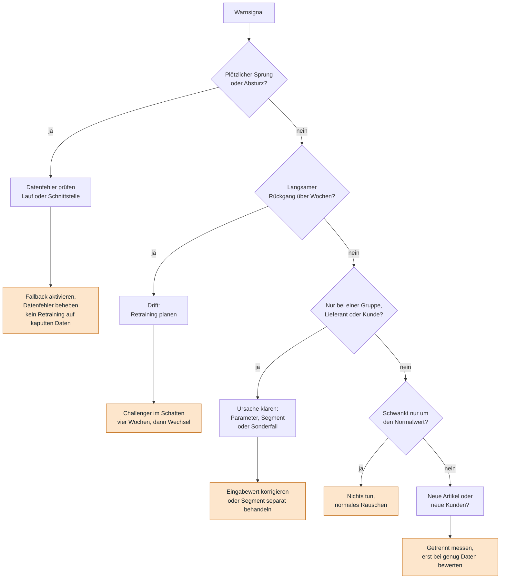

# Tag 16, Arbeitsauftrag 1: Pflege und Monitoring des Bestellmodells (Kettenblatt GmbH)

**Aufgabe:** Ein Plan zur Pflege und Überwachung des Prognosemodells. Was wird wie oft geprüft, von wem, mit welcher Folge? Woran erkennt man, dass das Modell nachlässt, und wie bringt man es in Ordnung? Dazu Kennzahlen mit Schwellenwerten und ein Test des Plans an der Chronik.

**Geforderte Ergebnisse:** (1) Plan als Tabelle Prüfung, Rhythmus, zuständig, Reaktion. (2) Kennzahlen mit Datenquelle und Schwellenwert. (3) Weg vom Warnsignal zur Entscheidung. (4) Zu jedem Ereignis der Chronik: bemerkt ja oder nein, wann, wodurch.

> [!NOTE]
> Das Aufgabenblatt liefert **keine Messreihen**. Alle Schwellenwerte sind **Vorschläge** und müssen nach den ersten Betriebswochen an echten Werten kalibriert werden. Rechnungen mit Zahlen aus dem Aufgabenblatt sind nachgerechnet, alle anderen Zahlen sind als Annahme gekennzeichnet.

---

## 1. Was bei Kettenblatt schiefgehen kann

Das Modell läuft seit März 2026 und wird seit Juni von niemandem betreut. Seitdem ist viel passiert:

| Was sich geändert hat | Art der Änderung | Wirkung auf das Modell |
|---|---|---|
| Radhaus (90 Filialen) bestellt zentral | Neue Nachfrage, größere Mengen | **Data Drift**: Eingangsdaten ändern sich |
| 260 neue Gravel-Artikel | Artikel ohne Verkaufsgeschichte | Kaltstart: das Modell kennt sie nicht |
| Kettenschlösser drei Wochen zu niedrig | Systematischer Fehler in einer Gruppe | Mögliches **Concept Drift** oder Folge von Radhaus |
| Reifenlieferant liefert alle 14 Tage | Prozessänderung | Eingabewert „Lieferzeit“ stimmt nicht mehr |
| Neues Warenwirtschaftssystem, neue Artikelnummern | Datenbruch (geplant für Januar 2027) | Schlüssel passen nicht mehr, keine Historie |

Zwei Arten von Drift (aus UE 1):

| | Data Drift | Concept Drift |
|---|---|---|
| Was ändert sich? | Die Eingangsdaten | Der Zusammenhang zwischen Eingabe und Absatz |
| Beispiel hier | Radhaus: viel größere Positionen | Kunden kaufen bei gleichem Wetter anders |
| Erkennbar durch | Vergleich der Eingabeverteilungen | Anstieg des Prognosefehlers |
| Reaktion | Ursache klären, ggf. Retraining | Retraining nötig |

Nicht jede Änderung ist Drift. Der Lieferrhythmus ist ein **Parameter**, den man korrigiert, ohne das Modell neu zu trainieren.

---

## 2. Was Kettenblatt am Montag weiß, und was erst später

Das Modell läuft montags um 4 Uhr und prognostiziert acht Wochen. Ob eine Prognose gut war, zeigt sich erst, wenn die Woche vorbei ist.



| Frage | Am Montag bekannt? | Daten dafür |
|---|---|---|
| Wie gut war die Prognose für die **Vorwoche**? | Ja | Absatz der Vorwoche aus dem Webshop, Prognose aus dem letzten Lauf |
| Wie gut war die 8-Wochen-Prognose? | Nein, erst nach acht Wochen | Gleiche Daten, aber mit Verzögerung |
| Hat die Bestellung eines Fernost-Artikels gepasst? | Nein, erst nach 10 bis 12 Wochen | Wareneingang und Verkauf danach |
| Wie oft ändert der Einkauf die Vorschläge? | Ja, wird aber nicht ausgewertet | Modell (Vorschlag) und Einkauf (ausgelöste Bestellung) |
| Liefert der Lieferant wie angenommen? | Ja, laufend | Wareneingang: zugesagter und tatsächlicher Termin |

Das heißt: Die Güte der **8-Wochen-Prognose** und die Wirkung der Fernost-Bestellungen kommen zu spät, um schnell zu warnen. Schnelle Warnungen müssen von **Frühindikatoren** kommen, die schon am Montag da sind: Eingangsdaten, Fehler der Vorwoche, Änderungsquote des Einkaufs, Lieferverhalten (UE 1: Leading Indicators). Das ist das Prinzip aus Tag 13 (Reifefenster), hier auf Wochen statt Monate übertragen.

> [!WARNING]
> **Der Absatz ist verdeckt.** Die Warenwirtschaft kennt nur die **ausgelieferte** Menge. Wo der Artikel nicht lieferbar war, fehlt die Nachfrage in dieser Zahl. Als Messgröße „Ist-Absatz“ darf deshalb nur die **Webshop-Bestellmenge einschließlich nicht lieferbarer und stornierter Positionen** dienen. Sonst sieht das Monitoring ein Modell, das zu niedrig prognostiziert, als „treffsicher“, weil der Ist-Wert durch die Fehlmenge selbst gedrückt wird.

---

## 3. Was ist teurer: zu wenig oder zu viel?

Aus dem Aufgabenblatt:

| | Kosten |
|---|---|
| Zu wenig bestellt | im Schnitt **28 €** entgangener Deckungsbeitrag je Position, mitunter geht der Kunde verloren |
| Zu viel bestellt | **1,5 % des Warenwerts pro Monat** Lagerkosten, Saisonware geht mit **30 % Nachlass** raus |

Beide Kosten lassen sich vergleichen. 28 € Fehlmenge entsprechen den Lagerkosten einer Ware mit 28 € ÷ 0,015 ≈ **1.867 Euro-Monaten**. Eine Position im Warenwert von 200 € müsste etwa neun Monate liegen, bevor Überbestand gleich teuer wird wie die Fehlmenge. Für Saisonware gilt das nicht: Bei 100 € Warenwert kostet allein der Nachlass 30 €, mehr als die 28 € Fehlmenge.

| Artikeltyp (Beispiele) | Was teurer ist | Folge für die Schwellen |
|---|---|---|
| Schnelldreher mit niedrigem Warenwert (Schläuche, Kettenschlösser, Bremsbeläge) | Fehlmenge | Unterbestand streng überwachen |
| Teure, langsam drehende Artikel | Überbestand | Überbestand streng überwachen |
| Saisonware (Winterhandschuhe) | Überbestand | Überbestand streng überwachen, besonders gegen Saisonende |
| Neuartikel (Gravel) | Beides unsicher | Einzeln beobachten, Sicherheitsbestand bewusst wählen |

**Die Antwort lautet also: nein, es gilt nicht für alle Artikel.** Eine einzige Gesamtkennzahl hilft nicht. Darum wird in Segmenten überwacht (siehe Abschnitt 5).

Einordnung des Nutzens: Das Ziel „Lagerwert um ein Zehntel senken“ bedeutet 19 Mio. € → **17,1 Mio. €**. Die Lagerkosten betragen 19 Mio. € × 1,5 % = **285.000 € pro Monat**, ein Zehntel davon sind **28.500 € pro Monat**. Das ist der Betrag, der jeden Monat verloren geht, wenn das Modell nachlässt und der Lagerwert wieder steigt.

---

## 4. Wer bemerkt es heute, und was soll am Montag geschehen?

**Wer bemerkt es heute als Erster?** Der Disponent, der sich über einen Vorschlag wundert. Das war bei den Kettenschlössern so, nach drei Wochen. Wie oft der Einkauf Vorschläge korrigiert, weiß niemand, obwohl die Daten dafür vorliegen (Vorschlag aus dem Modell, ausgelöste Bestellung aus dem Einkauf). Seit Mai werden etwa **80 %** unverändert übernommen. Das kann Vertrauen bedeuten oder Gewohnheit, ohne Messung bleibt es Raten.

**Wenn der Lauf ausfällt oder Unsinn liefert:** Die IT sieht nur „Job beendet“. Ein Lauf, der beendet ist, kann leere Zeilen, falsche Einheiten oder 14.000-mal denselben Wert geschrieben haben. Nötig sind Prüfungen **nach** dem Lauf und ein **Fallback**, bevor die Disponenten ihre Vorschläge am Montag prüfen.



Das Zeitfenster bis Mittwoch ist knapp, aber ausreichend, wenn der Alarm schon am Montagvormittag kommt.

**Fallback-Stufen (abgestuft, vom Besten zum Schlechtesten):**

| Stufe | Wann | Was geschieht |
|---|---|---|
| 1 | Nur einzelne Artikel auffällig | Diese Artikel mit Warnflagge an den Einkauf, Rest wie üblich |
| 2 | Lauf fehlerhaft oder Teile unplausibel | Letzte gute **Modellversion** auf den neuesten Daten neu laufen lassen |
| 3 | Eingangsdaten kaputt | **Regelvorschlag**: Mittel der letzten acht Wochen plus Sicherheitsbestand (einfach, erklärbar) |
| 4 | Auch das scheitert | Vorschläge der Vorwoche und manuelle Bestellung für kritische Artikel |

---

## 5. Kennzahlen mit Datenquelle und Schwellenwert

Alle Kennzahlen entstehen aus den fünf vorhandenen Datenquellen: Webshop, Warenwirtschaft, Modell, Einkauf, Wareneingang. Die Schwellen sind Vorschläge: **Gelb** = beobachten und Ursache klären, **Rot** = Maßnahme.

### A. Lauf und Datenqualität (jeden Montag, automatisch)

| Nr. | Kennzahl | Datenquelle | Gelb | Rot |
|---|---|---|---|---|
| K1 | Lauf fertig bis 05:30 Uhr | Modell (Laufprotokoll) | – | nicht fertig |
| K2 | Vollständigkeit: Zeilen = aktive Artikel × 8 Wochen (14.000 × 8 = 112.000) | Modell, Warenwirtschaft (Artikelstamm) | weniger als 99 % | weniger als 95 % |
| K3 | Unplausible Werte (leer, negativ, mehr als das Fünffache des Medians der letzten acht Wochen) | Modell, Webshop | über 1 % der Artikel | über 3 % |
| K4 | Frische der Eingangsdaten | Warenwirtschaft, Webshop | älter als 24 Stunden | älter als 48 Stunden |
| K5 | Neuartikel im Lauf (ohne Historie), Anzahl | Warenwirtschaft (Artikelstamm), Modell | über 20 | über 100 |
| K6 | Artikel mit Historie unter neuer Artikelnummer | Warenwirtschaft | unter 98 % | unter 95 % |

### B. Eingangsdaten (Data Drift, wöchentlich)

| Nr. | Kennzahl | Datenquelle | Gelb | Rot |
|---|---|---|---|---|
| K7 | PSI (Population Stability Index) je Eingabemerkmal: letzte vier Wochen gegenüber Trainingszeitraum | Modell (Eingabewerte), Webshop | 0,10 bis 0,25 | über 0,25 |
| K8 | Größe der Bestellposition (Median und 95 %-Wert) im Webshop gegenüber den letzten 13 Wochen | Webshop | +20 % | +50 % |
| K9 | Lieferverhalten je Lieferant: tatsächliches Lieferintervall und Lieferzeit gegenüber Annahme im Modell | Wareneingang, Modell (Eingabe) | Abweichung über 20 % | über 50 % oder ein ganzer Rhythmus verfehlt |

### C. Prognosegüte (Performance, wöchentlich, mit Reifefenster)

| Nr. | Kennzahl | Datenquelle | Gelb | Rot |
|---|---|---|---|---|
| K10 | **WAPE** Horizont 1 (Summe der Abweichungen ÷ Summe Ist) je Segment | Modell, Webshop (inkl. Fehlmengen) | über 120 % der Referenz, zwei Wochen in Folge | über 150 % der Referenz oder drei Wochen |
| K11 | **Bias** (Summe Prognose − Summe Ist) ÷ Summe Ist je Artikelgruppe | wie K10 | über ±10 % | über ±15 % oder drei Wochen in gleicher Richtung |
| K12 | Modell gegen Naivprognose (z. B. Mittel der letzten acht Wochen) | Modell, Webshop | Vorsprung unter 10 % | Modell schlechter als Naivprognose |
| K13 | WAPE Horizont 8 (erst nach acht Wochen) | wie K10 | Quartalsprüfung | Quartalsprüfung |

**Warum WAPE statt „im Mittel 17 % daneben“?** Der Fehler im Mittel (MAPE) wird bei selten verkauften Artikeln riesig, weil durch kleine Stückzahlen geteilt wird. Der WAPE summiert zuerst und teilt dann, das ist stabil. Die **Referenz** für K10 ist nicht die 17 % aus dem Test (andere Kennzahl), sondern der WAPE der ersten vier Betriebswochen, rückwirkend gerechnet.

**Segmente:** Umsatzklasse A, B, C, Saisonware, Neuartikel (unter 26 Wochen Verkauf), Kunde Radhaus, Warengruppe, Lieferant. In der Gesamtzahl verschwinden Fehler in Segmenten (Kettenschlösser). Selten verkaufte Artikel werden gebündelt über längere Fenster (13 Wochen) bewertet, weil Einzelwochen zu stark schwanken.

### D. Nutzung durch den Einkauf (wöchentlich)

| Nr. | Kennzahl | Datenquelle | Gelb | Rot |
|---|---|---|---|---|
| K14 | Änderungsquote: Anteil Positionen, bei denen die ausgelöste Menge vom Vorschlag abweicht (Referenz heute etwa 20 %) | Modell, Einkauf | über 30 % je Gruppe | über 40 % je Gruppe oder gleiche Richtung zwei Wochen |
| K15 | Änderungsquote unter 5 % bei Auffälligkeit in K10 bis K11 | Modell, Einkauf | Hinweis „Prüfung findet nicht mehr statt“ | – |

Eine **hohe** Änderungsquote deutet auf ein Modellproblem oder Misstrauen. Eine **sehr niedrige** bei gleichzeitig schlechter Güte deutet auf blindes Übernehmen.

### E. Geschäftswirkung (monatlich, verzögert)

| Nr. | Kennzahl | Datenquelle | Ziel | Gelb | Rot |
|---|---|---|---|---|---|
| K16 | Lieferfähigkeit (lieferbare ÷ alle Webshop-Positionen) | Webshop | 96 % | unter 95 % | unter 93 % |
| K17 | Lagerwert | Warenwirtschaft | 17,1 Mio. € | über 18 Mio. € | über 19 Mio. € |
| K18 | Kosten der Fehlprognose in € (Fehlmengen × 28 € plus Lagerkosten des Überbestands plus Nachlass Saisonware) | Webshop, Warenwirtschaft | sinkend | über Vormonat +10 % | über Vormonat +25 % |
| K19 | Restbestand Saisonware 4 Wochen vor Saisonende | Warenwirtschaft | gering | über Plan | deutlich über Plan |

K16 bis K19 reagieren **zu spät**, um frühzeitig zu warnen. Sie zeigen aber, ob das Ziel von 2026 erreicht wird. Zu beachten: Sie messen Modell **und** Einkauf zusammen, weil Einkauf Vorschläge ändert. Die Modellgüte selbst misst nur K10 bis K12.

### Rechenhilfe

```python
import numpy as np

def wape(ist, prognose):
    return np.abs(prognose - ist).sum() / ist.sum()

def bias(ist, prognose):
    return (prognose.sum() - ist.sum()) / ist.sum()

def psi(referenz, neu, klassen=10):
    grenzen = np.quantile(referenz, np.linspace(0, 1, klassen + 1))
    grenzen[0], grenzen[-1] = -np.inf, np.inf
    a = np.clip(np.histogram(referenz, grenzen)[0] / len(referenz), 1e-4, None)
    b = np.clip(np.histogram(neu, grenzen)[0] / len(neu), 1e-4, None)
    return float(((b - a) * np.log(b / a)).sum())
```

Getestet an Zufallszahlen: Bei gleicher Verteilung (Poisson, Mittel 20) ergibt der PSI 0,01. Bei einem Anstieg auf Mittel 26 (+30 %) steigt er auf 1,5, also deutlich über der Rot-Schwelle. Die Schwellen 0,10 und 0,25 sind übliche Faustwerte.

---

## 6. Der Plan: Prüfung, Rhythmus, zuständig, Reaktion

### Rollen

Heute ist niemand zuständig (die Beratung ist seit Juni weg). Der Plan beginnt mit Rollen:

| Rolle | Aufgabe | Wer (Vorschlag) |
|---|---|---|
| **Modellverantwortliche/r** (fachlich) | Entscheidet über Retraining, Fallback, Stilllegung. Haftet für das Ergebnis | Leitung Einkauf |
| **Modellbetreuung** | Wöchentlicher Bericht, Ursachenanalyse, Retraining vorbereiten | Eine feste Stelle, intern (Annahme: etwa ein Fünftel bis ein Drittel einer Vollzeitstelle) |
| **IT-Betrieb** | Lauf, Schnittstellen, Versionierung, Rückweg | IT |
| **Disponentinnen und Disponenten** | Änderungen am Vorschlag kurz begründen, Auffälligkeiten melden | Einkauf |
| **Vertrieb / Key Account** | Meldet große Kundenänderungen im Voraus (Radhaus) | Vertrieb |
| **Stammdaten** | Meldet Neuartikel und Artikelnummernwechsel im Voraus | Stammdaten |
| **Geschäftsführung** | Eskalationsstelle, Budget für Pflege | Geschäftsführung |

Grundsatz aus UE 1: Annahmen dokumentieren, nicht von Einzelnen abhängig sein (Wissensbewahrung).

### Prüfplan

| Prüfung | Rhythmus | Zuständig | Reaktion |
|---|---|---|---|
| **Laufprüfung** (K1 bis K6) | Jeden Montag nach dem Lauf, automatisch | IT-Betrieb meldet, Modellbetreuung entscheidet | Rot: Fallback-Stufe 2 bis 4, kein Retraining auf kaputten Daten |
| **Eingangsdaten-Drift** (K7 bis K9) | Wöchentlich | Modellbetreuung | Gelb: Ursache binnen einer Woche klären. Rot: Segment markieren, Sonderbehandlung, Retraining prüfen |
| **Prognosegüte** (K10 bis K12) | Wöchentlich, je Segment | Modellbetreuung | Gelb: beobachten. Rot oder drei Wochen gleiche Richtung: Ursachenanalyse, ggf. Parameter oder Retraining |
| **Nutzung** (K14, K15) | Wöchentlich | Modellbetreuung mit Leitung Einkauf | Gespräch mit Disponenten über häufig geänderte Gruppen |
| **Geschäftswirkung** (K16 bis K19) | Monatlich | Leitung Einkauf, Controlling | Bericht an Geschäftsführung, Bewertung des Ziels |
| **Änderungskalender** | Laufend, Abfrage einmal pro Monat | Vertrieb, Stammdaten, Einkauf, IT | Vor jeder angekündigten Änderung: Vorbereitung (siehe Abschnitt 8) |
| **Quartalsprüfung** | Alle drei Monate | Modellverantwortliche/r | Challenger im Schatten, Entscheidung über Wechsel |
| **Jahresreview** | Einmal im Jahr | Geschäftsführung | Weiterbetrieb, Erneuerung oder Stilllegung |

### Ampel und Zustände



---

## 7. Vom Warnsignal zur Entscheidung

Nach dem Muster der Folie „Was tun Sie?“: Die Reaktion hängt davon ab, **wie** sich das Signal verhält.



| Signal | Reaktion | Warum |
|---|---|---|
| Fehler springt in einer Woche, in mehreren Artikeln fehlt ein Feld | Datenfehler beheben, Fallback nutzen | Kein Retraining auf kaputten Daten (Unity-Fall: Fehlerhafte Daten wurden mitgelernt) |
| Fehler wächst über Wochen, über viele Segmente | Retraining planen | Echter Drift |
| Fehler nur bei Reifen nach Lieferantenwechsel | Lieferrhythmus im Modell korrigieren | Parameter, kein Modellproblem |
| Fehler schwankt um den Normalwert | Nichts tun | Rauschen |
| Neue Artikel mit schlechten Prognosen | Getrennt messen, einzeln disponieren, Analogartikel nutzen | Zu wenig Daten für ein Urteil |

### Retraining-Regeln

| Strategie (UE 1) | Einsatz bei Kettenblatt |
|---|---|
| Zeitgesteuert | **Ja**: Quartalsprüfung. Es wird geprüft, nicht blind neu trainiert |
| Ereignisgesteuert | **Ja**: bei Rot in K10 bis K12 oder bei Datenbruch |
| Inkrementell (laufend nachlernen) | **Nein**: Ein Datenfehler würde sofort mitgelernt |

Vor jedem Retraining: **Datenprüfung** (K2 bis K9 grün). Nach dem Training: **Champion-Challenger**. Das neue Modell rechnet vier Wochen im Schatten mit denselben Artikeln, der Wechsel erfolgt nur bei besserer Prognose in den kritischen Segmenten. Der Rückweg zur letzten guten Version bleibt immer offen (versioniertes Modell, Daten-Snapshot, Konfiguration).

---

## 8. Test an der Chronik: Was hätte der Plan bemerkt?

Annahmen: Der Plan ist seit Juni 2026 in Kraft. „Wann“ meint die erste mögliche Warnung, gerechnet vom Ereignis.

| Wann | Ereignis | Bemerkt? | Wann | Wodurch | Reaktion |
|---|---|---|---|---|---|
| Aug 2026 | Radhaus bestellt zentral, größere Mengen bei Ketten, Schläuchen, Bremsbelägen | **Ja** | Eine bis zwei Wochen nach Start | K8 (Positionsgröße im Webshop), K7 (PSI), danach K11 (Bias, Unterschätzung) in den Warengruppen. **Besser:** Der Änderungskalender hätte es **vorher** gemeldet | Segment „Radhaus“ anlegen, Sicherheitsbestand prüfen, Retraining nach sechs bis acht Wochen mit den neuen Daten |
| Sep 2026 | 260 neue Gravel-Artikel | **Ja** | Sofort im ersten Lauf nach Listung | K5 (Neuartikel über 100 → Rot), K6; später K10 getrennt für Neuartikel nach etwa vier Wochen | Neuartikel einzeln disponieren, Analogartikel (ähnliche bestehende Artikel) als Startwert |
| Okt 2026 | Kettenschlösser drei Wochen in Folge zu niedrig | **Ja, früher** | Nach der ersten bis zweiten Woche statt nach der dritten | K11 (Bias je Artikelgruppe über ±10 % bzw. gleiche Richtung zwei Wochen) und K14 (Änderungsquote bei Kettenschlössern steigt) | Ursache klären (vermutlich Radhaus, siehe Aug), Sicherheitsbestand anpassen |
| Nov 2026 | Größter Reifenlieferant liefert alle 14 Tage | **Ja** | In der ersten Woche mit ausgefallener Lieferung | K9 (Lieferintervall und -zeit im Wareneingang weichen von der Annahme ab) | **Parameter** im Modell korrigieren (kein Retraining). Die Formel „Prognose bis zum nächsten Liefertermin“ braucht nun den doppelten Zeitraum |
| Jan 2027 | Neues Warenwirtschaftssystem, neue Artikelnummern | **Ja, aber nur bei Vorbereitung** | Beim ersten Lauf (K6 unter 95 % → Rot, K2) | K6, K2, K5. **Das Ereignis liegt in der Zukunft.** Der Plan muss es vorher auffangen | Siehe unten |

Zwei Anmerkungen:

- **Die Ereignisse hängen zusammen.** Die Kettenschlösser im Oktober sind sehr wahrscheinlich die Folge von Radhaus im August. Ein Monitoring, das im August reagiert, hätte den Oktober-Fehler verhindert. Diese Vermutung beruht auf den Artikelarten, die Zahlen liegen nicht vor.
- **Im Oktober liegt der Gewinn bei ein bis zwei Wochen Vorsprung** gegenüber dem Disponenten, der erst nach drei Wochen aufmerksam wurde. Im August ist er größer, weil der Fehler gar nicht erst entsteht, wenn der Änderungskalender die Radhaus-Umstellung vorher ankündigt.

### Vorbereitung auf Januar 2027 (Datenbruch, geplant)

Ein Datenbruch ist ein **Projekt**, kein Alarm. Eine Checkliste für den Wechsel:

| Zeitpunkt | Schritt | Zuständig |
|---|---|---|
| Vor dem Wechsel | **Mapping alt → neu** der Artikelnummern anlegen und prüfen | Stammdaten, IT |
| Vor dem Wechsel | Verkaufshistorie auf neue Nummern **umschlüsseln** | IT, Modellbetreuung |
| Vor dem Wechsel | Testlauf mit den neuen Schnittstellen im Schattenbetrieb | IT, Modellbetreuung |
| Wechselwoche | Go/No-Go: Nur wenn K2 und K6 grün sind, geht der Lauf in Betrieb | Modellverantwortliche/r |
| Wechselwoche | Fallback Stufe 3 (Regelvorschlag) bereit | Einkauf |
| Nach dem Wechsel | Vier Wochen engere Überwachung, Segment „umgestellt“ getrennt messen | Modellbetreuung |

---

## 9. Was der Plan kostet, und was er verhindert

Der Plan ist nicht kostenlos: eine feste Betreuung (Annahme: ein Fünftel bis ein Drittel einer Stelle), etwas IT-Aufwand für die Automatik, Zeit im Einkauf für Rückmeldungen. Dagegen steht: Schon ein Rückgang des Lagerwerts um das geplante Zehntel spart **28.500 € Lagerkosten pro Monat**. Verfällt der Nutzen des Modells, geht dieser Betrag verloren, dazu entgehen Deckungsbeiträge (28 € je Fehlmenge-Position). Das ROI-Modell dazu ist Gegenstand von Arbeitsauftrag 2 und der Fallstudie.

## 10. Checkliste (aus UE 1)

| Frage | Antwort im Plan |
|---|---|
| Werden Eingangsdaten und Güte überwacht? | Ja: K1 bis K13 |
| Gibt es einen Rückweg zur letzten guten Version? | Ja: versioniertes Modell, Fallback-Stufen 2 bis 4 |
| Sind Auslöser für das Retraining festgelegt? | Ja: Quartalsprüfung, Rot in K10 bis K12, Datenbruch |
| Ist der Nutzen mit einer Vergleichsgruppe belegt? | Offen, siehe Arbeitsauftrag 2 |
| Sind alle Kosten drin, auch die Zeit der Fachabteilung? | Betreuung und Rückmeldungen des Einkaufs sind eingeplant |

---

## Was nicht geprüft ist

- **Schwellenwerte:** Alle Gelb- und Rot-Werte, die Referenz für den WAPE und die Annahme zum Betreuungsaufwand sind Vorschläge ohne Messdaten.
- **Rechnungen:** 19 Mio. € × 0,9 = 17,1 Mio. €; 19 Mio. € × 1,5 % = 285.000 €; ein Zehntel davon 28.500 €; 28 € ÷ 0,015 ≈ 1.867; 14.000 × 8 = 112.000 sind mit Python nachgerechnet. Der PSI-Test lief an Zufallszahlen.
- **Zusammenhang der Ereignisse:** Dass die Kettenschlösser eine Folge von Radhaus sind, ist eine Vermutung.
- **Mermaid:** Die Diagramme habe ich nicht gerendert. Bitte einmal auf GitHub ansehen.
