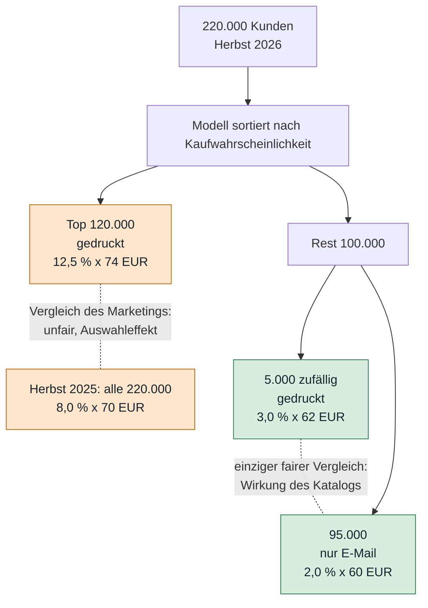

# Tag 16, Arbeitsauftrag 2: ROI des Katalogmodells (Teehaus Nordlicht GmbH)

> [!IMPORTANT]
> **Auf einen Blick**
>
> - **Das Modell lohnt sich, aber nicht wegen des Umsatzes.** Der Umsatz steigt nur um 1.300 € je Ausgabe (+0,1 %). Der Nutzen sind die gesparten Druckkosten: 133.000 € je Ausgabe, abzüglich 25.080 € entgangenem Deckungsbeitrag, also **107.920 € netto je Ausgabe** (rund 430.000 € im Jahr).
> - **ROI:** 231 % im ersten Jahr (Kosten 130.400 €) und 969 % im zweiten (Kosten 40.400 €). **Payback** nach der ersten Ausgabe (rund 3 Monate). Wenn der Nutzen nur halb so groß ist, sind es 66 % und 434 % und ein Payback nach der dritten Ausgabe.
> - **Meldung des Marketings:** Die Rechnungen stimmen, die Schlüsse nicht. Es werden die 120.000 besten Kunden mit allen 220.000 verglichen (Auswahleffekt), deshalb halten +56 % Käuferquote, 9,25 € je Katalog und 1,75 Mio. € Mehrumsatz nicht. Die Druckersparnis stimmt im Kern (532.000 € statt 560.000 €). Für den Newsletter gibt es keinen Beleg.
> - **Fairer Vergleich:** nur die 5.000 zufällig gezogenen gegen die 95.000 nur per E-Mail. Der Katalog bringt dort 0,26 € Deckungsbeitrag und kostet 1,40 €, der Druck lohnt sich bei ihnen nicht.
> - **Vorbehalt:** Basis ist eine Ausgabe und sechs Wochen. Offen sind Abwanderung der E-Mail-Gruppe, Saison, Einwilligung für E-Mail-Werbung und Modellverfall.

**Aufgabe:** Das Marketing meldet der Geschäftsführung, das Modell habe sich mit dem ersten Katalog bezahlt gemacht. Zu prüfen ist, was davon stimmt: Einsparung, Umsatz und Deckungsbeitrag für eine Ausgabe, ROI für Jahr 1 und 2, Payback Period, Bewertung der Meldung, fehlende Faktoren.

**Geforderte Ergebnisse:** (1) Rechnung für eine Ausgabe. (2) ROI Jahr 1 und 2 und Payback Period mit allen Annahmen. (3) Antwort an die Geschäftsführung, höchstens drei Sätze. (4) Weitere Faktoren mit Richtung (für oder gegen das Modell).

> [!NOTE]
> Alle Rechnungen sind mit einem kleinen Python-Skript nachgerechnet (am Ende des Dokuments). Zahlen aus dem Aufgabenblatt sind als solche behandelt, alles andere ist als **Annahme** gekennzeichnet. Die Erlöse stammen aus **einer** Ausgabe und sechs Wochen Beobachtung, jede Hochrechnung darauf ist eine Schätzung.

---

## 1. Der Kern in einem Bild

Das Marketing vergleicht die **besten** 120.000 Kunden mit **allen** 220.000. Das ist kein fairer Vergleich, weil die besten Kunden auch ohne Modell mehr kaufen. Fair vergleichbar sind nur die zufällig gezogenen 5.000 mit den übrigen 95.000, denn beide Gruppen sind vom Modell als „nicht ausgewählt“ eingestuft und unterscheiden sich allein durch den Katalog.



---

## 2. Rechnung für eine Katalogausgabe

Annahmen: Druck und Porto 1,40 € je Stück, Deckungsbeitrag 40 % vom Umsatz (beides aus dem Aufgabenblatt). Der Versand der E-Mail mit PDF wird mit **0 €** angesetzt, die Kosten sind nicht angegeben (siehe Abschnitt 6).

### 2.1 Einsparung bei Druck und Porto

| | Gedruckte Kataloge | Kosten bei 1,40 € |
|---|---:|---:|
| Herbst 2025 | 220.000 | 308.000 € |
| Herbst 2026 (120.000 + 5.000 Kontrollgruppe) | 125.000 | 175.000 € |
| **Einsparung je Ausgabe** | **95.000** | **133.000 €** |

Ohne die 5.000 Kontrollkataloge wären es 100.000 weniger Stück und 140.000 €. Die Kontrollgruppe kostet also 7.000 € je Ausgabe, und sie ist der Grund, warum sich der Effekt überhaupt belegen lässt.

### 2.2 Umsatz und Deckungsbeitrag (einfacher Vorher-Nachher-Vergleich)

Umsatz je Gruppe = Kunden x Käuferquote x Ø Bestellung.

| Gruppe | Kunden | Käufer | Umsatz |
|---|---:|---:|---:|
| Herbst 2025: alle | 220.000 | 17.600 | 1.232.000 € |
| 2026: vom Modell ausgewählt | 120.000 | 15.000 | 1.110.000 € |
| 2026: zufällig gezogen | 5.000 | 150 | 9.300 € |
| 2026: nur E-Mail | 95.000 | 1.900 | 114.000 € |
| **Herbst 2026 gesamt** | **220.000** | **17.050** | **1.233.300 €** |

| Größe | Herbst 2025 | Herbst 2026 | Veränderung |
|---|---:|---:|---:|
| Umsatz | 1.232.000 € | 1.233.300 € | **+1.300 €** (+0,1 %) |
| Deckungsbeitrag (40 %) | 492.800 € | 493.320 € | **+520 €** |
| Käufer insgesamt | 17.600 | 17.050 | −550 (−3,1 %) |
| Käuferquote insgesamt | 8,00 % | 7,75 % | −0,25 Punkte |

**Ergebnis je Ausgabe (einfacher Vergleich):** Der Umsatz ist praktisch unverändert, der Nutzen liegt in den Druckkosten: 133.000 € + 520 € = **133.520 €** je Ausgabe.

### 2.3 Wirkung des Katalogs, sauber geschätzt (Zufallsgruppe als Vergleich)

Der Vorjahresvergleich hat eine Schwäche: Herbst 2025 und Herbst 2026 unterscheiden sich auch durch Saison, Preise, Wetter und Konjunktur. Sauberer ist der Vergleich im selben Herbst:

| Je Kunde der 100.000 Nicht-Ausgewählten | gedruckt | nur E-Mail | Unterschied |
|---|---:|---:|---:|
| Umsatz (Quote x Bestellung) | 3,0 % x 62 € = 1,86 € | 2,0 % x 60 € = 1,20 € | **+0,66 €** |
| Deckungsbeitrag (40 %) | 0,744 € | 0,48 € | **+0,264 €** |
| Druckkosten | 1,40 € | 0 € | **−1,40 €** |

Der Katalog bringt bei diesen Kunden 0,26 € Deckungsbeitrag und kostet 1,40 €. **Pro Kunde bleiben −1,14 € übrig, der Druck lohnt sich bei ihnen nicht.** Das ist der eigentliche Beleg für das Modell.

Rechnung für die 95.000 nur per E-Mail erreichten Kunden:

| Posten | Betrag |
|---|---:|
| Druckkosten gespart | +133.000 € |
| Entgangener Deckungsbeitrag (95.000 x 0,264 €) | −25.080 € |
| **Nettonutzen je Ausgabe** | **+107.920 €** |

Ist der Unterschied zufällig? Die Differenz der Käuferquote beträgt 1,0 Prozentpunkte, der Standardfehler 0,25 Punkte, das 95-%-Intervall reicht von 0,5 bis 1,5 Punkten (z ≈ 4,1). Der Effekt ist also statistisch belegt, nur die Größe ist mit ±0,5 Punkten unsicher. Im ungünstigen Ende des Intervalls wäre der entgangene Deckungsbeitrag etwa 36.400 € statt 25.100 €, der Nettonutzen 96.600 €. Das Ergebnis bleibt positiv.

**Welche Zahl nehme ich?** Für den ROI verwende ich die vorsichtigere Schätzung **107.920 € je Ausgabe** (Basisszenario). Die 133.520 € des einfachen Vergleichs dienen als obere Grenze.

Der Unterschied von rund 25.600 € zeigt, dass der Vorjahresvergleich entgangenen Umsatz „verschluckt“: Wären alle 100.000 gedruckt worden, hätte der Umsatz nach der Zufallsgruppe bei etwa 1.296.000 € gelegen, also 64.000 € über Herbst 2025. Entweder war die Nachfrage im Herbst 2026 insgesamt höher, oder die 5.000 sind nicht ganz repräsentativ. Beides lässt sich mit einer Ausgabe nicht trennen.

---

## 3. ROI und Payback Period

### 3.1 Annahmen

| Annahme | Wert | Sicherheit |
|---|---|---|
| Ausgaben je Jahr | 4 | sicher (Aufgabenblatt) |
| Nutzen je Ausgabe | 107.920 € (Basis) | **unsicher**: eine Ausgabe, sechs Wochen |
| Jede Ausgabe wirkt wie Herbst 2026 | angenommen | **unsicher**: Advent ist vermutlich stärker, Sommer schwächer |
| Jahr 1 = die ersten 12 Monate im Betrieb (Herbst 2026 bis Sommer 2027) | angenommen | Definition |
| Einmalkosten fallen komplett in Jahr 1 | 75.000 € + 15.000 € = 90.000 € | sicher (Aufgabenblatt) |
| Laufende Kosten | siehe unten | sicher (Aufgabenblatt) |
| Kosten der E-Mail-Variante | 0 € | **unsicher**, nicht angegeben |
| Keine Veränderung der Kundenbasis | angenommen | **unsicher**, Abwanderung der E-Mail-Gruppe ist nicht erfasst |

### 3.2 Kosten (TCO)

| Posten | Jahr 1 | Jahr 2 |
|---|---:|---:|
| Entwicklung DataKontor (einmalig) | 75.000 € | 0 € |
| Einführung Marketing, IT, Datenschutz (einmalig) | 15.000 € | 0 € |
| Cloud-Betrieb (1.200 € x 12) | 14.400 € | 14.400 € |
| Analystin (ein Fünftel der Stelle) | 16.000 € | 16.000 € |
| Neutraining (2 x 5.000 €) | 10.000 € | 10.000 € |
| **Summe** | **130.400 €** | **40.400 €** |

Laufende Kosten insgesamt: 40.400 € im Jahr. Einmalkosten: 90.000 €.

### 3.3 ROI = (Nutzen − Kosten) / Kosten

Drei Szenarien, damit die Unsicherheit sichtbar wird. Das Basisszenario ist das, was ich der Geschäftsführung als Erwartung nennen würde.

| | Obere Grenze (einfacher Vergleich) | **Basis** (Zufallsgruppe) | Vorsicht (Nutzen halbiert) |
|---|---:|---:|---:|
| Nutzen je Ausgabe | 133.520 € | **107.920 €** | 53.960 € |
| Nutzen je Jahr (x 4) | 534.080 € | **431.680 €** | 215.840 € |
| **ROI Jahr 1** (Kosten 130.400 €) | 310 % | **231 %** | 66 % |
| **ROI Jahr 2** (Kosten 40.400 €) | 1.222 % | **969 %** | 434 % |
| ROI über zwei Jahre (Kosten 170.800 €) | 525 % | **405 %** | 153 % |
| Kapitalwert (NPV) bei 8 % Zins, 2 Jahre | 790.000 € | **608.000 €** | 223.000 € |

Rechenbeispiel Basis, Jahr 1: Nutzen 431.680 € − Kosten 130.400 € = 301.280 €. 301.280 / 130.400 = 2,31, also **231 %**. Jahr 2: (431.680 − 40.400) / 40.400 = 9,69, also **969 %**.

Der Zinssatz von 8 % ist eine Annahme zur Illustration des Zeitwerts (UE 1: NPV). Er ändert die Aussage nicht.

### 3.4 Payback Period

Der Nutzen kommt nicht gleichmäßig, sondern mit jeder Ausgabe (etwa alle drei Monate). Der Nutzen einer Ausgabe abzüglich eines Quartals laufender Kosten (10.100 €) bringt den kumulierten Stand so voran:

| Stand nach | Basis (107.920 € je Ausgabe) | Vorsicht (53.960 € je Ausgabe) |
|---|---:|---:|
| Start (Einmalkosten) | −90.000 € | −90.000 € |
| 1. Ausgabe | **+7.820 €** | −46.140 € |
| 2. Ausgabe | +105.640 € | −2.280 € |
| 3. Ausgabe | +203.460 € | **+41.580 €** |

- **Basis:** Payback nach der **ersten Ausgabe**, also rund **drei Monate**. Gleichmäßig verteilt gerechnet wären es 90.000 € / (35.973 € − 3.367 € je Monat) = 2,8 Monate.
- **Vorsicht:** Payback mit der **dritten Ausgabe**, nach etwa **7 bis 9 Monaten** (rechnerisch gleichmäßig 6,2 Monate).

**Belastbarkeit:** Damit sich das Modell im ersten Jahr rechnet, muss jede Ausgabe nur **32.600 €** Nutzen bringen (130.400 € / 4), das sind 30 % des Basiswertes. In Jahr 2 genügen **10.100 €** je Ausgabe. Die Aussage „lohnt sich“ ist damit robust, die Größe „231 %“ nicht.

---

## 4. Prüfung der Meldung des Marketings

| # | Aussage | Rechnung stimmt? | Aussage stimmt? | Warum |
|---|---|:---:|:---:|---|
| 1 | Käuferquote von 8,0 % auf 12,5 %, plus 56 % | ja (12,5 / 8,0 = 1,56) | **nein** | Verglichen werden die 120.000 besten Kunden mit allen 220.000. Das ist ein **Auswahleffekt**: Wer häufig kauft, kauft auch ohne Modell häufiger. Insgesamt sank die Käuferquote sogar von 8,00 % auf 7,75 %, 550 Käufer weniger. |
| 2 | 9,25 € Umsatz je Katalog statt 5,60 € | ja (12,5 % x 74 € = 9,25 €) | **nein** | Gleicher Fehler: Auswahl der Besten gegen Durchschnitt. Je Kunde der gesamten Kundenbasis liegt der Umsatz bei 5,61 € (1.233.300 € / 220.000), also unverändert. |
| 3 | 1,75 Mio. € Mehrumsatz im Jahr | ja (3,65 € x 120.000 x 4 = 1.752.000 €) | **nein** | Der Unterschied je Kunde wird nur mit den 120.000 Ausgewählten multipliziert. Die 100.000 Abgewählten bringen aber weniger Umsatz, das fehlt. Tatsächlich: **+1.300 € je Ausgabe**, etwa +5.200 € im Jahr, in der Praxis ein Nullbefund. |
| 4 | 560.000 € weniger Druckkosten im Jahr | ja (100.000 x 1,40 € x 4) | **im Kern ja** | Gedruckt wurden 125.000, nicht 120.000. Einsparung: 95.000 x 1,40 € x 4 = **532.000 €**, 5 % weniger. Ohne Kontrollgruppe wären es 560.000 €. E-Mail-Kosten fehlen noch. |
| 5 | Das Modell hat sich mit dem ersten Katalog bezahlt | – | **knapp ja, aber aus anderem Grund** | Bezahlt hat sich das Modell durch **eingesparten Druck** (133.000 €), nicht durch Mehrumsatz. Netto 107.920 € gegen 90.000 € Einmalkosten und 10.100 € Betriebskosten im ersten Quartal. Das beruht auf einer Ausgabe und sechs Wochen. |
| 6 | Auch den Newsletter so steuern | – | **nicht belegt** | Der Nutzen des Modells entsteht, weil Druck 1,40 € je Stück kostet. Ein Newsletter kostet fast nichts, ihn wegzulassen spart kaum etwas, kann aber Umsatz und Abmeldungen kosten. Dafür braucht es einen eigenen Test. |

**Kurzfassung:** Der Nutzen ist **echt, aber anders begründet und kleiner** als gemeldet. Die Meldung vermischt Auswahl und Wirkung, und sie zählt Umsatz, wo Deckungsbeitrag und Kosten zählen. Aus 1,75 Mio. € Mehrumsatz wird ein Nullbefund, und der Nutzen schrumpft auf etwa 430.000 € im Jahr, aber er bleibt deutlich positiv.

---

## 5. Antwort an die Geschäftsführung (drei Sätze)

> Das Modell rechnet sich, aber aus einem anderen Grund als gemeldet: Der Umsatz ist mit +1.300 € je Ausgabe praktisch unverändert, die 1,75 Mio. € Mehrumsatz entstehen nur, weil die 120.000 besten Kunden mit allen 220.000 verglichen werden. Der Nutzen sind die gesparten Druckkosten von etwa 133.000 € je Ausgabe, abzüglich rund 25.000 € entgangenem Deckungsbeitrag, also etwa 430.000 € im Jahr gegen 130.400 € Kosten im ersten Jahr (ROI rund 230 %, Payback nach der ersten bis dritten Ausgabe). Das beruht auf einer Ausgabe und sechs Wochen, daher sollten wir die Kontrollgruppe beibehalten, die E-Mail-Gruppe auf Abwanderung beobachten und die Steuerung des Newsletters erst nach einem eigenen Test beschließen.

---

## 6. Was in den Zahlen fehlt

| Faktor | Richtung | Begründung |
|---|:---:|---|
| **Langzeitwirkung auf die E-Mail-Gruppe**: sinkt die Kaufhäufigkeit nach mehreren Ausgaben ohne Print, wandern Kunden ab? | **gegen** | Sechs Wochen zeigen nur die Sofortwirkung. Der Kundenwert (CLV) kann über Quartale sinken. |
| **Bestellungen nach den sechs Wochen** | offen | Ein Katalog wirkt eventuell länger. Bei Print könnte Nachlauf fehlen, bei E-Mail Verlagerung in den Webshop. |
| **Nur eine Ausgabe, nur Herbst** | offen | Advent ist stärker, Frühjahr und Sommer schwächer. Hochrechnung x 4 ist grob. |
| **Vorjahresvergleich verzerrt** | gegen die Belastbarkeit | Saison, Preise, Konjunktur und Sortiment ändern sich zwischen 2025 und 2026. |
| **Kosten der E-Mail-Variante** (PDF-Erstellung, Versandtool) | **gegen** | Mit 0 € angesetzt, nicht angegeben. Klein, aber nicht null. |
| **Aufwand der Kontrollgruppe**: 7.000 € je Ausgabe | **gegen** (kurz), **für** (lang) | Kostet etwas, liefert aber den einzigen Wirksamkeitsbeleg. |
| **Nur gezieltes Wegfallen vs. Uplift**: das Modell sagt „wer kauft“, nicht „wer **wegen des Katalogs** kauft“ | **gegen** | Die Besten kaufen vermutlich ohnehin. Für die Top 120.000 gibt es keinen Test, ob der Katalog dort überhaupt etwas bewirkt. Hier liegt mögliches weiteres Sparpotenzial (Uplift-Modell). |
| **Vergleich mit einer einfachen Regel** (z. B. letzter Kauf < 12 Monate) | **offen** | Der Nutzen gehört teilweise schon dieser Regel. Der Mehrwert des Random Forest ist der Abstand zur einfachen Regel, nicht zum Versand an alle. |
| **Einwilligung für E-Mail-Werbung** | **gegen**, wenn fehlend | Nicht alle 100.000 dürfen vermutlich ohne Einwilligung angeschrieben werden. Prüfung durch den Datenschutz, nicht von mir rechtlich geprüft. |
| **Abhängigkeit von DataKontor** | **gegen** | Neutraining und Weiterentwicklung hängen am Dienstleister, Preisrisiko. |
| **Modellverfall** (siehe Arbeitsauftrag 1: Drift, Neutraining) | **gegen** | Nach einigen Ausgaben sinkt die Trefferquote, Nutzen sinkt, ohne Pflege kippt der Nutzen. |
| **Wiederverwendbarkeit** (Newsletter, Rabattaktionen, Reaktivierung) | **für** | Daten, Pipeline und Know-how sind bereits bezahlt. Der zweite Einsatz ist billiger. |
| **Nachhaltigkeit** (weniger Papier, Transport) | **für** | Weicher Nutzen, nützlich für Berichterstattung und Marke. |
| **Entlastung bei Druck- und Portopreisen** | **für** | Steigende Porto- und Papierpreise erhöhen den Nutzen jeder eingesparten Sendung. |
| **Fehlentscheidungen an der Schwelle** (Kunden knapp unter der Grenze) | neutral | Kunden bekommen eher zufällig Print oder nicht. Eine Schwelle nach Gewinn je Kunde statt fester Zahl 120.000 wäre sauberer. |

---

## 7. Antworten auf die Leitfragen

| Leitfrage | Antwort |
|---|---|
| Welche Zahlen brauche ich für eine Ausgabe, welche für ein Jahr? | **Je Ausgabe:** Kunden je Gruppe, Käuferquote, Ø Bestellung, Stückkosten, Marge. **Je Jahr:** Zahl der Ausgaben, saisonale Unterschiede, Einmal- und laufende Kosten, Zinssatz (für NPV). |
| Welche Annahmen, wie sicher? | Siehe 3.1. Sicher: Kosten, Marge, Zahl der Ausgaben. Unsicher: Nutzen je Ausgabe aus einer Ausgabe, gleiche Wirkung in allen Quartalen, kein Kundenverlust, E-Mail ohne Kosten. |
| Was lässt sich nach sechs Wochen nicht sagen? | Langzeitwirkung auf die E-Mail-Gruppe, saisonale Schwankung, Nachlauf der Bestellungen, ob der Effekt bei den Top-Kunden vom Katalog kommt, Stabilität des Modells über die Zeit. |
| Was fragt die Geschäftsführung als Erstes? | „Wie viel davon ist wirklich das Modell?“ und „Was passiert, wenn uns die E-Mail-Gruppe wegläuft?“ Beide Fragen sind oben beantwortet beziehungsweise offen benannt. |

---

## 8. Nachrechnung (Python)

```python
P, DB = 1.40, 0.40
r25 = 220_000 * .08 * 70                              # 1.232.000
r26 = 120_000*.125*74 + 5_000*.03*62 + 95_000*.02*60  # 1.233.300
spar_druck = (220_000 - 125_000) * P                  # 133.000
print(r26 - r25, (r26 - r25) * DB)                    # 1.300  520

# Zufallsgruppe als Gegenfaktisch
print_kunde, mail_kunde = .03*62, .02*60              # 1,86  1,20
verlust_db = 95_000 * (print_kunde - mail_kunde) * DB # 25.080
nutzen = spar_druck - verlust_db                      # 107.920

einmalig = 75_000 + 15_000
laufend  = 1_200*12 + 16_000 + 2*5_000                # 40.400
jahr = 4 * nutzen
roi1 = (jahr - (einmalig + laufend)) / (einmalig + laufend)   # 2,31
roi2 = (jahr - laufend) / laufend                             # 9,69
```

Das Skript gibt die in den Tabellen genannten Werte aus (z. B. Nutzen je Ausgabe 107.920 €, ROI Jahr 1 231 %, Jahr 2 969 %, Break-even je Ausgabe 32.600 € im ersten Jahr).
